# hnl-vsts

Audio plugins by hnldesign: effects and instruments for 64-bit Windows, as VST3 and CLAP. They are free and open
source, under the GNU General Public License ([Licence](#licence)). The VST3 builds are tested in Reason 12.5 and later.

For macOS there are experimental [test builds](https://github.com/c-kick/hnl-vsts/releases/tag/macos-test) (VST3,
CLAP and Audio Unit). Nobody has tried them on a real Mac yet. To compile them yourself, see
[BUILDING-MACOS.md](BUILDING-MACOS.md).

## Download and install

Each plugin in the lists below has a **Download** link to its current build: a zip that holds the plugin as VST3
and as CLAP. The [Downloads page](https://github.com/c-kick/hnl-vsts/releases/tag/downloads) lists them all with
version and date.

To install, copy one of the two from the zip. Your DAW needs only one of them:

- the `.vst3` folder goes to `C:\Program Files\Common Files\VST3\`
- the `.clap` file goes to `C:\Program Files\Common Files\CLAP\` (for DAWs that take CLAP, such as Bitwig
  Studio and Reaper)

Next to each version you will see the stage the plugin is in:

- **beta**: it passes its automated tests and has been used in Reason, but it is young. Expect rough edges.
- **alpha**: it passes its automated tests and has seen little use beyond that. Do not build a song on one. Right
  now HNL Analyzer is the only alpha, and it does not change the sound that passes through it.

Every plugin shows its version behind its title, so a screenshot tells which build it is.

## Effects

<table>
  <tr>
    <td rowspan="2" width="380"><a href="plugins/hnl-master">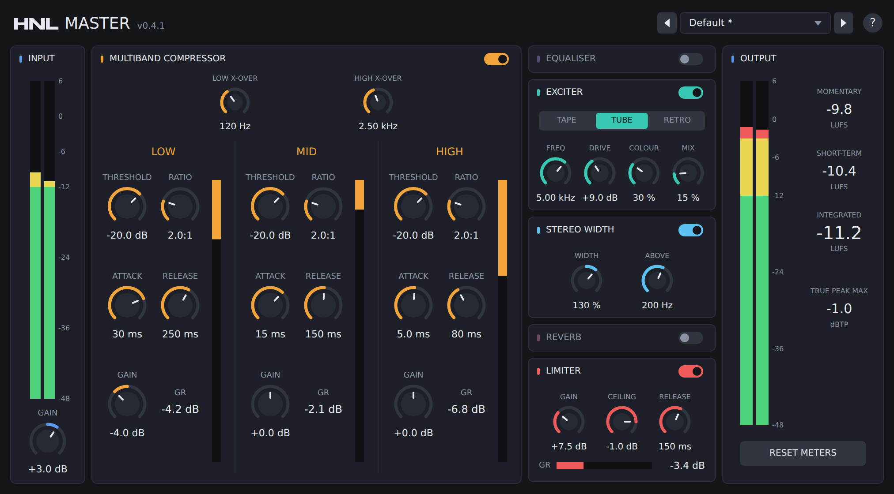</a></td>
    <th align="left"><a href="plugins/hnl-master">HNL Master</a></th>
  </tr>
  <tr>
    <td valign="top">Mastering chain: multiband compressor, equaliser, exciter (tape, tube, retro), stereo widener, reverb, true-peak limiter, loudness meters, presets<br><br><a href="https://github.com/c-kick/hnl-vsts/releases/download/downloads/HNL-Master-win64.zip"><b>Download</b></a> · <!-- version:hnl-master -->v0.10.1<!-- /version --> · beta · Windows 64-bit, VST3 and CLAP</td>
  </tr>
  <tr>
    <td rowspan="2" width="380"><a href="plugins/hnl-analyzer">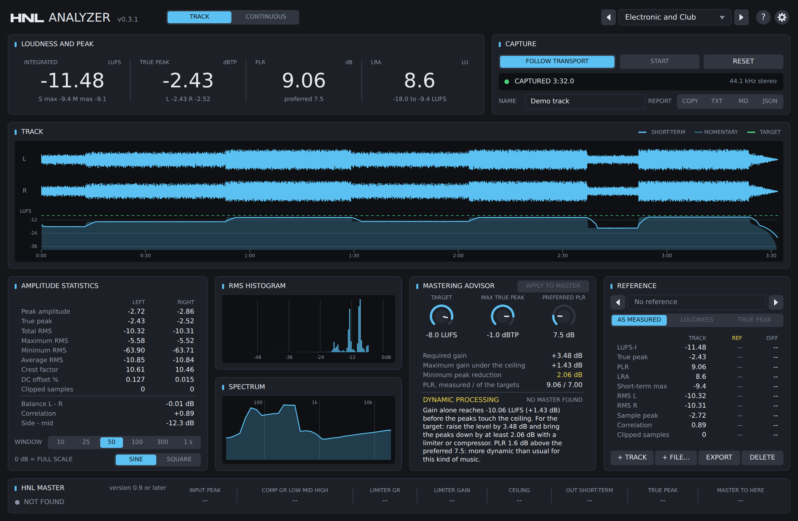</a></td>
    <th align="left"><a href="plugins/hnl-analyzer">HNL Analyzer</a></th>
  </tr>
  <tr>
    <td valign="top">Mastering analysis after the chain: loudness (LUFS), true peak, PLR, loudness range, RMS statistics and histogram, spectrum and stereo figures of a whole track, captured while the DAW plays it; an advisor for loudness targets, and comparison with a reference: a sound file, a saved analysis or the capture before. Finds HNL Master in the same song, shows its meters, and sets its limiter by the advice in one click. Does not change the sound<br><br><a href="https://github.com/c-kick/hnl-vsts/releases/download/downloads/HNL-Analyzer-win64.zip"><b>Download</b></a> · <!-- version:hnl-analyzer -->v0.3.1<!-- /version --> · alpha · Windows 64-bit, VST3 and CLAP</td>
  </tr>
  <tr>
    <td rowspan="2" width="380"><a href="plugins/hnl-channel-spacer"></a></td>
    <th align="left"><a href="plugins/hnl-channel-spacer">HNL Channel Spacer</a></th>
  </tr>
  <tr>
    <td valign="top">Makes room in one channel for another: turns down only the frequency ranges where the sidechain signal is playing, in 32 bands; also works as a sidechain ducker<br><br><a href="https://github.com/c-kick/hnl-vsts/releases/download/downloads/HNL-Channel-Spacer-win64.zip"><b>Download</b></a> · <!-- version:hnl-channel-spacer -->v0.4.1<!-- /version --> · beta · Windows 64-bit, VST3 and CLAP</td>
  </tr>
  <tr>
    <td rowspan="2" width="380"><a href="plugins/hnl-thickener">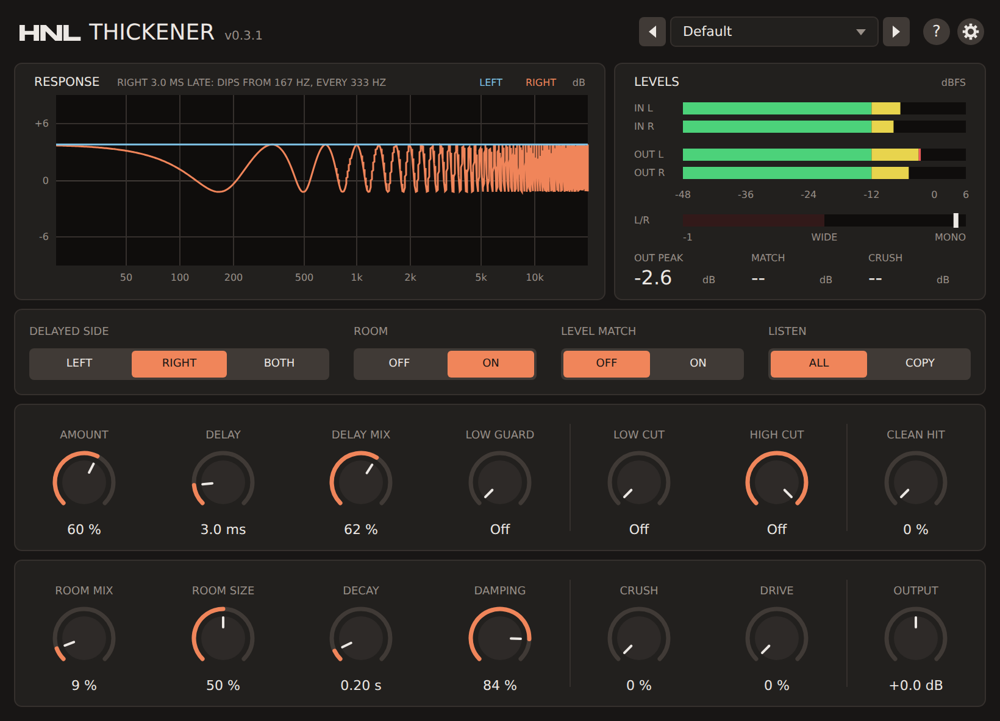</a></td>
    <th align="left"><a href="plugins/hnl-thickener">HNL Thickener</a></th>
  </tr>
  <tr>
    <td valign="top">Thickens drums, beats and anything else in the middle: adds a copy in which one channel is a few milliseconds late, through a small room, with a parallel compressor and saturator, on top of the untouched signal<br><br><a href="https://github.com/c-kick/hnl-vsts/releases/download/downloads/HNL-Thickener-win64.zip"><b>Download</b></a> · <!-- version:hnl-thickener -->v0.3.1<!-- /version --> · beta · Windows 64-bit, VST3 and CLAP</td>
  </tr>
  <tr>
    <td rowspan="2" width="380"><a href="plugins/hnl-widener">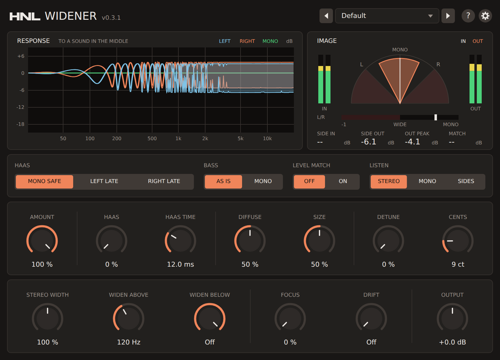</a></td>
    <th align="left"><a href="plugins/hnl-widener">HNL Widener</a></th>
  </tr>
  <tr>
    <td valign="top">Stereo widener that also makes a mono sound wide: Haas, diffusion, detuning, a slow drift and a focus that keeps the hits in the middle, all added to the side signal, so that a mono speaker plays exactly what went in<br><br><a href="https://github.com/c-kick/hnl-vsts/releases/download/downloads/HNL-Widener-win64.zip"><b>Download</b></a> · <!-- version:hnl-widener -->v0.3.1<!-- /version --> · beta · Windows 64-bit, VST3 and CLAP</td>
  </tr>
  <tr>
    <td rowspan="2" width="380"><a href="plugins/hnl-tape-master">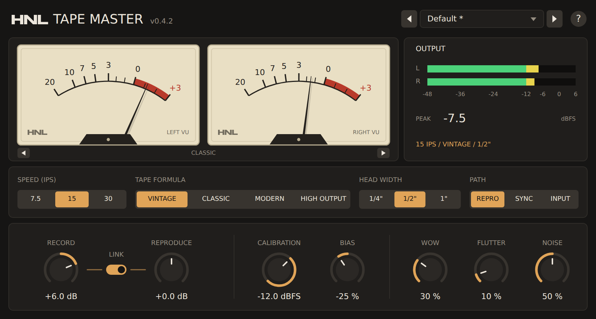</a></td>
    <th align="left"><a href="plugins/hnl-tape-master">HNL Tape Master</a></th>
  </tr>
  <tr>
    <td valign="top">Two-track mastering tape machine: saturation, tape compression, head response by speed, formula and head width, wow, flutter, hiss<br><br><a href="https://github.com/c-kick/hnl-vsts/releases/download/downloads/HNL-Tape-Master-win64.zip"><b>Download</b></a> · <!-- version:hnl-tape-master -->v0.6.1<!-- /version --> · beta · Windows 64-bit, VST3 and CLAP</td>
  </tr>
  <tr>
    <td rowspan="2" width="380"><a href="plugins/hnl-tape-echo"></a></td>
    <th align="left"><a href="plugins/hnl-tape-echo">HNL Tape Echo</a></th>
  </tr>
  <tr>
    <td valign="top">Tape echo with three playback heads and a spring reverb: saturating repeats, pitch bends, wow and flutter, self-oscillation, tempo sync<br><br><a href="https://github.com/c-kick/hnl-vsts/releases/download/downloads/HNL-Tape-Echo-win64.zip"><b>Download</b></a> · <!-- version:hnl-tape-echo -->v0.5.1<!-- /version --> · beta · Windows 64-bit, VST3 and CLAP</td>
  </tr>
  <tr>
    <td rowspan="2" width="380"><a href="plugins/hnl-bus-compressor">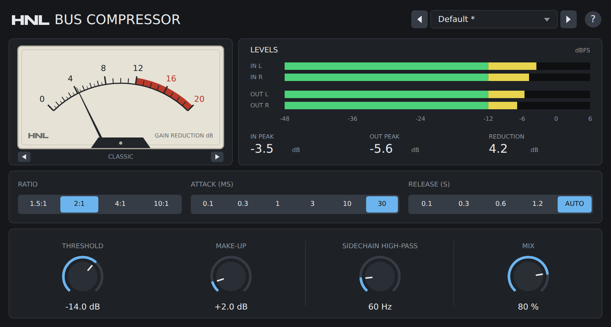</a></td>
    <th align="left"><a href="plugins/hnl-bus-compressor">HNL Bus Compressor</a></th>
  </tr>
  <tr>
    <td valign="top">Stereo bus compressor: glue for a mix or drum bus, with stepped ratio, attack and release, auto release, sidechain high-pass and parallel mix<br><br><a href="https://github.com/c-kick/hnl-vsts/releases/download/downloads/HNL-Bus-Compressor-win64.zip"><b>Download</b></a> · <!-- version:hnl-bus-compressor -->v0.5.1<!-- /version --> · beta · Windows 64-bit, VST3 and CLAP</td>
  </tr>
  <tr>
    <td rowspan="2" width="380"><a href="plugins/hnl-leveller"></a></td>
    <th align="left"><a href="plugins/hnl-leveller">HNL Leveller</a></th>
  </tr>
  <tr>
    <td valign="top">Levelling compressor for vocals and bass: a smooth opto type with a two-stage release and a fast FET type, with colour, sidechain high-pass and parallel mix<br><br><a href="https://github.com/c-kick/hnl-vsts/releases/download/downloads/HNL-Leveller-win64.zip"><b>Download</b></a> · <!-- version:hnl-leveller -->v0.5.1<!-- /version --> · beta · Windows 64-bit, VST3 and CLAP</td>
  </tr>
  <tr>
    <td rowspan="2" width="380"><a href="plugins/hnl-transient-shaper">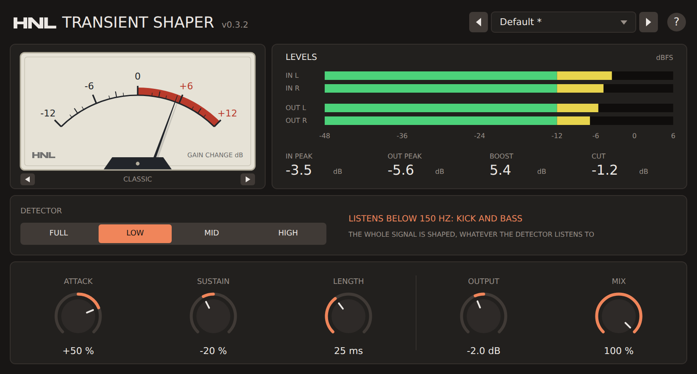</a></td>
    <th align="left"><a href="plugins/hnl-transient-shaper">HNL Transient Shaper</a></th>
  </tr>
  <tr>
    <td valign="top">Transient shaper for drums: attack and sustain of each hit up or down, whatever its level, with a detector that can listen to the lows, mids or highs only<br><br><a href="https://github.com/c-kick/hnl-vsts/releases/download/downloads/HNL-Transient-Shaper-win64.zip"><b>Download</b></a> · <!-- version:hnl-transient-shaper -->v0.5.1<!-- /version --> · beta · Windows 64-bit, VST3 and CLAP</td>
  </tr>
  <tr>
    <td rowspan="2" width="380"><a href="plugins/hnl-patina">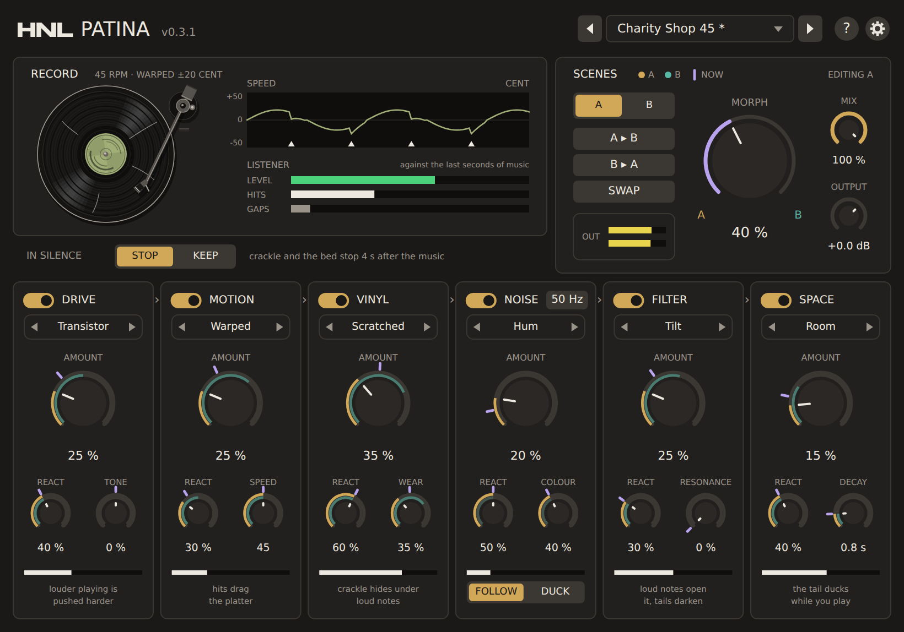</a></td>
    <th align="left"><a href="plugins/hnl-patina">HNL Patina</a></th>
  </tr>
  <tr>
    <td valign="top">Makes a clean sound old: a gain stage, a record that does not run true, the surface of that record, a noise bed, a filter and a room, each of which can react to the music, with two scenes per preset and a morph between them.<br><br><a href="https://github.com/c-kick/hnl-vsts/releases/download/downloads/HNL-Patina-win64.zip"><b>Download</b></a> · <!-- version:hnl-patina -->v0.3.1<!-- /version --> · beta · Windows 64-bit, VST3 and CLAP</td>
  </tr>
</table>

## Instruments

<table>
  <tr>
    <td rowspan="2" width="380"><a href="plugins/hnl-digital-piano">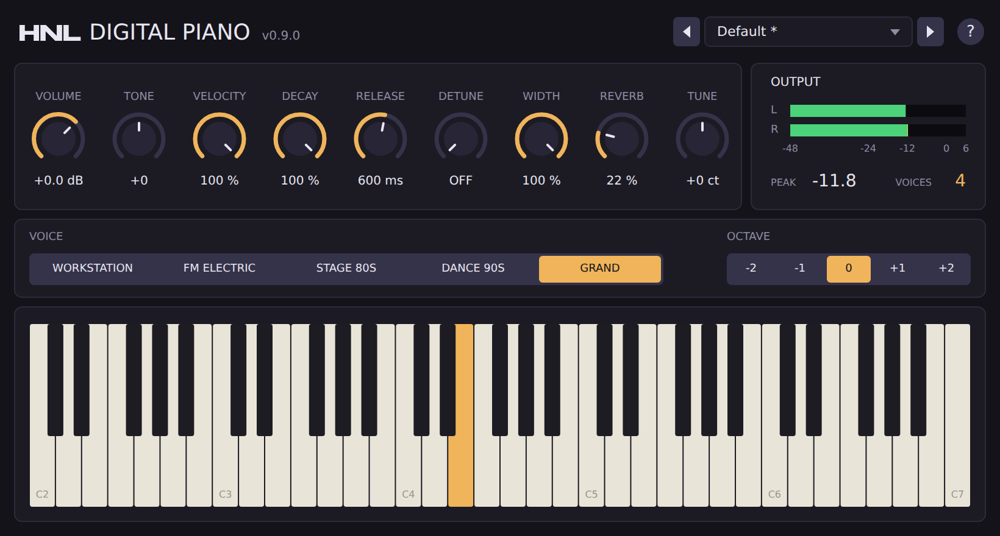</a></td>
    <th align="left"><a href="plugins/hnl-digital-piano">HNL Digital Piano</a></th>
  </tr>
  <tr>
    <td valign="top">Five pianos in stereo (workstation, FM electric, 1980s stage, 1990s dance, concert grand), with doubling, reverb and an on-screen keyboard<br><br><a href="https://github.com/c-kick/hnl-vsts/releases/download/downloads/HNL-Digital-Piano-win64.zip"><b>Download</b></a> · <!-- version:hnl-digital-piano -->v0.11.1<!-- /version --> · beta · Windows 64-bit, VST3 and CLAP</td>
  </tr>
  <tr>
    <td rowspan="2" width="380"><a href="plugins/hnl-sampler">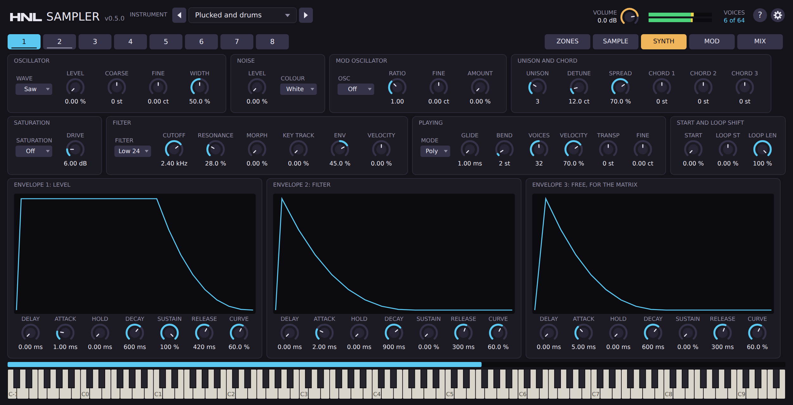</a></td>
    <th align="left"><a href="plugins/hnl-sampler">HNL Sampler</a></th>
  </tr>
  <tr>
    <td valign="top">Sampler in eight parts: WAV, AIFF, FLAC, SFZ and SoundFont sounds over keys and velocities, loops with crossfade, unison, an oscillator, a filter and saturation for every note, envelopes, LFOs, a modulation matrix with eight macros, MPE, tunings, eight stereo outputs. Comes with three demo instruments: a drum kit, strings and a pipe organ<br><br><a href="https://github.com/c-kick/hnl-vsts/releases/download/downloads/HNL-Sampler-win64.zip"><b>Download</b></a> · <!-- version:hnl-sampler -->v0.6.0<!-- /version --> · beta · Windows 64-bit, VST3 and CLAP</td>
  </tr>
</table>

## Things every plugin has

### Three looks

Every plugin comes in three looks. **Classic** is the flat look the plugins started with, and it is what you get
until you choose another. **Hi-Fi Black** and **Hi-Fi Silver** dress the same window as a piece of hi-fi
equipment: a brushed front plate, meters and figures behind dark glass, knobs of turned metal, keys with a light
in them. Every control stays where it is, and each plugin, and each stage of HNL Master, keeps its own colour in
all three.

| Classic | Hi-Fi Black | Hi-Fi Silver |
| --- | --- | --- |
| 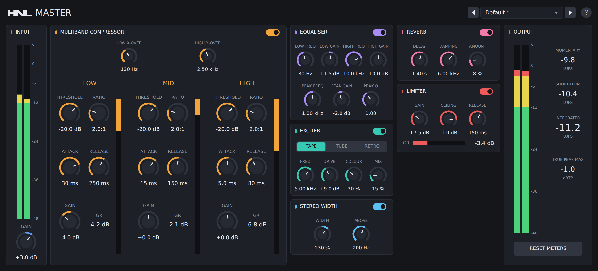 | 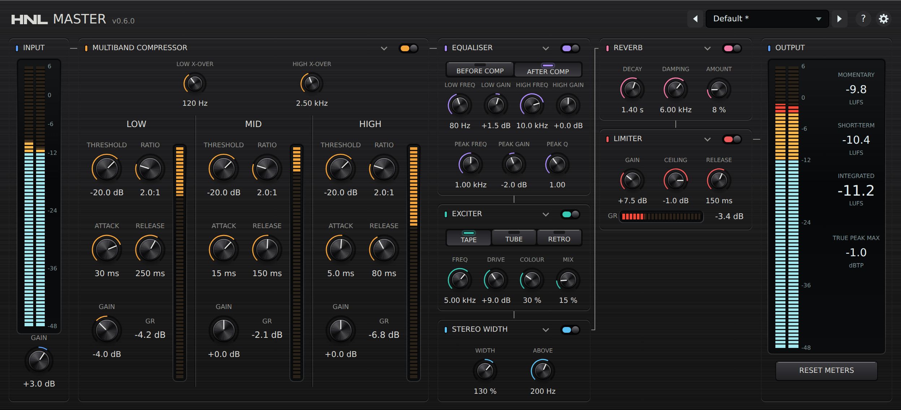 | 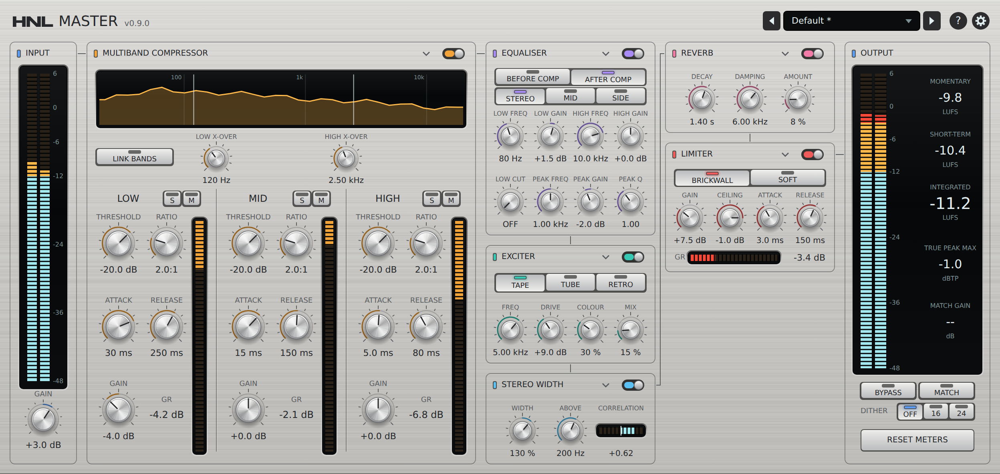 |
|  | 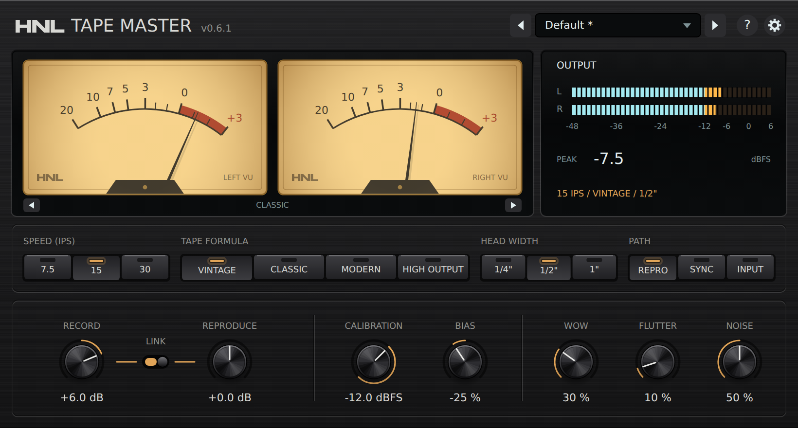 | 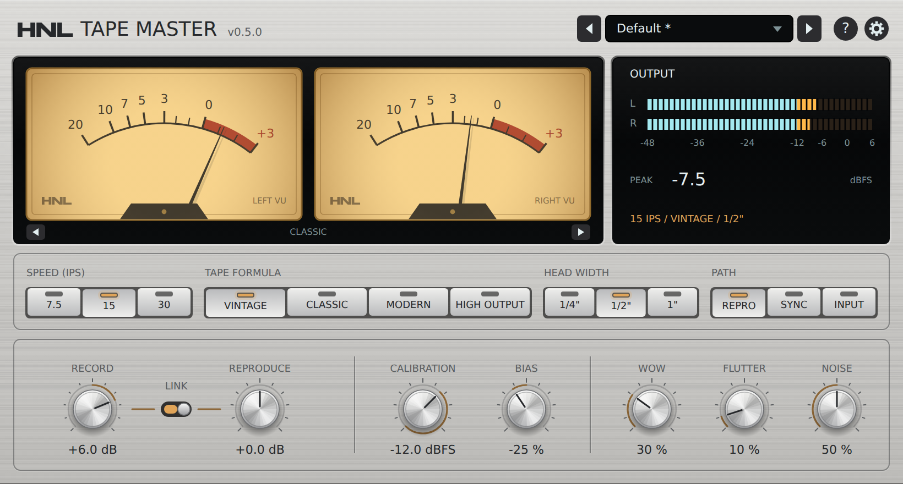 |

The cog at the top right of a plugin, next to the **?**, opens the list. Click a look, or use the arrows above the
list, and the window changes at once. Your choice applies to every HNL plugin in every song, and other HNL windows
that are open follow within a second. It does not change the sound and is not stored in the song.

### Window size

The same list holds the window sizes, from 75 to 200 %. Where your DAW allows it you can also drag the window by
its edge. The window keeps its proportions and opens next time at the size you left it at. The size is remembered
per plugin, not per song.

### Help tips

The **?** next to the cog switches on help tips: rest the mouse on a control to read what it does.

### Presets of your own

To save the current settings as a preset, open the preset list, choose **Save as...** at the end, type a name and
press Enter. You can also click the tick, which helps when your DAW keeps the keyboard to itself. Your presets
come after the factory ones in the list and are available in every song.

Saving under the name of one of your own presets replaces it. The cross behind a saved preset deletes it, after
asking once. Factory presets cannot be replaced or deleted.

Each preset is a small text file, so you can copy, share and back them up:

    %APPDATA%\HNL\<plugin name>\Presets\<preset name>.hnlpreset

On a Mac that is `~/Library/Application Support/HNL/<plugin name>/Presets/`.

The file holds `symbol = value` lines. A parameter that is missing from the file gets its default, so a preset
you save today still loads after the plugin gains a control. Values outside a control's range are brought back
into it. The list has room for 47 presets, factory ones included. A song stores the name of its preset and all
control values itself, so it sounds the same on a computer that does not have the preset file.

### Meter designs

The Bus Compressor, the Leveller, the Transient Shaper and the Tape Master can show their main meter in three
designs: a needle over a printed card (Classic), an arc that fills up with the reading as a figure (Arc), and a
row of lights (LEDs). The two arrows under the meter step through them. The choice is saved with the song, and
presets do not change it.

### Protection against bad input

Every plugin guards itself against the things that usually make a plugin go silent or blast noise: broken audio
coming in, parameter values out of range, and its own filters going wrong. If something does go wrong inside,
the plugin clears itself and carries on within a fraction of a second. Each plugin is also tested with sample
rates from 8 to 384 kHz and with deliberately hostile input. [How the plugins stay stable](#how-the-plugins-stay-stable)
has the details.

### Where settings are kept

The look and the window sizes are in `settings.txt` in the HNL folder (`%APPDATA%\HNL\` on Windows), next to
the plugins' preset folders. Without that file a plugin shows Classic at its normal size.

## For developers

### Layout

- `plugins/<name>/`: one folder per plugin. The audio engine is in `dsp/` (header-only C++17, no dependencies),
  the DPF plugin and its NanoVG UI sit next to it, and the offline tests are in `tests/`.
- `common/dsp/`: building blocks shared by the plugins (filters, oversampling, true-peak detection, the loudness
  filters, a small reverb), and `Safety.hpp`, the guards every plugin puts between itself and the DAW (see
  [How the plugins stay stable](#how-the-plugins-stay-stable)).
- `common/ui/`: UI parts shared by the plugins: preset bar, help tips, meters, the looks and the window size.
- `common/Presets.hpp` defines factory presets, `common/UserPresets.hpp` handles the presets a user saves, and
  `common/UserSettings.hpp` the settings that apply to all plugins.
- `common/Link.hpp`: how plugins in one song find each other through a small block of shared memory. HNL
  Analyzer uses it to show HNL Master's meters and to set its limiter. Tested by `common/tests/link_test.cpp`.
- `dpf/`: the [DISTRHO Plugin Framework](https://github.com/DISTRHO/DPF), as a git submodule.
- `toolchain/`: wrappers that run zig as the Windows cross-compiler.
- `tools/ui-preview/`: a stand-in for DPF's drawing API that writes a plugin UI as SVG, to check a layout on a
  machine without Windows or OpenGL.

### Building

You need `make`, a native `g++` for the tests, and [zig](https://ziglang.org) for the Windows build (the path is
in `toolchain/zwrap`; override it with `ZIG=`).

```sh
git submodule update --init --recursive
./test.sh               # offline tests, native
./build.sh              # dist/<Plugin>.vst3 and dist/<Plugin>.clap for 64-bit Windows
./build.sh hnl-master   # one plugin
```

Install from `dist/` the same way as from a download: the `<Plugin>.vst3` folder to
`C:\Program Files\Common Files\VST3\`, or the `<Plugin>.clap` file to `C:\Program Files\Common Files\CLAP\`.

The macOS [test builds](https://github.com/c-kick/hnl-vsts/releases/tag/macos-test), for Intel and Apple silicon,
are made on a build server (`.github/workflows/macos.yml`, started by hand). They pass Apple's validation of Audio
Units there, but they are not signed with an Apple developer account; the release page explains how to get them
past the block macOS puts on downloads. `release.sh` does not make them, so they can be older than the Windows
builds. [BUILDING-MACOS.md](BUILDING-MACOS.md) has the steps to compile them yourself.

### Tests

`./test.sh` builds every engine test twice: once plainly, and once with `-O3 -ffast-math`, the flags DPF builds
the plugin with. Under those flags the compiler may assume that NaN and infinity never occur, so a test that only
passes the first time has found code that behaves differently in the plugin than in its tests.

Each plugin also has an `abuse_test`. `common/tests/HostAbuse.hpp` plays a DAW that does everything a DAW is
allowed to do: sample rates from 8 to 384 kHz, blocks of any length, parameters jumping about, garbage tempo and
MIDI. It checks that the plugin's output stays bounded, that it comes to rest afterwards, and that it never needed
its own safety net. It looks at the first two outputs; a plugin with more gets room for all of them.

A plugin whose tests take longer than 15 minutes counts as failed (`TEST_TIMEOUT=<seconds>` changes that).

The shared UI code has tests that run against each plugin's own UI class:

- `common/tests/ui_presets_test.cpp` saves, loads and deletes a preset. `common/tests/presets_test.cpp` covers
  the preset files themselves. `HNL_PRESET_DIR`, when set, replaces the preset folder.
- `common/tests/ui_skin_test.cpp` checks, among other things, that a new user gets Classic, that choosing a look
  changes the settings file and nothing else, and that every look draws.
- `common/tests/ui_size_test.cpp` covers the window size.
- `common/tests/ui_meter_test.cpp` steps through the meter designs in the plugins that have them.

### Pictures

`plugins/<name>/tests/preview.sh` writes the UI as SVG files into `build/`, and `tools/ui-preview/shot.mjs` turns
them into PNG with a Playwright Chromium. `tools/ui-preview/docs.sh <playwright index.mjs> [name]` does both and
puts the pictures into `plugins/<name>/docs/`. Run it after changing a UI or a version number, because the version
is in every picture.

### How the plugins stay stable

A plugin that misbehaves can ruin a whole song: one bad number in a filter and the output is silent, or stuck at
full scale, until the DAW is restarted. The shared code in `common/dsp/Safety.hpp` deals with the usual causes,
and every plugin uses it the same way. Each case below has a test in the plugin's `tests/plugin_test.cpp`.

| What can go wrong | What the plugin does |
| --- | --- |
| The DAW sends a parameter value outside its range, or one that is not a number. | The value is pulled back into range, and a non-number becomes the default (`hnl::cleanParam` in `setParameterValue`). |
| The incoming audio contains samples that are not numbers, for instance from a broken plugin earlier in the chain. | Those samples are treated as silence (`hnl::cleanInput` at the top of `run`). |
| The engine still produces a non-number. | That block is silenced and the engine restarts clean (`hnl::isClean`, then `reset()`), so the plugin recovers on its own within one block. |
| A filter rings out into silence and its numbers become so small that the processor slows down (denormals). | Such numbers are treated as zero while the engine runs (`hnl::ScopedNoDenormals` at the top of `process`). |
| Switching a stage or a mode lets out old sound, or makes the level jump. | A stage that is off does not run its filters, and they are cleared when it comes back (HNL Master's stages, Tape Master's path). When a mode changes, the state it shares is carried over (Bus Compressor's Auto release, Leveller's Opto tail). |
| Heavy work stalls the audio. | Slow work happens on a separate thread. The piano, for example, computes a voice's waves in the background and keeps playing the voice it has until they are ready (`Piano::setParamsRealtime`). |

One detail matters if you change this code. The plugins are built with `-ffast-math`, and under that flag the
compiler removes the usual checks for "is this a number" (`std::isfinite`, `x != x`). The checks here look at the
bits instead (`hnl::isFinite`). clang removes even a plain test on the bits, so the bits first pass through
`hnl::hidden`. `common/tests/run.sh` verifies this with clang as well when zig is available, because g++ alone
does not show the problem.

### Shared UI code

- **Looks:** `common/ui/Skin.hpp` holds the colours of each look (`Skin`), the parts a window is drawn with
  (`faceplate`, `platePanel`, `displayPanel`, `knob`, `keys`, `toggle`, `button` and others, each in a flat and a
  solid version) and the cog with its list (`SkinMenu`). `common/UserSettings.hpp` reads and writes the settings
  file. A plugin only supplies its Classic colours. A look the plugin does not know falls back to Classic.
- **Window size:** `common/ui/WindowSize.hpp` handles it for a UI that draws in a fixed design space. Its first
  lines say what a UI has to do to use it.
- **Presets:** `common/UserPresets.hpp` (the files, no drawing code) and the preset bar in
  `common/ui/Widgets.hpp`.
- **Meters:** `hnl::ui::drawMeter` and `MeterSwitch` in `common/ui/Widgets.hpp`. A plugin only describes its
  scale (`MeterScale`: the marks, where the red begins, where a bar starts). The chosen design is plugin state
  (`meter`, next to `preset`).

### Adding a plugin

Create `plugins/<name>/` with a `Makefile` that includes `../../dpf/Makefile.plugins.mk` (copy the one from
`hnl-master`), a `DistrhoPluginInfo.h` with its own `DISTRHO_PLUGIN_UNIQUE_ID`, and `tests/run.sh`. Copy the
guards described under [How the plugins stay stable](#how-the-plugins-stay-stable) from an existing plugin, with their tests. `build.sh` and `test.sh` pick the plugin up by
its folder name.

A plugin with a window has all three looks from its first version:

- Its own design is its Classic look, passed to `hnl::ui::classicSkin`.
- It draws everything through the parts in `common/ui/Skin.hpp` with the colours of `skin()`, and never with a
  colour of its own in the drawing code. The two Hi-Fi looks then follow without more work.
- The cog (`SkinMenu`) goes to the right of the help button.
- The position of a control must not depend on the look.

`plugins/hnl-leveller` is the example for a plugin with one colour, `plugins/hnl-master` for one with a colour
per stage. The plugin's `tests/run.sh` sets `HNL_SETTINGS_DIR` to an empty folder under `build/` and runs
`common/tests/ui_skin_test.cpp` against the UI class, and its `tests/preview.sh` renders the Hi-Fi looks next to
Classic. `test.sh` refuses a plugin with a UI whose `tests/run.sh` does not run that test.

### Versions and releases

Each plugin has its own version (`HNL_VERSION_MAJOR`, `_MINOR` and `_PATCH` in its `DistrhoPluginInfo.h`) and is
tagged `<name>/v<version>`. The plugin reports the version to the DAW and shows it behind its title.

A plugin is a beta unless its `DistrhoPluginInfo.h` sets `HNL_STAGE` to `"alpha"`, as HNL Analyzer's does at the
moment. The stage is shown next to the version in the lists above and in the notes of the Downloads release.

Any change a user can notice gets a new version. A bug fix raises the patch number and a new feature the minor
number. The major number goes up for a change that breaks what exists: a song saved with the older version opens
or sounds differently, or a parameter disappears or changes meaning. Each plugin's README ends with a changelog,
newest version first, and the change is written there in the same commit.

`./release.sh [name ...]` releases plugins. It runs their tests, builds them, zips them (`./package.sh` makes
`dist/<Plugin>-win64.zip` with the VST3 and the CLAP build in it), tags them, and uploads the zips to the one
release on GitHub, "Downloads". That release always holds the current zip of every plugin under a name without a
version, so the download links never change. Its notes list plugin, version and date. Without a name the script
releases every plugin whose version has no tag yet, and `--dry-run` shows what it would do. There is no release
per version; older versions are built from their tags.

## Licence

Copyright (C) 2026 hnldesign/c_kick/Klaas Leussink.

These plugins are free software: you can redistribute them and/or modify them under the terms of the GNU General
Public License as published by the Free Software Foundation, either version 3 of the License, or (at your option)
any later version. They are distributed in the hope that they will be useful, but without any warranty; without
even the implied warranty of merchantability or fitness for a particular purpose. The full text is in
[LICENSE](LICENSE), and in `LICENSE.txt` in every download.

In short: use them for anything, music you sell included; study, change and share them. Whoever passes on a
changed version passes on its source under the same licence.

The [DISTRHO Plugin Framework](https://github.com/DISTRHO/DPF) in `dpf/` is not part of this work and keeps its
own licence (ISC, see `dpf/LICENSING.md`).
