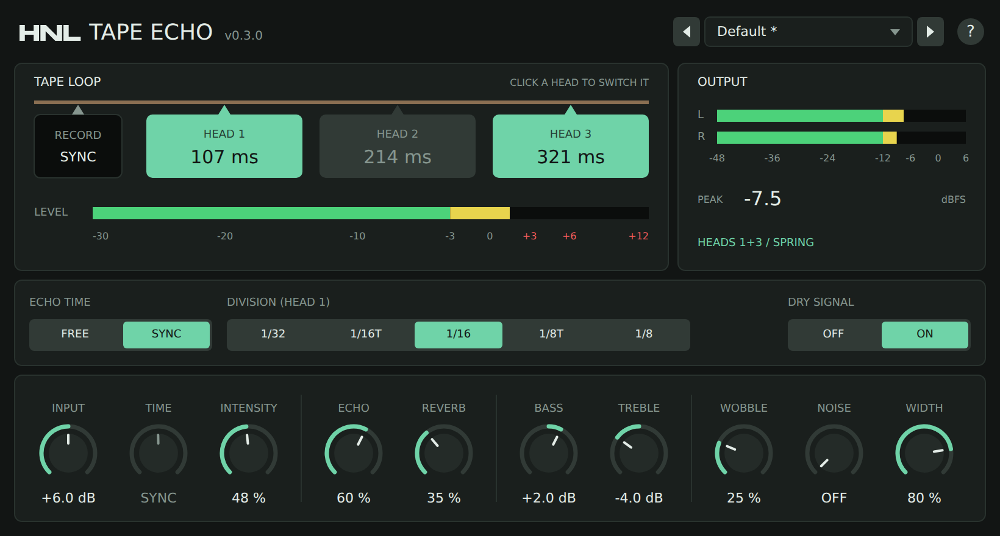
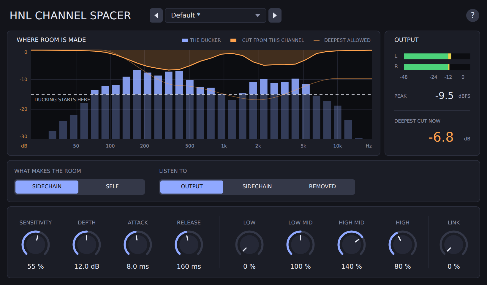

# hnl-vsts

Audio plugins by HNL Design (effects and an instrument), built as VST3 for Windows (tested in Reason 12.5+).

## Effects

| Plugin | What it is |
| --- | --- |
| [HNL Master](plugins/hnl-master) | Mastering chain: multiband compressor, equaliser, exciter (tape, tube, retro), stereo widener, reverb, true-peak limiter, loudness meters, presets |
| [HNL Tape Master](plugins/hnl-tape-master) | Two-track mastering tape machine: saturation, tape compression, head response by speed, formula and head width, wow, flutter, hiss |
| [HNL Tape Echo](plugins/hnl-tape-echo) | Tape echo with three playback heads and a spring reverb: saturating repeats, pitch bends, wow and flutter, self-oscillation, tempo sync |
| [HNL Bus Compressor](plugins/hnl-bus-compressor) | Stereo bus compressor: glue for a mix or drum bus, with stepped ratio, attack and release, auto release, sidechain high-pass and parallel mix |
| [HNL Leveller](plugins/hnl-leveller) | Levelling compressor for vocals and bass: a smooth opto type with a two-stage release and a fast FET type, with colour, sidechain high-pass and parallel mix |
| [HNL Transient Shaper](plugins/hnl-transient-shaper) | Transient shaper for drums: attack and sustain of each hit up or down, whatever its level, with a detector that can listen to the lows, mids or highs only |
| [HNL Channel Spacer](plugins/hnl-channel-spacer) | Makes room in one channel for another: turns down only the frequency ranges where the sidechain signal is playing, in 32 bands; also works as a sidechain ducker |

| HNL Master | HNL Tape Master |
| --- | --- |
|  |  |
| **HNL Tape Echo** | **HNL Bus Compressor** |
|  |  |
| **HNL Leveller** | **HNL Transient Shaper** |
|  |  |
| **HNL Channel Spacer** | |
|  | |

## Instruments

| Plugin | What it is |
| --- | --- |
| [HNL Digital Piano](plugins/hnl-digital-piano) | Five pianos in stereo (workstation, FM electric, 1980s stage, 1990s dance, concert grand), with doubling, reverb and an on-screen keyboard |

| HNL Digital Piano |
| --- |
|  |

## Layout

- `plugins/<name>/`: one folder per plugin. Audio engine in `dsp/` (header-only C++17, no dependencies), the DPF
  plugin and its NanoVG UI next to it, and offline tests in `tests/`.
- `common/dsp/`: building blocks shared by the plugins (filters, oversampling, true-peak detection, a small reverb),
  and `Safety.hpp`: the guards every plugin puts between itself and the host (see "What a plugin must survive").
- `common/ui/`: UI parts shared by the plugins (preset bar, help tips); `common/Presets.hpp`: how presets are
  defined.
- `dpf/`: the [DISTRHO Plugin Framework](https://github.com/DISTRHO/DPF), as a git submodule.
- `toolchain/`: wrappers that run zig as the Windows cross-compiler.
- `tools/ui-preview/`: a stand-in for DPF's drawing API that writes a plugin UI as SVG, to check a layout on a
  machine without Windows or OpenGL.

## Building

Needs `make`, a host `g++` for the tests, and [zig](https://ziglang.org) for the Windows build (path in
`toolchain/zwrap`, override with `ZIG=`).

```sh
git submodule update --init --recursive
./test.sh               # offline tests, native
./build.sh              # dist/<Plugin>.vst3 for 64-bit Windows
./build.sh hnl-master   # one plugin
```

`./test.sh` builds every engine test twice: once plainly, and once with `-O3 -ffast-math`, the flags DPF builds the
plugin itself with. Under those flags the compiler may assume that NaN and infinity never occur, so a test that
only passes the first time shows code that behaves differently in the plugin than in its tests. Each plugin
also has an `abuse_test`: `common/tests/HostAbuse.hpp` plays the part of a host that does everything a host may
do (sample rates from 8 to 384 kHz, blocks of any length, parameters jumping about, garbage tempo and MIDI) and
checks that the plugin stays bounded, comes to rest afterwards and never needed its own safety net. A plugin whose
tests take longer than 15 minutes counts as failed (`TEST_TIMEOUT=<seconds>` changes that).

`plugins/<name>/tests/preview.sh` writes the UI as SVG files into `build/`; `tools/ui-preview/shot.mjs` turns them
into PNG with a Playwright Chromium.

Install by copying the `<Plugin>.vst3` folder from `dist/` to `C:\Program Files\Common Files\VST3\`.

## What a plugin must survive

A host can hand a plugin anything, and a plugin that goes wrong takes the whole song with it. Every plugin here
therefore does the following, and has a test for each in `tests/plugin_test.cpp`:

- **Parameter values** are pulled into their range when they arrive, and a value that is not a number becomes
  the default (`hnl::cleanParam` in `setParameterValue`).
- **Input samples** that are not numbers count as silence (`hnl::cleanInput` at the top of `run`). Should the
  output still contain one, that block is silent and the engine starts again clean (`hnl::isClean`, then
  `reset()`), instead of staying broken until the host restarts it.
- **Numbers too small to matter** count as zero while the engine runs (`hnl::ScopedNoDenormals` at the top of
  `process`), so filters ringing out into silence do not slow the processor down.
- **A switch never lets out old sound or jumps in level.** A stage that is switched off does not run its
  filters; when it comes back they are cleared (HNL Master's stages, Tape Master's path). State that a mode no
  longer uses is handed over, not dropped (Bus Compressor's Auto release, Leveller's Opto tail).
- **Nothing slow on the audio thread.** The piano computes a voice's waves on a thread of its own and keeps
  playing the voice it has until they are there (`Piano::setParamsRealtime`).

Tests of whether something is a number look at its bits (`hnl::isFinite`): `std::isfinite` and `x != x` are
removed by the compiler under `-ffast-math`.

## Adding a plugin

Create `plugins/<name>/` with a `Makefile` that includes `../../dpf/Makefile.plugins.mk` (copy the one from
`hnl-master`), a `DistrhoPluginInfo.h` with its own `DISTRHO_PLUGIN_UNIQUE_ID`, and `tests/run.sh`. Copy the guards named above from an existing plugin, with their
tests. `build.sh` and `test.sh` pick it up by folder name.

## Versions

Each plugin has its own version (`getVersion()` in its plugin source) and is tagged `<name>/v<version>`.
