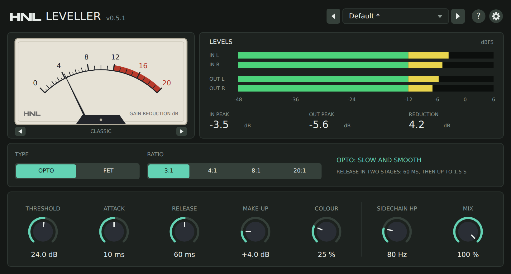

# hnl-vsts

Audio plugins by hnldesign (effects and instruments), built as VST3 and CLAP for Windows (the VST3 tested in
Reason 12.5+). For macOS there are experimental
[test builds](https://github.com/c-kick/hnl-vsts/releases/tag/macos-test) (VST3, CLAP and Audio Unit) that nobody has tried on a real Mac yet; to compile them on a Mac
yourself, see [BUILDING-MACOS.md](BUILDING-MACOS.md).

## Effects

<table>
  <tr>
    <td rowspan="2" width="380"><a href="plugins/hnl-master"></a></td>
    <th align="left"><a href="plugins/hnl-master">HNL Master</a></th>
  </tr>
  <tr>
    <td valign="top">Mastering chain: multiband compressor, equaliser, exciter (tape, tube, retro), stereo widener, reverb, true-peak limiter, loudness meters, presets<br><br><a href="https://github.com/c-kick/hnl-vsts/releases/download/downloads/HNL-Master-win64.zip"><b>Download</b></a> · <!-- version:hnl-master -->v0.6.0<!-- /version --> · beta · Windows 64-bit, VST3 and CLAP</td>
  </tr>
  <tr>
    <td rowspan="2" width="380"><a href="plugins/hnl-channel-spacer"></a></td>
    <th align="left"><a href="plugins/hnl-channel-spacer">HNL Channel Spacer</a></th>
  </tr>
  <tr>
    <td valign="top">Makes room in one channel for another: turns down only the frequency ranges where the sidechain signal is playing, in 32 bands; also works as a sidechain ducker<br><br><a href="https://github.com/c-kick/hnl-vsts/releases/download/downloads/HNL-Channel-Spacer-win64.zip"><b>Download</b></a> · <!-- version:hnl-channel-spacer -->v0.3.0<!-- /version --> · beta · Windows 64-bit, VST3 and CLAP</td>
  </tr>
  <tr>
    <td rowspan="2" width="380"><a href="plugins/hnl-thickener"></a></td>
    <th align="left"><a href="plugins/hnl-thickener">HNL Thickener</a></th>
  </tr>
  <tr>
    <td valign="top">Thickens drums, beats and anything else in the middle: adds a copy in which one channel is a few milliseconds late, through a small room, with a parallel compressor and saturator, on top of the untouched signal<br><br><a href="https://github.com/c-kick/hnl-vsts/releases/download/downloads/HNL-Thickener-win64.zip"><b>Download</b></a> · <!-- version:hnl-thickener -->v0.2.0<!-- /version --> · beta · Windows 64-bit, VST3 and CLAP</td>
  </tr>
  <tr>
    <td rowspan="2" width="380"><a href="plugins/hnl-widener"></a></td>
    <th align="left"><a href="plugins/hnl-widener">HNL Widener</a></th>
  </tr>
  <tr>
    <td valign="top">Stereo widener that also makes a mono sound wide: Haas, diffusion, detuning, a slow drift and a focus that keeps the hits in the middle, all added to the side signal, so that a mono speaker plays exactly what went in<br><br><a href="https://github.com/c-kick/hnl-vsts/releases/download/downloads/HNL-Widener-win64.zip"><b>Download</b></a> · <!-- version:hnl-widener -->v0.2.0<!-- /version --> · beta · Windows 64-bit, VST3 and CLAP</td>
  </tr>
  <tr>
    <td rowspan="2" width="380"><a href="plugins/hnl-tape-master"></a></td>
    <th align="left"><a href="plugins/hnl-tape-master">HNL Tape Master</a></th>
  </tr>
  <tr>
    <td valign="top">Two-track mastering tape machine: saturation, tape compression, head response by speed, formula and head width, wow, flutter, hiss<br><br><a href="https://github.com/c-kick/hnl-vsts/releases/download/downloads/HNL-Tape-Master-win64.zip"><b>Download</b></a> · <!-- version:hnl-tape-master -->v0.5.0<!-- /version --> · beta · Windows 64-bit, VST3 and CLAP</td>
  </tr>
  <tr>
    <td rowspan="2" width="380"><a href="plugins/hnl-tape-echo"></a></td>
    <th align="left"><a href="plugins/hnl-tape-echo">HNL Tape Echo</a></th>
  </tr>
  <tr>
    <td valign="top">Tape echo with three playback heads and a spring reverb: saturating repeats, pitch bends, wow and flutter, self-oscillation, tempo sync<br><br><a href="https://github.com/c-kick/hnl-vsts/releases/download/downloads/HNL-Tape-Echo-win64.zip"><b>Download</b></a> · <!-- version:hnl-tape-echo -->v0.4.0<!-- /version --> · beta · Windows 64-bit, VST3 and CLAP</td>
  </tr>
  <tr>
    <td rowspan="2" width="380"><a href="plugins/hnl-bus-compressor"></a></td>
    <th align="left"><a href="plugins/hnl-bus-compressor">HNL Bus Compressor</a></th>
  </tr>
  <tr>
    <td valign="top">Stereo bus compressor: glue for a mix or drum bus, with stepped ratio, attack and release, auto release, sidechain high-pass and parallel mix<br><br><a href="https://github.com/c-kick/hnl-vsts/releases/download/downloads/HNL-Bus-Compressor-win64.zip"><b>Download</b></a> · <!-- version:hnl-bus-compressor -->v0.4.0<!-- /version --> · beta · Windows 64-bit, VST3 and CLAP</td>
  </tr>
  <tr>
    <td rowspan="2" width="380"><a href="plugins/hnl-leveller"></a></td>
    <th align="left"><a href="plugins/hnl-leveller">HNL Leveller</a></th>
  </tr>
  <tr>
    <td valign="top">Levelling compressor for vocals and bass: a smooth opto type with a two-stage release and a fast FET type, with colour, sidechain high-pass and parallel mix<br><br><a href="https://github.com/c-kick/hnl-vsts/releases/download/downloads/HNL-Leveller-win64.zip"><b>Download</b></a> · <!-- version:hnl-leveller -->v0.4.0<!-- /version --> · beta · Windows 64-bit, VST3 and CLAP</td>
  </tr>
  <tr>
    <td rowspan="2" width="380"><a href="plugins/hnl-transient-shaper"></a></td>
    <th align="left"><a href="plugins/hnl-transient-shaper">HNL Transient Shaper</a></th>
  </tr>
  <tr>
    <td valign="top">Transient shaper for drums: attack and sustain of each hit up or down, whatever its level, with a detector that can listen to the lows, mids or highs only<br><br><a href="https://github.com/c-kick/hnl-vsts/releases/download/downloads/HNL-Transient-Shaper-win64.zip"><b>Download</b></a> · <!-- version:hnl-transient-shaper -->v0.4.0<!-- /version --> · beta · Windows 64-bit, VST3 and CLAP</td>
  </tr>
  <tr>
    <td rowspan="2" width="380"><a href="plugins/hnl-patina"></a></td>
    <th align="left"><a href="plugins/hnl-patina">HNL Patina</a></th>
  </tr>
  <tr>
    <td valign="top">Makes a clean sound old: a gain stage, a record that does not run true, the surface of that record, a noise bed, a filter and a room, each of which can react to the music, with two scenes per preset and a morph between them. An alpha: a first version that passes its offline tests and has not been played in a host yet<br><br><a href="https://github.com/c-kick/hnl-vsts/releases/download/downloads/HNL-Patina-win64.zip"><b>Download</b></a> · <!-- version:hnl-patina -->v0.2.0<!-- /version --> · <b>alpha, largely untested</b> · Windows 64-bit, VST3 and CLAP</td>
  </tr>
</table>

## Instruments

<table>
  <tr>
    <td rowspan="2" width="380"><a href="plugins/hnl-digital-piano"></a></td>
    <th align="left"><a href="plugins/hnl-digital-piano">HNL Digital Piano</a></th>
  </tr>
  <tr>
    <td valign="top">Five pianos in stereo (workstation, FM electric, 1980s stage, 1990s dance, concert grand), with doubling, reverb and an on-screen keyboard<br><br><a href="https://github.com/c-kick/hnl-vsts/releases/download/downloads/HNL-Digital-Piano-win64.zip"><b>Download</b></a> · <!-- version:hnl-digital-piano -->v0.10.0<!-- /version --> · beta · Windows 64-bit, VST3 and CLAP</td>
  </tr>
  <tr>
    <td rowspan="2" width="380"><a href="plugins/hnl-sampler"></a></td>
    <th align="left"><a href="plugins/hnl-sampler">HNL Sampler</a></th>
  </tr>
  <tr>
    <td valign="top">Sampler in eight parts: WAV, AIFF, FLAC, SFZ and SoundFont sounds over keys and velocities, loops with crossfade, unison, an oscillator, a filter and saturation for every note, envelopes, LFOs, a modulation matrix with eight macros, MPE, tunings, eight stereo outputs. An alpha: a first version that passes its offline tests and has not been played in a host yet<br><br><a href="https://github.com/c-kick/hnl-vsts/releases/download/downloads/HNL-Sampler-win64.zip"><b>Download</b></a> · <!-- version:hnl-sampler -->v0.2.1<!-- /version --> · <b>alpha, largely untested</b> · Windows 64-bit, VST3 and CLAP</td>
  </tr>
</table>

## Download

Every plugin below has a **Download** link to its current build: a zip for 64-bit Windows that holds the plugin
as VST3 and as CLAP. All of them are also listed, with version and date, on the
[Downloads page](https://github.com/c-kick/hnl-vsts/releases/tag/downloads).

To install, copy the `.vst3` folder from the zip to `C:\Program Files\Common Files\VST3\`, or, for a host
that takes CLAP (Bitwig Studio, Reaper and others), the `.clap` file to `C:\Program Files\Common Files\CLAP\`.
A host needs only one of the two. Each plugin shows its version behind its title.

Every plugin says what stage it is in, next to its version:

- **beta**: it passes its offline tests and has been tried in Reason, but it is young; expect rough edges.
- **alpha**: it passes its offline tests and is otherwise largely untested. HNL Sampler and HNL Patina are the two:
  neither has been played in a host yet. Do not build a song on them.

The plugins are free software under the GNU General Public License, version 3 or later: see [Licence](#licence).

## Three looks for every plugin

Every plugin comes in three looks. **Classic** is the flat look the plugins have always had, and it is what a
plugin shows unless you choose another. **Hi-Fi Black** and **Hi-Fi Silver** dress the same window as a piece of
hi-fi equipment: a brushed front plate, meters and figures behind dark glass, knobs of turned metal, keys with a
light in them. Nothing moves between the looks, and each plugin, and each stage of HNL Master, keeps its own colour
in all three.

| Classic | Hi-Fi Black | Hi-Fi Silver |
| --- | --- | --- |
|  |  |  |
|  |  |  |

The cog at the top right of a plugin, next to the **?**, opens the list of looks. A click on a look changes the
window at once, and the choice holds for every HNL plugin and every song. It changes nothing about the sound. More
under [Looks](#looks).

## Layout

- `plugins/<name>/`: one folder per plugin. Audio engine in `dsp/` (header-only C++17, no dependencies), the DPF
  plugin and its NanoVG UI next to it, and offline tests in `tests/`.
- `common/dsp/`: building blocks shared by the plugins (filters, oversampling, true-peak detection, a small reverb),
  and `Safety.hpp`: the guards every plugin puts between itself and the host (see "What a plugin must survive").
- `common/ui/`: UI parts shared by the plugins (preset bar, help tips, meters, and the looks: see "Looks");
  `common/Presets.hpp`: how factory presets are defined; `common/UserPresets.hpp`: the presets a user saves (see
  "Presets of your own"); `common/UserSettings.hpp`: the settings that hold for all plugins.
- `dpf/`: the [DISTRHO Plugin Framework](https://github.com/DISTRHO/DPF), as a git submodule.
- `toolchain/`: wrappers that run zig as the Windows cross-compiler.
- `tools/ui-preview/`: a stand-in for DPF's drawing API that writes a plugin UI as SVG, to check a layout on a
  machine without Windows or OpenGL.

## Building

Needs `make`, a host `g++` for the tests, and [zig](https://ziglang.org) for the Windows build (path in
`toolchain/zwrap`, override with `ZIG=`).

```sh
git submodule update --init --recursive
./test.sh               # offline tests, native
./build.sh              # dist/<Plugin>.vst3 and dist/<Plugin>.clap for 64-bit Windows
./build.sh hnl-master   # one plugin
```

`./test.sh` builds every engine test twice: once plainly, and once with `-O3 -ffast-math`, the flags DPF builds the
plugin itself with. Under those flags the compiler may assume that NaN and infinity never occur, so a test that
only passes the first time shows code that behaves differently in the plugin than in its tests. Each plugin
also has an `abuse_test`: `common/tests/HostAbuse.hpp` plays the part of a host that does everything a host may
do (sample rates from 8 to 384 kHz, blocks of any length, parameters jumping about, garbage tempo and MIDI) and
checks that the plugin stays bounded, comes to rest afterwards and never needed its own safety net (it looks at the
first two outputs; a plugin with more is given room for all of them). A plugin whose
tests take longer than 15 minutes counts as failed (`TEST_TIMEOUT=<seconds>` changes that).

`plugins/<name>/tests/preview.sh` writes the UI as SVG files into `build/`; `tools/ui-preview/shot.mjs` turns them
into PNG with a Playwright Chromium. `tools/ui-preview/docs.sh <playwright index.mjs> [name]` does both and puts
the pictures into `plugins/<name>/docs/`; run it after a change to a UI or to a version number, which is in every
picture.

Install by copying the `<Plugin>.vst3` folder from `dist/` to `C:\Program Files\Common Files\VST3\`, or, for a
host that takes CLAP (Bitwig Studio, Reaper and others), the `<Plugin>.clap` file to
`C:\Program Files\Common Files\CLAP\`. Both hold the same plugin; a host needs only one of them.

For macOS there are experimental [test builds](https://github.com/c-kick/hnl-vsts/releases/tag/macos-test), for Intel and Apple silicon, as VST3, CLAP and Audio Unit.
They are made on a build server (`.github/workflows/macos.yml`, started by hand) and pass Apple's validation of
Audio Units there, but nobody has tried them on a real Mac yet, and they are not signed with an Apple developer
account: the release page says how to get them past the block macOS puts on downloads. `release.sh` does not make
them, so they can be older than the Windows builds. [BUILDING-MACOS.md](BUILDING-MACOS.md) has the steps to compile
them yourself.

## Presets of your own

Every plugin can keep the settings of the moment as a preset: open the preset list, choose **Save as...** at its
end, type a name and press Enter (or click the tick, which also works when the host keeps the keyboard to
itself). Saved presets follow the factory ones in the list and in the arrows, and are there in every song.
Saving under the name of one of your own presets replaces it; the cross behind a saved preset deletes it, after
asking once. Factory presets cannot be replaced or deleted.

A preset is a small text file, one per preset, so presets can be copied, shared and backed up:

    %APPDATA%\HNL\<plugin name>\Presets\<preset name>.hnlpreset

On a Mac that is `~/Library/Application Support/HNL/<plugin name>/Presets/`.

It holds `symbol = value` lines. A parameter that is not in the file gets its default, so a preset saved today
still loads after a plugin gained a control; values outside a control's range are brought back into it. The list
has room for 47 presets, factory ones included. A song stores the name of its preset and all control values
itself, so it sounds the same on a computer that does not have the preset file.

The code is shared: `common/UserPresets.hpp` (the files; no drawing code, tested by
`common/tests/presets_test.cpp`) and the preset bar in `common/ui/Widgets.hpp`. `common/tests/ui_presets_test.cpp`
saves, loads and deletes a preset through each plugin's own UI class. `HNL_PRESET_DIR`, when set, replaces the
folder (the tests use it).

## Meter designs

The Bus Compressor, the Leveller, the Transient Shaper and the Tape Master show their main meter in one of three
designs: a needle over a printed card (Classic), an arc that fills with the reading as a figure (Arc) and a row of
lights (LEDs). Two arrows under the meter step through them. The choice is stored with the song as plugin state
(`meter`, next to `preset`), so a song opens with the design it was saved with; presets do not change it.

The designs and the switch are shared: `hnl::ui::drawMeter` and `MeterSwitch` in `common/ui/Widgets.hpp`. A plugin
only describes its scale (`MeterScale`: the marks, where the red begins, where a bar starts).
`common/tests/ui_meter_test.cpp` steps through the designs in each of these plugins' own UI class.

## Looks

The three looks (see [Three looks for every plugin](#three-looks-for-every-plugin)) are chosen with the cog at the
top right, next to the **?**. It opens the list; a click on a look, or on the arrows above the list, changes the
window at once, so the looks can be tried one after the other. The choice holds for every HNL plugin and every
song, and other HNL windows that are open follow within a second. It changes nothing about the sound and is not
stored in the song: it is kept in `settings.txt` in the HNL folder (`%APPDATA%\HNL\` on Windows, beside the
plugins' preset folders). Without that file, or with a look in it that a plugin does not know, a plugin shows
Classic.

The looks are shared code: `common/ui/Skin.hpp` holds the colours of each look (`Skin`), the parts a window is
drawn with (`faceplate`, `platePanel`, `displayPanel`, `knob`, `keys`, `toggle`, `button` and others, each of which
draws the flat or the solid version) and the cog with its list (`SkinMenu`); `common/UserSettings.hpp` reads and
writes the settings file. A plugin only supplies its Classic colours. `common/tests/ui_skin_test.cpp` runs against
each plugin's own UI class and checks, among other things, that a new user gets Classic, that a choice reaches the
settings file and nothing else (no parameter, no plugin state), and that every look draws.

## What a plugin must survive

A host can hand a plugin anything, and a plugin that goes wrong takes the whole song with it. Every plugin here
therefore does the following, and has a test for each in `tests/plugin_test.cpp`:

- **Parameter values** are pulled into their range when they arrive, and a value that is not a number becomes
  the default (`hnl::cleanParam` in `setParameterValue`).
- **Input samples** that are not numbers count as silence (`hnl::cleanInput` at the top of `run`). Should the
  output still contain one, that block is silent and the engine starts again clean (`hnl::isClean`, then
  `reset()`), instead of staying broken until the host restarts it.
- **Numbers too small to matter** count as zero while the engine runs (`hnl::ScopedNoDenormals` at the top of
  `process`), so filters ringing out into silence do not slow the processor down.
- **A switch never lets out old sound or jumps in level.** A stage that is switched off does not run its
  filters; when it comes back they are cleared (HNL Master's stages, Tape Master's path). State that a mode no
  longer uses is handed over, not dropped (Bus Compressor's Auto release, Leveller's Opto tail).
- **Nothing slow on the audio thread.** The piano computes a voice's waves on a thread of its own and keeps
  playing the voice it has until they are there (`Piano::setParamsRealtime`).

Tests of whether something is a number look at its bits (`hnl::isFinite`): `std::isfinite` and `x != x` are
removed by the compiler under `-ffast-math`. clang removes a plain test on the bits as well, so the bits first pass
through `hnl::hidden`; `common/tests/run.sh` checks this with clang too when zig is there, because g++ alone does
not show it.

## Adding a plugin

Create `plugins/<name>/` with a `Makefile` that includes `../../dpf/Makefile.plugins.mk` (copy the one from
`hnl-master`), a `DistrhoPluginInfo.h` with its own `DISTRHO_PLUGIN_UNIQUE_ID`, and `tests/run.sh`. Copy the guards named above from an existing plugin, with their
tests. `build.sh` and `test.sh` pick it up by folder name.

A plugin with a window has all three looks (see "Looks") from its first version. Its own design is its Classic
look, given to `hnl::ui::classicSkin`; it draws everything through the parts in `common/ui/Skin.hpp` with the
colours of `skin()`, never with a colour of its own in the drawing code, so that the two Hi-Fi looks follow without
more work; and it puts the cog (`SkinMenu`) right of the help button. Where things stand may not depend on the look.
`plugins/hnl-leveller` is the example for a plugin with one colour, `plugins/hnl-master` for one with a colour per
stage. Its `tests/run.sh` sets `HNL_SETTINGS_DIR` to an empty folder under `build/` and runs
`common/tests/ui_skin_test.cpp` against the UI class, and its `tests/preview.sh` renders the Hi-Fi looks beside
Classic. `test.sh` refuses a plugin with a UI whose `tests/run.sh` does not run that test.

## Versions

Each plugin has its own version (`HNL_VERSION_MAJOR`, `_MINOR` and `_PATCH` in its `DistrhoPluginInfo.h`) and is
tagged `<name>/v<version>`. The plugin reports it to the host and shows it behind its title, so a screenshot or a
question about a plugin tells which build it is about.

A plugin is a beta unless its `DistrhoPluginInfo.h` says otherwise with `HNL_STAGE` (`"alpha"` for HNL Sampler).
The stage stands next to the version in the table above and in the notes of the Downloads release.

A change that a user of the plugin can notice gets a new version: a bug fix raises the patch number, a new
feature the minor number, and a change that breaks what exists (a song saved with the older version opens or
sounds differently, a parameter goes or changes meaning) the major number. Each plugin's README ends with a
changelog, newest version first, and the change is written there in the same commit.

`./release.sh [name ...]` releases plugins: it runs their tests, builds them, zips them (`./package.sh`:
`dist/<Plugin>-win64.zip`, with the VST3 and the CLAP build in it), tags them, and puts the zips into the one
release on GitHub, "Downloads". That release always holds the current zip of every plugin under a name without
a version, so the download links above never change; its notes list plugin, version and date. Without a name it
releases every plugin whose version has no tag yet; `--dry-run` shows what it would do. There is no release per
version: older versions are built from their tags.

## Licence

Copyright (C) 2026 hnldesign/c_kick/Klaas Leussink.

These plugins are free software: you can redistribute them and/or modify them under the terms of the GNU General
Public License as published by the Free Software Foundation, either version 3 of the License, or (at your option)
any later version. They are distributed in the hope that they will be useful, but without any warranty; without
even the implied warranty of merchantability or fitness for a particular purpose. The full text is in
[LICENSE](LICENSE), and in `LICENSE.txt` in every download.

In short: use them for anything, music you sell included; study, change and share them. Whoever passes on a
changed version passes on its source under the same licence.

The [DISTRHO Plugin Framework](https://github.com/DISTRHO/DPF) in `dpf/` is not part of this work and keeps its
own licence (ISC, see `dpf/LICENSING.md`).
