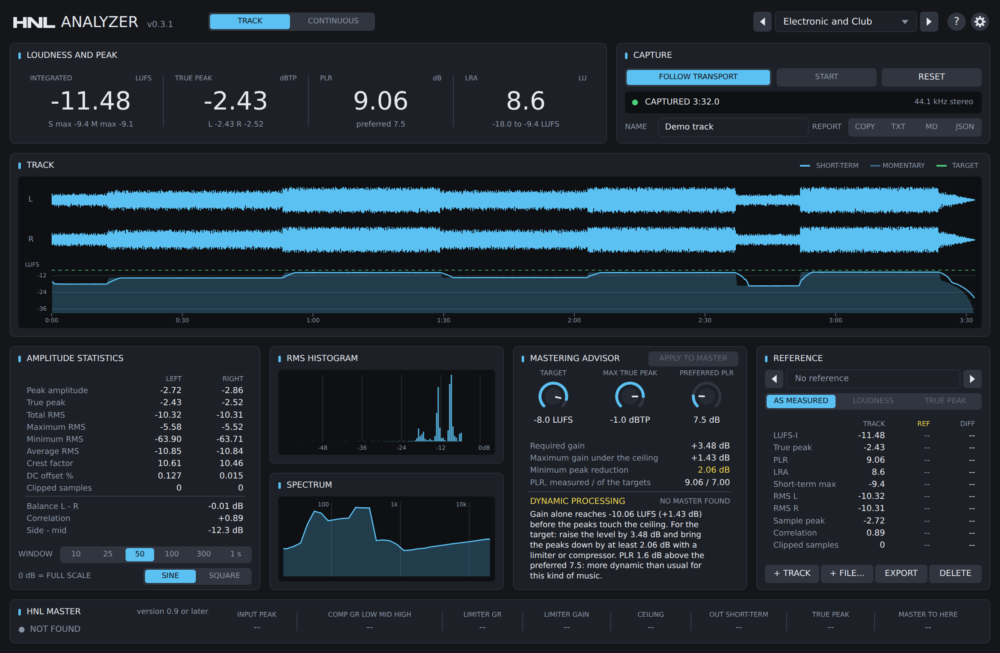
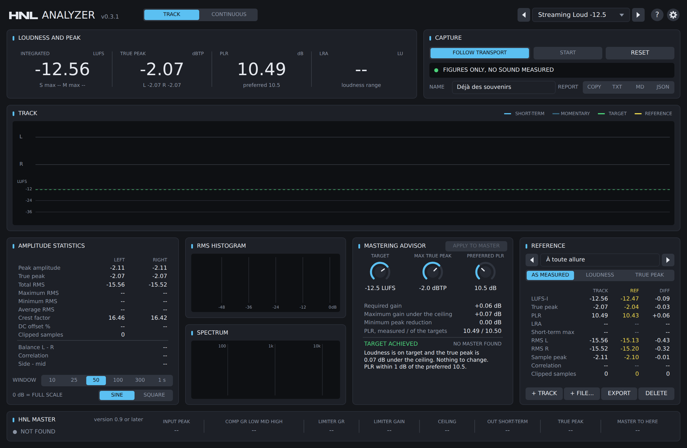
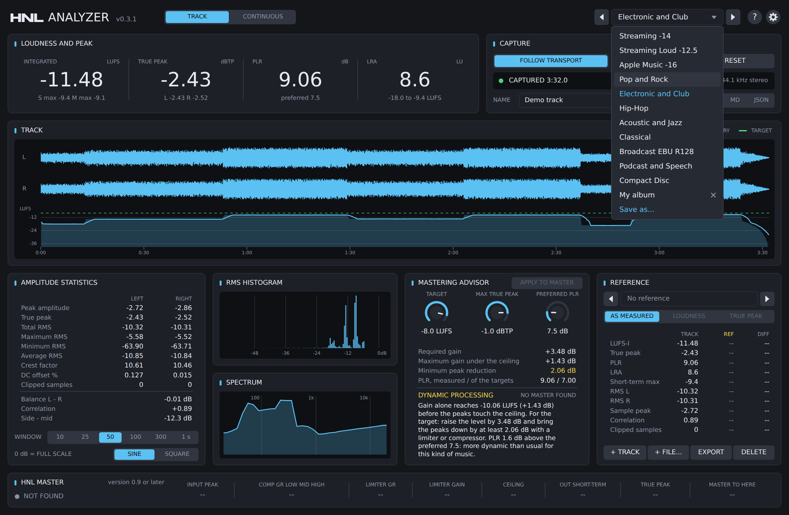
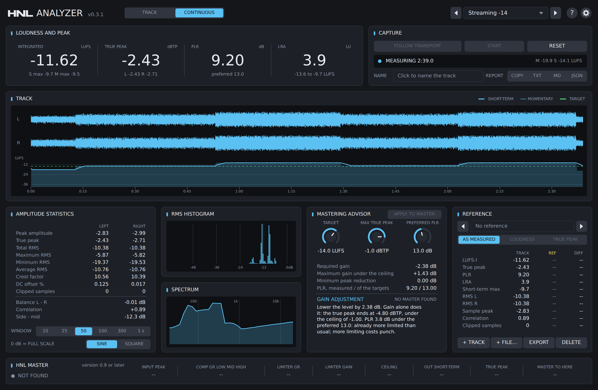
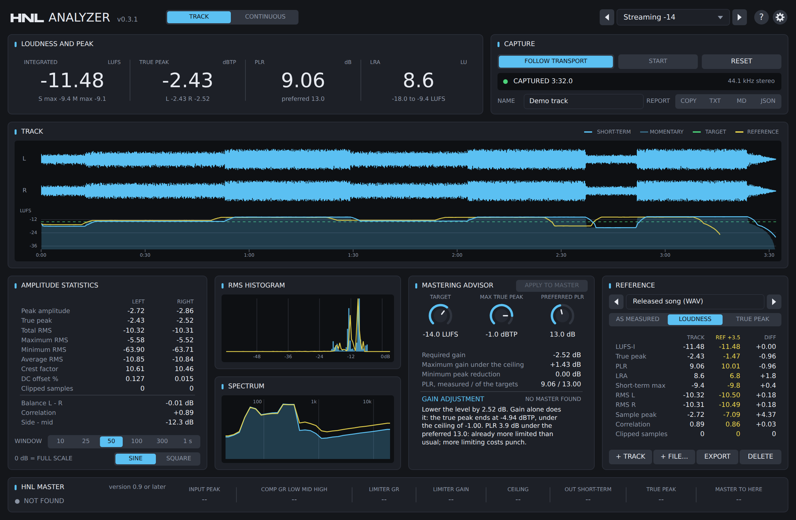
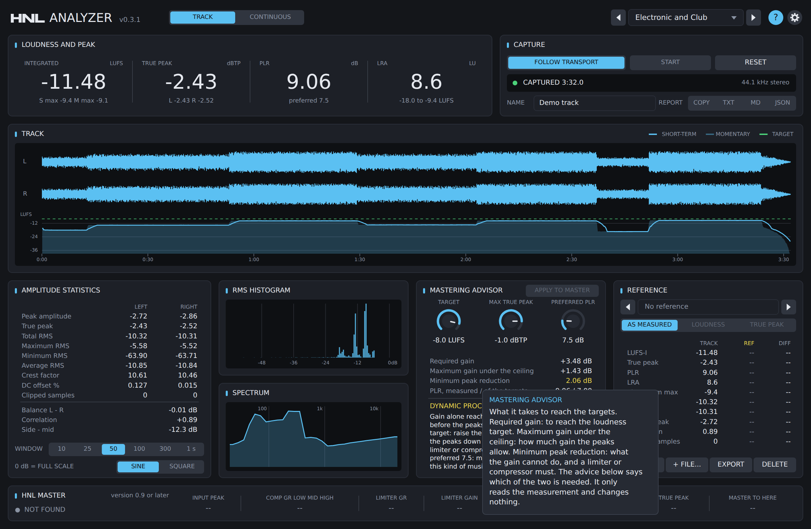
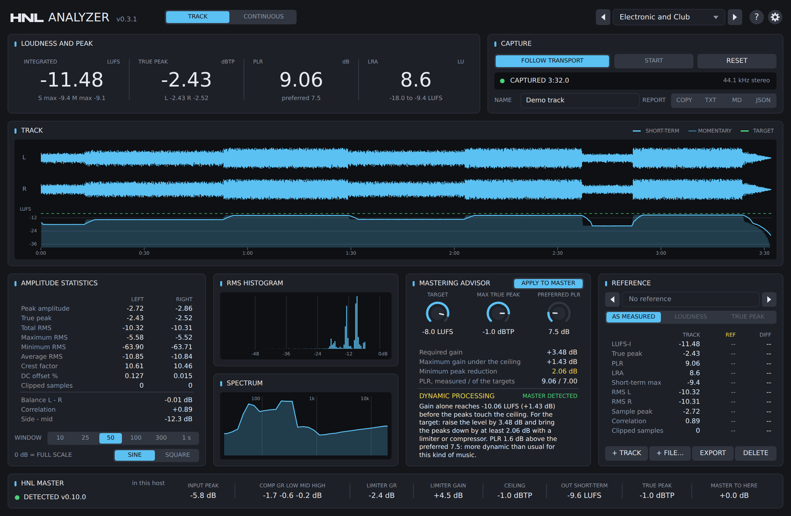

# HNL Analyzer

A mastering meter for the end of the chain, usually right after HNL Master. It measures a whole track while the
DAW plays it: loudness, true peak, RMS statistics, spectrum and stereo figures. An advisor then tells you how far
the track is from your loudness target and what it takes to get there, and you can hold the result against a
reference. The sound passes through untouched and without delay.



| A reference, matched in loudness | Figures typed in by hand | The list of targets |
| --- | --- | --- |
|  |  |  |

| Continuous | A sound file as the reference | Help tips |
| --- | --- | --- |
|  |  |  |

*These pictures are rendered from the plugin's drawing code, not taken from a DAW.*

**This is an alpha.** It passes its tests and has been used in Reason, but not for long and not in other DAWs.
[What has and has not been tried](#what-has-and-has-not-been-tried) lists the details.

## Why it exists

Checking a master usually goes like this: export the song, open the file in an audio editor, read the amplitude
statistics, work out by hand how much gain and limiting it still needs, go back to the DAW, repeat. HNL Analyzer
does that inside the DAW. Play the track once and the figures are there, they stay when playback stops, and the
advisor does the arithmetic.

## Quick start

1. Put HNL Analyzer last on the master, after HNL Master or whatever you master with.
2. Pick your targets with the preset bar (Streaming -14, Apple Music -16, and so on) or set the three knobs.
3. Play the track from start to end. With FOLLOW TRANSPORT on, measuring starts and stops with the DAW.
4. Read the advisor. It says how much gain the track needs and whether the peaks leave room for it.
5. If HNL Master is in the song, click APPLY TO MASTER to set its limiter accordingly, then play the track again
   to check.

The question mark in the corner switches on help tips for every part of the window.

## Measuring

The plugin always measures the sound that passes through it. The keys next to the title choose how.

| Mode | What is measured | When it starts and ends |
| --- | --- | --- |
| **Track** | One pass of the song. The result stays after playback stops and is saved with the song. | With FOLLOW TRANSPORT on: from the moment the DAW starts playing until it stops. With it off: between START and STOP. |
| **Continuous** | Everything that passes, whatever the transport does. The waveform and loudness history show the last three and a half minutes; the figures cover everything since RESET. | Runs until you change the mode. |

The dot in the status line is green for a complete result, blue while measuring and red for one that was cut
short. Each new result pushes the one before it to *Previous capture* in the reference list, so you can always
compare a change with what you had before.

A few cases worth knowing:

- **A quick tap on play.** A capture started by the transport that lasts under three seconds is thrown away, and
  the track you had stays on screen. A capture you start with START is kept however short it is.
- **The playhead jumps** (a loop, a click in the timeline). The capture ends there, marked *incomplete: transport
  jumped*, and a new one starts at the new position. A capture started with START ignores the transport.
- **The mode or sample rate changes** during a capture. It ends, marked incomplete.
- **The DAW stops running the plugin** without stopping the transport, for instance when its audio engine is
  switched off. After a second and a half the capture ends, marked *host stopped processing*.
- **RESET** clears what is shown. The capture before it stays available as a reference.

## What is measured

| Figure | How |
| --- | --- |
| Integrated loudness (LUFS-I) | ITU-R BS.1770-4 and EBU R128: K-weighted, 400 ms blocks every 100 ms, gated at -70 LUFS and at 10 LU below the mean. |
| Short-term and momentary loudness | The last 3 s and the last 400 ms, every 100 ms, with their maxima and their course over the track. |
| Loudness range (LRA) | EBU Tech 3342: the short-term values, gated at -70 LUFS and at 20 LU below their mean, from the 10th to the 95th percentile. The two levels it lies between are shown under it. |
| True peak, per channel | BS.1770 Annex 2 with eight times oversampling. This is the same detector HNL Master's limiter uses. |
| PLR | True peak minus integrated loudness. |
| Sample peak, lowest and highest sample, per channel | The samples as they are. |
| Total RMS, per channel | Over the whole track. |
| Maximum, minimum and average RMS, per channel | Of consecutive windows without overlap. Six window lengths are measured at once (10, 25, 50, 100, 300 ms and 1 s), so you can change the length after the capture. Average is the mean of the windows' RMS values. |
| RMS histogram | How many windows of the chosen length had each level, in half-decibel steps, both channels together. |
| Crest factor | Sample peak minus total RMS. |
| DC offset | The mean of the samples, as a percentage of full scale. |
| Clipped samples | Flat tops: two or more samples in a row at full scale (within 0.001 dB), plus any sample above it. |
| Balance, correlation, mid and side | Left against right in dB; how alike the channels are (+1 identical, 0 unrelated, -1 opposite); the RMS of half their sum and of half their difference. |
| Spectrum | The average of the whole track in third octaves from 20 Hz to 20 kHz. |
| Waveform and loudness history | Lowest and highest sample per channel, and the loudness, over the whole track. |

**Matching Adobe Audition's RMS figures.** WINDOW sets the window length (Audition defaults to 50 ms). **0 dB =
FULL SCALE** sets what counts as 0 dB: SINE reads a full-scale sine wave as 0 dB, which is Audition's default,
and SQUARE reads it as -3.01 dB. Loudness and peaks are not affected by either setting.

A mono file is measured as one channel, as BS.1770 prescribes, and not as the same sound from two speakers,
which would read 3 LU higher.

## Mastering advisor

The three knobs are your targets: the integrated loudness to aim for, the highest true peak you allow, and the
PLR that is normal for the kind of music. The advisor sets those against the measured loudness and true peak:

| Line | What it is |
| --- | --- |
| Required gain | Target loudness minus measured loudness. |
| Maximum gain under the ceiling | Ceiling minus measured true peak: how much gain the peaks allow. Negative when the peaks are already over the ceiling. |
| Minimum peak reduction | The part of the required gain that would push the peaks over the ceiling. A limiter or compressor has to take off at least this much. |
| PLR, measured / of the targets | True peak minus loudness, next to ceiling minus loudness target. The second is the largest PLR that fits both targets. |

It then gives one of four verdicts:

- **Target achieved**: within 0.1 dB.
- **Gain adjustment**: turning the level up or down is enough.
- **Dynamic processing**: the gain that reaches the loudness target would push the peaks over the ceiling.
- **Peaks over the ceiling**: loud enough, but the peaks have to come down.

The preferred PLR does not change these figures. The advisor only mentions it when the master is more than 1 dB
away from it.

An example with the targets at -12.5 LUFS and -2.0 dBTP:

    Measured:                        -13.54 LUFS, -1.58 dBTP, PLR 11.96 dB
    Required gain:                   +1.04 dB
    Maximum gain under the ceiling:  -0.42 dB
    Minimum peak reduction:          1.46 dB      -> dynamic processing

The advice is plain arithmetic on the measurement, so the same measurement always gives the same advice.

**Targets as presets.** The preset bar holds sets of targets by service (Streaming -14, Apple Music -16, Broadcast
EBU R128) and by kind of music, and *Save as...* keeps your own. The service and broadcast figures are the ones
those services publish. The ones per genre are where commercial masters of that kind tend to sit. Treat them as
starting points.

## Working with HNL Master



When [HNL Master](../hnl-master) (0.9 or later) is in the same song, the two plugins find each other. There is
nothing to connect or set up. The strip at the bottom of the window then says **DETECTED** with Master's version
and shows its meters live:

| Figure | What it is |
| --- | --- |
| Input peak | The level going into Master's chain, the higher of left and right. |
| Comp GR low, mid, high | How much each band of its compressor is turning down right now. |
| Limiter GR, gain, ceiling | How much its limiter takes off, and how it is set. Shows OFF when the limiter is switched off. |
| Out short-term, true peak | What Master measures at its own output: the loudness of the last three seconds and its true-peak maximum. |
| Master to here | The short-term loudness arriving at Analyzer minus the one Master sends, while a capture runs. It reads 0.0 when nothing sits between the two. It turns yellow beyond 0.5 dB: a plugin or fader in between is changing the level, so Analyzer is not measuring what Master puts out. |

These are live meters, the same ones Master's own window shows. They are not saved with the analysis and do not
appear in the reports.

The strip also warns about two settings that make a measurement misleading: **BYPASSED** when Master's Bypass is
on, and **MATCH ON** when its Match is on. Match turns the output down to the level of the unprocessed sound, so
switch it off before you measure a master. *Not processing* means the DAW is not running Master at the moment.

If the song holds more than one HNL Master, the strip says *1 of 2* and a click steps to the next. The one whose
sound reaches Analyzer is the one where *Master to here* reads 0.0. This choice is not saved with the song.

### APPLY TO MASTER

The key next to the advisor's title sets Master's limiter according to the advice, in one click:

- the **ceiling** goes to your maximum true peak,
- the **gain** goes up or down by the required gain,
- the limiter is switched **on** if it was off.

It needs HNL Master 0.10 or later. The key stays off until a Master is found, and the line next to the advice
tells you where things stand: **MASTER DETECTED** when the key can be used, **NO MASTER FOUND** when there is
none. If there is a Master but nothing to send, the line gives the reason:

| The line says | Meaning |
| --- | --- |
| NEEDS MASTER 0.10 | The Master in the song is older than 0.10. |
| MASTER BYPASSED, MASTER: MATCH ON | Switch Bypass or Match off in Master first. |
| CAPTURE RUNNING | Wait until the capture has ended, or stop playback. |
| CAPTURE A TRACK | What is shown is the continuous meter or a file. APPLY needs a track capture. |
| KNOB AT ITS END | Master's limiter gain is already as high or as low as it goes. |
| SET: PLAY AGAIN | This capture has been applied. Play the track again for a new measurement. |
| NO ANSWER | Master did not respond within a second and a half, usually because the DAW is not running it. Nothing was changed. |

How to use it: play the track with Analyzer after Master, stop, and click APPLY TO MASTER. Then play the track
again. More gain makes the limiter work harder, and that costs a little loudness, so the first click rarely
lands exactly on target. If the advice still asks for a change after the second pass, click again. Two rounds
are usually enough.

Each capture can be applied only once, also if you close and reopen the window in between. A second click can
never add the same gain twice.

Master's own window follows the change and the new values are saved with the song. The DAW's undo does not
cover it, so if you may want the old settings back, note the limiter gain and ceiling from the strip before you
click.

The link between the plugins can be switched off by setting `HNL_LINK_NAME=off` in the DAW's environment.

## Comparing with a reference

A reference comes from one of three places:

- **+ FILE...** takes a sound file from disk: a released song you want to sit next to, the previous track on the
  album, last week's version. It is measured much faster than it plays. The name box shows the progress, and the
  same key cancels. The result is saved with your references under the file's name and compared with right away.
  The track on screen is not touched. On Windows you can also drop a file on the window.
- **+ TRACK** saves the analysis on screen as a reference, under the track's name.
- **Previous capture** is always there: each new result moves the one before it to this place.

The arrows above the table step through *No reference*, *Previous capture* and the saved ones. With a reference
chosen, the table shows the track, the reference and the difference (track minus reference). The reference is
also drawn in yellow in the loudness history, the histogram and the spectrum.

The keys under the name set how the two are compared:

- **AS MEASURED**: as they are.
- **LOUDNESS**: the reference is moved to the track's integrated loudness. That takes the level difference out
  and leaves the difference in peaks, dynamics and tone.
- **TRUE PEAK**: the reference is moved to the track's true peak. This shows how the two would compare under the
  same ceiling.

The gain applied to the reference is shown above its column.

A file measured as a reference goes through exactly the same meter as a capture. A track captured during
playback and the file exported from it give identical figures for the same samples.

### Where references live

Each reference is a JSON file in `%APPDATA%\HNL\HNL Analyzer\References\`. They are available in every song and
you can copy and share them. Only the figures are stored, never the audio. EXPORT writes the chosen reference to
a file of your choice, + FILE... reads such a file back in, and DELETE removes the chosen one after asking once.
Which reference a song uses, and how it is matched, is saved with the song.

You can also type a reference by hand from figures you noted somewhere else. Only what you enter is compared;
the rest shows as `--`:

```json
{
  "name": "À toute allure",
  "integrated_lufs": -12.47,
  "true_peak_dbtp": -2.04,
  "rms_reference": "sine",
  "rms_left_db": -15.13,
  "rms_right_db": -15.20,
  "sample_peak_db": -2.10,
  "clipped_samples": 0
}
```

Two real masters compared this way, from the figures an audio editor gave for them (second picture above):

| Metric | Déjà des souvenirs | À toute allure | Difference |
| --- | ---: | ---: | ---: |
| LUFS-I | -12.56 | -12.47 | -0.09 |
| True peak | -2.07 | -2.04 | -0.03 |
| PLR | 10.49 | 10.43 | +0.06 |
| RMS L | -15.56 | -15.13 | -0.43 |
| RMS R | -15.52 | -15.20 | -0.32 |
| Sample peak | -2.11 | -2.10 | -0.01 |
| Clipped samples | 0 | 0 | 0 |

Other keys a typed reference may have: `short_term_max_lufs` with `momentary_max_lufs`, `loudness_range_lu`,
`true_peak_left_dbtp` and `_right_`, `sample_peak_left_db` and `_right_`, `duration_seconds`, `sample_rate`.

## Reports

COPY puts the figures on the clipboard as text. TXT, MD and JSON write them to a file as plain text, Markdown or
data. A report includes the advisor and, when a reference is chosen, the comparison. NAME is the track's name in
the reports, and the name it gets when you save it as a reference.

## Files it reads

WAV (8 to 32 bit, float, RF64), AIFF, AIFF-C and FLAC, up to 101 minutes at 44.1 kHz. Of a file with more than
two channels, the first two are measured. A file that is cut short or damaged is measured as far as it can be
read and marked incomplete, with the reason.

MP3 is not supported. The HNL plugins contain no third-party code, and an MP3 decoder is too much to write for
this. Use the WAV or FLAC of your reference instead. That is the better choice anyway: an MP3 has higher peaks
than its source, so its figures are not those of the master it was made from.

## The window

The cog in the corner lists the looks and the window sizes (75 to 200 %). Where the DAW allows it you can also
drag the window by its edge. The size is remembered for this plugin, not per song.

## Limits

- No MP3, and no more than two channels.
- A sound file can be a reference, but not the track. The track is always what the DAW plays.
- Master's meters in the strip are live only. They are not recorded over the length of the track.
- Dropping files on the window works on Windows only, and not in DAWs that keep drops to themselves. + FILE...
  always works.
- When HNL Master runs as CLAP, APPLY TO MASTER sets and saves the values, but Master's window shows the old
  ones until you reopen it. As VST3 it follows at once.
- The DAW's undo does not cover APPLY TO MASTER.

## What has and has not been tried

Tried in Reason on Windows, as VST3:

- Captures that follow the transport: they start with playback, end when it stops, and start again when the
  playhead is moved.
- Finding HNL Master and showing its meters.
- APPLY TO MASTER.

Not tried yet:

- **Exporting (bouncing) a song.** A capture counts samples, so a render that runs faster than real time is no
  problem in itself. If the window still shows the old result after an export, start the capture by hand: START
  before the export, STOP after it.
- **Other DAWs**, including ones that run every plugin in its own process.
- **In a DAW:** the file dialog, files as references, dropping files, the clipboard, the reports and resizing
  the window. All of these are covered by the automated tests only.
- **The official EBU test files with real programme material** (Tech 3341 cases 7 and 8, Tech 3342 cases 5 and
  6). The meter is tested against the EBU cases that can be generated from their description. To check the
  others yourself, download the "EBU Loudness test set" from tech.ebu.ch and add the files with + FILE...: cases
  7 and 8 should read -23.0 LUFS within 0.1, the range cases 5 and 15 LU within 1.
- **A side-by-side with Adobe Audition.** The RMS figures follow Audition's documentation, but two may differ:
  Audition does not document whether its *Average RMS* averages the windows' RMS values (as here) or their
  decibels, and *Possibly clipped samples* is its own count.

## For developers

### Tests

`tests/run.sh` runs seven test programs:

- `dsp_test` checks the meter against signals with known answers: the EBU Tech 3341 cases that can be generated
  (1 to 5, 9 and 12 for loudness within 0.1 LU; 15 to 19 for true peak within +0.2 and -0.4 dB), EBU Tech 3342
  cases 1 to 4 (range within 1 LU), the K-weighting at four sample rates, and RMS, crest factor, DC offset,
  clipping, correlation and spectrum. It also covers the advisor, the comparison and the JSON, including 400
  damaged copies.
- `engine_test` plays the DAW: the transport starts, stops and jumps, captures are started by hand, the DAW
  stops running the plugin, and a second thread reads throughout. WAV, AIFF and FLAC files of the same sound must
  give the same figures as a capture of it.
- `plugin_test` runs the plugin in DPF's wrapper: the output equals the input bit for bit in every mode, and the
  analysis survives being saved and restored as state.
- `abuse_test` does everything a DAW is allowed to do (`common/tests/HostAbuse.hpp`).
- `ui_test`, `ui_presets_test` and `ui_skin_test` click and type in the window itself, including with an HNL
  Master that appears, changes and leaves.

The link between plugins is tested in `common/tests/link_test.cpp`, with a second process as the other plugin.
Both engine tests run twice: plainly, and with the flags the plugin is built with.

To compare with FFmpeg: `tests/measure.cpp` measures files with the plugin's code and prints the report, and
`measure --demo <folder>` writes five test sounds.

    ffmpeg -i song.wav -af ebur128=peak=true -f null -          # I, LRA, true peak
    ffmpeg -i song.wav -af astats -f null -                     # peak, RMS, DC offset, crest factor

`astats` gives RMS against a square wave, so compare it with `measure --square`.

### Code

- `dsp/Measure.hpp`: the meter. No allocation after `prepare()`.
- `dsp/Advisor.hpp`: the advisor, and what APPLY TO MASTER sets.
- `dsp/Report.hpp`: an analysis with its name and state, the comparison with a reference, the JSON, the reports.
- `dsp/Engine.hpp`: when a capture begins and ends, how figures get from the audio thread to the window, reading
  a reference file on its own thread, and the references on disk.
- `common/Link.hpp`: how HNL plugins find each other. Every HNL Master writes its meters into a small named
  block of shared memory, and Analyzer's window reads it thirty times a second. Neither audio thread waits for
  the other.
- `AnalyzerPlugin.cpp`, `AnalyzerUI.cpp`: the DPF plugin and its window. The window reads the measurement
  straight from the plugin (`DISTRHO_PLUGIN_WANT_DIRECT_ACCESS`); only the settings are parameters.
- Shared with other plugins: the loudness filters and correlation (`common/dsp/Metering.hpp`), the true-peak
  detector (`common/dsp/Filters.hpp`), HNL Sampler's file readers (`../hnl-sampler/dsp/AudioFile.hpp`), and the
  preset bar, help tips, looks and window size (`common/ui/`).

The analysis is held in a fixed amount of memory, well under a megabyte whatever the length of the track. The
audio thread never waits for the window.

The parameters the DAW sees: Mode, Follow Transport, RMS Window, RMS Reference, the three targets, and six
meters it can read (momentary, short-term and integrated loudness, true peak, PLR, LRA).

## Changelog

### 0.3.1 (2026-11-28)

- Fixed: on Windows, on a display set to another scale than 100 %, clicks could land beside what was drawn, so that
  knobs and buttons did not answer or another one did. The window was made larger for the display's scale without
  the plugin being told, and it read every click that much too far right and down (at 125 %, a quarter). It now goes
  by the size its window really has. Reported for HNL Sampler in Cubase and Studio One; found by reading the code
  that makes the window, and not yet seen fixed in those DAWs themselves.

### 0.3.0 (2026-11-28)

- New: APPLY TO MASTER in the advisor sets the limiter of HNL Master (0.10 or later) by the advice: the ceiling
  to the maximum true peak, the gain by the required gain, the limiter on. The key is off until an HNL Master is
  found, and the line beside the advice says MASTER DETECTED, or why there is nothing to send. One capture is
  sent once; play the track again to see where it landed.

### 0.2.0 (2026-11-28)

- New: HNL Master in the same song (version 0.9 or later) is found by itself, and a strip at the bottom of the
  window shows its meters of the moment: input peak, the gain reduction of its compressor's bands and of its
  limiter, the limiter's gain and ceiling, its loudness and true peak, and whether the level changes between
  HNL Master and here. It only reads; nothing in HNL Master is changed. The window is 64 pixels higher for it
  (1200 x 784).

### 0.1.0 (2026-11-27)

- First version: a whole track measured while the host plays it, or a meter that runs continuously; loudness, true peak, PLR, loudness range, RMS statistics
  with histogram, crest factor, DC offset, clipping, stereo figures, spectrum, outline and loudness history; the
  mastering advisor with targets as presets; references (a sound file, a saved analysis, the capture before) with
  matching in loudness and in true peak; a window that can be made larger and smaller; reports as
  text, Markdown and JSON.
