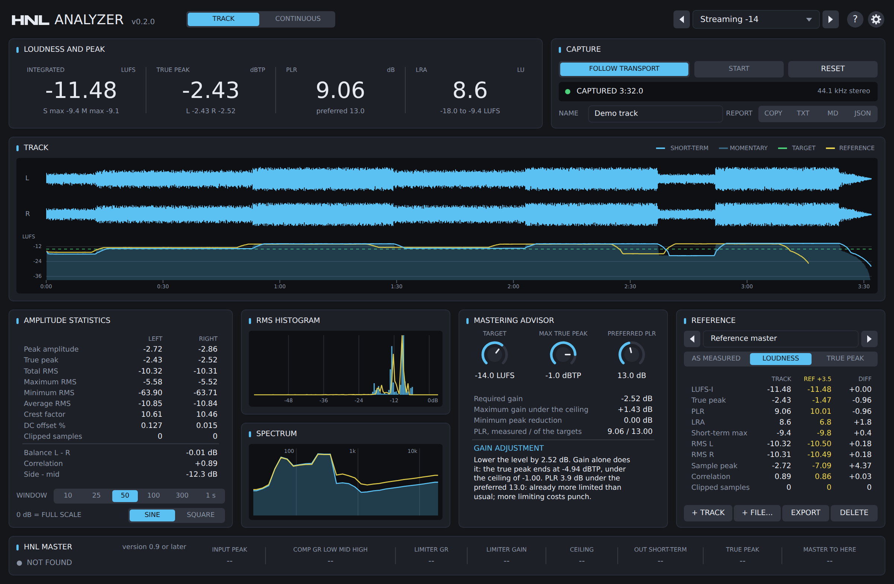

# HNL Analyzer

Mastering analysis for the end of the chain, typically after HNL Master: the loudness, peaks, RMS statistics,
spectrum and stereo figures of a whole track, an advisor that says what it takes to reach a loudness target, and
a comparison with a reference. The sound passes through it untouched and without delay.


| A reference, matched in loudness | Figures typed in by hand | The list of targets |
| --- | --- | --- |
|  |  |  |

| Continuous | A sound file as the reference | Help tips |
| --- | --- | --- |
|  |  |  |

*Rendered from the plugin's drawing code; not yet screenshots from a host.*

**An alpha.** It passes its offline tests and has had one first run in Reason, no more: see [What is not checked yet](#what-is-not-checked-yet).

The window can be made larger and smaller: the cog in the corner lists the sizes (75 to 200 %) under the looks,
and where the host allows it the window can be dragged by its edge, down to three quarters of its design size. It
keeps its shape, everything in it is drawn anew at the size it has, and it opens next time at the size it was
left at. That size is kept for this plugin, not in the song.

It is made to replace this round trip: export from the host, open the file in an audio editor, read its amplitude
statistics, work out by hand how much gain and how much limiting the master still needs, go back. Here the
track is measured while the host plays it, the figures stay when it stops, and the advisor does the sum.

## Two ways to measure

What is measured is always the sound that passes through the plugin. The keys next to the title choose how.

| Mode | What is measured | When it starts and ends |
| --- | --- | --- |
| **Track** | One pass of the song, while the host plays it. The result stays after playback stops and is kept with the song. | With FOLLOW TRANSPORT on: when the host starts playing, until it stops. With it off: between START and STOP. |
| **Continuous** | Whatever passes, all the time, whatever the transport does. The outline and the loudness history show the last three and a half minutes; the figures are of everything since RESET. | Runs until the mode is changed. |

A sound file is not a third way to measure the track: it is what the track is compared with. + FILE in the
Reference panel takes a WAV, AIFF or FLAC file (a released song, an earlier master) and makes it the reference:
see [Reference matching](#reference-matching). The file goes through the same meter as a capture
(`dsp/Measure.hpp`), so a track captured while it plays and the file exported from it give the same figures: for
the same samples, to the last digit (the tests check that).

### What a capture does when things go otherwise

- **A tap on play.** A capture the transport started that lasts less than three seconds is not kept: the track
  that was measured stays on screen. A capture started with START is kept however short.
- **A jump of the transport** (a loop, a click in the song) while capturing: the capture ends there, marked
  *incomplete: transport jumped*, and a new one begins at the new place. A capture started by hand ignores the
  transport and only counts the jumps.
- **The mode or the sample rate changes** during a capture: it ends, marked incomplete.
- **The host stops running the plugin** without stopping its transport (its audio engine is switched off, or a
  bounce ends): after a second and a half the capture counts as ended, marked *host stopped processing*. When
  the host comes back, that is a new capture.
- **RESET** forgets what is shown. The capture before it stays available as a reference, and a file that is
  being read for a reference goes on being read.

The dot in the status line is green for a result that is whole, blue while measuring, red for one that was cut
short. Every new result moves the one before it to *Previous capture* in the reference list, so that a change in
the chain can be compared with what was there before it.

### Offline rendering in Reason

Not tried yet. What the plugin does is known. A capture counts
samples, not time, so it does not matter that a render runs faster than playback; and the plugin's window need
not be open, because the result lives in the plugin and is kept with the song. What is not known is what Reason
tells a plugin while it exports: whether its transport reads as playing.

To find out: put the plugin last on the master, leave FOLLOW TRANSPORT on, export the song, then open the
plugin's window. If it shows *CAPTURED* with the length of the song, the export was measured. If it shows what
was there before, Reason did not say it was playing: press START before the export instead (a capture by hand
measures whatever passes) and STOP after it. The silence around the export then counts in the RMS figures and in
the length, not in the integrated loudness, which leaves silence out.

## What is measured

| Figure | How |
| --- | --- |
| Integrated loudness (LUFS-I) | ITU-R BS.1770-4 and EBU R128: K-weighted, blocks of 400 ms every 100 ms, gated at -70 LUFS and at 10 LU under the mean. |
| Short-term and momentary loudness | The last 3 s and the last 400 ms, every 100 ms; their maxima over the track, and their course over time. |
| Loudness range (LRA) | EBU Tech 3342: the short-term values, gated at -70 LUFS and at 20 LU under their mean, from the 10th to the 95th percentile. The two levels it lies between are shown under it. |
| True peak, per channel | BS.1770 Annex 2 with eight times oversampling (the detector HNL Master's limiter uses). |
| PLR | True peak minus integrated loudness. |
| Sample peak, lowest and highest sample, per channel | Of the samples as they are. |
| Total RMS, per channel | Over the whole track. |
| Maximum, minimum and average RMS, per channel | Of windows that follow each other without overlap. Six window lengths are measured at once (10, 25, 50, 100, 300 ms and 1 s), so the length can be changed after a capture. Average is the mean of the windows' RMS values. |
| RMS histogram | How many windows of the chosen length had each level, in steps of half a decibel, both channels together. |
| Crest factor | Sample peak minus total RMS. |
| DC offset | The mean of the samples, as a percentage of full scale. |
| Clipped samples | Flat tops: two or more samples in a row at full scale (within 0.001 dB), and any sample over it. |
| Balance, correlation, mid and side | Left against right in dB; how alike they are (+1 the same, 0 unrelated, -1 opposite); the RMS of half their sum and of half their difference. |
| Spectrum | The mean of the whole track in third octaves from 20 Hz to 20 kHz. |
| Outline and loudness history | The lowest and highest sample of each channel, and the loudness, over the whole track: always between 1024 and 2048 points, however long it is. |
| Length, sample rate, kind of file | As captured, or as the file says. |

**The RMS figures as Adobe Audition shows them.** WINDOW sets the window length (Audition's is 50 ms unless told
otherwise) and **0 dB = FULL SCALE** what counts as 0 dB: SINE, as Audition has it unless told otherwise, reads a
sine wave at full scale as 0 dB; SQUARE reads it as -3.01 dB. Loudness and peaks do not depend on either.

A mono file is measured as one channel, as BS.1770 says, not as the same sound from two speakers (which would read
3 LU higher).

Everything is kept in memory of a fixed size, well under a megabyte whatever the length of the track, and the
audio thread never waits for the window: it hands over a copy of its figures about twenty times a second when
nobody else holds them, and tries again in the next block when somebody does.

## Mastering advisor

Three targets, on the knobs: the integrated loudness to aim for, the highest true peak allowed, and the PLR that
is usual for the kind of music. From those and the measured loudness and true peak:

| Line | What it is |
| --- | --- |
| Required gain | Target loudness minus measured loudness. |
| Maximum gain under the ceiling | Ceiling minus measured true peak: what gain alone may add. Below zero when the peaks are over it already. |
| Minimum peak reduction | What the required gain would push over the ceiling: the least a limiter or compressor must take off the peaks. |
| PLR, measured / of the targets | True peak minus loudness, beside ceiling minus loudness target: the largest PLR that fits both targets. |

Then one of four verdicts: **target achieved** (within 0.1 dB), **gain adjustment** (gain alone does it, up or
down), **dynamic processing** (the gain that reaches the loudness would push the peaks over the ceiling) or
**peaks over the ceiling** (loud enough, but the peaks must come down). The preferred PLR does not change these
figures; the advisor only remarks on a master that lies more than 1 dB from it, either way.

An example, with the targets at -12.5 LUFS and -2.0 dBTP:

    Measured:                 -13.54 LUFS, -1.58 dBTP, PLR 11.96 dB
    Required gain:             +1.04 dB
    Maximum gain under the ceiling:  -0.42 dB
    Minimum peak reduction:    1.46 dB      -> dynamic processing

It is plain arithmetic on the figures above, so the same measurement always gives the same advice, and it changes
nothing in the sound.

**Targets as presets.** The preset bar holds sets of targets: by service (Streaming -14, Apple Music -16,
Broadcast EBU R128), by kind of music, and Save as... keeps your own, as in every HNL plugin. The figures for
services and broadcast are the ones those publish. The ones per kind of music are where commercial masters of
that kind tend to sit: starting points, not rules.

## HNL Master in the same song


The strip at the bottom of the window shows [HNL Master](../hnl-master) (version 0.9 or later) when there is one
in the song. Nothing has to be set up or connected: the two find each other by themselves, in any host. The dot
is green and the strip says **DETECTED** with its version; without one it says **NOT FOUND**.

| Figure | What it is |
| --- | --- |
| Input peak | The level before HNL Master's chain, the higher of left and right. |
| Comp GR low, mid, high | How much each band of its compressor turns down at this moment. |
| Limiter GR, gain, ceiling | What its limiter takes off, and how it is set. OFF when the limiter is switched off. |
| Out short-term, true peak | What HNL Master measures at its own output: the loudness of the last three seconds, and its true-peak maximum. |
| Master to here | The short-term loudness that arrives here minus the one HNL Master sends, while a capture runs. 0.0 when nothing stands between the two. Yellow when they lie more than 0.5 dB apart: a plugin or a fader in between changes the level, and what is measured here is then not what HNL Master puts out. |

They are the meters of this moment, as HNL Master's own window shows them, not figures of the whole track; they
are not kept with the analysis and are not in the reports.

The strip also says what would make the measurement mean something else than it seems: **BYPASSED** when HNL
Master's Bypass is on, **MATCH ON** when its Match is (the level is then turned down to that of the unprocessed
sound: switch it off before measuring a master), and *not processing* when the host does not run it.

With more than one HNL Master (one on a bus, one on the master) those in this host come first; the strip says
*1 of 2*, and a click on it steps to the next. Which one it is shows in *Master to here*: 0.0 for the one whose
sound arrives here. That choice is not kept with the song yet.

This only reads. Nothing in HNL Master is changed from here.

How it works: every HNL Master writes its meters into a small block of memory that the system keeps under a name
(`common/Link.hpp`), and this window reads it thirty times a second. The audio thread of neither plugin waits for
the other. `HNL_LINK_NAME=off` in the environment of the host switches it off.

## Reference matching

A reference comes from one of three places:

- **+ FILE...** takes a sound file from disk: a released song you want to sit beside, the master of the
  previous track on the album, last week's version. It is measured much faster than it plays (the name box shows
  how far it is; the key cancels meanwhile), saved with the references under the file's name, and compared with
  at once. The track that is shown is not touched, and the plugin goes on measuring what passes. A file can also
  be dropped on the window (Windows). A file that ends before its header says, or a FLAC file with a damaged
  frame, is measured as far as it could be read and marked incomplete, with the reason.
- **+ TRACK** keeps the analysis that is shown as a reference, under the track's name.
- **Previous capture**: every new result moves the one before it there.

A saved reference holds all its figures, the histograms, the spectrum and the loudness history. The arrows above
the table step through *No reference*, *Previous capture* and the saved ones. With a reference chosen, the table shows the track, the reference and the difference
(track minus reference), and the reference is drawn in yellow in the loudness history, the histogram and the
spectrum.

The keys under the name set how the two are held against each other:

- **AS MEASURED**: as they are.
- **LOUDNESS**: the reference moved to the integrated loudness of the track. The difference in level is gone,
  and what is left is the difference in peaks, dynamics and tone.
- **TRUE PEAK**: the reference moved to the true peak of the track: what the two would be under the same
  ceiling.

The gain the reference is shown with stands above its column.

A reference is one JSON file in `%APPDATA%\HNL\HNL Analyzer\References\` (beside the presets of the plugins), so
references hold for every song and can be copied and shared. EXPORT writes the chosen one to a file anywhere,
+ FILE... takes such a file back in (it tells a JSON reference from a sound file by its extension), DELETE
removes the chosen one after asking once. Only the figures are kept, never the sound of the file. Which reference a song compares with, and how, is
kept with the song.

The JSON has a `summary` a person can read and a `data` part with everything as measured. A reference can also
be typed by hand from figures noted down elsewhere; only what was noted is compared, the rest shows as `--`:

```json
{
  "name": "À toute allure",
  "integrated_lufs": -12.47,
  "true_peak_dbtp": -2.04,
  "rms_reference": "sine",
  "rms_left_db": -15.13,
  "rms_right_db": -15.20,
  "sample_peak_db": -2.10,
  "clipped_samples": 0
}
```

Two real masters compared this way, from the figures an audio editor gave for them (second picture above):

| Metric | Déjà des souvenirs | À toute allure | Difference |
| --- | ---: | ---: | ---: |
| LUFS-I | -12.56 | -12.47 | -0.09 |
| True peak | -2.07 | -2.04 | -0.03 |
| PLR | 10.49 | 10.43 | +0.06 |
| RMS L | -15.56 | -15.13 | -0.43 |
| RMS R | -15.52 | -15.20 | -0.32 |
| Sample peak | -2.11 | -2.10 | -0.01 |
| Clipped samples | 0 | 0 | 0 |

Other keys a typed reference may have: `short_term_max_lufs` with `momentary_max_lufs`, `loudness_range_lu`,
`true_peak_left_dbtp` and `_right_`, `sample_peak_left_db` and `_right_`, `duration_seconds`, `sample_rate`.

## Reports

COPY puts the figures on the clipboard as text. TXT, MD and JSON write them to a file, plain, as Markdown or as
data, with the advisor and, when a reference is chosen, the comparison. NAME is the name of the track in those
reports and the name the track is saved under as a reference.

## Files it reads

WAV (8 to 32 bit, float, RF64), AIFF and AIFF-C, and FLAC, with the readers of HNL Sampler. A WAV or AIFF file is
read in blocks, so its length does not matter to memory; a FLAC file is read whole, up to 2 GB.

There is no reader for MP3: the plugins here carry no code of others, and an MP3 decoder is too large to write
alongside. An MP3 file is refused with a line that says so. Use the WAV or FLAC of the reference instead; an
MP3 also has higher peaks than its source, so its figures would not be those of the master it was made from.

## How it was checked

`tests/run.sh` runs seven test programs.

- `dsp_test`: the meter against signals whose figures are known. The test signals of **EBU Tech 3341** that can
  be made from their description (cases 1 to 5, 9 and 12: loudness within 0.1 LU; 15 to 19: true peak within
  +0.2 and -0.4 dB) and of **EBU Tech 3342** (cases 1 to 4: range within 1 LU); the K-weighting at 100 Hz and
  10 kHz and at four sample rates; RMS, crest factor, DC offset, clipping, correlation, mid and side and the
  spectrum against signals with a known answer; the same figures for blocks of 1 to 4410 frames; then the
  advisor, the comparison, and the JSON, also on 400 damaged copies.
- `engine_test`: the test plays the host. The transport starts, stops and jumps; captures by hand; the host
  that stops running the plugin; a second thread reading throughout; WAV, AIFF and FLAC files of the same sound
  giving the same figures as a capture of it; files cut short and damaged; a file read for a reference
  while the track that is shown stays as it is.
- `plugin_test`: the plugin in DPF's host-side wrapper: what comes out is what went in, bit for bit, in every
  mode and with every setting; a capture driven by the host's transport; the analysis saved and given back as
  state.
- `abuse_test`: the host that does everything a host may do (`common/tests/HostAbuse.hpp`).
- `ui_test`, `ui_presets_test`, `ui_skin_test`: the window itself, clicked and typed in; with an HNL Master that
  enters, changes, gets a second one beside it and leaves.

How the plugins find each other is tested in `common/tests/link_test.cpp`, with a second process as the other
plugin: found, gone when it leaves, gone when its process is killed, more instances than there is room for.

Both engine tests run twice: plainly, and with the flags the plugin is built with.

### What is not checked yet

- **Finding HNL Master, beyond a first run.** The tests above run on Linux. The Windows half of
  `common/Link.hpp` (a named file mapping instead of POSIX shared memory) has had one run in Reason
  (28 November 2026), in which HNL Master was detected and its figures shown. Not tried: other hosts, and a host
  that runs each plugin in a process of its own.
- **In a host.** It has had one first run in Reason (27 November 2026), in which a capture followed the transport
  as meant: it began with playback, ended when it stopped, and began anew when the playhead was moved. Not tried
  there yet: the system's file dialog, a sound file as reference, files dropped on the window, the clipboard,
  the reports, the window at another size, and offline rendering (above).
- **The official EBU test files.** The signals above were made from their description. The files with real
  programme material (Tech 3341 cases 7 and 8, Tech 3342 cases 5 and 6) could not be fetched where this was
  built. They are on tech.ebu.ch ("EBU Loudness test set"); add them with + FILE... and read the reference
  column: cases 7 and 8 must read -23.0 LUFS within 0.1, the range cases 5 and 15 LU within 1.
- **Adobe Audition.** The RMS figures follow what Audition documents: windows of a set length, 0 dB as a sine or
  a square wave at full scale. Two of its figures may still differ. *Average RMS* is here the mean of the
  windows' RMS values; whether Audition averages those or their decibels is not documented. *Possibly clipped
  samples* is Audition's own count; the rule here is in the table above. A track measured in both will tell.
- **FFmpeg.** `tests/measure.cpp` measures files with the plugin's code and prints the report; `measure --demo
  <folder>` writes five test sounds. To compare:

      ffmpeg -i song.wav -af ebur128=peak=true -f null -          # I, LRA, true peak
      ffmpeg -i song.wav -af astats -f null -                     # peak, RMS, DC offset, crest factor

  `astats` gives RMS against a square wave: compare with `measure --square`.

## What is not in it

- **MP3**, and anything else compressed with loss (above).
- **More than two channels.** Of a file with more, the first two are measured.
- **Files dropped on the window on a Mac**, and in a host that keeps drops to itself. + FILE... always works.
- **A sound file measured as the track.** A file is a reference here; the track is what the host plays. (The
  `measure` tool in `tests/` prints the full report of a file.)
- **HNL Master's own figures**: the level before the chain, the gain reduction of each band and of the limiter
  over time, and a comparison of before and after at equal loudness. That needs the two plugins to find each
  other in a song, which no HNL plugin does yet.
- **Files longer than 101 minutes at 44.1 kHz** (the limit of the readers). A capture has no limit.

## Code

- `dsp/Measure.hpp`: the meter and what it measures. No allocation after `prepare()`.
- `dsp/Advisor.hpp`: the advisor.
- `dsp/Report.hpp`: an analysis with its name and state, the comparison with a reference, the JSON, the reports.
- `dsp/Engine.hpp`: when a capture begins and ends, how the figures pass from the audio thread to the others,
  the measuring of a reference file on a thread of its own, the analysis that is kept, and the references on
  disk.
- `common/Link.hpp`: how HNL plugins find each other and read each other's figures.
- `AnalyzerPlugin.cpp`, `AnalyzerUI.cpp`: the DPF plugin and its window. The window reads what was measured
  from the plugin itself (`DISTRHO_PLUGIN_WANT_DIRECT_ACCESS`); only the settings are parameters.
- Shared with others: the loudness filters and the correlation (`common/dsp/Metering.hpp`, moved there from HNL
  Master), the true-peak detector (`common/dsp/Filters.hpp`), the file readers of HNL Sampler
  (`../hnl-sampler/dsp/AudioFile.hpp`), the preset bar, help tips, looks and the size of the window
  (`common/ui/`).

The parameters the host sees: Mode, Follow Transport, RMS Window, RMS Reference, the three targets, and six
meters it can read (momentary, short-term and integrated loudness, true peak, PLR, LRA).

## Changelog

### 0.2.0 (2026-11-28)

- New: HNL Master in the same song (version 0.9 or later) is found by itself, and a strip at the bottom of the
  window shows its meters of the moment: input peak, the gain reduction of its compressor's bands and of its
  limiter, the limiter's gain and ceiling, its loudness and true peak, and whether the level changes between
  HNL Master and here. It only reads; nothing in HNL Master is changed. The window is 64 pixels higher for it
  (1200 x 784).

### 0.1.0 (2026-11-27)

- First version: a whole track measured while the host plays it, or a meter that runs continuously; loudness, true peak, PLR, loudness range, RMS statistics
  with histogram, crest factor, DC offset, clipping, stereo figures, spectrum, outline and loudness history; the
  mastering advisor with targets as presets; references (a sound file, a saved analysis, the capture before) with
  matching in loudness and in true peak; a window that can be made larger and smaller; reports as
  text, Markdown and JSON.
