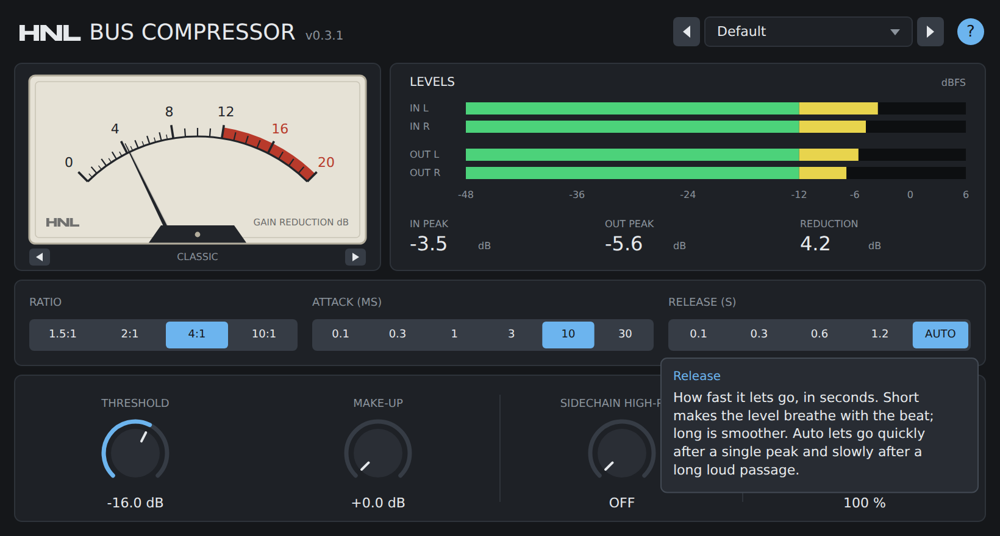
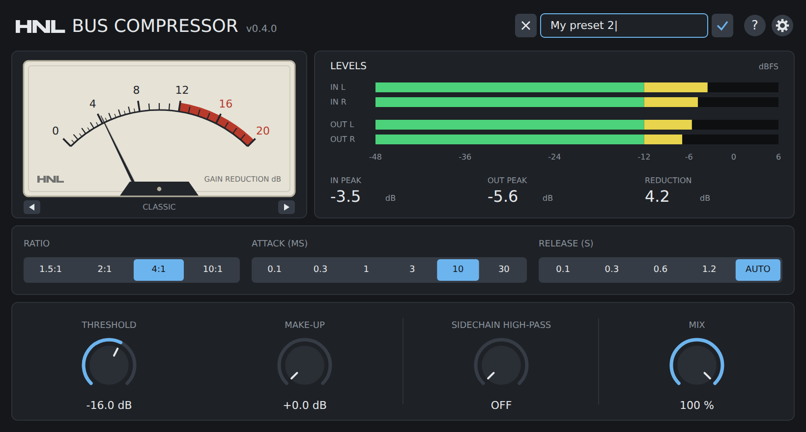
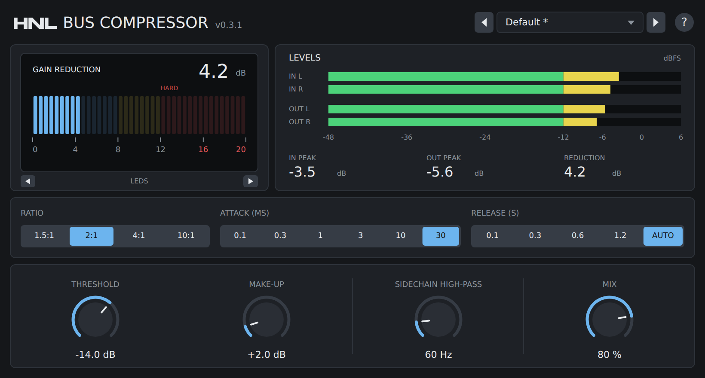

# HNL Bus Compressor

A stereo compressor for the mix bus or a drum bus. It gives you the "glue" that makes separate tracks move
together. It is the simple, single-band counterpart of the multiband compressor in HNL Master.

| Help tips | Presets | Saving a preset |
| --- | --- | --- |
|  |  |  |

| Meter design: Arc | Meter design: LEDs |
| --- | --- |
|  |  |

*These pictures are rendered from the plugin's drawing code, not taken from a DAW.*

## What it does

- **One gain for both channels.** The louder channel sets the reduction and both channels get the same amount, so
  the stereo image does not shift.
- **A soft knee that follows the ratio.** 1.5:1 and 2:1 bend in gradually over 12 and 10 dB, 4:1 over 6 dB and
  10:1 over 3 dB.
- **Auto release.** It lets go quickly after a single peak and slowly after a long loud passage, so it does not
  pump on a dense mix.
- **Sidechain high-pass.** It keeps the bass out of the level detector, so the kick does not make the whole mix
  duck. The sound itself is not filtered.
- **Mix.** Blends the compressed signal with the untouched one, for parallel compression.

## Quick start

1. Put HNL Bus Compressor on the mix bus or a drum bus.
2. Pick a preset from the menu at the top right, or start from the default.
3. Lower **Threshold** until the needle shows the reduction you want. 2 to 4 dB is typical for glue.
4. Bring the level back with **Make-up**.

## Controls

| Control | What it changes |
| --- | --- |
| Threshold | The level above which the signal is turned down, from -40 to 0 dBFS. Lower it until the needle shows the reduction you want; 2 to 4 dB is typical for glue. |
| Ratio | 1.5:1, 2:1, 4:1 or 10:1. |
| Attack | 0.1, 0.3, 1, 3, 10 or 30 ms. Slow settings let the hit of the drums through; fast ones flatten it. |
| Release | 0.1, 0.3, 0.6 or 1.2 s, or Auto. |
| Make-up | 0 to 20 dB of gain on the compressed signal, to bring back the level. |
| Sidechain high-pass | Off, or up to 300 Hz (12 dB per octave), on the detector only. |
| Mix | 0% is the untouched signal, 100% only the compressed one. |

The meter shows the gain reduction in dB. The bars show the peak level going in and coming out.

Drag a knob up or down. Hold Shift for fine steps, or use the mouse wheel. A double-click or Ctrl-click returns a
knob to its default.

## Presets and help

The menu at the top right holds ten presets. They assume a mix that peaks a few dB under 0 dBFS, so set the
threshold to your own level. *Save as...* at the end of the list keeps your current settings under a name of
your own, for use in every song.

The **?** button switches help tips on. Rest the mouse on any control to read what it does.

## The window

The two arrows under the meter step through three meter designs: a needle over a printed card (Classic), an arc
that fills, with the reading as a figure (Arc), and a row of lights (LEDs). The choice is saved with the song and
does not change the sound. A new instance starts on Classic.

The cog at the top right lists the looks (Classic, Hi-Fi Black and Hi-Fi Silver) and the window sizes (75 to
200 %). Where the DAW allows it you can also drag the window by its edge. A look applies to every HNL plugin at
once, and the size is remembered for this plugin. Neither is saved with the song.

## How it works

The plugin is operated the way classic VCA bus compressors are: stepped ratio, attack and release, and an auto
release with two time constants. It is not a copy of any of them and is not affiliated with them.

The attack and release times are time constants, so the reduction covers 63% of the way in that time. The
detector reads peaks. The gain element is clean and adds no saturation of its own. There is no latency.

## Limits

- The compressor does not limit. With make-up gain the output can go over 0 dBFS.
- The detector does not look ahead.

## Installing

[Download HNL-Bus-Compressor-win64.zip](https://github.com/c-kick/hnl-vsts/releases/download/downloads/HNL-Bus-Compressor-win64.zip): the current build, for 64-bit Windows.

The zip holds the plugin as VST3 (copy the `.vst3` folder to `C:\Program Files\Common Files\VST3\`) and as CLAP
(copy the `.clap` file to `C:\Program Files\Common Files\CLAP\`). Your DAW needs only one of the two.

## For developers

From the repository root, `./build.sh hnl-bus-compressor` builds the plugin and `./test.sh hnl-bus-compressor`
runs its tests (see the [main readme](../../README.md)).

- `dsp/BusCompressor.hpp`: the compressor.
- `BusCompPlugin.cpp`, `BusCompUI.cpp`: the DPF plugin and its window.
- `Params.hpp`, `Presets.hpp`, `Help.hpp`: the parameters, the presets and the help tips.
- `tests/run.sh`: runs `dsp_test` (plainly, and with the flags the plugin is built with), `plugin_test`,
  `abuse_test` (`common/tests/HostAbuse.hpp`) and the window tests shared by all HNL plugins.

## Changelog

### 0.5.0 (2026-11-27)

- New: the window can be made larger and smaller. The cog at the top right lists the sizes (75 to 200 %) under the
  looks, and where the host allows it the window can be dragged by its edge, down to three quarters of its design
  size. It keeps its shape, everything in it is drawn anew at the size it has, and it opens next time at the size
  it was left at. The size is kept for this plugin, not in the song, and changes nothing about the sound.

### 0.4.0 (2026-11-22)

- New: three looks. Classic, the look the plugin has always had, stays the default; Hi-Fi Black and Hi-Fi Silver
  dress the same window as a piece of hi-fi equipment. The cog at the top right chooses, for every HNL plugin at
  once. The choice changes nothing about the sound and is not stored in the song.
- To make room for the cog, the preset bar and the help button stand 28 pixels further left.

### 0.3.2 (2026-11-18)

- Fixed: samples and parameter values that are not numbers are caught again in the builds made with clang.

### 0.3.1 (2026-11-17)

- Fixed: a preset's name can be typed in a host that hands over the keys without their text.
- The licence text (GPL-3.0-or-later) comes with the download.

### 0.3.0 (2026-11-17)

- The version is shown behind the title, next to the HNL logo; the preset bar stands at the right.
- The preset menu spreads a long list evenly over its columns.
- The meter comes in three designs (classic, arc, leds).
- A CLAP build next to the VST3.

### 0.2.0 (2026-11-17)

- New: presets of your own, saved, replaced and deleted from the preset menu.

### 0.1.1 (2026-11-17)

- Fixed: leaving Auto release made the level jump; the reduction that was held is now handed over.
- Guards against samples and parameter values that are not numbers, and against whatever else a host may send.

### 0.1.0 (2026-11-16)

- First version: stereo bus compressor with auto release, sidechain high-pass and mix.
