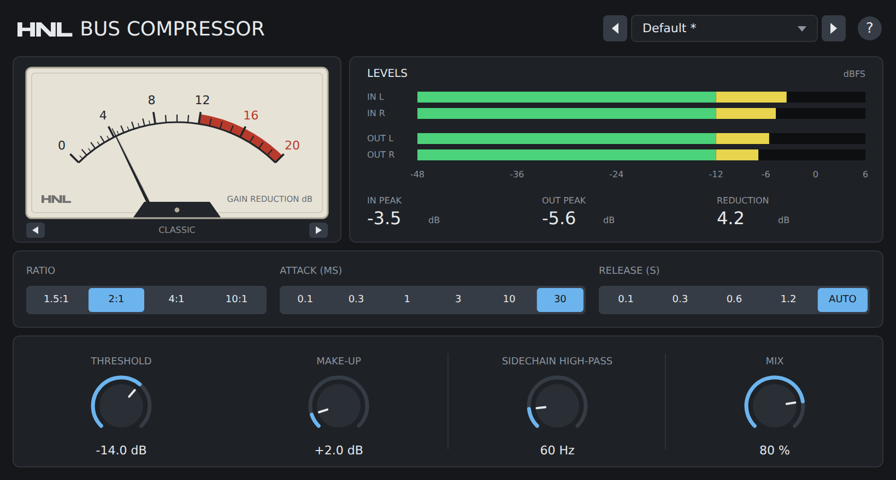
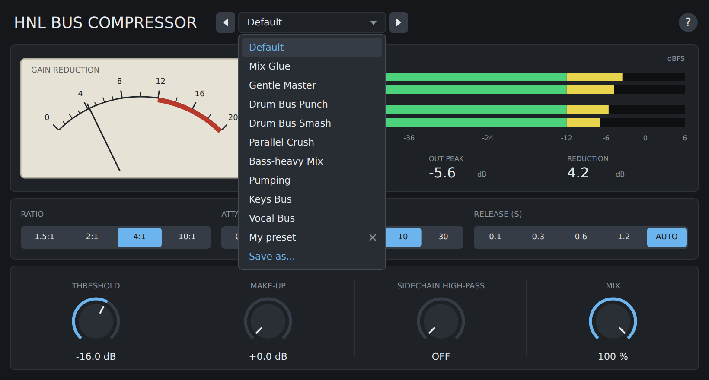
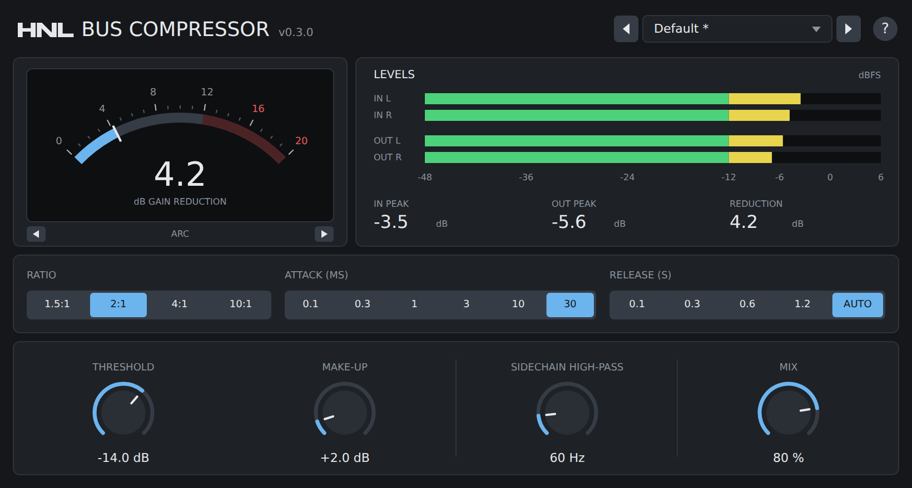

# HNL Bus Compressor

A stereo compressor for the mix bus or a drum bus: the "glue" that makes separate tracks move together. It is
the simple, single-band counterpart of the multiband compressor in HNL Master.

| Help tips | Presets | Saving a preset |
| --- | --- | --- |
|  |  |  |

| Meter design: Arc | Meter design: LEDs |
| --- | --- |
|  |  |

*Rendered from the plugin's drawing code; not yet a screenshot from a host.*

## What it does

- **One gain for both channels:** the louder channel sets the reduction and both get the same, so the stereo
  image does not shift.
- **Soft knee that follows the ratio:** 1.5:1 and 2:1 bend in gradually over 12 and 10 dB, 4:1 over 6 dB, 10:1
  over 3 dB.
- **Auto release:** lets go quickly after a single peak and slowly after a long loud passage, so it does not
  pump on a dense mix.
- **Sidechain high-pass:** keeps the bass out of the level detector, so the kick does not make the whole mix
  duck. The sound itself is not filtered.
- **Mix:** blends the compressed signal with the untouched one, for parallel compression.

## Controls

| Control | What it changes |
| --- | --- |
| Threshold | The level above which the signal is turned down, from -40 to 0 dBFS. Lower it until the needle shows the reduction you want; 2 to 4 dB is typical for glue. |
| Ratio | 1.5:1, 2:1, 4:1 or 10:1. |
| Attack | 0.1, 0.3, 1, 3, 10 or 30 ms. Slow settings let the hit of the drums through; fast ones flatten it. |
| Release | 0.1, 0.3, 0.6 or 1.2 s, or Auto. |
| Make-up | 0 to 20 dB of gain on the compressed signal, to bring back the level. |
| Sidechain high-pass | Off, or up to 300 Hz (12 dB per octave), on the detector only. |
| Mix | 0% is the untouched signal, 100% only the compressed one. |

The meter shows the gain reduction in dB. The bars show the peak level going in and coming out; the compressor
does not limit, so with make-up gain the output can go over 0 dBFS.

The two arrows under the meter step through three designs: a needle over a printed card (Classic), an arc that
fills with the reading as a figure (Arc) and a row of lights (LEDs). The choice is kept with the song and changes
nothing about the sound; a new instance starts on Classic.

Ten presets are in the menu at the top right. They assume a mix that peaks a few dB under 0 dBFS: set the
threshold to your own level. The **?** button switches help on: rest the mouse on any control to read what it
does.

Drag a knob up or down (Shift for fine steps, mouse wheel also works); double-click or Ctrl-click returns it to
its default. There is no latency.

## About the model

It follows the way classic VCA bus compressors are operated (stepped ratio, attack and release, an auto release
with two time constants) and is not a copy of, or affiliated with, any of them. The attack and release times are
time constants: the reduction covers 63% of the way in that time. The detector reads peaks, without lookahead.
The gain element is clean: it adds no saturation of its own.

## Installing

[Download HNL-Bus-Compressor-win64.zip](https://github.com/c-kick/hnl-vsts/releases/download/downloads/HNL-Bus-Compressor-win64.zip): the current build, for 64-bit Windows.

The zip holds the plugin as VST3
(copy the `.vst3` folder to `C:\Program Files\Common Files\VST3\`) and as CLAP (copy the `.clap` file to `C:\Program Files\Common Files\CLAP\`). A host needs only one of the
two. Windows 64-bit.
