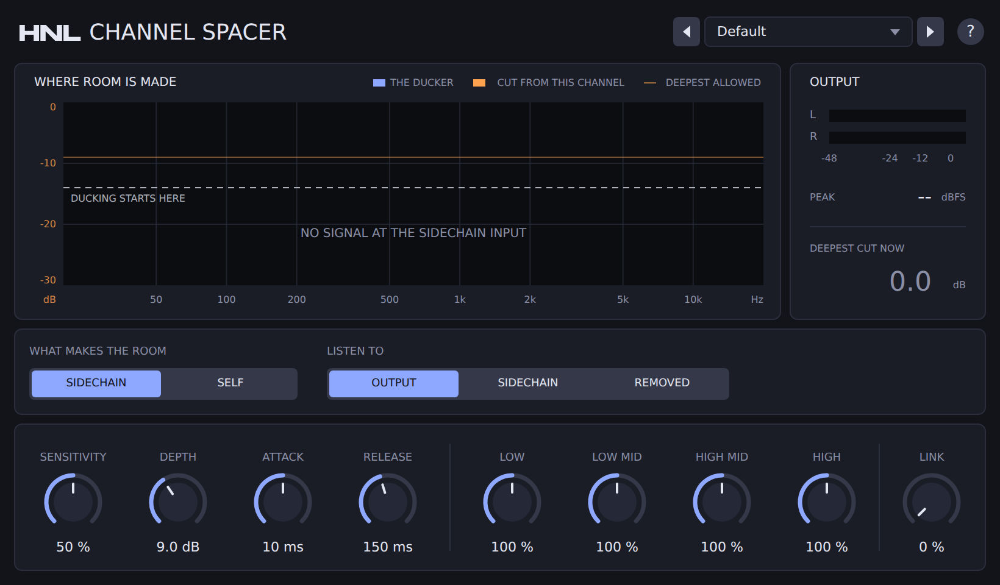
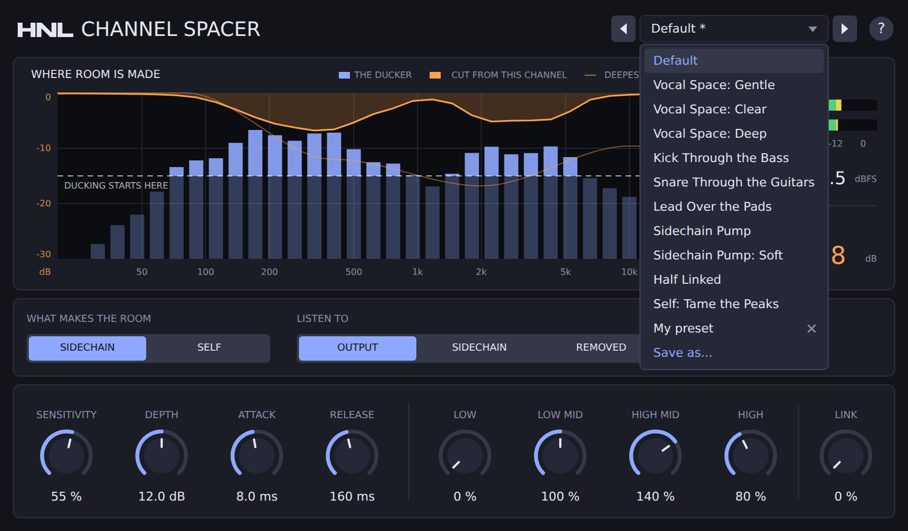

# HNL Channel Spacer

Makes room in one channel for another. Put it on the channel that should give way (pads, guitars, a bass) and feed
the signal that needs the room (a voice, a kick) into its sidechain input. Wherever the sidechain signal is
playing, that part of the spectrum is turned down in the channel, and nothing else.

This VST started life as a Combinator patch I built in Reason: a vocoder used as a four-band crossover, 
a compressor per band as level detector, and a second vocoder as the equaliser they control. 
This VST plugin does the same with 32 bands.

| Default | Help tips | Presets | Saving a preset |
| --- | --- | --- | --- |
|  |  |  |  |

*Rendered from the plugin's drawing code; not yet screenshots from a host.*

## Connecting it

The plugin has two stereo inputs: the main input (the channel it sits on) and a sidechain input. In Reason the
sidechain input appears as a second pair of audio jacks on the back of the plugin device; cable the
ducker in from a Spider splitter or a send.

**Listen to: Sidechain** plays what arrives at the sidechain input, to check the cabling. With nothing arriving
the display says so, and the plugin passes its input through untouched.

## Controls

| Control | What it changes |
| --- | --- |
| What makes the room | Sidechain: the signal at the sidechain input. Self: the channel ducks itself, which smooths its own loudest ranges and needs no sidechain. |
| Listen to | Output, the sidechain signal, or only what is being removed. |
| Sensitivity | How readily the ducker makes room: the dashed line in the display. From 0% (only a ducker above -12 dB ducks) to 100% (anything above -72 dB). |
| Depth | The deepest cut a band can get, 0 to 24 dB. A band gets half a dB of cut per dB the ducker is above the line, easing into the depth. |
| Attack | How fast a band is turned down, 0.5 to 200 ms. |
| Release | How fast it comes back, 20 ms to 2 s. |
| Low, Low Mid, High Mid, High | Amount of ducking per range (around 80 Hz, 400 Hz, 2 kHz, 10 kHz) as a share of Depth, 0 to 200%. In between, the amount glides from one range to the next. No band is cut more than 30 dB. |
| Link | 0%: every band listens to its own part of the ducker. 100%: all bands follow the ducker as a whole, and the entire signal dips as with a classic sidechain compressor. |

The display shows the level of the ducker per band (bars), where ducking starts (dashed line), what is being cut
right now (curve from the top) and how deep each range may go (thin line).

Eleven presets are in the menu at the top right. The **?** button switches help on: rest the mouse on any control
to read what it does.

Drag a knob up or down (Shift for fine steps, mouse wheel also works); double-click or Ctrl-click returns it to
its default. The plugin adds no latency.

## How it works

The ducker is split into 32 bands, a third of an octave apart from 25 Hz to 19 kHz, and its level is followed in
each. The cut is made by subtraction: every band of the main signal is filtered out and a share of it is taken
away. The filters themselves never change, only the shares, so moving cuts make no noise of their own, and with
no ducking the output is the input, bit for bit. Neighbouring bands overlap so that equal cuts in all of them
turn the whole signal down evenly (within about half a dB at 12 dB of cut). The price is that a cut is never narrower than
about two bands: a single sustained note as ducker gets less than the full depth, a voice comes close to it.

Both channels of the main signal get the same cut; the two sidechain channels are added before they are measured.

## Building

From the repository root: `./build.sh hnl-channel-spacer` (see the [main readme](../../README.md)); tests:
`./test.sh hnl-channel-spacer`.
