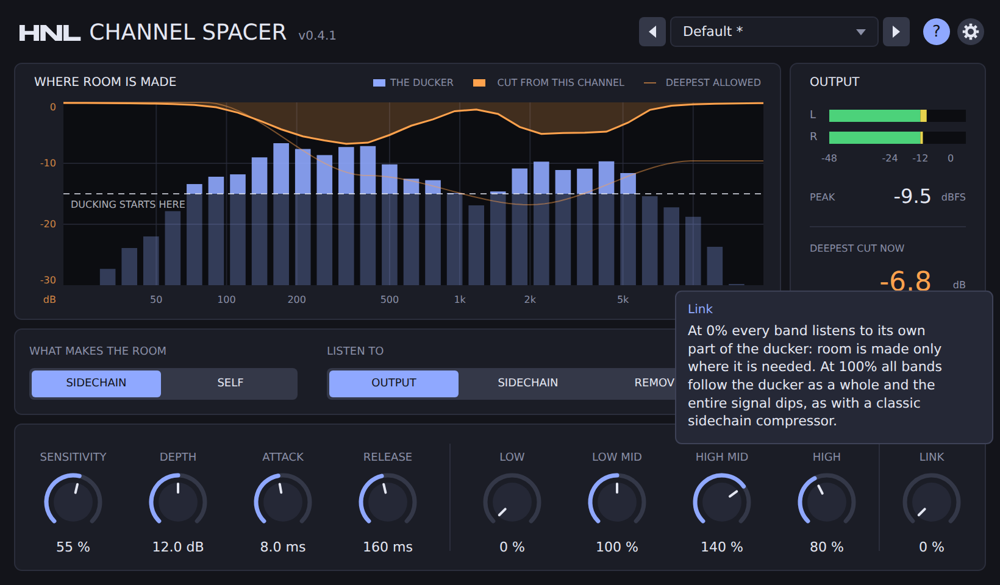
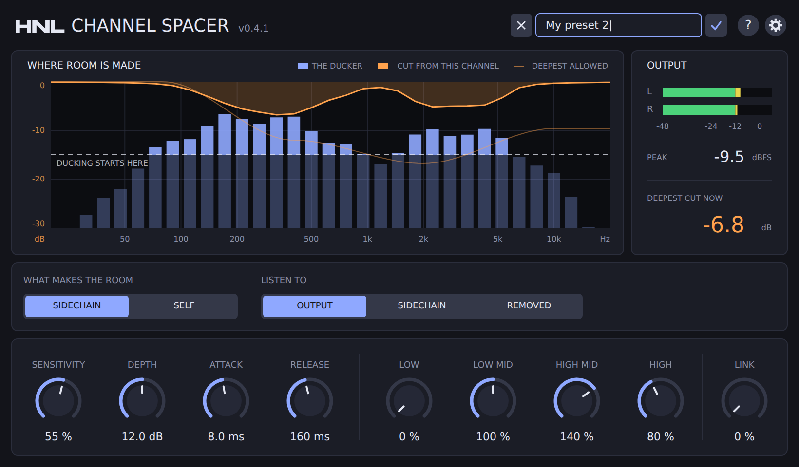

# HNL Channel Spacer

Makes room in one channel for another. Put it on the channel that should give way (pads, guitars, a bass) and feed
the signal that needs the room (a voice, a kick) into its sidechain input. Wherever the sidechain signal is
playing, that part of the spectrum is turned down in the channel, and nothing else.

This plugin started life as a Combinator patch I built in Reason: a vocoder used as a four-band crossover, a
compressor per band as level detector, and a second vocoder as the equaliser they control. The plugin does the
same with 32 bands.

| Default | Help tips | Presets | Saving a preset |
| --- | --- | --- | --- |
|  |  |  |  |

*These pictures are rendered from the plugin's drawing code, not taken from a DAW.*

## Quick start

1. Put HNL Channel Spacer on the channel that should give way.
2. Feed the signal that needs the room into the sidechain input (see [Connecting it](#connecting-it)).
3. Set **Listen to** to Sidechain to check that the signal arrives, then set it back to Output.
4. Pick a preset from the menu at the top right, or set **Sensitivity** and **Depth** yourself.

The rest of this page calls the signal that makes the room the ducker.

## Connecting it

The plugin has two stereo inputs: the main input (the channel it sits on) and a sidechain input. In Reason the
sidechain input appears as a second pair of audio jacks on the back of the plugin device. Cable the ducker in
from a Spider splitter or a send.

With **Listen to** on Sidechain you hear what arrives at the sidechain input, which is a quick way to check the
cabling. When nothing arrives, the display says so and the plugin passes its input through untouched.

## Controls

| Control | What it changes |
| --- | --- |
| What makes the room | Sidechain: the signal at the sidechain input. Self: the channel ducks itself, which smooths its own loudest ranges and needs no sidechain. |
| Listen to | Output, the sidechain signal, or only what is being removed. |
| Sensitivity | How readily the ducker makes room. This is the dashed line in the display. From 0% (only a ducker above -12 dB ducks) to 100% (anything above -72 dB). |
| Depth | The deepest cut a band can get, 0 to 24 dB. A band gets half a dB of cut per dB the ducker is above the line, easing into the depth. |
| Attack | How fast a band is turned down, 0.5 to 200 ms. |
| Release | How fast it comes back, 20 ms to 2 s. |
| Low, Low Mid, High Mid, High | Amount of ducking per range (around 80 Hz, 400 Hz, 2 kHz, 10 kHz) as a share of Depth, 0 to 200%. In between, the amount glides from one range to the next. No band is cut more than 30 dB. |
| Link | 0%: every band listens to its own part of the ducker. 100%: all bands follow the ducker as a whole, and the entire signal dips as with a classic sidechain compressor. |

The display shows four things: the level of the ducker per band (bars), where ducking starts (dashed line), what
is being cut right now (curve from the top) and how deep each range may go (thin line).

Drag a knob up or down. Hold Shift for fine steps, or use the mouse wheel. A double-click or Ctrl-click returns a
knob to its default.

## Presets and help

The menu at the top right holds eleven presets. *Save as...* at the end of the list keeps your current settings
under a name of your own, for use in every song.

The **?** button switches help tips on. Rest the mouse on any control to read what it does.

## The window

The cog at the top right lists the looks (Classic, Hi-Fi Black and Hi-Fi Silver) and the window sizes (75 to
200 %). Where the DAW allows it you can also drag the window by its edge. A look applies to every HNL plugin at
once, and the size is remembered for this plugin. Neither is saved with the song.

## How it works

The ducker is split into 32 bands, a third of an octave apart from 25 Hz to 19 kHz, and its level is followed in
each. The cut is made by subtraction: every band of the main signal is filtered out and a share of it is taken
away. The filters themselves never change, only the shares. That is why moving cuts make no noise of their own,
and why the output is the input, bit for bit, when nothing is ducked.

Neighbouring bands overlap, so that equal cuts in all of them turn the whole signal down evenly (within about
half a dB at 12 dB of cut).

Both channels of the main signal get the same cut. The two sidechain channels are added together before they are
measured. The plugin adds no latency.

## Limits

- A cut is never narrower than about two bands. That is the price of the overlap. A single sustained note as
  ducker gets less than the full depth; a voice comes close to it.
- No band is cut more than 30 dB.

## Installing

[Download HNL-Channel-Spacer-win64.zip](https://github.com/c-kick/hnl-vsts/releases/download/downloads/HNL-Channel-Spacer-win64.zip): the current build, for 64-bit Windows.

The zip holds the plugin as VST3 (copy the `.vst3` folder to `C:\Program Files\Common Files\VST3\`) and as CLAP
(copy the `.clap` file to `C:\Program Files\Common Files\CLAP\`). Your DAW needs only one of the two.

## For developers

From the repository root, `./build.sh hnl-channel-spacer` builds the plugin and `./test.sh hnl-channel-spacer`
runs its tests (see the [main readme](../../README.md)).

- `dsp/Spacer.hpp`: the 32 bands and the ducking.
- `SpacerPlugin.cpp`, `SpacerUI.cpp`: the DPF plugin and its window.
- `Params.hpp`, `Presets.hpp`, `Help.hpp`: the parameters, the presets and the help tips.
- `tests/run.sh`: runs `dsp_test` (plainly, and with the flags the plugin is built with), `plugin_test`,
  `abuse_test` (`common/tests/HostAbuse.hpp`) and the window tests shared by all HNL plugins.

## Changelog

### 0.4.1 (2026-11-28)

- Fixed: on Windows, on a display set to another scale than 100 %, clicks could land beside what was drawn, so that
  knobs and buttons did not answer or another one did. The window was made larger for the display's scale without
  the plugin being told, and it read every click that much too far right and down (at 125 %, a quarter). It now goes
  by the size its window really has. Reported for HNL Sampler in Cubase and Studio One; found by reading the code
  that makes the window, and not yet seen fixed in those DAWs themselves.

### 0.4.0 (2026-11-27)

- New: the window can be made larger and smaller. The cog at the top right lists the sizes (75 to 200 %) under the
  looks, and where the host allows it the window can be dragged by its edge, down to three quarters of its design
  size. It keeps its shape, everything in it is drawn anew at the size it has, and it opens next time at the size
  it was left at. The size is kept for this plugin, not in the song, and changes nothing about the sound.

### 0.3.0 (2026-11-22)

- New: three looks. Classic, the look the plugin has always had, stays the default; Hi-Fi Black and Hi-Fi Silver
  dress the same window as a piece of hi-fi equipment. The cog at the top right chooses, for every HNL plugin at
  once. The choice changes nothing about the sound and is not stored in the song.
- To make room for the cog, the preset bar and the help button stand 28 pixels further left.

### 0.2.3 (2026-11-18)

- Fixed: samples and parameter values that are not numbers are caught again in the builds made with clang.

### 0.2.2 (2026-11-17)

- Fixed: a preset's name can be typed in a host that hands over the keys without their text.
- The licence text (GPL-3.0-or-later) comes with the download.

### 0.2.1 (2026-11-17)

- The version is shown behind the title, next to the HNL logo; the preset bar stands at the right.
- The preset menu spreads a long list evenly over its columns.
- A CLAP build next to the VST3.

### 0.2.0 (2026-11-17)

- New: presets of your own, saved, replaced and deleted from the preset menu.

### 0.1.1 (2026-11-17)

- Guards against samples and parameter values that are not numbers, and against whatever else a host may send.

### 0.1.0 (2026-11-16)

- First version: a 32-band ducker driven by a sidechain input.
