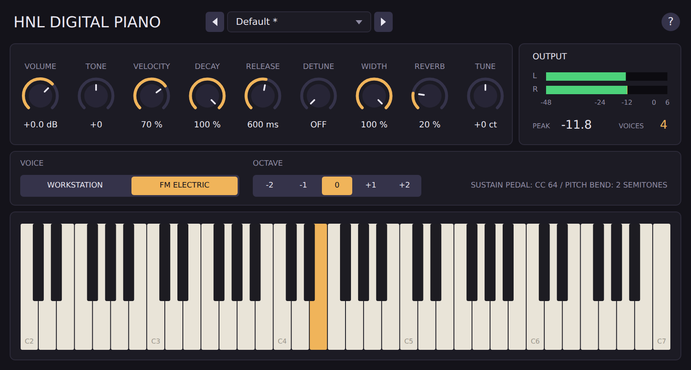
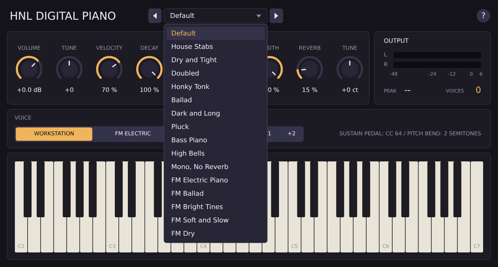

# HNL Digital Piano

An instrument with the digital pianos of the 1980s and 1990s, each as its own voice, all in stereo.

| FM Electric | Help tips | Presets |
| --- | --- | --- |
|  |  |  |

*Rendered from the plugin's drawing code; not yet screenshots from a host.*

## Voices

| Voice | What it is |
| --- | --- |
| Workstation | The sampled piano of late-1980s workstation keyboards: the piano of countless house and dance records. Hard attack, strong fundamental, a tone that mellows within a second. |
| FM Electric | The glassy electric piano of 1980s FM synthesizers: a bell on the attack, a body that barks when played hard and mellows as it rings, and a slow shimmer from side to side. |

Switching voice affects new notes; notes already sounding keep theirs.

### Workstation

Those keyboards played short recordings of a piano through a filter and an envelope. This voice plays no
recordings. It was fitted to reference recordings of such a piano, one note every six semitones: for each of
those notes, `tools/fit.cpp` measured every partial (its frequency, its starting phase, and its level at 29
moments from the first millisecond to ten seconds) and the dull knock of the attack below the note's pitch.
Those measurements are in `dsp/PianoData.hpp`. When the plugin loads, it adds up sine waves from them and so
computes one wave per measured note; as on the original machines, each wave serves the keys around it, played a
little faster or slower. **No audio of any instrument is stored in the plugin or in this repository.**

Measured against the reference notes, in third-octave bands from the first moment to four seconds in, the
output differs by about 2 dB on average. Keys between the measured notes cannot be checked that way.

The measured piano is mono. Here every wave is made in stereo, as if the piano were recorded with two
microphones: left and right carry the same partials at somewhat different levels and phases. The fundamental
keeps the same level on both sides, so no note leans to one side by chance, and the bass stays in the middle.
With Width at 0% the result is mono, and closest to the measured sound.

### FM Electric

Computed the way FM synthesizers did it: sine waves whose phase is pushed around by other sine waves, three
pairs per note. One pair has its modulator fourteen times above the note and makes the bell of the attack; two
pairs make the body. The second body pair is tuned a fraction of a hertz above the first, added on the left and
taken off on the right: that is the slow shimmer from side to side, and it disappears completely in mono, so
nothing cancels there. It is an FM patch of its own in that style, built from how the classic patch is known to
be put together, not a copy of a factory sound, and it has not been compared against a reference.

Both voices place low keys a little to the left and high keys to the right.

## Controls

| Control | What it changes |
| --- | --- |
| Volume | Output level. A hard eight-note chord stays just under full scale at 0 dB. |
| Tone | Workstation: closes or opens the filter on every note; at full velocity it is already wide open, and to the right it also stays open for soft notes. FM Electric: how hard the tone barks, from mellow to bright and bell-like. |
| Velocity | How much playing harder adds level and brightness. At 0% every note is the same, for programmed stabs. |
| Decay | How long a held note rings: 100% is the natural length (long in the bass, short in the treble); lower fades it sooner. |
| Release | How long a note rings on after the key is let go: the time to fall 60 dB, 50 ms to 5 s (default 600 ms). |
| Detune | Workstation: above 0, every note sounds twice, one sharp and one flat, spread left and right (two voices per note). FM Electric: a faster shimmer. |
| Width | 100% is the full stereo image; 0% is mono. |
| Reverb | A touch of room. |
| Tune | Fine tuning, a semitone either way. |
| Octave | Shifts the keyboard by up to two octaves. |
| Voice | Which piano plays. |

Sixteen presets are in the menu next to the name; they leave Volume and Tune alone. The **?** button switches
help on: rest the mouse on any control to read what it does.

The keyboard on screen plays notes for trying a sound: click a key (lower on the key is harder), drag to slide.
Drag a knob up or down (Shift for fine steps, mouse wheel also works); double-click or Ctrl-click returns it to
its default.

## MIDI

Notes with velocity, sustain pedal (CC 64), pitch bend (two semitones), all notes off (CC 123) and all sound
off (CC 120). 64 voices; when they run out, the quietest note makes way. No latency.

The plugin was called HNL House Piano up to 0.3.0. It kept its identity, so songs that used it should open
with the renamed plugin.

## Installing

Download the zip from the [releases](https://github.com/c-kick/hnl-vsts/releases) and unzip it into
`C:\Program Files\Common Files\VST3\`. Windows 64-bit, VST3. It is an instrument: in Reason, add it from the
instruments, not the effects.
