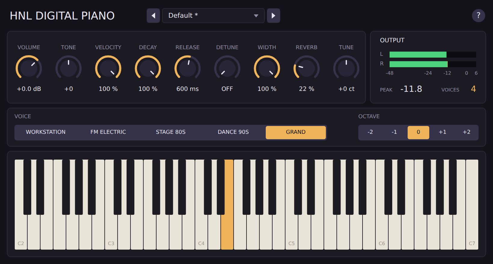
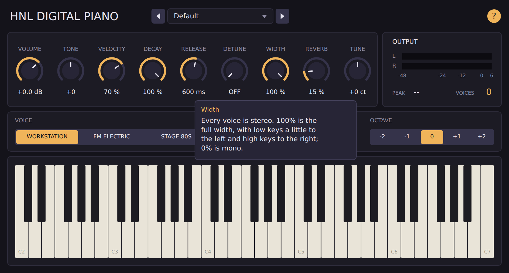

# HNL Digital Piano

An instrument with five pianos, each as its own voice, all in stereo: the digital pianos of the 1980s and
1990s, and a modelled grand.

| Grand | Help tips | Presets |
| --- | --- | --- |
|  |  |  |

*Rendered from the plugin's drawing code; not yet screenshots from a host.*

## Voices

| Voice | What it is | Where its sound comes from |
| --- | --- | --- |
| Workstation | The sampled piano of late-1980s workstation keyboards: the piano of countless house records. Hard attack, strong fundamental, a tone that mellows within a second. | Fitted to recordings of single notes, a note every six keys. Within about 2 dB of them. |
| FM Electric | The glassy electric piano of 1980s FM synthesizers: a bell on the attack, a body that barks when played hard, a slow shimmer from side to side. | Computed with FM synthesis. An FM patch of its own in that style; not compared with a reference. |
| Stage 80s | The rounded, slightly artificial stage piano of the mid 1980s. Its tone changes a lot with touch. | Fitted to single notes at four velocities, a note every six keys, rendered with an emulator of the original sound engine. Within about 1.5 dB of them. |
| Dance 90s | The thin, cutting piano of 1990s dance records. | Worked out from three recorded chords around middle C, the only reference there was. Chords it plays are within about 2.5 dB of those; the rest of the keyboard is extrapolated and the attack is blurred. The weakest of the fitted voices. |
| Grand | A concert grand. | A model of how a piano makes its sound; no recordings involved. |

Switching voice affects new notes; notes already sounding keep theirs. The first time a voice is chosen, the
plugin works out its waves, which takes a moment (around a second) and can interrupt the sound once.

**No audio of any instrument is stored in the plugin or in this repository.** A fitted voice holds
measurements: for each reference note, every partial (its frequency, its starting phase, and its level at 29
moments from the first millisecond to ten seconds) and the dull knock of the attack. `tools/fit.cpp` and
`tools/fit_chords.cpp` make those from recordings; the data is in `dsp/*Data.hpp`. The plugin adds up sine
waves from them and so computes one wave per measured note and velocity; as on the original machines, each wave
serves the keys around it, played a little faster or slower. The "within about N dB" figures compare the
plugin's output with the reference in third-octave bands over the first seconds of a note.

The measured pianos are mono. Every wave is made in stereo here, as if recorded with two microphones: left and
right carry the same partials at somewhat different levels and phases. The fundamental keeps the same level on
both sides, so no note leans by chance, and the bass stays in the middle. With Width at 0% the result is mono,
and closest to the measured sound. All voices place low keys a little to the left and high keys to the right.

### FM Electric

Sine waves whose phase is pushed around by other sine waves, three pairs per note. One pair has its modulator
fourteen times above the note and makes the bell of the attack; two pairs make the body. The second body pair
is tuned a fraction of a hertz above the first, added on the left and taken off on the right: that is the slow
shimmer from side to side, and it disappears completely in mono, so nothing cancels there.

### Grand

Written from the physics, in `dsp/GrandModel.hpp`:

- **Stiff strings:** the partials lie above the exact harmonics, a little in the middle, more in the bass and
  much more at the top.
- **The hammer:** it strikes about an eighth of the way along the string, and its felt is soft at low speed
  and hard at high speed. A hard blow puts far more energy into the upper partials (about 17 dB more than a
  soft one, an octave below middle C). Three hammer strengths are computed, with a filter in between.
- **Two or three strings per note:** never tuned exactly alike. They give a loud, fast-fading start and a
  quiet, long-lasting aftersound that beats slowly. One string in the low bass, two above, three from the
  tenor up.
- **Decay:** higher partials die sooner than lower ones, high notes sooner than low notes.
- **Soundboard:** weak for the lowest fundamentals, a broad warmth and presence, and a fine pattern of
  stronger and weaker spots that gives every key its own colour.
- **Hammer knock**, and **dampers** that are slow on the bass strings, quick in the treble and absent on the
  top keys, which ring on.

It has one wave per four keys. Not modelled: strings ringing in sympathy with the pedal down, the noise of the
pedal and the keys coming back up, and the change of tone when a note is struck again while still sounding.

## Controls

| Control | What it changes |
| --- | --- |
| Volume | Output level. A hard eight-note chord stays just under full scale at 0 dB. |
| Tone | Closes or opens the filter on every note; to the right it also stays open for soft notes. On FM Electric: how hard the tone barks, from mellow to bright and bell-like. |
| Velocity | How much playing harder adds level and brightness. At 0% every note is the same, for programmed stabs. |
| Decay | How long a held note rings: 100% is the natural length (long in the bass, short in the treble); lower fades it sooner. |
| Release | How long a note rings on after the key is let go: the time to fall 60 dB, 50 ms to 5 s (default 600 ms). On Grand it follows the dampers: longer in the bass, shorter in the treble. |
| Detune | Above 0, every note sounds twice, one sharp and one flat, spread left and right (two voices per note). On FM Electric: a faster shimmer instead. |
| Width | 100% is the full stereo image; 0% is mono. |
| Reverb | A touch of room. |
| Tune | Fine tuning, a semitone either way. |
| Octave | Shifts the keyboard by up to two octaves. |
| Voice | Which piano plays. |

Twenty-seven presets are in the menu next to the name; they leave Volume and Tune alone. The **?** button switches
help on: rest the mouse on any control to read what it does.

The keyboard on screen plays notes for trying a sound: click a key (lower on the key is harder), drag to slide.
Drag a knob up or down (Shift for fine steps, mouse wheel also works); double-click or Ctrl-click returns it to
its default.

## MIDI

Notes with velocity, sustain pedal (CC 64), pitch bend (two semitones), all notes off (CC 123) and all sound
off (CC 120). 64 voices; when they run out, the quietest note makes way. No latency.

The plugin was called HNL House Piano up to 0.3.0. It kept its identity, so songs that used it should open
with the renamed plugin.

## Installing

Download the zip from the [releases](https://github.com/c-kick/hnl-vsts/releases) and unzip it into
`C:\Program Files\Common Files\VST3\`. Windows 64-bit, VST3. It is an instrument: in Reason, add it from the
instruments, not the effects.
