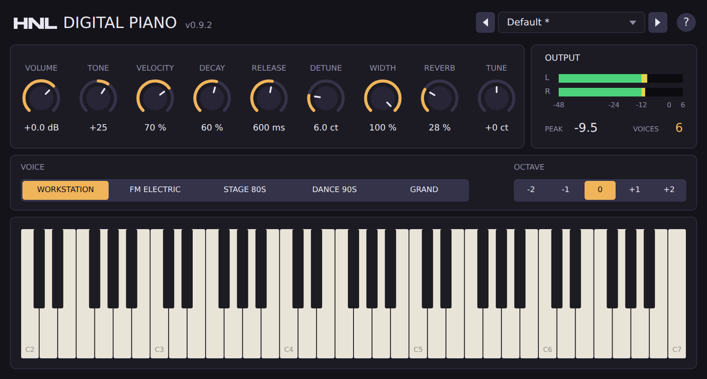

# HNL Digital Piano

An instrument with five pianos in one plugin: four digital pianos from the 1980s and 1990s, and a concert grand.
Each is a voice of its own and all five are in stereo.

| Grand | Help tips | Presets | Saving a preset |
| --- | --- | --- | --- |
|  |  |  |  |

*These pictures are rendered from the plugin's drawing code, not taken from a DAW.*

## Installing

[Download HNL-Digital-Piano-win64.zip](https://github.com/c-kick/hnl-vsts/releases/download/downloads/HNL-Digital-Piano-win64.zip),
the current build for 64-bit Windows.

The zip holds the plugin as VST3 and as CLAP. Your DAW needs only one of the two.

- **VST3:** copy the `.vst3` folder to `C:\Program Files\Common Files\VST3\`.
- **CLAP:** copy the `.clap` file to `C:\Program Files\Common Files\CLAP\`.

## Quick start

1. Add HNL Digital Piano as an instrument. In Reason you find it under the instruments, not the effects.
2. Choose a piano with **Voice**, or pick one of the presets from the menu at the top right.
3. Play. The keyboard in the window plays notes too, which is handy for trying a sound without a MIDI keyboard.
4. Shape the sound with **Tone**, **Velocity** and **Release**.

The **?** button switches on help tips for every control.

## The voices

| Voice | What it is | Where its sound comes from |
| --- | --- | --- |
| Workstation | The sampled piano of late-1980s workstation keyboards, heard on countless house records. Hard attack, strong fundamental, a tone that mellows within a second. | Fitted to recordings of single notes, one every three keys from C1 to C7, each held for six seconds. After those six seconds the fade continues at the rate it had. The result is within about 1.5 dB of the recordings. The original only gets quieter when you play softer. Here soft notes are also a little darker (see Velocity). The source is mono, and the stereo is made in the plugin, wider than for the other voices. |
| FM Electric | The glassy electric piano of 1980s FM synthesizers. A bell on the attack, a body that barks when played hard, a slow shimmer from side to side. | Computed with FM synthesis. It is a patch written for this plugin in that style, and it has not been compared with a reference. |
| Stage 80s | The rounded, slightly artificial stage piano of the mid 1980s. Its tone changes a lot with touch. | Fitted to single notes at four velocities, one every six keys, rendered with an emulator of the original sound engine. Within about 1.5 dB of them. |
| Dance 90s | The thin, cutting piano of 1990s dance records. | Worked out from three recorded chords around middle C, which was the only reference available. Chords it plays are within about 2.5 dB of those. The rest of the keyboard is extrapolated and the attack is blurred. This is the weakest of the fitted voices. |
| Grand | A concert grand, from soft to loud. | Fitted in stereo to single notes of a real grand played soft, medium and loud, every third key, from the University of Iowa Musical Instrument Samples. |

A change of voice applies to new notes. Notes that are already sounding keep the voice they started with.

The first time you choose a voice, the plugin has to work out its waves, which takes about a second. The sound
does not stop for that. Until the waves are ready, new notes still play with the voice you had. When a song opens
with a voice already chosen, that voice is there from the first note.

### How a fitted voice is made

**No audio of any instrument is stored in the plugin or in this repository.** A fitted voice holds measurements
of the reference notes. For each note that is every partial (its frequency, its starting phase, and its level at
29 moments from the first millisecond to ten seconds) and the dull knock of the attack. From those the plugin
adds up sine waves into one wave per measured note and velocity. As on the original machines, each wave serves
the keys around it, played a little faster or slower.

The "within about N dB" figures in the table compare the plugin's output with the reference in third-octave
bands over the first seconds of a note.

### Stereo

The measured pianos are mono, except the grand. The plugin makes their waves in stereo, as if they were recorded
with two microphones: left and right carry the same partials at somewhat different levels and phases. The
fundamental has the same level on both sides, so no note leans to one side by chance and the bass stays in the
middle. With **Width** at 0% the result is mono, and closest to the measured sound.

All voices except Grand also place low keys a little to the left and high keys a little to the right.

### FM Electric

This voice is made of sine waves whose phase is pushed around by other sine waves, three pairs per note. One
pair has its modulator fourteen times above the note and makes the bell of the attack. The other two make the
body. The second body pair is tuned a fraction of a hertz above the first, and it is added on the left and
subtracted on the right. That gives the slow shimmer from side to side. In mono the shimmer disappears
completely, so nothing cancels there.

### Grand

The grand is fitted to the piano recordings of the
[University of Iowa Musical Instrument Samples](https://theremin.music.uiowa.edu/MIS.html), which are free to
use. They are single notes at three dynamics, and every third key was measured. The three dynamics became three
sets of waves, and a filter covers the steps in between.

- **Room noise.** The recordings were made in a room, with its noise. The fitting follows each partial only
  until it sinks into that noise and lets it fade on from there, so the noise is not part of the sound.
- **Stereo.** The recordings are stereo and both sides were measured, with the start of the note and the place
  of its partials found once for both. The two microphones stood far apart. In the recordings some notes are
  7 dB louder on one side, and for several notes the two sides partly cancel when summed. An instrument should
  not do that, so the measured differences are kept within bounds: the fundamental stays nearly centred, a
  partial leans at most 3 dB to one side, and no partial is more than a quarter turn out of step between the
  sides. What you get is the real piano's own width, with every key near the middle and at most about 3 dB lost
  in mono. The tone lies between the two microphones. Keys are not placed from left to right on top of that, as
  they are for the other voices.
- **The ends of the keyboard.** High up, the soft notes hardly rise above the noise. From about two octaves
  above middle C, soft playing uses the medium notes with a darker filter. The top keys use the loud notes for
  every touch. The lowest three keys borrow from the lowest C, played a little slower.
- **The fade.** A real note fades fast at first (about 20 dB in the first second at middle C) and then lingers
  quietly for a long time. That comes straight from the measurements.
- **Dampers.** These are added on top of the measurements. They are slow on the bass strings, quick in the
  treble and absent on the top keys, which ring on.

An earlier version of this voice was a model written from the physics alone. It did not sound convincing and
was replaced by the fitted one.

## Controls

| Control | What it changes |
| --- | --- |
| Volume | Output level. A hard eight-note chord stays just under full scale at 0 dB. |
| Tone | Closes or opens the filter on every note. Turned to the right, the filter also stays open for soft notes. On FM Electric it sets how hard the tone barks, from mellow to bright and bell-like. |
| Velocity | How much playing harder adds level and brightness. At 0% every note is the same, which suits programmed stabs. |
| Decay | How long a held note rings. 100% is the natural length (long in the bass, short in the treble). Lower values fade it sooner. |
| Release | How long a note rings on after you let the key go: the time to fall 60 dB, from 50 ms to 5 s (default 600 ms). On Grand it follows the dampers, so it is longer in the bass and shorter in the treble. |
| Detune | Above 0, every note sounds twice, one sharp and one flat, spread left and right. That takes two voices per note. On FM Electric it makes the shimmer faster instead. |
| Width | 100% is the full stereo image, 0% is mono. |
| Reverb | A touch of room. |
| Tune | Fine tuning, a semitone either way. |
| Octave | Shifts the keyboard by up to two octaves. |
| Voice | Which piano plays. |

Drag a knob up or down to turn it. Hold Shift for fine steps, or use the mouse wheel. A double-click or
Ctrl-click returns a knob to its default.

**The keyboard** in the window plays notes for trying a sound. Click a key, lower on the key for a harder hit,
and drag to slide over the keys. Notes from the DAW do not light up on it.

**Presets.** The menu at the top right holds twenty-seven presets, and *Save as...* keeps your own. Presets
leave Volume and Tune alone.

**Help.** The **?** button switches help on. Rest the mouse on any control to read what it does.

## MIDI

The plugin responds to:

- notes with velocity,
- the sustain pedal (CC 64),
- pitch bend, two semitones either way,
- all notes off (CC 123) and all sound off (CC 120),
- reset all controllers (CC 121), which puts pitch bend in the middle and lifts the pedal.

There are 64 voices. When they run out, the quietest note makes way. The plugin adds no latency.

## The window

The cog at the top right lists the looks (Classic, Hi-Fi Black and Hi-Fi Silver) and the window sizes (75 to
200 %). Where the DAW allows it you can also drag the window by its edge. The look applies to every HNL plugin
at once, and the size is remembered for this plugin. Neither is saved with the song or changes the sound.

## Limits

- Windows 64-bit only.
- The Grand has no strings ringing in sympathy with the pedal down, no pedal or key noise, and no change of
  tone when you strike a note again while it still sounds.
- Dance 90s rests on three chords around middle C. Away from there it is an extrapolation.
- FM Electric is a patch of its own and has not been compared with a reference instrument.
- 64 voices, and Detune uses two per note.

## What has and has not been tried

- **A song saved with HNL House Piano.** The plugin had that name up to 0.3.0. It kept its identity when it was
  renamed, so a song that used HNL House Piano should open with HNL Digital Piano. This has not been tried.

## For developers

### Tests

`tests/run.sh` runs six test programs:

- `dsp_test` measures the piano engine. It runs twice: plainly, and with the flags the plugin is built with.
- `plugin_test` runs the plugin in DPF's wrapper.
- `abuse_test` does everything a DAW is allowed to do (`common/tests/HostAbuse.hpp`).
- `ui_presets_test`, `ui_skin_test` and `ui_size_test` drive the window itself: saving, loading and deleting a
  preset, the choice of look and the size of the window. These three are shared by all plugins (`common/tests/`).

### Code

- `dsp/Piano.hpp`: the engine, with all five voices.
- `dsp/PianoFit.hpp`: what a fitted voice is made of.
- `dsp/*Data.hpp`: the measurements of the fitted voices.
- `tools/fit.cpp`, `tools/fit_chords.cpp`: the programs that make those measurements from recordings.
- `PianoPlugin.cpp`, `PianoUI.cpp`: the DPF plugin and its window.
- `Params.hpp`, `Presets.hpp`, `Help.hpp`: the parameters, the presets and the help texts.

The waves of a voice are computed on a thread of their own, away from the audio thread.

The parameters the DAW sees are the eleven controls in the table above, plus three meters it can read: the
output peak left and right, and the number of voices sounding. New parameters are added at the end, because
DAWs store automation by position.

## Changelog

### 0.11.0 (2026-11-27)

- New: the window can be made larger and smaller. The cog at the top right lists the sizes (75 to 200 %) under the
  looks, and where the host allows it the window can be dragged by its edge, down to three quarters of its design
  size. It keeps its shape, everything in it is drawn anew at the size it has, and it opens next time at the size
  it was left at. The size is kept for this plugin, not in the song, and changes nothing about the sound.

### 0.10.0 (2026-11-22)

- New: three looks. Classic, the look the plugin has always had, stays the default; Hi-Fi Black and Hi-Fi Silver
  dress the same window as a piece of hi-fi equipment. The cog at the top right chooses, for every HNL plugin at
  once. The choice changes nothing about the sound and is not stored in the song.
- To make room for the cog, the preset bar and the help button stand 28 pixels further left.

### 0.9.3 (2026-11-18)

- Fixed: samples and parameter values that are not numbers are caught again in the builds made with clang.

### 0.9.2 (2026-11-17)

- Fixed: a preset's name can be typed in a host that hands over the keys without their text.
- The licence text (GPL-3.0-or-later) comes with the download.

### 0.9.1 (2026-11-17)

- The version is shown behind the title, next to the HNL logo; the preset bar stands at the right.
- The preset menu spreads a long list evenly over its columns.
- A CLAP build next to the VST3.

### 0.9.0 (2026-11-17)

- New: presets of your own, saved, replaced and deleted from the preset menu.

### 0.8.2 (2026-11-17)

- The waves of a voice are computed away from the audio thread; the voice in use plays on until they are there.
- Guards against samples and parameter values that are not numbers, and against whatever else a host may send.

### 0.8.1 (2026-11-16)

- The workstation voice is wider in stereo.

### 0.8.0 (2026-11-16)

- The workstation voice is fitted again to a closer reference, with a note measured every three keys.

### 0.7.0 (2026-11-16)

- The grand is measured in stereo; its lowest and highest keys come from nearer notes.

### 0.6.0 (2026-11-16)

- The grand is fitted to recordings of a real grand.

### 0.5.0 (2026-11-16)

- New: stage, dance and grand voices.
- The preset menu is laid out in columns.

### 0.4.0 (2026-11-16)

- Renamed from HNL House Piano.
- New: the FM electric piano voice.

### 0.3.0 (2026-11-16)

- As HNL House Piano: fitted to reference measurements.

### 0.2.0 (2026-11-16)

- As HNL House Piano: longer release and sustain.

### 0.1.0 (2026-11-16)

- First version, as HNL House Piano: a stereo digital piano.
