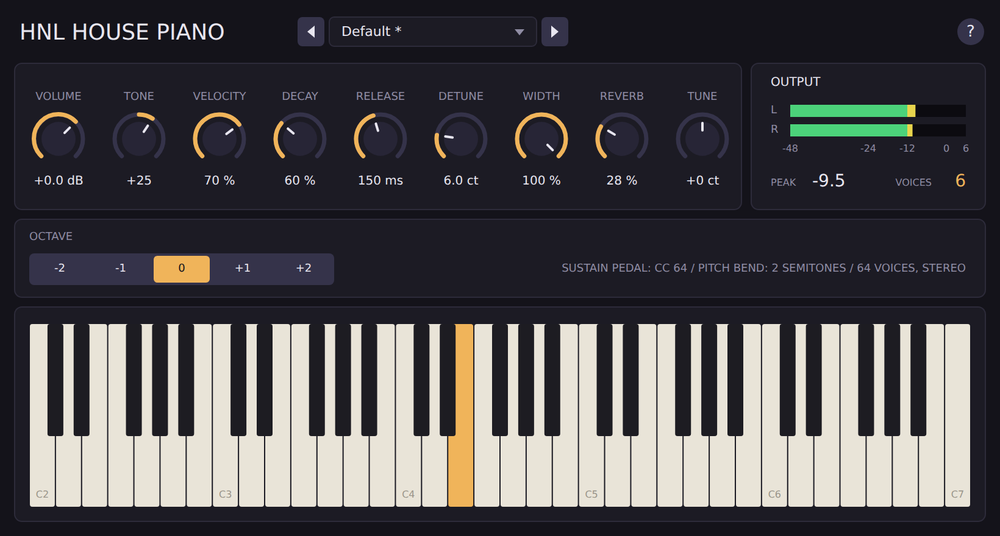
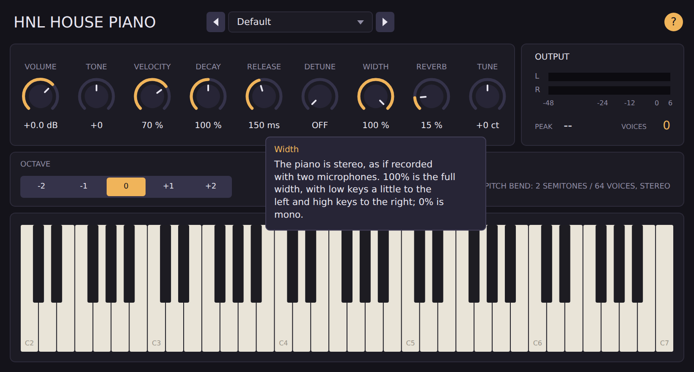
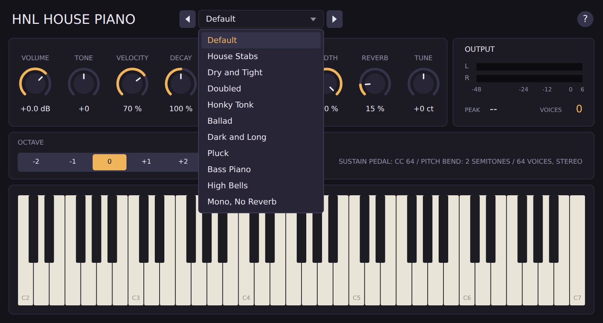

# HNL House Piano

A bright digital piano in the manner of the sample-playback workstations of the late 1980s: the piano of
countless house and dance records. Punchy attack, a little thin, a sustain that stands still, and in stereo.

| Help tips | Presets |
| --- | --- |
|  |  |

*Rendered from the plugin's drawing code; not yet screenshots from a host.*

## How it makes its sound

Those workstations played short recordings of a piano. The start of a note was the real attack; after a
fraction of a second the recording ran into a short loop, so the tone froze while an envelope faded it out. One
recording served several keys, played faster or slower, and a filter that opened with velocity did the rest.
That recipe is the sound.

This plugin follows the recipe but makes its own recordings. When it loads it computes 29 stereo waves, one per
three keys, from a model of a struck piano string: stiff-string partials, the hammer and its strike point, and a
bright body. Each wave has an attack that runs into a loop. **It contains no samples of any instrument**, so it
is in the character of those pianos, not a copy of one.

## Stereo

Every wave is stereo, as if the piano were recorded with two microphones: left and right carry the same partials
at somewhat different levels and phases. The bass stays in the middle, the upper part of the tone spreads out,
and low keys sit a little to the left and high keys to the right. Summed to mono it loses about 1 dB.

## Controls

| Control | What it changes |
| --- | --- |
| Volume | Output level. A hard eight-note chord stays just under full scale at 0 dB. |
| Tone | Closes or opens the filter on every note: darker and rounder to the left, wide open to the right. |
| Velocity | How much playing harder adds level and brightness. At 0% every note is the same, for programmed stabs. |
| Decay | How long a held note rings: 100% is natural (long in the bass, short in the treble). |
| Release | How long a note takes to fall 60 dB after the key is let go. |
| Detune | Above 0, every note sounds twice, one sharp and one flat, spread left and right. Uses two voices per note. |
| Width | 100% is the full stereo image; 0% is mono. |
| Reverb | A touch of room. |
| Tune | Fine tuning, a semitone either way. |
| Octave | Shifts the keyboard by up to two octaves. |

Eleven presets are in the menu next to the name; they leave Volume and Tune alone. The **?** button switches
help on: rest the mouse on any control to read what it does.

The keyboard on screen plays notes for trying a sound: click a key (lower on the key is harder), drag to slide.
Drag a knob up or down (Shift for fine steps, mouse wheel also works); double-click or Ctrl-click returns it to
its default.

## MIDI

Notes with velocity, sustain pedal (CC 64), pitch bend (two semitones), all notes off (CC 123) and all sound
off (CC 120). 64 voices; when they run out, the quietest note makes way. No latency.

## Installing

Download the zip from the [releases](https://github.com/c-kick/hnl-vsts/releases) and unzip it into
`C:\Program Files\Common Files\VST3\`. Windows 64-bit, VST3. It is an instrument: in Reason, add it from the
instruments, not the effects.
