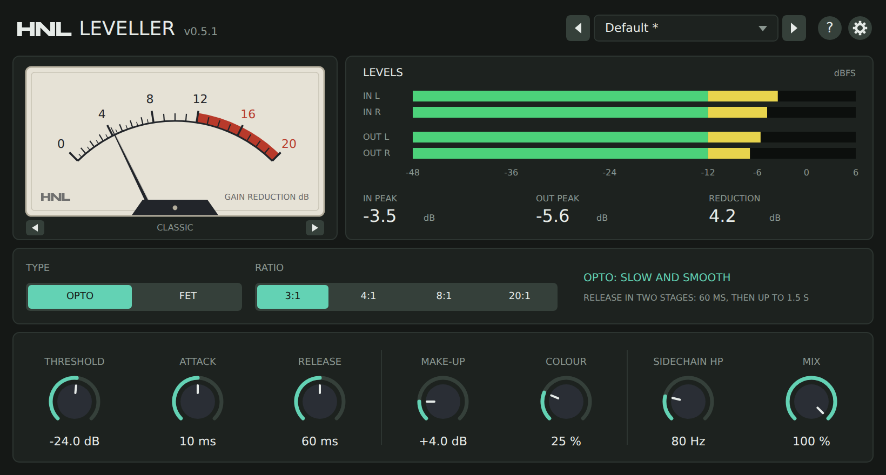
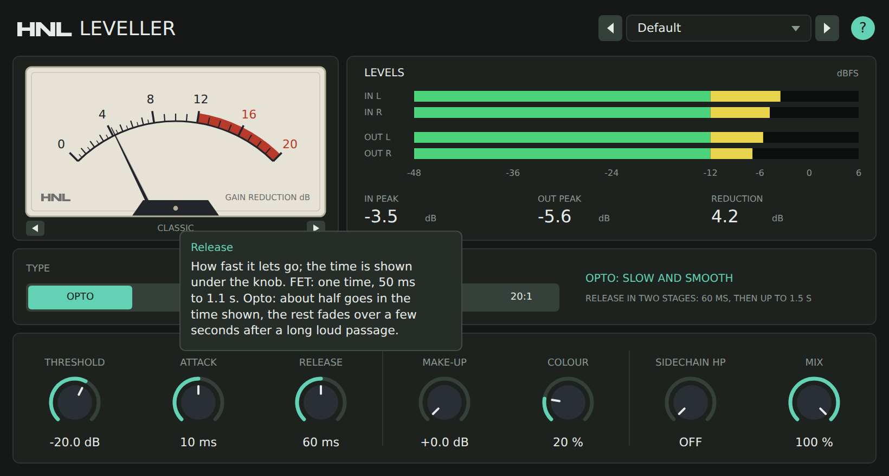
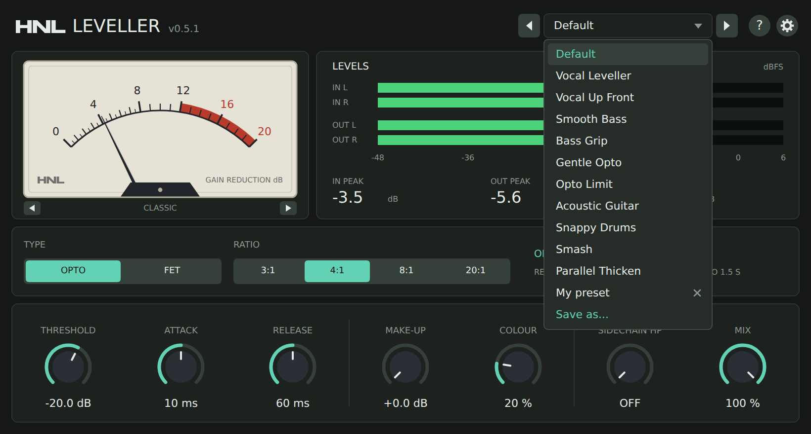
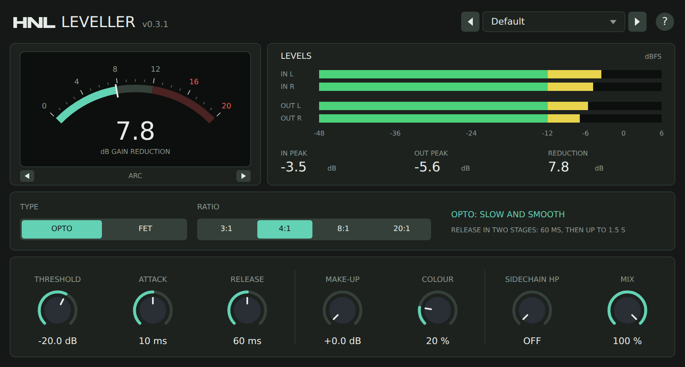
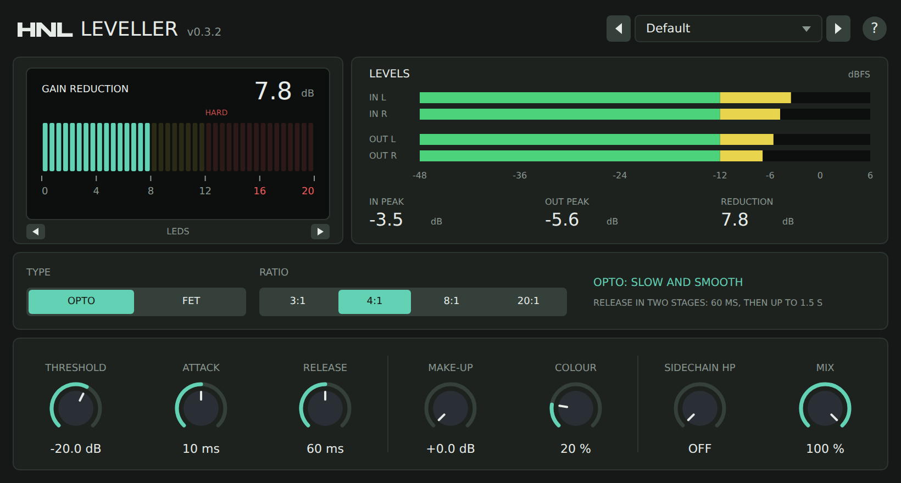

# HNL Leveller

A levelling compressor for single sources such as a vocal or a bass, with two characters: a slow, smooth Opto
and a fast, firm FET.

| FET type | Help tips | Presets | Saving a preset |
| --- | --- | --- | --- |
|  |  |  |  |

| Meter design: Arc | Meter design: LEDs |
| --- | --- |
|  |  |

*Rendered from the plugin's drawing code; not yet a screenshot from a host.*

## The two types

| | Opto | FET |
| --- | --- | --- |
| Use | Rides the level without being heard | Catches every peak, brings a sound forward |
| Knee | Wide: 16 dB at 3:1 down to 8 dB at 20:1 | Tight: 6 dB at 3:1 down to 3 dB at 20:1 |
| Attack | 2.5 to 40 ms (10 ms in the middle) | 0.02 to 0.8 ms |
| Release | In two stages: about half goes in 20 to 180 ms, the rest fades over 0.5 to 4.5 s | One time, 50 ms to 1.1 s |
| Colour | Mostly second harmonic (warm) | Mostly third harmonic (more edge) |

The Opto's slow stage builds up while it compresses. A single short peak is let go at once; after a long loud
passage the gain comes back slowly, so the level does not jump up in the gaps between phrases.

## Controls

| Control | What it changes |
| --- | --- |
| Type | Opto or FET. |
| Ratio | 3:1, 4:1, 8:1 or 20:1. |
| Threshold | The level above which the signal is turned down, from -50 to 0 dBFS. 3 to 6 dB of reduction evens out a vocal; 10 or more is a sound of its own. |
| Attack, Release | Fast to slow within the type's range; the time is shown under the knob. |
| Make-up | 0 to 24 dB of gain on the compressed signal. |
| Colour | Harmonics that grow with the level: at 100% about 2% second harmonic (Opto) or 0.8% third (FET) for a signal at -12 dBFS, four times as much third at -6 dBFS. At 0 the compressor is clean. |
| Sidechain HP | Off, or up to 300 Hz (12 dB per octave), on the detector only: keeps plosives or the lowest bass notes from pulling the level down. |
| Mix | 0% is the untouched signal, 100% only the compressed one. |

The meter shows the gain reduction in dB. The bars show the peak level going in and coming out; the compressor
does not limit, so with make-up gain the output can go over 0 dBFS. Both channels always get the same reduction.

The two arrows under the meter step through three designs: a needle over a printed card (Classic), an arc that
fills with the reading as a figure (Arc) and a row of lights (LEDs). The choice is kept with the song and changes
nothing about the sound; a new instance starts on Classic.

Eleven presets are in the menu at the top right. They assume a track that peaks around -6 dBFS: set the threshold
to your own level. The **?** button switches help on: rest the mouse on any control to read what it does.

Drag a knob up or down (Shift for fine steps, mouse wheel also works); double-click or Ctrl-click returns it to
its default. There is no latency.

## About the model

It follows the way classic optical and FET levelling amplifiers behave and is not a copy of, or affiliated with,
any of them. The times are time constants: the reduction covers 63% of the way in that time. The detector reads
peaks, without lookahead. The colour stage adds second and third harmonics only and is not oversampled; on
material with a lot of level above 8 kHz, high Colour settings can add a little aliasing.

## Installing

[Download HNL-Leveller-win64.zip](https://github.com/c-kick/hnl-vsts/releases/download/downloads/HNL-Leveller-win64.zip): the current build, for 64-bit Windows.

The zip holds the plugin as VST3
(copy the `.vst3` folder to `C:\Program Files\Common Files\VST3\`) and as CLAP (copy the `.clap` file to `C:\Program Files\Common Files\CLAP\`). A host needs only one of the
two. Windows 64-bit.

## Changelog

### 0.5.0 (2026-11-27)

- New: the window can be made larger and smaller. The cog at the top right lists the sizes (75 to 200 %) under the
  looks, and where the host allows it the window can be dragged by its edge, down to three quarters of its design
  size. It keeps its shape, everything in it is drawn anew at the size it has, and it opens next time at the size
  it was left at. The size is kept for this plugin, not in the song, and changes nothing about the sound.

### 0.4.0 (2026-11-22)

- New: three looks. Classic, the look the plugin has always had, stays the default; Hi-Fi Black and Hi-Fi Silver
  dress the same window as a piece of hi-fi equipment. The cog at the top right chooses, for every HNL plugin at
  once. The choice changes nothing about the sound and is not stored in the song.
- To make room for the cog, the preset bar and the help button stand 28 pixels further left.

### 0.3.2 (2026-11-18)

- Fixed: samples and parameter values that are not numbers are caught again in the builds made with clang.

### 0.3.1 (2026-11-17)

- Fixed: a preset's name can be typed in a host that hands over the keys without their text.
- The licence text (GPL-3.0-or-later) comes with the download.

### 0.3.0 (2026-11-17)

- The version is shown behind the title, next to the HNL logo; the preset bar stands at the right.
- The preset menu spreads a long list evenly over its columns.
- The meter comes in three designs (classic, arc, leds).
- A CLAP build next to the VST3.

### 0.2.0 (2026-11-17)

- New: presets of your own, saved, replaced and deleted from the preset menu.

### 0.1.1 (2026-11-17)

- Fixed: switching from Opto to FET made the level jump; the reduction that was held is now handed over.
- Guards against samples and parameter values that are not numbers, and against whatever else a host may send.

### 0.1.0 (2026-11-16)

- First version: a levelling compressor with an opto and a FET type.
