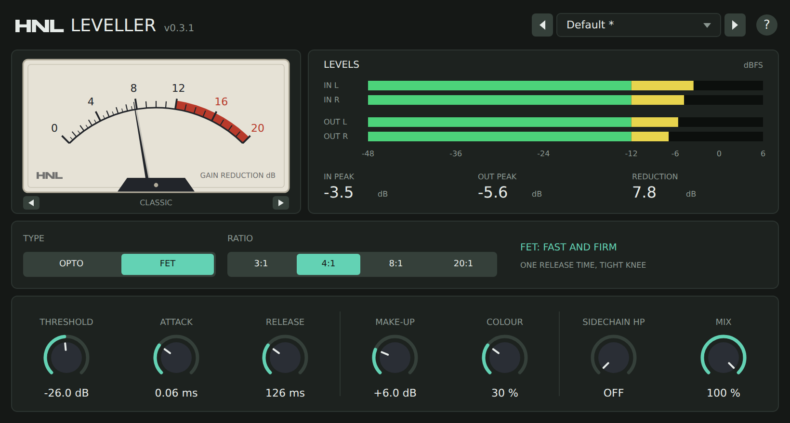
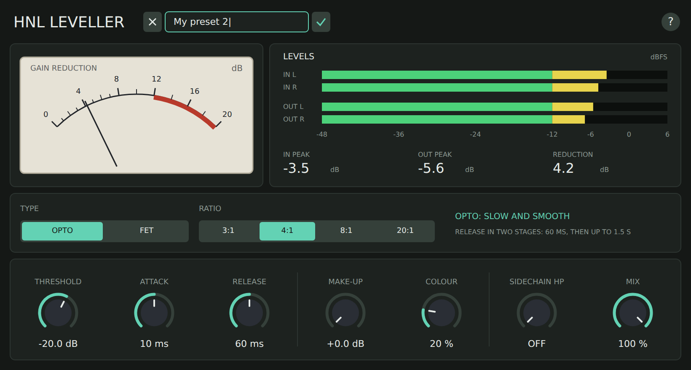

# HNL Leveller

A levelling compressor for single sources such as a vocal or a bass, with two characters: a slow, smooth Opto
and a fast, firm FET.

| FET type | Help tips | Presets | Saving a preset |
| --- | --- | --- | --- |
|  |  |  |  |

*Rendered from the plugin's drawing code; not yet a screenshot from a host.*

## The two types

| | Opto | FET |
| --- | --- | --- |
| Use | Rides the level without being heard | Catches every peak, brings a sound forward |
| Knee | Wide: 16 dB at 3:1 down to 8 dB at 20:1 | Tight: 6 dB at 3:1 down to 3 dB at 20:1 |
| Attack | 2.5 to 40 ms (10 ms in the middle) | 0.02 to 0.8 ms |
| Release | In two stages: about half goes in 20 to 180 ms, the rest fades over 0.5 to 4.5 s | One time, 50 ms to 1.1 s |
| Colour | Mostly second harmonic (warm) | Mostly third harmonic (more edge) |

The Opto's slow stage builds up while it compresses. A single short peak is let go at once; after a long loud
passage the gain comes back slowly, so the level does not jump up in the gaps between phrases.

## Controls

| Control | What it changes |
| --- | --- |
| Type | Opto or FET. |
| Ratio | 3:1, 4:1, 8:1 or 20:1. |
| Threshold | The level above which the signal is turned down, from -50 to 0 dBFS. 3 to 6 dB of reduction evens out a vocal; 10 or more is a sound of its own. |
| Attack, Release | Fast to slow within the type's range; the time is shown under the knob. |
| Make-up | 0 to 24 dB of gain on the compressed signal. |
| Colour | Harmonics that grow with the level: at 100% about 2% second harmonic (Opto) or 0.8% third (FET) for a signal at -12 dBFS, four times as much third at -6 dBFS. At 0 the compressor is clean. |
| Sidechain HP | Off, or up to 300 Hz (12 dB per octave), on the detector only: keeps plosives or the lowest bass notes from pulling the level down. |
| Mix | 0% is the untouched signal, 100% only the compressed one. |

The needle shows the gain reduction in dB. The bars show the peak level going in and coming out; the compressor
does not limit, so with make-up gain the output can go over 0 dBFS. Both channels always get the same reduction.

Eleven presets are in the menu next to the name. They assume a track that peaks around -6 dBFS: set the threshold
to your own level. The **?** button switches help on: rest the mouse on any control to read what it does.

Drag a knob up or down (Shift for fine steps, mouse wheel also works); double-click or Ctrl-click returns it to
its default. There is no latency.

## About the model

It follows the way classic optical and FET levelling amplifiers behave and is not a copy of, or affiliated with,
any of them. The times are time constants: the reduction covers 63% of the way in that time. The detector reads
peaks, without lookahead. The colour stage adds second and third harmonics only and is not oversampled; on
material with a lot of level above 8 kHz, high Colour settings can add a little aliasing.

## Installing

Download the zip from the [releases](https://github.com/c-kick/hnl-vsts/releases) and unzip it into
`C:\Program Files\Common Files\VST3\`. Windows 64-bit, VST3.
