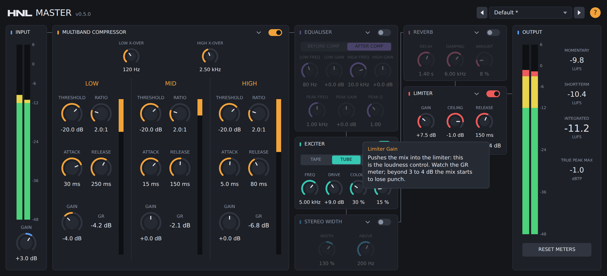
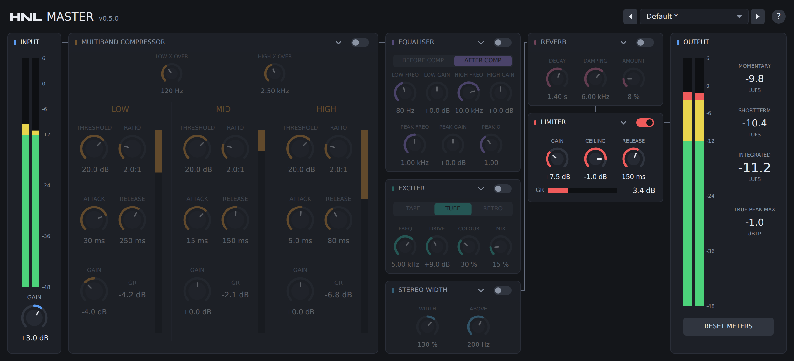

# HNL Master

A mastering chain in one plugin, for the master bus.

| Help tips | Presets | Saving a preset |
| --- | --- | --- |
|  |  |  |

*Rendered from the plugin's drawing code.*

Signal flow, left to right:

| Stage | Controls |
| --- | --- |
| Input | Gain, level meters |
| Multiband compressor | Three bands with adjustable crossovers; threshold, ratio, attack, release and gain per band |
| Equaliser | Low shelf, peak (with Q) and high shelf; before or after the compressor |
| Exciter | Tape, Tube or Retro character; frequency, drive, colour (odd to even harmonics) and mix; 4x oversampled |
| Stereo width | 0 to 200%, widening only above a set frequency; the mono sum never changes |
| Reverb | Decay, damping and amount; lows below 200 Hz stay dry |
| Limiter | Gain, ceiling and release; look-ahead with true-peak detection |
| Output | Level meters, momentary / short-term / integrated loudness (LUFS), true-peak maximum |

The equaliser can stand before the compressor instead of after it: the box under its title chooses. After the
compressor it shapes the tone of the result; before it, the compressor works on the equalised sound. Thin lines
between the stages show the way the sound goes.

Twelve presets are in the menu at the top right. A `*` after the preset name means a control was changed since it
was chosen.

The **?** button next to the presets switches help on: rest the mouse on any control or meter to read what it
does.

## Nothing moves unless you fold it

A stage that is switched off stays where it is and goes dim; its controls still work, so it can be set up before
it is switched on. Switching stages and stepping through presets never moves anything in the window.

The arrow next to a stage's switch folds that stage to its title bar, and the window shrinks to fit. A folded
stage that is on keeps working. Switching a folded stage on opens it; switching it off leaves it folded. What is
folded is kept with the song, not in presets.

Everything on:

As a new instance opens:

Only the limiter on:

The compressor and the stereo width folded:

## Using it

- Drag a knob up or down; hold Shift for fine steps. The mouse wheel also works.
- Double-click or Ctrl-click a knob to return it to its default.
- Reset meters clears the integrated loudness and the true-peak maximum.

The plugin reports its latency to the host (about 4 ms: 184 samples at 44.1 kHz, 196 at 48 kHz, 340 at 96 kHz).

## Installing

[Download HNL-Master-win64.zip](https://github.com/c-kick/hnl-vsts/releases/download/downloads/HNL-Master-win64.zip): the current build, for 64-bit Windows.

The zip holds the plugin as VST3
(copy the `.vst3` folder to `C:\Program Files\Common Files\VST3\`) and as CLAP (copy the `.clap` file to `C:\Program Files\Common Files\CLAP\`). A host needs only one of the
two. Windows 64-bit; the VST3 is tested in Reason.

## Changelog

### 0.5.0 (2026-11-22)

- A stage that is switched off stays where it is and goes dim, instead of collapsing. Switching stages and
  stepping through presets no longer moves the window or the preset selector.
- New: a fold arrow next to each stage's switch folds that stage to its title bar. What is folded is kept with
  the song, not in presets.
- New: the equaliser can stand before the compressor (parameter "EQ Before Compressor").
- New: thin lines between the stages show the way the sound goes.
- A little more room between the modules; the window is 1248 x 568 with everything open.

### 0.4.3 (2026-11-18)

- Fixed: samples and parameter values that are not numbers are caught again in the builds made with clang.

### 0.4.2 (2026-11-17)

- Fixed: a preset's name can be typed in a host that hands over the keys without their text.

### 0.4.1 (2026-11-17)

- The version is shown behind the title.
- The preset menu spreads a long list evenly over its columns.
- A CLAP build next to the VST3.

### 0.4.0 (2026-11-17)

- New: presets of your own, saved, replaced and deleted from the preset menu.

### 0.3.1 (2026-11-17)

- Fixed: a stage that was switched back on could let out old sound or jump in level.
- Guards against samples and parameter values that are not numbers.

### 0.3.0 (2026-11-16)

- New: help tips, and the preset bar shared by all HNL plugins.

### 0.2.0 (2026-11-16)

- New: equaliser, stereo widener, reverb, three exciter characters, presets.

### 0.1.0 (2026-11-16)

- First version: multiband compressor, exciter and true-peak limiter.
