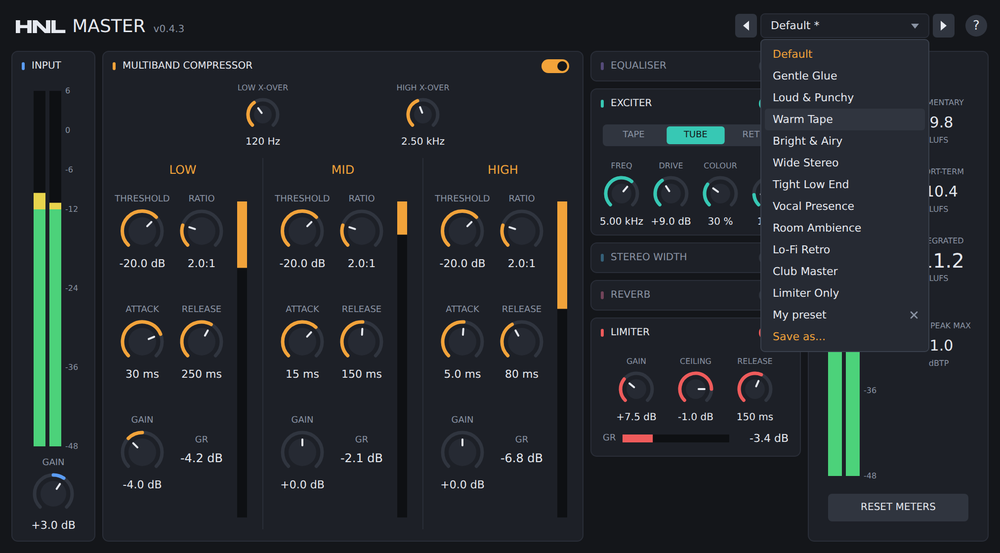

# HNL Master

A mastering chain in one plugin, for the master bus.

| Help tips | Presets | Saving a preset |
| --- | --- | --- |
|  |  |  |

*Rendered from the plugin's drawing code.*

Signal flow, left to right:

| Stage | Controls |
| --- | --- |
| Input | Gain, level meters |
| Multiband compressor | Three bands with adjustable crossovers; threshold, ratio, attack, release and gain per band |
| Equaliser | Low shelf, peak (with Q) and high shelf |
| Exciter | Tape, Tube or Retro character; frequency, drive, colour (odd to even harmonics) and mix; 4x oversampled |
| Stereo width | 0 to 200%, widening only above a set frequency; the mono sum never changes |
| Reverb | Decay, damping and amount; lows below 200 Hz stay dry |
| Limiter | Gain, ceiling and release; look-ahead with true-peak detection |
| Output | Level meters, momentary / short-term / integrated loudness (LUFS), true-peak maximum |

Twelve presets are in the menu at the top right. A `*` after the preset name means a control was changed since it
was chosen.

The **?** button next to the presets switches help on: rest the mouse on any control or meter to read what it
does.

## Compact by design

A stage that is switched off collapses to its title bar, and the window shrinks to fit.

Everything on:

As a new instance opens:

Only the limiter:

## Using it

- Drag a knob up or down; hold Shift for fine steps. The mouse wheel also works.
- Double-click or Ctrl-click a knob to return it to its default.
- Reset meters clears the integrated loudness and the true-peak maximum.

The plugin reports its latency to the host (about 4 ms: 184 samples at 44.1 kHz, 196 at 48 kHz, 340 at 96 kHz).

## Installing

[Download HNL-Master-win64.zip](https://github.com/c-kick/hnl-vsts/releases/download/downloads/HNL-Master-win64.zip): the current build, for 64-bit Windows.

The zip holds the plugin as VST3
(copy the `.vst3` folder to `C:\Program Files\Common Files\VST3\`) and as CLAP (copy the `.clap` file to `C:\Program Files\Common Files\CLAP\`). A host needs only one of the
two. Windows 64-bit; the VST3 is tested in Reason.
