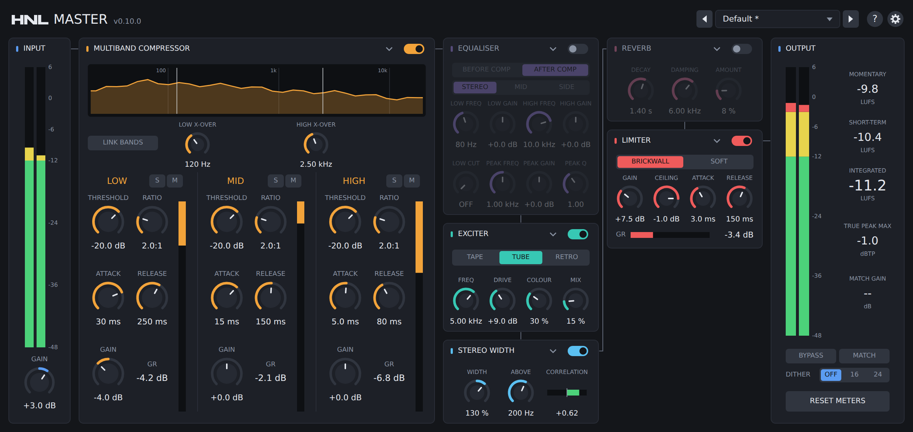

# HNL Master

A mastering chain in one plugin, for the master bus.

| Help tips | Presets | Saving a preset |
| --- | --- | --- |
|  |  |  |

*Rendered from the plugin's drawing code.*

Signal flow, left to right:

| Stage | Controls |
| --- | --- |
| Input | Gain, level meters |
| Multiband compressor | Three bands with adjustable crossovers; threshold, ratio, attack, release and gain per band; the bands can be linked, soloed and muted; a spectrum of what goes in |
| Equaliser | Low cut, low shelf, peak (with Q) and high shelf; before or after the compressor; on left and right, or on the mid or the side part alone |
| Exciter | Tape, Tube or Retro character; frequency, drive, colour (odd to even harmonics) and mix; 4x oversampled |
| Stereo width | 0 to 200%, widening only above a set frequency; the mono sum never changes; a correlation meter |
| Reverb | Decay, damping and amount; lows below 200 Hz stay dry |
| Limiter | Gain, ceiling, attack and release; brickwall (look-ahead) or soft, with true-peak detection |
| Output | Level meters, momentary / short-term / integrated loudness (LUFS), true-peak maximum; bypass with matched loudness; dither to 16 or 24 bit |

The equaliser can stand before the compressor instead of after it: the box under its title chooses. After the
compressor it shapes the tone of the result; before it, the compressor works on the equalised sound. Thin lines
between the stages show the way the sound goes.

## Linked bands, and a soft limiter

**LINK BANDS**, at the top left of the compressor, makes the three bands move together: turn a threshold, ratio,
attack, release or gain, and the same control of the other two bands goes along by as much. The differences
between the bands stay as they are. A band that reaches the end of its range waits there and has its difference
back when the knob is turned back. A double click returns all three to their default. The link is kept with the
song, not in presets, and changes nothing in the sound by itself.

The limiter works in one of two ways, chosen in the box under its title:

- **Brickwall**, as it always was: it looks ahead and turns down before a peak arrives, so nothing passes the
  ceiling. Attack sets how far ahead it starts, from 0.5 to 5 ms; the 3 ms it starts at is what earlier versions
  had fixed. Shorter keeps more punch, longer is smoother.
- **Soft**: no look-ahead. It turns down at the speed of Attack (0.5 to 50 ms), so the peaks that are faster
  pass the ceiling. That sounds more open and less held. The output can then go over the ceiling, by 12 dB at
  most, and what comes after the plugin may clip; the true-peak figure turns red when it does.

## Hearing what the chain does

**BYPASS**, in the output module, gives the sound as it came in. It is as late as the processed sound, so
switching does not skip, and every stage goes dim while it is on.

**MATCH** turns the processed sound to the loudness of the unprocessed one. Louder always sounds better, so
without it a bypass tells you little: with it, switching Bypass on and off compares the sound and not the level.
MATCH GAIN shows by how much it turns, which is how much louder the chain makes the mix. The meters show what
leaves the plugin, so they read lower while Match is on. **Switch Match off before you export.**

**S** and **M** beside the name of each band of the compressor solo and mute it, to set a crossover or a
threshold by ear. More than one band can be soloed; a muted band is silent, soloed or not. They too are for
listening only.

The **spectrum** at the top of the compressor shows what goes into it, from 20 Hz at the left to 20 kHz at the
right, over 72 dB. The two lines are the crossovers. A band that is not heard is dark.

The **correlation** bar in the stereo width module shows how alike left and right are at the output. To the
right they agree; to the left, in red, they work against each other and parts of the sound will be weaker or
gone in mono.

Bypass, Match, solo, mute and dither are parameters like the others, kept with the song, but a preset leaves
them as they are.

## Low cut, mid and side, dither

- **LOW CUT** in the equaliser takes away what lies below its frequency, 12 dB per octave, 15 to 150 Hz. All the
  way down it is off. Rumble is hardly heard, but the compressor and the limiter work on it all the same.
- **STEREO / MID / SIDE** under the equaliser's title chooses what it works on: left and right alike, only the
  middle of the image, or only its width. The low cut always works on everything.
- **DITHER**, in the output module, rounds the result to 16 or 24 bits with dither (triangular, two steps from
  peak to peak, no noise shaping). Set it to the word length you export to, and leave it off for 32 bit float or
  when something else comes after the plugin. The unprocessed sound of Bypass is never dithered.

Twelve presets are in the menu at the top right. A `*` after the preset name means a control was changed since it
was chosen.

The **?** button next to the presets switches help on: rest the mouse on any control or meter to read what it
does.

## Nothing moves unless you fold it

A stage that is switched off stays where it is and goes dim; its controls still work, so it can be set up before
it is switched on. Switching stages and stepping through presets never moves anything in the window.

The arrow next to a stage's switch folds that stage to its title bar, and the window shrinks to fit. A folded
stage that is on keeps working. Switching a folded stage on opens it; switching it off leaves it folded. What is
folded is kept with the song, not in presets.

Everything on:

As a new instance opens:

Only the limiter on:

The compressor and the stereo width folded:

## Found by HNL Analyzer

From version 0.9 on, [HNL Analyzer](../hnl-analyzer) (0.2 or later) in the same song finds HNL Master by itself
and shows its meters beside its own measurement: the input peak, the gain reduction of the three bands and of
the limiter, the limiter's gain and ceiling, the loudness and the true peak. Nothing has to be connected, and it
works in any host. Its sound and its latency are what they were.

From version 0.10 on, the APPLY TO MASTER key of HNL Analyzer (0.3 or later) sets three things here: the limiter's
gain, its ceiling, and the limiter on. They are taken with the next block of audio, kept within the range of each
knob, and the host is told, so that this window follows and the song is saved with them. Nothing else can be set
from outside. As VST3 that is; as CLAP the values are set and saved, but this window shows the old ones until it is
opened again.

For this every instance writes its meters into a small block of memory that the system keeps under a name
(`common/Link.hpp`). The audio thread stores a handful of numbers per block and never waits. `HNL_LINK_NAME=off`
in the environment of the host switches it off.

## Using it

- Drag a knob up or down; hold Shift for fine steps. The mouse wheel also works.
- Double-click or Ctrl-click a knob to return it to its default.
- Reset meters clears the integrated loudness and the true-peak maximum.

The plugin reports its latency to the host (about 6 ms: 273 samples at 44.1 kHz, 292 at 48 kHz, 532 at 96 kHz). It is
the same in both modes of the limiter and at every attack.

## Installing

[Download HNL-Master-win64.zip](https://github.com/c-kick/hnl-vsts/releases/download/downloads/HNL-Master-win64.zip): the current build, for 64-bit Windows.

The zip holds the plugin as VST3
(copy the `.vst3` folder to `C:\Program Files\Common Files\VST3\`) and as CLAP (copy the `.clap` file to `C:\Program Files\Common Files\CLAP\`). A host needs only one of the
two. Windows 64-bit; the VST3 is tested in Reason.

## Changelog

### 0.10.0 (2026-11-28)

- New: HNL Analyzer (0.3 or later) can set the limiter's gain and ceiling and switch the limiter on, with its
  APPLY TO MASTER key. Tested on Linux, and tried in Reason on Windows.

### 0.9.0 (2026-11-28)

- New: HNL Analyzer (0.2 or later) in the same song finds HNL Master and shows its meters and the limiter's gain
  and ceiling. Read only; the sound is unchanged. An instance is found from the moment the host prepares it for
  audio. Tested on Linux, and tried once in Reason on Windows.

### 0.8.0 (2026-11-27)

- New: the window can be made larger and smaller. The cog at the top right lists the sizes (75 to 200 %) under the
  looks, and where the host allows it the window can be dragged by its edge, down to three quarters of its design
  size. It keeps its shape, everything in it is drawn anew at the size it has, and it opens next time at the size
  it was left at. The size is kept for this plugin, not in the song, and changes nothing about the sound.

### 0.7.0 (2026-11-24)

- New: the limiter can be soft instead of a brickwall (parameter "Limiter Soft"): it then reacts at the speed
  of Attack, and the fastest peaks pass the ceiling. Brickwall stays the default.
- New: an Attack knob on the limiter (parameter "Limiter Attack"). As a brickwall it is the look-ahead, 0.5 to
  5 ms; soft it is the attack time, up to 50 ms. At its default of 3 ms the brickwall sounds as it did.
- New: LINK BANDS in the compressor makes the controls of the three bands move together. Kept with the song.
- The latency is 2 ms longer (about 6 ms), to hold the longest look-ahead; it does not change with the mode or
  the attack.
- New: BYPASS and MATCH in the output module (parameters "Bypass" and "Match Loudness"): the unprocessed sound,
  and the processed sound at the same loudness, to compare the two fairly.
- New: solo and mute for each band of the compressor.
- New: a spectrum of what goes into the compressor, with the crossovers in it.
- New: a low cut in the equaliser (parameter "EQ Low Cut"), and the equaliser on the mid or the side part alone
  (parameter "EQ Works On").
- New: a correlation meter in the stereo width module.
- New: dither to 16 or 24 bit (parameter "Dither").
- A preset leaves bypass, match, solo, mute and dither as they are.
- The window is 24 pixels higher, 1248 x 592 with everything open, and the compressor's knobs stand lower to
  make room for the spectrum. The limiter is 22 pixels higher, for the box that chooses its mode.

### 0.6.0 (2026-11-22)

- New: three looks. Classic, the look the plugin has always had, stays the default; Hi-Fi Black and Hi-Fi Silver
  dress the same window as a piece of hi-fi equipment. The cog at the top right chooses, for every HNL plugin at
  once. The choice changes nothing about the sound and is not stored in the song.
- To make room for the cog, the preset bar and the help button stand 28 pixels further left.

### 0.5.0 (2026-11-22)

- A stage that is switched off stays where it is and goes dim, instead of collapsing. Switching stages and
  stepping through presets no longer moves the window or the preset selector.
- New: a fold arrow next to each stage's switch folds that stage to its title bar. What is folded is kept with
  the song, not in presets.
- New: the equaliser can stand before the compressor (parameter "EQ Before Compressor").
- New: thin lines between the stages show the way the sound goes.
- A little more room between the modules; the window is 1248 x 568 with everything open.

### 0.4.3 (2026-11-18)

- Fixed: samples and parameter values that are not numbers are caught again in the builds made with clang.

### 0.4.2 (2026-11-17)

- Fixed: a preset's name can be typed in a host that hands over the keys without their text.

### 0.4.1 (2026-11-17)

- The version is shown behind the title.
- The preset menu spreads a long list evenly over its columns.
- A CLAP build next to the VST3.

### 0.4.0 (2026-11-17)

- New: presets of your own, saved, replaced and deleted from the preset menu.

### 0.3.1 (2026-11-17)

- Fixed: a stage that was switched back on could let out old sound or jump in level.
- Guards against samples and parameter values that are not numbers.

### 0.3.0 (2026-11-16)

- New: help tips, and the preset bar shared by all HNL plugins.

### 0.2.0 (2026-11-16)

- New: equaliser, stereo widener, reverb, three exciter characters, presets.

### 0.1.0 (2026-11-16)

- First version: multiband compressor, exciter and true-peak limiter.
