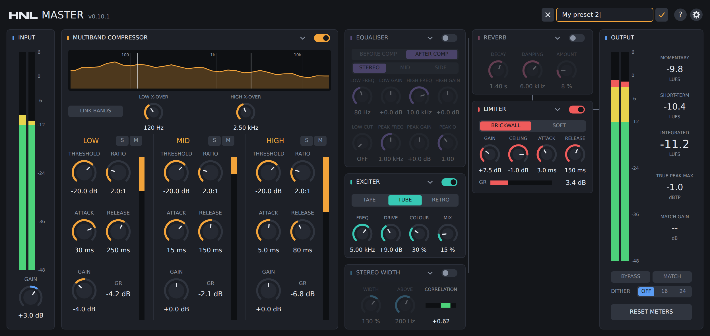
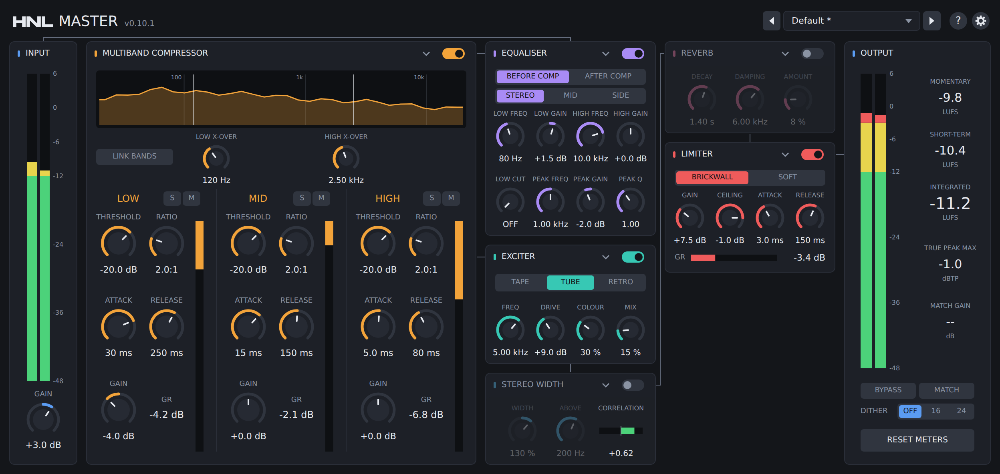
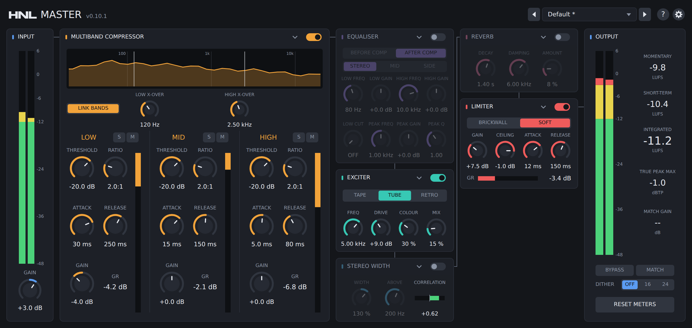
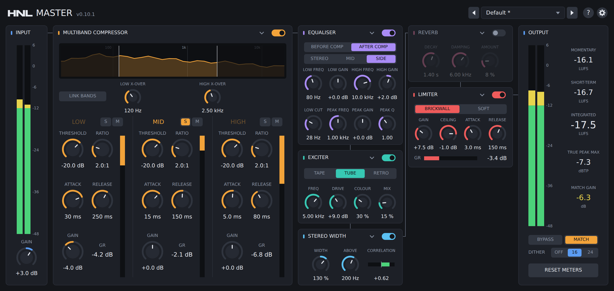
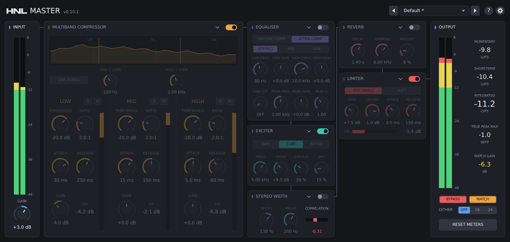
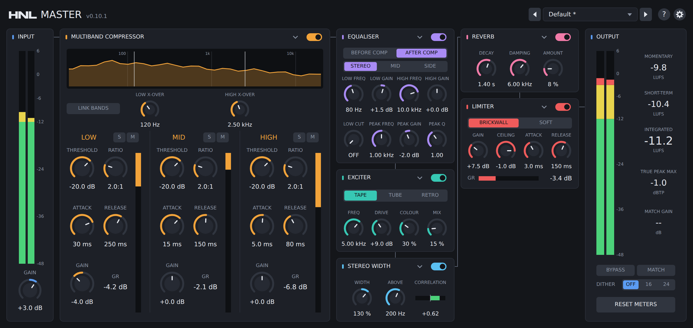
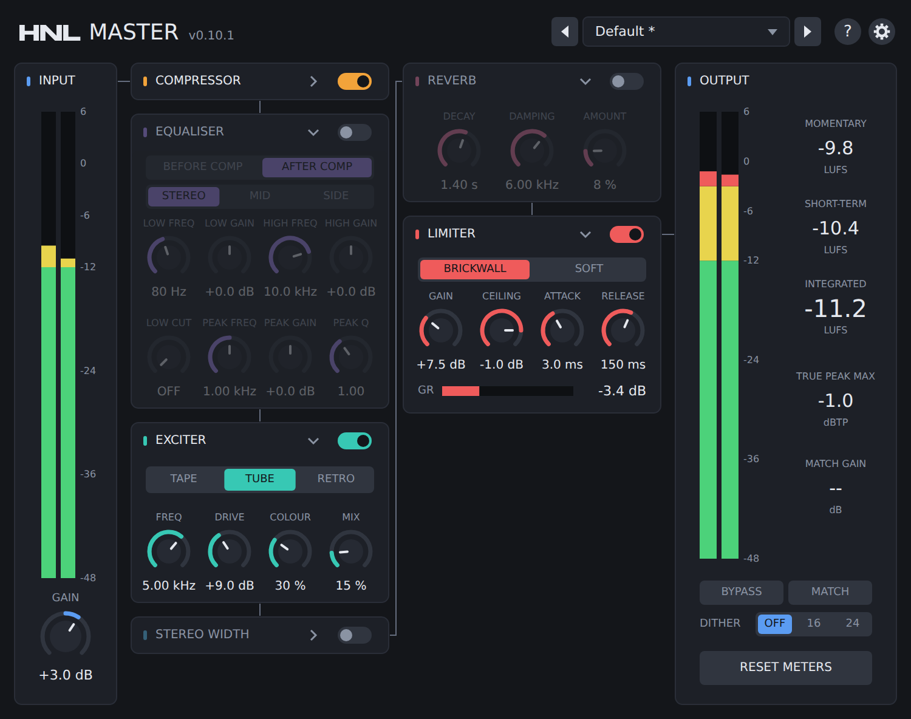

# HNL Master

A mastering chain in one plugin, for the master bus. The sound goes through a multiband compressor, an
equaliser, an exciter, a stereo widener, a reverb and a true-peak limiter, with meters at both ends. Each stage
has its own switch, so you use only what the song needs.

| Help tips | Presets | Saving a preset |
| --- | --- | --- |
|  |  |  |

*These pictures are rendered from the plugin's drawing code.*

## Quick start

1. Put HNL Master on the master bus.
2. Pick a preset from the menu at the top right as a starting point, or start from the default.
3. Switch the stages you want on and the others off. A stage that is off can still be set up.
4. Set the limiter. **Gain** makes the master louder, **Ceiling** is the level the peaks are held under. The
   loudness and true-peak figures in the output module show where you are.
5. Switch **MATCH** on and click **BYPASS** on and off. Both sounds are now equally loud, so you hear what the
   chain does and not only that it is louder.
6. Before you export, switch Match, Bypass, solo and mute off, and set **DITHER** to the word length of the
   file.

The **?** button next to the presets switches on help tips. Rest the mouse on any control or meter to read what
it does.

## The chain

The sound runs through the stages from left to right.

| Stage | Controls |
| --- | --- |
| Input | Gain, level meters |
| Multiband compressor | Three bands with adjustable crossovers; threshold, ratio, attack, release and gain per band; the bands can be linked, soloed and muted; a spectrum of what goes in |
| Equaliser | Low cut, low shelf, peak (with Q) and high shelf; before or after the compressor; on left and right, or on the mid or the side part alone |
| Exciter | Tape, Tube or Retro character; frequency, drive, colour (odd to even harmonics) and mix; 4x oversampled |
| Stereo width | 0 to 200%, widening only above a set frequency; the mono sum never changes; a correlation meter |
| Reverb | Decay, damping and amount; lows below 200 Hz stay dry |
| Limiter | Gain, ceiling, attack and release; brickwall (look-ahead) or soft, with true-peak detection |
| Output | Level meters, momentary / short-term / integrated loudness (LUFS), true-peak maximum; bypass with matched loudness; dither to 16 or 24 bit |

The equaliser normally sits after the compressor, where it shapes the tone of the result. The box under its
title moves it in front, and then the compressor works on the equalised sound. Thin lines between the stages
show the route the sound takes.

## Compressor

**LINK BANDS**, at the top left of the compressor, makes the three bands move together. Turn a threshold,
ratio, attack, release or gain and the same control of the other two bands moves by the same amount, so the
differences between the bands are kept. A band that reaches the end of its range waits there, and gets its
difference back when you turn the knob the other way. A double click returns all three to their default. The
link is saved with the song, not in presets, and switching it on or off does not change the sound.

**S** and **M** next to the name of each band solo and mute it, which helps when you set a crossover or a
threshold by ear. You can solo more than one band. A muted band is silent even when it is soloed. Both are for
listening only.

The **spectrum** at the top of the compressor shows what goes into it, from 20 Hz on the left to 20 kHz on the
right, over 72 dB. The two lines are the crossovers. A band you cannot hear at the moment is drawn dark.

## Equaliser

- **LOW CUT** removes everything below its frequency, at 12 dB per octave, from 15 to 150 Hz. Turned all the way
  down it is off. You hardly hear rumble, but the compressor and the limiter react to it all the same.
- **STEREO / MID / SIDE** under the equaliser's title chooses what the equaliser works on: left and right
  alike, only the middle of the image, or only its width. The low cut always works on everything.

## Stereo width

The **correlation** bar shows how alike left and right are at the output. To the right they agree. To the left,
in red, they work against each other, and parts of the sound will be weaker or gone in mono.

## Limiter

The box under the limiter's title chooses between two ways of working:

- **Brickwall** looks ahead and turns the level down before a peak arrives, so nothing passes the ceiling.
  Attack sets how far ahead it starts, from 0.5 to 5 ms. The default is 3 ms, which is the fixed value that
  versions before 0.7 used. Shorter keeps more punch, longer is smoother.
- **Soft** does not look ahead. It turns down at the speed of Attack (0.5 to 50 ms), so peaks faster than that
  pass the ceiling. The result sounds more open and less held back. The output can go over the ceiling, by 12 dB
  at most, and whatever comes after the plugin may clip. The true-peak figure turns red when that happens.

## Output: comparing, metering and dither

**BYPASS** lets you hear the sound as it came in. The unprocessed sound is delayed by as much as the processed
one, so switching does not skip. Every stage goes dim while Bypass is on.

**MATCH** brings the processed sound to the loudness of the unprocessed one. Louder always sounds better, so
without Match a bypass tells you little. With it, switching Bypass on and off compares the sound and not the
level. MATCH GAIN shows how far Match is turning, which is how much louder the chain makes the mix. The meters
show what leaves the plugin, so they read lower while Match is on. **Switch Match off before you export.**

**DITHER** rounds the result to 16 or 24 bits with dither (triangular, two steps from peak to peak, no noise
shaping). Set it to the word length you export to. Leave it off for 32 bit float, or when something else comes
after the plugin. The unprocessed sound you hear with Bypass is never dithered.

The loudness meter shows momentary (the last 0.4 s), short-term (the last 3 s) and integrated loudness.
**Reset meters** clears the integrated loudness and the true-peak maximum. Click it before you play the song
through for a reading.

Bypass, Match, solo, mute and dither are parameters like the others and are saved with the song, but choosing a
preset does not change them.

## Presets and help

The menu at the top right holds twelve presets. A `*` after the preset name means a control has been changed
since you chose it. *Save as...* at the end of the list keeps your own settings under a name, for use in every
song.

The **?** button next to the presets switches help on. Rest the mouse on any control or meter to read what it
does.

## Knobs

- Drag a knob up or down. Hold Shift for fine steps. The mouse wheel also works.
- Double-click or Ctrl-click a knob to return it to its default.

## The window

A stage that is switched off stays in place and goes dim. Its controls still work, so you can set it up before
you switch it on. Switching stages and stepping through presets never moves anything in the window.

The arrow next to a stage's switch folds that stage down to its title bar, and the window shrinks to fit. A
folded stage that is on keeps working. Switching a folded stage on opens it, and switching it off leaves it
folded. Which stages are folded is saved with the song, not in presets.

The cog at the top right lists the looks and the window sizes (75 to 200 %). Where the DAW allows it you can
also drag the window by its edge. The size is remembered for this plugin, not per song.

Everything on:

A new instance:

Only the limiter on:

The compressor and the stereo width folded:

## Working with HNL Analyzer

When [HNL Analyzer](../hnl-analyzer) (0.2 or later) is in the same song as HNL Master 0.9 or later, the two
plugins find each other. There is nothing to connect or set up. Analyzer then shows Master's meters next to its
own measurement: the input peak, the gain reduction of the three compressor bands and of the limiter, the
limiter's gain and ceiling, the loudness and the true peak. This does not change Master's sound or its latency.

From HNL Master 0.10, the **APPLY TO MASTER** key in Analyzer (0.3 or later) sets three things here, according
to Analyzer's advice:

- the limiter's **Ceiling** goes to your maximum true peak,
- the limiter's **Gain** goes up or down by the required gain,
- the limiter is switched **on** if it was off.

The values stay within the range of each knob (0 to 24 dB for the gain, -6 to 0 dB for the ceiling). Master's
window follows the change and the new values are saved with the song. Nothing else in Master can be set from
outside. Analyzer will not send anything while Bypass or Match is on here, so switch those off first.

The [Analyzer manual](../hnl-analyzer#apply-to-master) describes how to use the key.

## Latency

The plugin reports its latency to the DAW. It is about 6 ms: 273 samples at 44.1 kHz, 292 at 48 kHz and 532 at
96 kHz. It is the same in both limiter modes and at every attack setting.

## Installing

[Download HNL-Master-win64.zip](https://github.com/c-kick/hnl-vsts/releases/download/downloads/HNL-Master-win64.zip): the current build, for 64-bit Windows.

The zip holds the plugin as VST3 and as CLAP. Copy the `.vst3` folder to
`C:\Program Files\Common Files\VST3\`, or the `.clap` file to `C:\Program Files\Common Files\CLAP\`. Your DAW
needs only one of the two.

## Limits

- Windows 64-bit only.
- In Soft mode the limiter lets fast peaks through, up to 12 dB over the ceiling. Use Brickwall when nothing may
  pass the ceiling.
- Match, Bypass, solo and mute are for listening. They are saved with the song, so check them before you export.
- The dither has no noise shaping.
- APPLY TO MASTER reaches the limiter's gain, ceiling and on switch only.
- When HNL Master runs as CLAP, APPLY TO MASTER sets and saves the values, but this window shows the old ones
  until you close and reopen it. As VST3 it follows at once.

## What has and has not been tried

Tried in Reason on Windows, as VST3:

- The plugin itself.
- Being found by HNL Analyzer, with its meters shown there.
- APPLY TO MASTER from HNL Analyzer.

The link with HNL Analyzer and APPLY TO MASTER are also covered by automated tests, which run on Linux.

Not tried yet:

- **Other DAWs.**
- **The CLAP build** in a DAW.

## For developers

### Tests

`tests/run.sh` builds and runs the tests:

- `dsp_test` measures the audio engine. It runs twice: plainly, and with the flags the plugin is built with.
- `plugin_test` runs the plugin in DPF's wrapper.
- `abuse_test` does everything a DAW is allowed to do (`common/tests/HostAbuse.hpp`).
- `ui_presets_test`, `ui_fold_test` and `ui_link_test` click in the window itself: saving, loading and deleting
  a preset, folding stages, linking the bands and switching the limiter's mode.
- `ui_skin_test` and `ui_size_test`, shared by all plugins, check the looks and the window sizes.

### The link with HNL Analyzer

Every instance of HNL Master writes its meters into a small block of memory that the system keeps under a name
(`common/Link.hpp`). The audio thread stores a handful of numbers per block and never waits. What APPLY TO
MASTER sends is taken up with the next block of audio, clamped to the range of each knob, and reported to the
DAW, which is why the window follows and the song is saved with the new values.

Setting `HNL_LINK_NAME=off` in the DAW's environment switches the link off.

### Parameters

Every control in the window is a parameter the DAW can automate, 58 in all (`Params.hpp`). The DAW can also read
the meters: input and output level, true peak, the gain reduction of the three bands and of the limiter, the
three loudness figures, the match gain, the correlation and the 32 bands of the spectrum. Link Bands and the
folding of stages are saved with the song but are not parameters.

## Changelog

### 0.10.1 (2026-11-28)

- Fixed: on Windows, on a display set to another scale than 100 %, clicks could land beside what was drawn, so that
  knobs and buttons did not answer or another one did. The window was made larger for the display's scale without
  the plugin being told, and it read every click that much too far right and down (at 125 %, a quarter). It now goes
  by the size its window really has. Reported for HNL Sampler in Cubase and Studio One; found by reading the code
  that makes the window, and not yet seen fixed in those DAWs themselves.

### 0.10.0 (2026-11-28)

- New: HNL Analyzer (0.3 or later) can set the limiter's gain and ceiling and switch the limiter on, with its
  APPLY TO MASTER key. Tested on Linux, and tried in Reason on Windows.

### 0.9.0 (2026-11-28)

- New: HNL Analyzer (0.2 or later) in the same song finds HNL Master and shows its meters and the limiter's gain
  and ceiling. Read only; the sound is unchanged. An instance is found from the moment the host prepares it for
  audio. Tested on Linux, and tried once in Reason on Windows.

### 0.8.0 (2026-11-27)

- New: the window can be made larger and smaller. The cog at the top right lists the sizes (75 to 200 %) under the
  looks, and where the host allows it the window can be dragged by its edge, down to three quarters of its design
  size. It keeps its shape, everything in it is drawn anew at the size it has, and it opens next time at the size
  it was left at. The size is kept for this plugin, not in the song, and changes nothing about the sound.

### 0.7.0 (2026-11-24)

- New: the limiter can be soft instead of a brickwall (parameter "Limiter Soft"): it then reacts at the speed
  of Attack, and the fastest peaks pass the ceiling. Brickwall stays the default.
- New: an Attack knob on the limiter (parameter "Limiter Attack"). As a brickwall it is the look-ahead, 0.5 to
  5 ms; soft it is the attack time, up to 50 ms. At its default of 3 ms the brickwall sounds as it did.
- New: LINK BANDS in the compressor makes the controls of the three bands move together. Kept with the song.
- The latency is 2 ms longer (about 6 ms), to hold the longest look-ahead; it does not change with the mode or
  the attack.
- New: BYPASS and MATCH in the output module (parameters "Bypass" and "Match Loudness"): the unprocessed sound,
  and the processed sound at the same loudness, to compare the two fairly.
- New: solo and mute for each band of the compressor.
- New: a spectrum of what goes into the compressor, with the crossovers in it.
- New: a low cut in the equaliser (parameter "EQ Low Cut"), and the equaliser on the mid or the side part alone
  (parameter "EQ Works On").
- New: a correlation meter in the stereo width module.
- New: dither to 16 or 24 bit (parameter "Dither").
- A preset leaves bypass, match, solo, mute and dither as they are.
- The window is 24 pixels higher, 1248 x 592 with everything open, and the compressor's knobs stand lower to
  make room for the spectrum. The limiter is 22 pixels higher, for the box that chooses its mode.

### 0.6.0 (2026-11-22)

- New: three looks. Classic, the look the plugin has always had, stays the default; Hi-Fi Black and Hi-Fi Silver
  dress the same window as a piece of hi-fi equipment. The cog at the top right chooses, for every HNL plugin at
  once. The choice changes nothing about the sound and is not stored in the song.
- To make room for the cog, the preset bar and the help button stand 28 pixels further left.

### 0.5.0 (2026-11-22)

- A stage that is switched off stays where it is and goes dim, instead of collapsing. Switching stages and
  stepping through presets no longer moves the window or the preset selector.
- New: a fold arrow next to each stage's switch folds that stage to its title bar. What is folded is kept with
  the song, not in presets.
- New: the equaliser can stand before the compressor (parameter "EQ Before Compressor").
- New: thin lines between the stages show the way the sound goes.
- A little more room between the modules; the window is 1248 x 568 with everything open.

### 0.4.3 (2026-11-18)

- Fixed: samples and parameter values that are not numbers are caught again in the builds made with clang.

### 0.4.2 (2026-11-17)

- Fixed: a preset's name can be typed in a host that hands over the keys without their text.

### 0.4.1 (2026-11-17)

- The version is shown behind the title.
- The preset menu spreads a long list evenly over its columns.
- A CLAP build next to the VST3.

### 0.4.0 (2026-11-17)

- New: presets of your own, saved, replaced and deleted from the preset menu.

### 0.3.1 (2026-11-17)

- Fixed: a stage that was switched back on could let out old sound or jump in level.
- Guards against samples and parameter values that are not numbers.

### 0.3.0 (2026-11-16)

- New: help tips, and the preset bar shared by all HNL plugins.

### 0.2.0 (2026-11-16)

- New: equaliser, stereo widener, reverb, three exciter characters, presets.

### 0.1.0 (2026-11-16)

- First version: multiband compressor, exciter and true-peak limiter.
