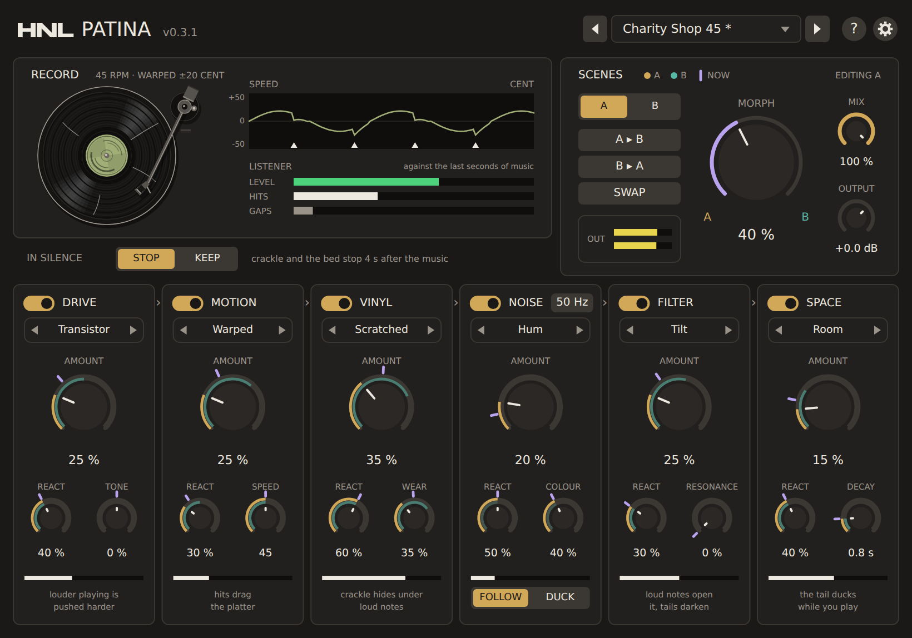
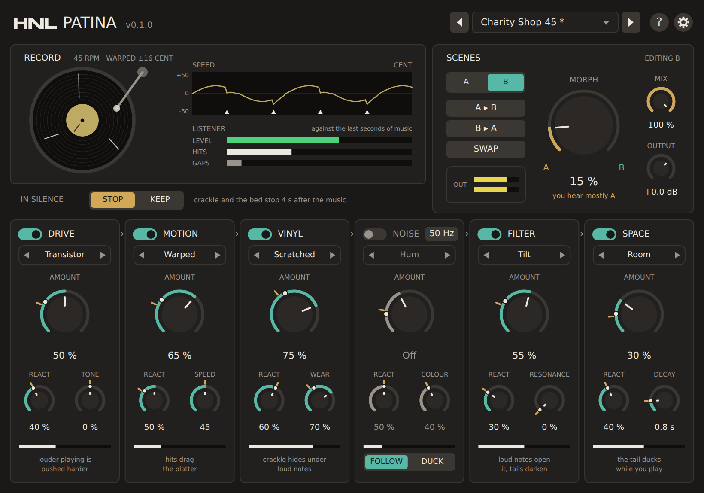
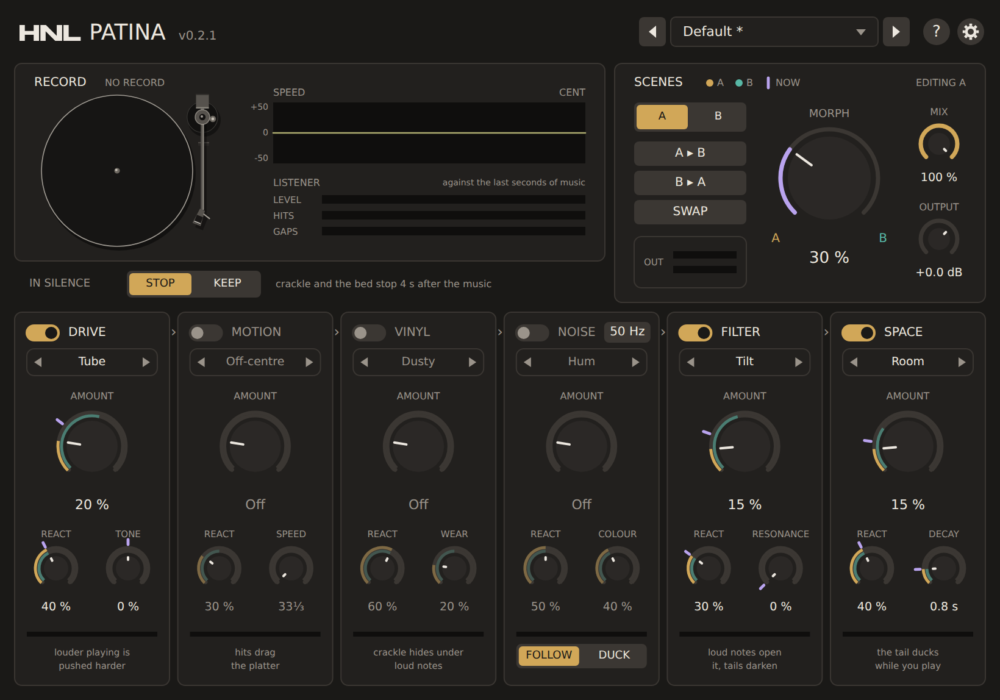
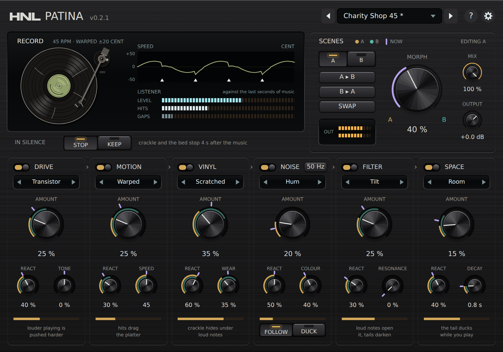
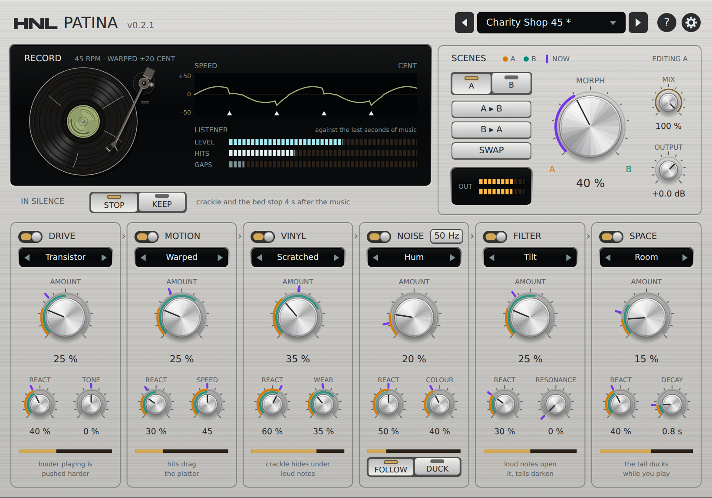
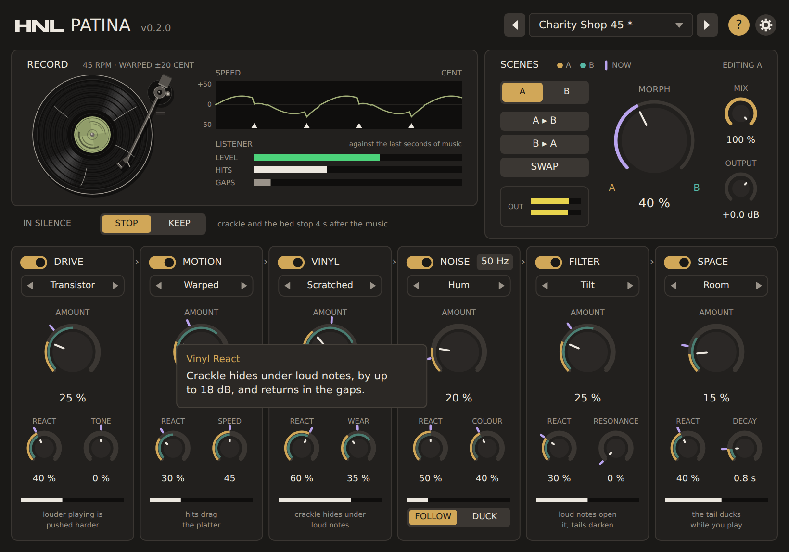
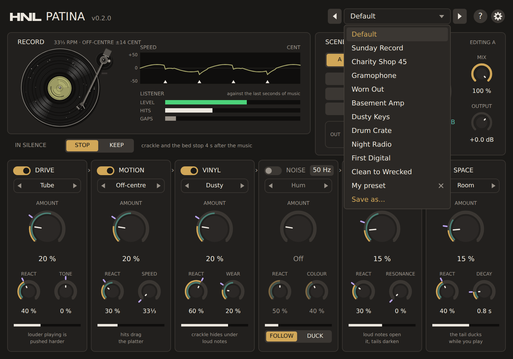
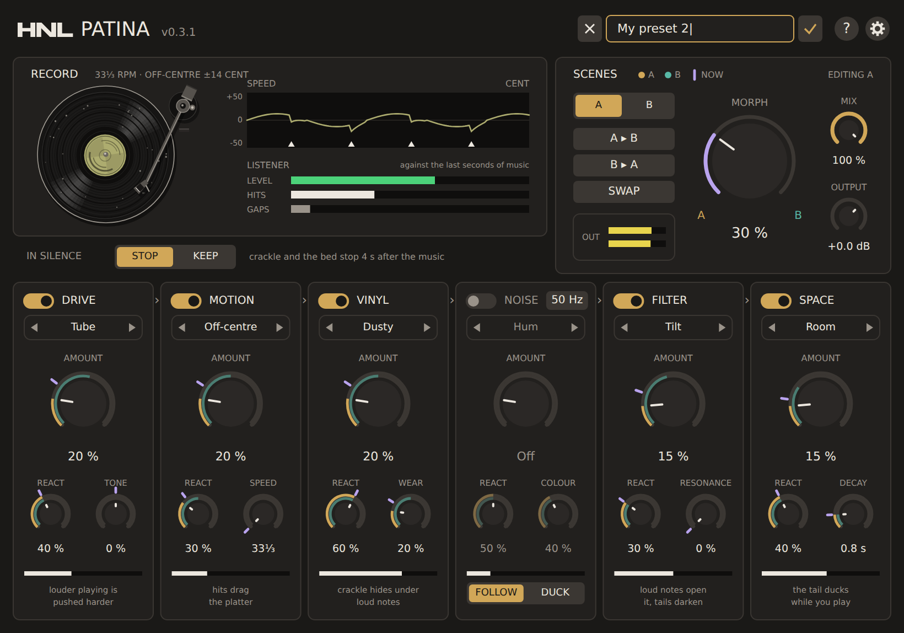

# HNL Patina

Makes a clean sound old. It has six modules in a row, each with one Amount knob: a gain stage, a record that
does not run true, the surface of that record, a noise bed, a filter and a room. Three things set it apart:

- **It listens to the music.** Every module has a React knob. Crackle hides under loud notes, loud playing is
  driven harder, a hit drags the record's speed down for a moment. The wear plays along with the part.
- **One record turns under all of it.** The movement comes from a turntable, not from tape. The same turning
  record places the scratches, and each of them passes the needle once a turn.
- **Two scenes and a morph.** A preset holds two complete settings, A and B, and one dial goes from one to
  the other.

There is no tape in it. HNL Tape Master and HNL Tape Echo do tape.

| Scene B on the knobs, Morph close to A | No record: Motion and Vinyl off |
| --- | --- |
|  |  |

| Hi-Fi Black | Hi-Fi Silver |
| --- | --- |
|  |  |

| Help tips | Presets | Saving a preset |
| --- | --- | --- |
|  |  |  |

*These pictures are rendered from the plugin's drawing code, not taken from a DAW.*

**This is a beta.** It passes its tests and has been tried in Reason, but it is young. Expect rough edges.

## Quick start

1. Put HNL Patina on the sound you want to age.
2. Pick a preset from the preset menu. The factory presets have a mild scene A and a heavy scene B of the
   same character.
3. Turn **Morph** from A towards B for more of it.
4. To change a scene, choose it with **A / B** and turn the knobs. Each module has its own on/off switch.
5. Use **Mix** to blend the result with the untouched sound.

The **?** button switches on help tips for every control.

## How it works

    in ─┬─► drive ─► motion ─► vinyl ─► noise ─► filter ─► space ─► mix ─► output
        │               ▲         ▲        ▲        ▲                ▲
        │               └─────────┴─ platter (angle, speed) ─┘       │
        ├─► listener ─► React of every module                        │
        └─► (untouched, delayed by the reported latency) ────────────┘

Every module has an on/off switch, a type, **Amount**, **React** and one knob of its own. At Amount 0 a
module passes its input unchanged, sample for sample, whatever else is set.

| Module | Types | Amount | React | Own knob |
| --- | --- | --- | --- | --- |
| Drive | Tube, Transistor, Diode, Fuzz | Up to 36 dB of gain into the stage; the level stays the same | Loud playing is pushed up to 9 dB harder | Tone |
| Motion | Off-centre, Warped, Slipping Belt, Tired Motor | Pitch movement, up to ±50 cent | Hits drag the platter | Speed: 33⅓, 45, 78 |
| Vinyl | Dusty, Scratched, Worn Groove, Shellac | Surface noise and wear | Crackle hides under loud notes | Wear |
| Noise | Hum, Buzz, Static, Room Tone | Level of the bed | Follow or Duck (a switch) | Colour |
| Filter | Tilt, Band, Ladder | How far it closes | Loud notes open it | Resonance |
| Space | Room, Chamber, Spring, Early Digital | Level of the reverb | The tail ducks while you play | Decay, 0.2 to 4 s |

- **The listener** measures each moment against the last few seconds of music, not against full scale. A jump
  of 6 dB reads the same at -40 dBFS as at -6, so React needs no threshold. A sound that stays at one level,
  such as a held pad or a finished mix, gives React little to follow.
- **The record** is Motion and Vinyl together. With both off there is no record, and the other modules get
  the sound as it came out of Drive. With Motion off and Vinyl on the record still turns, at Speed, so the
  scratches keep their rhythm.
- **Scratched** has one to six scratches, more as you turn Amount up. Each clicks at the same place in every
  turn. That is 1.8 s apart at 33⅓, 1.33 s at 45 and 0.77 s at 78.
- **Noise** has no hiss. Hum and Buzz sound at the mains frequency, 50 or 60 Hz. You set that with a button in
  the module's title row. It is saved with the song and presets do not change it.
- **Space** comes last, around the worn sound. Whatever the type, the reverb is mono below 200 Hz. Early
  Digital runs at 12 kHz with 12 bits, and its tail ends abruptly, as it did on those machines.
- **In Silence** sets what the plugin's own sounds (crackle, rumble, the bed) do when the music stops. With
  Stop they go on for 4 seconds and then fade out in 2. They are there in a gap between phrases and gone after
  the song. With Keep they go on, which gives you crackle before the first note.

### Scenes and Morph

A scene is everything the six modules hold. **A / B** chooses which scene the knobs show and change, and that
choice is saved with the song.

Around each knob are two arcs, always in the same place and each in the colour of its scene. The outer arc is
the knob in scene A, the inner one in scene B. The scene you are editing is drawn stronger. Morph has a colour
of its own: a short line outside the arcs shows where Morph has the knob now, and that is what you hear.

**Morph** goes from A (0%) to B (100%). At either end the sound is exactly that scene. In between:

- **Knobs** move straight from one value to the other.
- **A module that is off in one scene** fades in over the whole morph, with the type of the scene in which it
  is on.
- **A module that is on in both scenes with different types** changes over at 50%. It is turned down to
  nothing in 25 ms, changes type, and comes back in 25 ms. Morph then has to come back below 48% before the
  module changes again, so a morph held at 50% does not chatter.
- **Motion** changes type without that dip. Its movement glides from one type to the other.

**A ▸ B**, **B ▸ A** and **Swap** copy and exchange the scenes. **Mix** is separate from all this. It sets how
much of the result you hear next to the untouched signal.

## Controls

| Control | What it changes |
| --- | --- |
| Morph | 0 to 100%: from scene A to scene B. |
| Mix | 0 to 100%: the result next to the untouched signal. With Motion on, less than 100% is a slow chorus: the sound next to a copy of itself that moves in pitch. |
| Output | -24 to +12 dB. Not part of a preset. |
| In Silence | Stop or Keep: whether the plugin's own sounds stop after the music. |
| A / B | Which scene the knobs show and change. |
| A ▸ B, B ▸ A, Swap | Copy one scene over the other, or exchange them. |
| The switch in a module's title | The module on or off, in the scene being edited. |
| The window under it | The module's type: click its right half for the next, its left half for the previous. |
| Amount, React, the third knob | See the table above. Drag up and down, Shift for fine steps, double-click or Ctrl-click for the default, or use the mouse wheel. |
| 50 Hz / 60 Hz (Noise) | The mains frequency of Hum and Buzz. Not part of a preset. |
| Follow / Duck (Noise) | What React does to the bed. |
| The cog | The look of the window: Classic, Hi-Fi Black or Hi-Fi Silver, for all HNL plugins at once. |

**Presets.** The preset menu holds eleven presets, each with two scenes, and *Save as...* keeps your own.
Presets leave Output and the mains frequency alone.

**Help.** The **?** button switches help on. Rest the mouse on any control to read what it does.

## Measured

At 48 kHz, one module on at a time unless said otherwise.

| What | Result |
| --- | --- |
| Latency | 36 samples + 12 ms: 612 samples at 48 kHz, 565 at 44.1, 1188 at 96. The same for every setting |
| All modules off, or Mix 0 with all of them on | The input, that much later, exactly |
| Off-centre, Amount 100% | ±50.7 cent at every speed; the delay swings 8.4 ms at 33⅓, 6.2 at 45, 3.6 at 78 |
| Warped, Tired Motor, Amount 100% | ±50.7 and ±52 cent |
| Slipping Belt, Amount 100% | 5 to 7 cent, slowly and without a pattern |
| A hit, React 100% | The pitch sags 17.5 cent |
| 8 hits a second for 12 s, Amount and React 100% | The delay stays within 11 ms of its centre and never jumps |
| Crackle under a steady loud tone, React 100% against 0 | 18 dB down |
| Wear, at 8 kHz and Amount 100% | -2 dB at Wear 0, -24 dB at Wear 100% |
| Hum at Amount 100% | Fundamental and octave at -20 dBFS; -19 dBFS in all |
| Buzz, Static, Room Tone at Amount 100% | -23, -29 and -30 dBFS |
| Noise, Follow: after the music stops | Gone (73 dB down) three seconds later |
| Noise, Duck: in a gap against under the music | 18 dB up |
| Drive, any type and Amount | Output within 0.01 dB of the input level, on a steady tone |
| Drive's harmonics at Amount 25% and 100% | Tube -20 and -10 dB, Transistor -25 and -10, Diode -29 and -11, Fuzz -11 at both |
| Filter at Amount 60%: 60 Hz, 1 kHz, 8 kHz | Tilt 0, -5, -11 dB. Band -15, 0, -8. Ladder 0, -9, -68 |
| Ladder at its corner, Resonance 0 and 80% | -12 and +9 dB |
| Space under a steady tone, React 100% against 0 | 12 dB down |
| Everything on, two heavy scenes | 4% of one processor core on the machine that ran the tests |

## The window

The cog at the top right lists the looks (Classic, Hi-Fi Black and Hi-Fi Silver) and the window sizes (75 to
200 %). Where the DAW allows it you can also drag the window by its edge. The look applies to every HNL plugin
at once, and the size is remembered for this plugin. Neither is saved with the song or changes the sound.

## Limits

- **Latency.** The plugin is 13 ms late and tells the DAW so. That is the price of ±50 cent on a record at
  33⅓. In a moving delay the pitch is off by the rate at which the delay changes, and a slow swing needs a long
  delay. If you play keys through it live, you will feel it.
- **A change of type cuts the old type's sound in 25 ms.** For Space that cuts the old tail. Letting it ring
  out while the new one comes in needs two reverbs running at once, and that is not built.
- **The record's speed is not tied to the song's tempo.**

## For developers

### Tests

`tests/run.sh` runs seven test programs:

- `dsp_test` measures the engine. It runs twice: plainly, and with the flags the plugin is built with.
- `plugin_test` runs the plugin in DPF's wrapper.
- `abuse_test` does everything a DAW is allowed to do (`common/tests/HostAbuse.hpp`).
- `ui_presets_test`, `ui_scenes_test`, `ui_skin_test` and `ui_size_test` drive the window itself, on the
  drawing stand-in: the presets, the scenes, the choice of look and the size of the window.

### Code

- `dsp/Listener.hpp`: what the plugin hears in the music. No sound passes through it.
- `dsp/Platter.hpp`: the turning record and what it does to the length of a delay, and the table of where
  the scratches lie, which the window draws from as well.
- `dsp/Modules.hpp`: Drive, Vinyl, Noise, Filter and Space.
- `dsp/Patina.hpp`: the engine, with the scenes and Morph, what React makes of the listener, the latency and
  Mix.
- `dsp/Parts.hpp`: a fixed random sequence (a song renders the same every time from the same start) and
  the moving delay. The small room and the spring are shared with HNL Thickener and HNL Tape Echo:
  `common/dsp/Room.hpp` and `common/dsp/Spring.hpp`.
- `Params.hpp`: 67 inputs (5 for the plugin, 31 for each scene) and 13 outputs for the window. Their order
  is permanent.

## Changelog

### 0.3.0 (2026-11-27)

- New: the window can be made larger and smaller. The cog at the top right lists the sizes (75 to 200 %) under the
  looks, and where the host allows it the window can be dragged by its edge, down to three quarters of its design
  size. It keeps its shape, everything in it is drawn anew at the size it has, and it opens next time at the size
  it was left at. The size is kept for this plugin, not in the song, and changes nothing about the sound.

### 0.2.1 (2026-11-22)

- The plugin is a beta now: it has been played in a host. Nothing else changed.

### 0.2.0 (2026-11-22), alpha

- New: every knob of a module shows both scenes at once, as two arcs in the colours of A and B, where it showed
  the scene being edited as an arc and the other as a tick. Morph has its own colour, on its dial and as a short
  line at every knob for the value Morph makes of the two. Hi-Fi Silver has stronger inks for the three colours.
- New: the turntable is drawn again: a platter with a mat and a bright rim, a record with grooves, gaps between
  the songs, light on it and a printed label, and an arm with its weight, bearing and head that turns on its
  bearing and lies beside the platter when there is no record. The record shows the Vinyl type: dust, scratches
  where they click, a worn groove, a 78 with its large label.

### 0.1.0 (2026-11-22), alpha

- First version, not yet played in a host.
