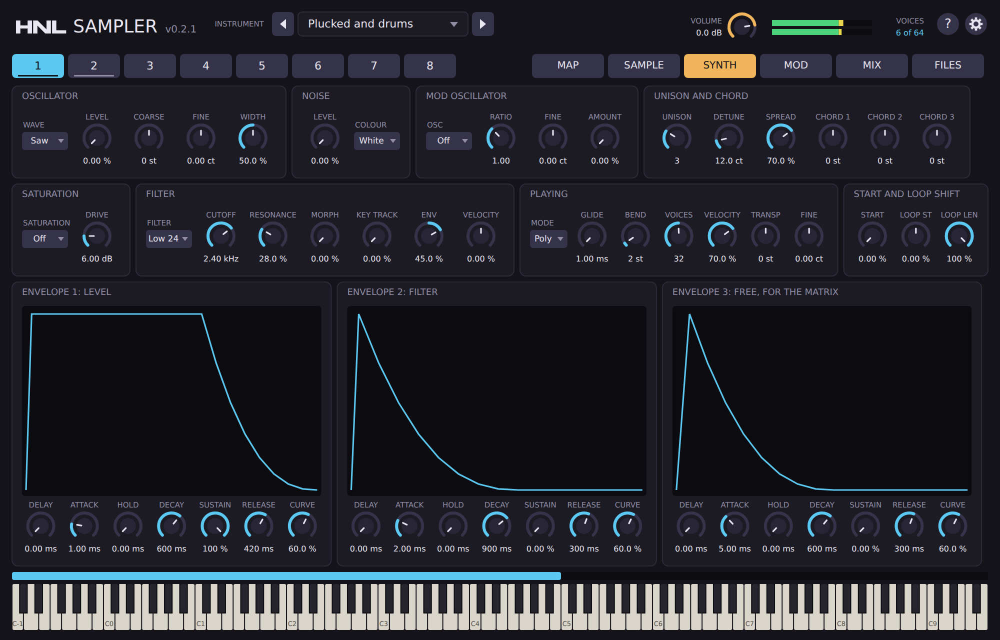
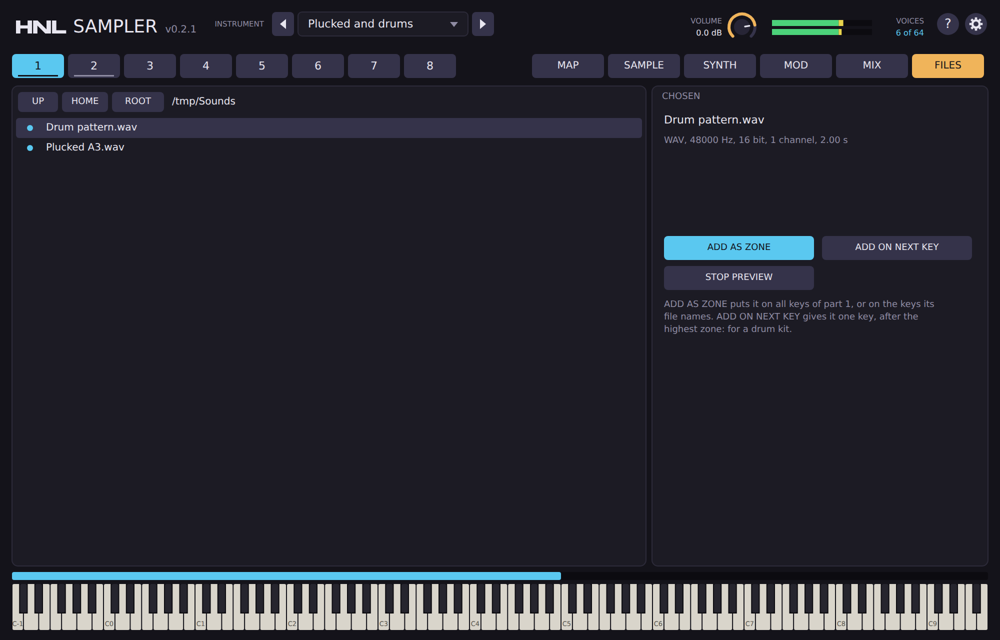

# HNL Sampler

A sampler: sounds from disk spread over keys and velocities, in eight parts, each with its own oscillator,
filter, envelopes, LFOs and modulation matrix. Eight stereo outputs.

| Zones | The sound | Modulation | Mixer | Files |
| --- | --- | --- | --- | --- |
|  |  |  |  |  |

*Rendered from the plugin's drawing code; not yet screenshots from a host.*

**This is an alpha (0.1.0).** It passes its offline tests and is otherwise largely untested: it has not been
played in a host yet. Expect faults, and do not build a song on it.

## How it is put together

An **instrument** has eight **parts**. A part has **zones**: each zone is one sound, the keys and velocities it
answers to, and how it plays (root key, tuning, start and end, loop). A note starts a voice for every zone of a
part that covers it, so zones that overlap sound together. Everything else belongs to the part: its settings
shape all its zones alike.

The host sees only nine parameters: Volume and eight **macros**. The instrument itself is kept in the song as
state. To automate something inside the instrument, give a macro a target in the modulation matrix.

Sounds are not stored in the song or in a saved instrument: they are named by their place on disk and read
again when the song opens. A sound that is no longer there is shown in red on the MAP page; the rest of the
instrument plays on.

## Pages

The row of numbers chooses the part; the pages work on that part.

| Page | What is on it |
| --- | --- |
| MAP | The zones of the part, keys across and velocities up. Drag a zone to move it, an edge to change its range. Below it the chosen zone's settings: ranges, root key, tune, key track, gain, pan, group and choked by (one zone cutting off another, as a closed hi-hat does the open one), round robin, and whether it sounds on the key going down or coming up. A new sampler opens here, empty and silent, with a button that leads to the files. |
| SAMPLE | The chosen zone's sound, with markers to drag for start, end and loop, a ruler in seconds, and every place shown in samples and as time. Loop forward, back and forth or backward, with a crossfade; reverse; one shot. Tools: find a loop without a bump, detect the pitch, normalise, and cut a drum loop into a zone per hit. |
| SYNTH | Oscillator (sine, triangle, sawtooth, square, pulse) and noise, playing along with the sample or alone; a modulation oscillator for FM, AM and ring modulation of sample and oscillator; unison of up to eight and chords of up to four notes inside one voice; saturation and a filter for every note on its own; three envelopes. |
| MOD | Three LFOs, a row of sixteen steps, the eight macros (click a name to type another), and the matrix: twelve rows of source, via, target and amount. |
| MIX | For each part: level, pan, sends, MIDI channel, output pair, mute, MPE. The delay, reverb and chorus all parts send to. The tuning. |
| FILES | Folders and files. A click plays a sound; a double click uses it. The buttons beside the list follow the kind of file chosen. The page opens in the folder it was last in. |

Drag a knob or a number up and down; hold Shift for fine steps; double-click (or Ctrl-click) for the default.
The **?** in the corner switches on help tips for every part of the window.

## Files it reads

| Kind | Formats |
| --- | --- |
| Sounds | WAV (8 to 32 bit, float, RF64), AIFF and AIFF-C, FLAC. Root key, tuning and loop points in a file are taken over when it becomes a zone. |
| Instruments | SFZ and SoundFont 2 (`.sf2`), read into one part. Zones, ranges, tuning, loops, groups and round robin are taken over. The envelope, filter and vibrato of the first zone become the part's: here those belong to a part, not to each zone. What could not be taken over is listed after the import. Of a SoundFont, the first preset is read. |
| Tunings | Scala `.scl`. |
| Its own | `.hnlsampler`: an instrument as text, saved from the list at the top (Save as...) into the same folder as the presets of the other plugins. |

There is no reader for MP3 or Ogg Vorbis: the plugins here carry no code of others, and those formats are too
large to write a decoder for alongside.

## The sound

- **Reading a sound at another speed** is done with a windowed sinc of 12 points, more for sounds played faster
  than recorded, where the extra points also remove what would come back as false tones. A 1 kHz tone played a
  fifth up has everything else 90 dB below it; 9 kHz played two octaves up, which cannot be heard as a tone at
  48 kHz, leaves 79 dB less than it came in with.
- **Loops** join without a click when the loop is a whole number of periods (Find loop looks for that) or with
  a crossfade when it is not. The part's Loop start and Loop length, and anything in the matrix aimed at them,
  move and shorten the loop while it plays.
- **Envelopes, LFOs and the matrix** are worked out about 1500 times a second, counted from the start of each
  note, with levels gliding in between. The same notes give the same sound whatever block length the host uses.
- **The filter** is a state-variable filter that stays stable while its cutoff moves: low, band and high pass
  at 12 dB per octave, low and high also at 24, notch, peak, and a morph from lowpass by bandpass to highpass
  and notch.
- **Voices:** 64 in all, 32 per part unless set otherwise. When they run out, a released voice makes way
  first, then the quietest.
- **MPE:** with MPE on, a part listens on all channels and each note takes pitch bend (48 semitones), pressure
  and timbre (CC 74) from its own channel; channel 1 bends all notes by the part's bend range.

## What is not in it yet

The list this plugin was started from is longer than a first version can hold. Not built yet:

- **Streaming from disk.** Every sound is read into memory whole (shared between all samplers in the song).
- **Recording** from an input, resampling the plugin's own output, drawing a waveform, and edits that change
  the sound itself (cut, fade). Start, end, loop, gain and reverse are settings of the zone and leave the file
  alone.
- **The phrase sequencer and MIDI out.** The row of steps is a modulation source, not a sequencer of notes.
- **Envelopes with more stages**, and envelopes and filters for each zone on its own.
- **More than the first preset** of a SoundFont, and finding moved sounds again.
- **Dropping files** on the window: DPF, the framework under these plugins, passes no dropped files on. Sounds come
  in through the FILES page.
- **Favourite folders and a search** in the FILES page.
- **Tempo detection** is in the code (`dsp/Analysis.hpp`, with a test) but has no button yet.

## Code

- `dsp/Model.hpp`: the instrument as a document, the tables of all settings, and its text form.
- `dsp/Engine.hpp`, `Interp.hpp`, `Effects.hpp`: the sound. Audio thread only; allocates nothing after it is
  prepared.
- `dsp/Sampler.hpp`: the document, the engine and the reading of files together. A change makes a new
  document and hands it to the audio thread; the old one is freed once no note plays from it any more. A
  thread of its own reads sounds.
- `dsp/AudioFile.hpp`, `Import.hpp`, `Analysis.hpp`: reading sound files, reading SFZ, SoundFont and Scala,
  and finding pitch, hits, tempo and loop points. The FLAC reader agrees with all 64 files of the IETF's FLAC
  conformance set that a decoder must handle, checked once by the checksum each file carries.
- `SamplerPlugin.cpp`, `SamplerUI.cpp`: the DPF plugin and its UI. The UI works on the plugin's own document,
  which it reaches through the plugin instance (`DISTRHO_PLUGIN_WANT_DIRECT_ACCESS`).

`tests/run.sh` runs seven test programs: the three readers and the analysis (each also on damaged and random
input), measurements of the engine (`dsp_test`), the plugin in DPF's host-side wrapper, the host that does
everything a host may do (`common/tests/HostAbuse.hpp`), and the UI class clicked and dragged on the drawing
stand-in (`ui_test`).

## Changelog

### 0.2.1 (2026-11-22), alpha

- Fixed: the FILES page opens in the folder it was last in. It kept the folder only when a file was used, and
  did not always find it again when the window was opened anew; now every folder that is opened is kept, for
  as long as the host runs and in a file for the next time.

### 0.2.0 (2026-11-22), alpha

- New: three looks. Classic, the look the plugin has always had, stays the default; Hi-Fi Black and Hi-Fi Silver
  dress the same window as a piece of hi-fi equipment. The cog at the top right chooses, for every HNL plugin at
  once. The choice changes nothing about the sound and is not stored in the song.
- To make room for the cog, the instrument bar, the volume knob, the output meters, the voice count and the help
  button stand 28 pixels further left.

### 0.1.0 (2026-11-22), alpha

- First version, released untested in a host.
