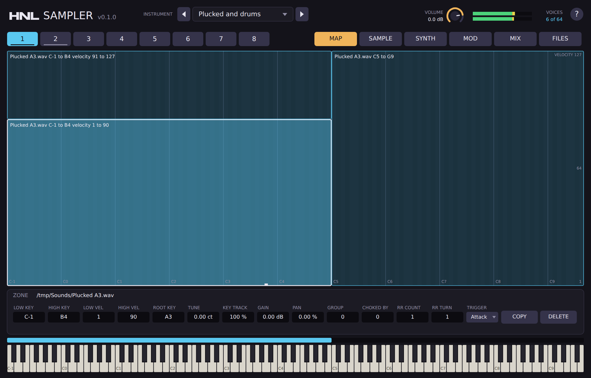
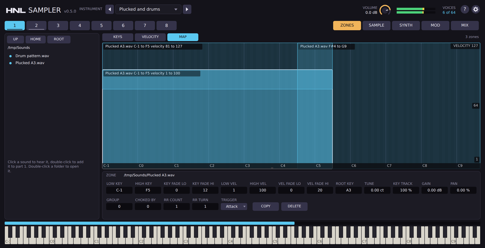
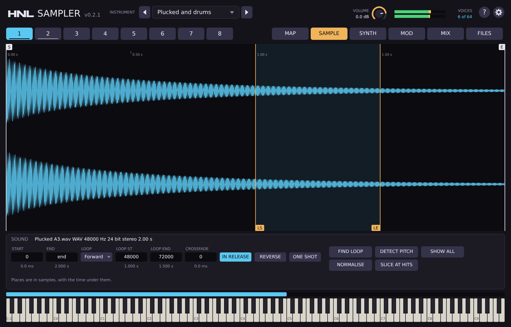
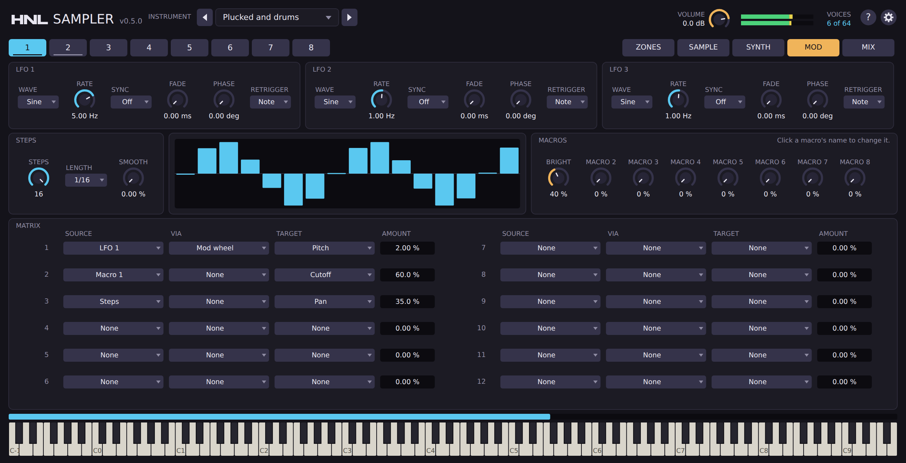
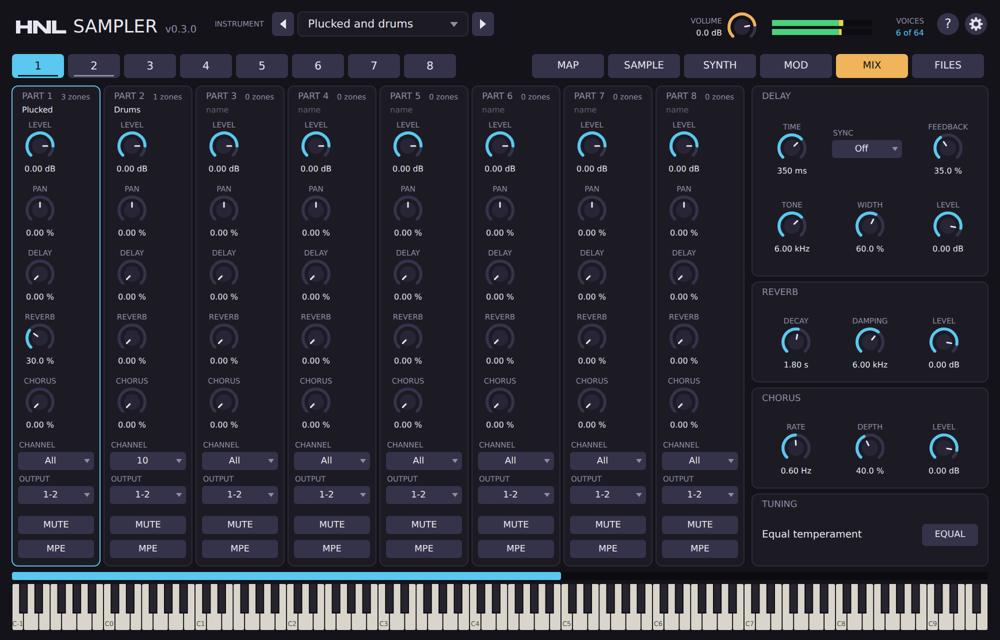

# HNL Sampler

A sampler. You spread sounds from disk over keys and velocities, in eight parts, and each part has its own
oscillator, filter, envelopes, LFOs and modulation matrix. There are eight stereo outputs.

| Zones, with the files beside them | All zones in one picture | The sound | A loop cut into slices | Modulation | Mixer |
| --- | --- | --- | --- | --- | --- |
|  |  |  |  |  |  |

*These pictures are rendered from the plugin's drawing code, not taken from a DAW.*

**This is a beta.** It passes its tests and has been played in a DAW, but it is young, so expect rough edges.
[What has and has not been tried](#what-has-and-has-not-been-tried) lists the details.

Three demo instruments come with it, with their sounds inside the plugin: a jazz drum kit, strings and a pipe
organ. See [What comes with it](#what-comes-with-it).

## Quick start

1. Load the plugin and choose Jazz Kit, Strings or Pipe Organ from the list at the top. It plays right away.
2. To build your own, start from Init and open the ZONES page. The files on your disk are listed beside it.
3. Click a sound to hear it. Double-click it to add it as a zone.
4. Drag the zone's bar to the keys it should answer to, and drag an end of the bar to change its range.
5. Open SAMPLE to set start, end and loop, then SYNTH, MOD and MIX to shape the part.
6. Choose *Save as...* in the list at the top to keep the instrument.

The **?** in the corner switches on help tips for every part of the window.

## How it is put together

An **instrument** has eight **parts**. A part has **zones**. Each zone is one sound, the keys and velocities it
answers to, and how it plays: root key, tuning, start and end, loop. A note starts a voice for every zone of the
part that covers it, so zones that overlap sound together.

A zone can fade in over the keys or the velocities at an end of its range. Two zones that overlap there then
cross over into each other, with a curve that keeps their power or one that keeps their sum.

Everything else belongs to the part. Its settings shape all its zones in the same way.

**Automation.** Your DAW sees only nine parameters: Volume and eight **macros**. The instrument itself is saved
in the song. To automate something inside the instrument, give a macro a target in the modulation matrix.

**Where the sounds live.** Sounds are not stored in the song or in a saved instrument. The instrument remembers
where each sound is on disk and reads it again when the song opens. A sound that is no longer there is shown in
red on the ZONES page, and the rest of the instrument plays on. The sounds of the demo instruments are inside
the plugin itself, so a song that uses them opens on any computer.

## What comes with it

Three demo instruments are in the list at the top, below Init, so the plugin plays as soon as you load it. They
are there to play and to take apart. You can change every setting, and *Save as...* keeps the result as an
instrument of your own.

| Instrument | What it is | Keys | What it shows |
| --- | --- | --- | --- |
| Jazz Kit | A jazz drum kit played with sticks: kick, snare, rimshot, cross-stick, two toms, hi-hat (closed, pedal, open), crash, ride and its bell. 37 sounds. | The General MIDI drum keys, B0 to F2. The two toms are spread over the six tom keys, each a little lower or higher than recorded. | Two or three layers by velocity; two takes in turn on kick, snare and closed hi-hat (round robin); the closed and the pedal hi-hat cut off the open one; one shot. |
| Strings | A cello section below and a violin section above, sustained with vibrato. 16 notes, three or four semitones apart. | C1 to C7 | Loops; a filter that opens with a harder touch; macro 1, "Darker", which closes it. |
| Pipe Organ | A church organ, one loud stop. 11 notes, six semitones apart. | C1 to C7 | Loops; no answer to touch, as on an organ; the reverb. |

The sounds are cut from recordings that their makers gave to the public domain (CC0): Virtuosity Drums by
Versilian Studios and Karoryfer Samples, the strings of VSCO 2 Community Edition by Versilian Studios, and the
pipe organ of the Versilian Community Sample Library, sampled by Simon Dalzell.
[`factory/SOURCES.md`](factory/SOURCES.md) says where each one comes from and what was done to it. They are
mono, 16 bit, and take 3.9 MB together.

The choice of sounds and their balance were decided from measurements. The levels of the drums against each
other in particular may need adjusting to your taste. Use the Gain of each zone, on the ZONES page.

## Pages

The row of numbers chooses the part. The pages work on that part.

| Page | What is on it |
| --- | --- |
| ZONES | The zones of the part in three views (KEYS, VELOCITY and MAP), and the settings of the chosen zone. |
| SAMPLE | The chosen zone's sound, with markers for start, end and loop, the loop settings and the tools. |
| SYNTH | Oscillator (sine, triangle, sawtooth, square, pulse) and noise, playing along with the sample or alone; a modulation oscillator for FM, AM and ring modulation of sample and oscillator; unison of up to eight and chords of up to four notes inside one voice; saturation and a filter for every note on its own; three envelopes. |
| MOD | Three LFOs, a row of sixteen steps, the eight macros (click a name to type another), and the matrix: twelve rows of source, via, target and amount. |
| MIX | For each part: level, pan, sends, MIDI channel, output pair, mute, MPE. The delay, reverb and chorus all parts send to. The tuning. |

### ZONES

The page shows the zones of the part in one of three views:

- **KEYS** and **VELOCITY** give every zone a row, with the name of its sound, a small loudspeaker and a bar for
  the keys or the velocities it covers. Drag the middle of a bar to move it and an end to change its range. Drag
  an end of the line above the bar to set a fade. The loudspeaker plays the part of the sound that the zone
  plays.
- **MAP** shows all zones in one picture, with keys across and velocities up. Where zones lie on top of each
  other, each click chooses the next one. The chosen zone has a handle on each side for dragging its fades.

**FOLLOW**, next to the views, makes the zone you play on the keyboard the chosen one.

Below the views are the settings of the chosen zone: its ranges, its fades and their curve (Power or Linear),
root key, tune, key track, gain, pan, round robin, and whether it sounds when the key goes down or when it comes
up. **Group** and **choked by** let one zone cut off another, the way a closed hi-hat cuts off the open one.

### SAMPLE

The page shows the chosen zone's sound. Drag the markers to set start, end and loop. There is a ruler in
seconds, and every position is shown both in samples and as time. The arrows and the list above the settings
choose which zone is shown.

Other zones that play from the same sound, such as the slices of a drum loop, are marked in the wave with their
keys. Click in one to choose it.

A loop can run forward, back and forth or backward, with a crossfade. A zone can also play in reverse, or as a
one shot.

The tools find a loop without a bump, detect the pitch, normalise, and cut a drum loop into a zone per hit.

### The files

Next to ZONES and SAMPLE is the list of **files**: the folders and files on your disk. Click a sound to hear it
and double-click it to add it as a zone. The buttons under the list depend on the kind of file you have chosen.
A sound can be added on all keys or on the next key, or it can replace the chosen zone's sound, in which case
the zone keeps its keys and settings. The list opens in the folder you were last in.

### Knobs and the window

Drag a knob or a number up and down. Hold Shift for fine steps. Double-click or Ctrl-click for the default.

The **?** in the corner switches on help tips for every part of the window.

The cog in the corner lists the looks and the window sizes (75 to 200 %). Where the DAW allows it you can also
drag the window by its edge, down to three quarters of its design size. The window keeps its proportions and
everything in it is redrawn at the new size. It opens next time at the size you left it at. The size is
remembered for this plugin, not per song.

## Files it reads

| Kind | Formats |
| --- | --- |
| Sounds | WAV (8 to 32 bit, float, RF64), AIFF and AIFF-C, FLAC. Root key, tuning and loop points in a file are taken over when it becomes a zone. |
| Instruments | SFZ and SoundFont 2 (`.sf2`), read into one part. Zones, ranges, tuning, loops, groups and round robin are taken over. The envelope, filter and vibrato of the first zone become the part's, because here those belong to a part and not to each zone. What could not be taken over is listed after the import. Of a SoundFont, the first preset is read. |
| Tunings | Scala `.scl`. |
| Its own | `.hnlsampler`: an instrument as text, saved from the list at the top (*Save as...*) into the same folder as the presets of the other plugins. |

MP3 and Ogg Vorbis are not supported. The HNL plugins contain no third-party code, and a decoder for those
formats is too much to write for this.

## The sound

- **Playing a sound at another pitch** uses a windowed sinc of 12 points, and more points for sounds played
  faster than recorded, where they also remove what would otherwise come back as false tones. A 1 kHz tone
  played a fifth up has everything else 90 dB below it. A 9 kHz tone played two octaves up, which is too high
  to be heard as a tone at 48 kHz, comes out 79 dB weaker than it went in.
- **Loops** join without a click when the loop is a whole number of periods (Find loop looks for that), or with
  a crossfade when it is not. The part's Loop start and Loop length, and anything in the matrix aimed at them,
  move and shorten the loop while it plays.
- **Envelopes, LFOs and the matrix** are worked out about 1500 times a second, counted from the start of each
  note, with levels gliding in between. The same notes give the same sound whatever block length the DAW uses.
- **The filter** is a state-variable filter that stays stable while its cutoff moves. It does low, band and high
  pass at 12 dB per octave, low and high pass also at 24, notch, peak, and a morph from lowpass through bandpass
  to highpass and notch.
- **Voices.** There are 64 in all, and 32 per part unless you set it otherwise. When they run out, a released
  voice makes way first, then the quietest.
- **MPE.** With MPE on, a part listens on all channels and each note takes pitch bend (48 semitones), pressure
  and timbre (CC 74) from its own channel. Channel 1 bends all notes by the part's bend range.

## Limits

The plan for this plugin is longer than what a first version can hold. These things are not built yet:

- **Streaming from disk.** Every sound is read into memory whole. That memory is shared between all samplers in
  the song.
- **Recording** from an input, resampling the plugin's own output, drawing a waveform, and edits that change
  the sound itself (cut, fade). Start, end, loop, gain and reverse are settings of the zone and leave the file
  alone.
- **The phrase sequencer and MIDI out.** The row of steps is a modulation source, not a sequencer of notes.
- **Envelopes with more stages**, and envelopes and filters for each zone on its own.
- **More than the first preset** of a SoundFont, and finding sounds again after they have been moved.
- **Dropping files** on the window. DPF, the framework under these plugins, does not pass dropped files on.
  Sounds come in through the list of files.
- **Favourite folders and a search** in the list of files.
- **Tempo detection.** There is no button for it yet.

MP3 and Ogg Vorbis files cannot be read, as explained under [Files it reads](#files-it-reads).

## What has and has not been tried

Tried in a DAW:

- The plugin has been played in a DAW since 0.3.
- A round of testing in Ableton Live and Cubase led to 0.4, and a tester's round in Ableton Live, Cubase and
  Studio One led to 0.6.

Not tried yet:

- **The fix for clicks on a scaled display.** In Cubase and Studio One on Windows, on a display set to a scale
  other than 100 %, clicks did not land on what was drawn. Version 0.6 fixes that and an automated test shows
  it, but the fix has not been seen working in those DAWs themselves.

## For developers

### Code

- `dsp/Model.hpp`: the instrument as a document, the tables of all settings, and its text form.
- `dsp/Engine.hpp`, `Interp.hpp`, `Effects.hpp`: the sound. Audio thread only. Allocates nothing after it is
  prepared.
- `dsp/Sampler.hpp`: the document, the engine and the reading of files together. A change makes a new
  document and hands it to the audio thread. The old one is freed once no note plays from it any more. Sounds
  are read on a thread of their own.
- `dsp/AudioFile.hpp`, `Import.hpp`, `Analysis.hpp`: reading sound files, reading SFZ, SoundFont and Scala,
  and finding pitch, hits, tempo and loop points. Tempo detection has a test but no button in the window yet.
  The FLAC reader agrees with all 64 files of the IETF's FLAC conformance set that a decoder must handle,
  checked once by the checksum each file carries.
- `dsp/Factory.hpp`, `FactoryData.cpp`, `factory/`: the sounds and instruments that come with the plugin. The
  files under `factory/` are compiled into it with `#embed`, or by the assembler (`.incbin`) when the compiler
  is too old for that. `tools/factory-sounds/` makes them from the recordings, with a FLAC writer of its own
  (`FlacEncode.hpp`).
- `SamplerPlugin.cpp`, `SamplerUI.cpp`: the DPF plugin and its UI. The UI works on the plugin's own document,
  which it reaches through the plugin instance (`DISTRHO_PLUGIN_WANT_DIRECT_ACCESS`).

### Tests

`tests/run.sh` runs eight test programs:

- `audiofile_test`, `import_test` and `analysis_test` check the three readers and the analysis, each also on
  damaged and random input.
- `dsp_test` measures the engine.
- `factory_test` checks what comes with the plugin: every sound reads, every key of the three instruments
  plays, and a note held for 12 seconds keeps its level, passes its loop without a click and is in tune.
- `plugin_test` runs the plugin in DPF's wrapper.
- `abuse_test` does everything a DAW is allowed to do (`common/tests/HostAbuse.hpp`).
- `ui_test` clicks and drags in the UI class itself, on the drawing stand-in.

Two tests shared by all plugins run on its UI as well: the choice of look, and the size of the window, also on
a display the DAW scales.

### Parameters

The parameters the DAW sees: Volume, the eight macros, and three meters it can read (output peak left and
right, and the number of voices).

## Changelog

### 0.6.0 (2026-11-28)

After a tester's round in Ableton Live, Cubase and Studio One.

- Fixed: in Cubase and Studio One on Windows, on a display set to another scale than 100 %, clicks did not land on
  what was drawn: the pages could not be chosen, much of the window did not answer, and a click on SAMPLE could open
  MIX. The window was made larger for the display's scale without the plugin being told, so that it read every
  click that much too far right and down (at 125 %, a quarter). It now goes by the size its window really has.
  Found by reading the code that makes the window, and shown in a test that makes a window the same way; not yet
  seen fixed in those hosts themselves.
- New: fades in the MAP view. The chosen zone has a small square half way along each side: dragged inward it sets
  the fade over the keys (left and right) or the velocities (top and bottom), and every zone grows darker towards
  an end it fades at. KEYS and VELOCITY have their lines above the bars as before.
- New: Fade curve, a setting of the zone: Power (as it was) keeps the power of two zones that cross, for sounds
  that have nothing to do with each other; Linear keeps the sum of their levels, for sounds that are much alike,
  such as the same note recorded softer and harder. Instruments saved before have Power.
- New: FOLLOW, beside the three views. With it on, the zone a key plays becomes the chosen one, on ZONES and on
  SAMPLE: play, and the list shows which sound answers to that key at that velocity. It follows the chosen part.
- Changed: COPY and DELETE on the ZONES page stand one place further right, to make room for Fade curve.

### 0.5.0 (2026-11-28)

- New: every row of the zone list has a small loudspeaker. A click plays what that zone plays of its sound, from its
  start to its end, as it is on disk: without the zone's tuning and level and without the part's filter and envelopes.
  It is the quickest way to tell slices and layers apart.
- Changed: the names in the zone list have half as much room again (310 pixels, it was 200), so that long file names
  are no longer cut. The bars are that much narrower.

### 0.4.0 (2026-11-27)

After a first round of testing in Ableton Live and Cubase.

- New: the window can be made larger and smaller: the cog lists the sizes (75 to 200 %), and where the host allows it
  the window can be dragged by its edge. Everything is drawn anew at the size it has. The size is kept for this plugin.
- New: the MAP page is now ZONES, with three views. KEYS and VELOCITY give every zone a row with its sound's name
  and a bar, with wide ends to take hold of. MAP is the picture of all zones that was there before.
- New: fades. A zone can come in over the keys or the velocities at an end of its range (the line above its bar, or
  the four fade settings of the zone), so that zones cross over into each other. Instruments saved before have none.
- New: the files stand beside ZONES and SAMPLE; the FILES page is gone. Replace sound gives the chosen zone another
  sound and leaves its keys and settings.
- New: SAMPLE has arrows and a list to choose which zone it shows, and marks the other zones that play from the same
  sound: the slices of a loop are all in sight, and a click in one chooses it.
- New: in the MAP view a corner of a zone changes keys and velocities together, and the mouse shows what a press
  would take hold of, there and on the bars.
- Changed: no text is smaller than 9 pixels at 100 %, and what is written on a zone or on the scales of the MAP view
  stands on a dark ground. For the room that takes, the window is 1252 pixels wide (it was 1000), and SYNTH, MOD and
  MIX use the whole width.
- Fixed: zones that lay under another zone in the map could not be chosen with the mouse (in Jazz Kit, seven of the
  37 sounds). Each click on such a place now chooses the next zone there, and every zone has its row in the list.
- Fixed: SAMPLE showed a newly added or newly chosen sound through the zoom of the one before it, so that of a long
  sound only the beginning was in sight. Another sound is now always shown whole.
- Fixed: after Slice at hits, SAMPLE showed the first zone of the part, which was another sound when the sliced zone
  was not the first. It shows the first slice.

### 0.3.0 (2026-11-24)

- The plugin is a beta now: it has been played in a host.
- New: three demo instruments come with the plugin, in the list at the top: Jazz Kit, Strings and Pipe Organ. Their
  sounds are inside the plugin (3.9 MB), so a song that uses them opens anywhere. See "What comes with it".
- Fixed: a click the first time a note reached the end of a forward loop that does not start at the beginning of
  its sound. For the last few samples before the jump back, what was read past the loop's end came from the start
  of the sound and not from the start of the loop. Later turns of the loop were right.

### 0.2.1 (2026-11-22), alpha

- Fixed: the FILES page opens in the folder it was last in. It kept the folder only when a file was used, and
  did not always find it again when the window was opened anew; now every folder that is opened is kept, for
  as long as the host runs and in a file for the next time.

### 0.2.0 (2026-11-22), alpha

- New: three looks. Classic, the look the plugin has always had, stays the default; Hi-Fi Black and Hi-Fi Silver
  dress the same window as a piece of hi-fi equipment. The cog at the top right chooses, for every HNL plugin at
  once. The choice changes nothing about the sound and is not stored in the song.
- To make room for the cog, the instrument bar, the volume knob, the output meters, the voice count and the help
  button stand 28 pixels further left.

### 0.1.0 (2026-11-22), alpha

- First version, released untested in a host.
