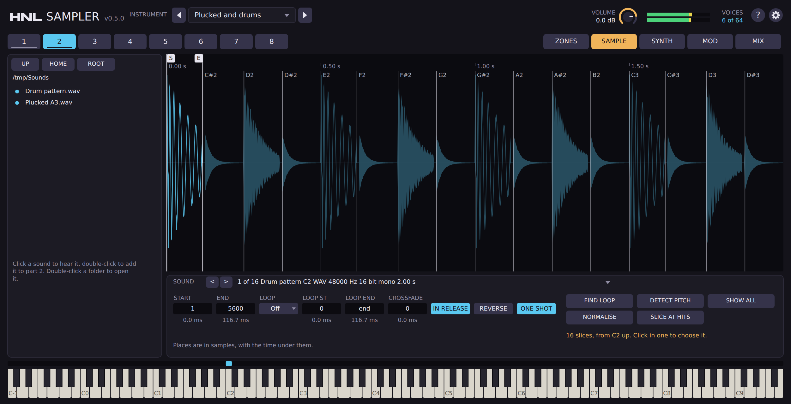

# HNL Sampler

A sampler: sounds from disk spread over keys and velocities, in eight parts, each with its own oscillator,
filter, envelopes, LFOs and modulation matrix. Eight stereo outputs.

| Zones, with the files beside them | All zones in one picture | The sound | A loop cut into slices | Modulation | Mixer |
| --- | --- | --- | --- | --- | --- |
|  |  |  |  |  |  |

*Rendered from the plugin's drawing code; not yet screenshots from a host.*

**A beta.** It passes its offline tests and has been played in a host, but it is young; expect rough edges.

Three demo instruments come with it, their sounds inside the plugin: a jazz drum kit, strings and a pipe organ.
See [What comes with it](#what-comes-with-it).

## How it is put together

An **instrument** has eight **parts**. A part has **zones**: each zone is one sound, the keys and velocities it
answers to, and how it plays (root key, tuning, start and end, loop). A note starts a voice for every zone of a
part that covers it, so zones that overlap sound together. A zone can come in gradually over the keys or the
velocities at an end of its range, so that two zones that overlap there cross over into each other. Everything
else belongs to the part: its settings shape all its zones alike.

The host sees only nine parameters: Volume and eight **macros**. The instrument itself is kept in the song as
state. To automate something inside the instrument, give a macro a target in the modulation matrix.

Sounds are not stored in the song or in a saved instrument: they are named by their place on disk and read
again when the song opens. A sound that is no longer there is shown in red on the ZONES page; the rest of the
instrument plays on. The sounds of the instruments that come with the plugin are inside the plugin itself, so a
song that uses them opens on any computer.

## What comes with it

Three demo instruments stand in the list at the top, below Init, so that the plugin plays as soon as it is
loaded. They are there to play, and to take apart: every setting of them can be changed, and Save as... keeps the
result as an instrument of your own.

| Instrument | What it is | Keys | What it shows |
| --- | --- | --- | --- |
| Jazz Kit | A jazz drum kit played with sticks: kick, snare, rimshot, cross-stick, two toms, hi-hat (closed, pedal, open), crash, ride and its bell. 37 sounds. | The General MIDI drum keys, B0 to F2. The two toms are spread over the six tom keys, each a little lower or higher than recorded. | Two or three layers by velocity; two takes in turn on kick, snare and closed hi-hat (round robin); the closed and the pedal hi-hat cut off the open one; one shot. |
| Strings | A cello section below and a violin section above, sustained with vibrato. 16 notes, three or four semitones apart. | C1 to C7 | Loops; a filter that opens with a harder touch; macro 1, "Darker", which closes it. |
| Pipe Organ | A church organ, one loud stop. 11 notes, six semitones apart. | C1 to C7 | Loops; no answer to touch, as on an organ; the reverb. |

The sounds are cut from recordings that their makers gave to the public domain (CC0): Virtuosity Drums by
Versilian Studios and Karoryfer Samples, the strings of VSCO 2 Community Edition by Versilian Studios, and the
pipe organ of the Versilian Community Sample Library, sampled by Simon Dalzell.
[`factory/SOURCES.md`](factory/SOURCES.md) says where each comes from and what was done to it. They are mono,
16 bit, and take 3.9 MB together.

Which sounds and how they are balanced was decided from measurements. The levels of the drums against each
other in particular may want adjusting to taste (Gain of each zone, on the ZONES page).

## Pages

The row of numbers chooses the part; the pages work on that part.

| Page | What is on it |
| --- | --- |
| ZONES | The zones of the part, in three views. KEYS and VELOCITY give every zone a row with the name of its sound, a small loudspeaker that plays what the zone plays of it, and a bar for the keys or the velocities it covers: drag the middle of a bar to move it, an end to change its range, and an end of the line above it to set a fade. MAP shows all zones in one picture, keys across and velocities up; where zones lie on top of each other, each click chooses the next one. Below it the chosen zone's settings: ranges and fades, root key, tune, key track, gain, pan, group and choked by (one zone cutting off another, as a closed hi-hat does the open one), round robin, and whether it sounds on the key going down or coming up. |
| SAMPLE | The chosen zone's sound, with markers to drag for start, end and loop, a ruler in seconds, and every place shown in samples and as time. The arrows and the list above the settings choose which zone is shown. Other zones that play from the same sound, such as the slices of a drum loop, are marked in the wave with their keys; a click in one chooses it. Loop forward, back and forth or backward, with a crossfade; reverse; one shot. Tools: find a loop without a bump, detect the pitch, normalise, and cut a drum loop into a zone per hit. |
| SYNTH | Oscillator (sine, triangle, sawtooth, square, pulse) and noise, playing along with the sample or alone; a modulation oscillator for FM, AM and ring modulation of sample and oscillator; unison of up to eight and chords of up to four notes inside one voice; saturation and a filter for every note on its own; three envelopes. |
| MOD | Three LFOs, a row of sixteen steps, the eight macros (click a name to type another), and the matrix: twelve rows of source, via, target and amount. |
| MIX | For each part: level, pan, sends, MIDI channel, output pair, mute, MPE. The delay, reverb and chorus all parts send to. The tuning. |

Beside ZONES and SAMPLE stand the **files**: folders and files on disk. A click plays a sound; a double click adds
it as a zone. The buttons under the list follow the kind of file chosen: a sound can be added on all keys or on the
next key, or take the place of the chosen zone's sound, which keeps its keys and settings. The list opens in the
folder it was last in.

Drag a knob or a number up and down; hold Shift for fine steps; double-click (or Ctrl-click) for the default.
The **?** in the corner switches on help tips for every part of the window.

The window can be made larger and smaller: the cog in the corner lists the sizes (75 to 200 %) under the looks, and
where the host allows it the window can be dragged by its edge, down to three quarters of its design size. It keeps its shape, everything in it is drawn anew at the size it has, and it opens next time
at the size it was left at. That size is kept for this plugin, not in the song.

## Files it reads

| Kind | Formats |
| --- | --- |
| Sounds | WAV (8 to 32 bit, float, RF64), AIFF and AIFF-C, FLAC. Root key, tuning and loop points in a file are taken over when it becomes a zone. |
| Instruments | SFZ and SoundFont 2 (`.sf2`), read into one part. Zones, ranges, tuning, loops, groups and round robin are taken over. The envelope, filter and vibrato of the first zone become the part's: here those belong to a part, not to each zone. What could not be taken over is listed after the import. Of a SoundFont, the first preset is read. |
| Tunings | Scala `.scl`. |
| Its own | `.hnlsampler`: an instrument as text, saved from the list at the top (Save as...) into the same folder as the presets of the other plugins. |

There is no reader for MP3 or Ogg Vorbis: the plugins here carry no code of others, and those formats are too
large to write a decoder for alongside.

## The sound

- **Reading a sound at another speed** is done with a windowed sinc of 12 points, more for sounds played faster
  than recorded, where the extra points also remove what would come back as false tones. A 1 kHz tone played a
  fifth up has everything else 90 dB below it; 9 kHz played two octaves up, which cannot be heard as a tone at
  48 kHz, leaves 79 dB less than it came in with.
- **Loops** join without a click when the loop is a whole number of periods (Find loop looks for that) or with
  a crossfade when it is not. The part's Loop start and Loop length, and anything in the matrix aimed at them,
  move and shorten the loop while it plays.
- **Envelopes, LFOs and the matrix** are worked out about 1500 times a second, counted from the start of each
  note, with levels gliding in between. The same notes give the same sound whatever block length the host uses.
- **The filter** is a state-variable filter that stays stable while its cutoff moves: low, band and high pass
  at 12 dB per octave, low and high also at 24, notch, peak, and a morph from lowpass by bandpass to highpass
  and notch.
- **Voices:** 64 in all, 32 per part unless set otherwise. When they run out, a released voice makes way
  first, then the quietest.
- **MPE:** with MPE on, a part listens on all channels and each note takes pitch bend (48 semitones), pressure
  and timbre (CC 74) from its own channel; channel 1 bends all notes by the part's bend range.

## What is not in it yet

The list this plugin was started from is longer than a first version can hold. Not built yet:

- **Streaming from disk.** Every sound is read into memory whole (shared between all samplers in the song).
- **Recording** from an input, resampling the plugin's own output, drawing a waveform, and edits that change
  the sound itself (cut, fade). Start, end, loop, gain and reverse are settings of the zone and leave the file
  alone.
- **The phrase sequencer and MIDI out.** The row of steps is a modulation source, not a sequencer of notes.
- **Envelopes with more stages**, and envelopes and filters for each zone on its own.
- **More than the first preset** of a SoundFont, and finding moved sounds again.
- **Dropping files** on the window: DPF, the framework under these plugins, passes no dropped files on. Sounds come
  in through the list of files.
- **Favourite folders and a search** in the list of files.
- **Tempo detection** is in the code (`dsp/Analysis.hpp`, with a test) but has no button yet.

## Code

- `dsp/Model.hpp`: the instrument as a document, the tables of all settings, and its text form.
- `dsp/Engine.hpp`, `Interp.hpp`, `Effects.hpp`: the sound. Audio thread only; allocates nothing after it is
  prepared.
- `dsp/Sampler.hpp`: the document, the engine and the reading of files together. A change makes a new
  document and hands it to the audio thread; the old one is freed once no note plays from it any more. A
  thread of its own reads sounds.
- `dsp/AudioFile.hpp`, `Import.hpp`, `Analysis.hpp`: reading sound files, reading SFZ, SoundFont and Scala,
  and finding pitch, hits, tempo and loop points. The FLAC reader agrees with all 64 files of the IETF's FLAC
  conformance set that a decoder must handle, checked once by the checksum each file carries.
- `dsp/Factory.hpp`, `FactoryData.cpp`, `factory/`: the sounds and instruments that come with the plugin. The
  files under `factory/` are compiled into it with `#embed`, or by the assembler (`.incbin`) when the compiler
  is too old for that; `tools/factory-sounds/` makes them from the recordings, with a FLAC writer of its own
  (`FlacEncode.hpp`).
- `SamplerPlugin.cpp`, `SamplerUI.cpp`: the DPF plugin and its UI. The UI works on the plugin's own document,
  which it reaches through the plugin instance (`DISTRHO_PLUGIN_WANT_DIRECT_ACCESS`).

`tests/run.sh` runs eight test programs: the three readers and the analysis (each also on damaged and random
input), measurements of the engine (`dsp_test`), what comes with the plugin (`factory_test`: every sound reads,
every key of the three instruments plays, a note held for 12 seconds keeps its level and passes its loop without
a click, and is in tune), the plugin in DPF's host-side wrapper, the host that does
everything a host may do (`common/tests/HostAbuse.hpp`), and the UI class clicked and dragged on the drawing
stand-in (`ui_test`).

## Changelog

### 0.5.0 (2026-11-28)

- New: every row of the zone list has a small loudspeaker. A click plays what that zone plays of its sound, from its
  start to its end, as it is on disk: without the zone's tuning and level and without the part's filter and envelopes.
  It is the quickest way to tell slices and layers apart.
- Changed: the names in the zone list have half as much room again (310 pixels, it was 200), so that long file names
  are no longer cut. The bars are that much narrower.

### 0.4.0 (2026-11-27)

After a first round of testing in Ableton Live and Cubase.

- New: the window can be made larger and smaller: the cog lists the sizes (75 to 200 %), and where the host allows it
  the window can be dragged by its edge. Everything is drawn anew at the size it has. The size is kept for this plugin.
- New: the MAP page is now ZONES, with three views. KEYS and VELOCITY give every zone a row with its sound's name
  and a bar, with wide ends to take hold of. MAP is the picture of all zones that was there before.
- New: fades. A zone can come in over the keys or the velocities at an end of its range (the line above its bar, or
  the four fade settings of the zone), so that zones cross over into each other. Instruments saved before have none.
- New: the files stand beside ZONES and SAMPLE; the FILES page is gone. Replace sound gives the chosen zone another
  sound and leaves its keys and settings.
- New: SAMPLE has arrows and a list to choose which zone it shows, and marks the other zones that play from the same
  sound: the slices of a loop are all in sight, and a click in one chooses it.
- New: in the MAP view a corner of a zone changes keys and velocities together, and the mouse shows what a press
  would take hold of, there and on the bars.
- Changed: no text is smaller than 9 pixels at 100 %, and what is written on a zone or on the scales of the MAP view
  stands on a dark ground. For the room that takes, the window is 1252 pixels wide (it was 1000), and SYNTH, MOD and
  MIX use the whole width.
- Fixed: zones that lay under another zone in the map could not be chosen with the mouse (in Jazz Kit, seven of the
  37 sounds). Each click on such a place now chooses the next zone there, and every zone has its row in the list.
- Fixed: SAMPLE showed a newly added or newly chosen sound through the zoom of the one before it, so that of a long
  sound only the beginning was in sight. Another sound is now always shown whole.
- Fixed: after Slice at hits, SAMPLE showed the first zone of the part, which was another sound when the sliced zone
  was not the first. It shows the first slice.

### 0.3.0 (2026-11-24)

- The plugin is a beta now: it has been played in a host.
- New: three demo instruments come with the plugin, in the list at the top: Jazz Kit, Strings and Pipe Organ. Their
  sounds are inside the plugin (3.9 MB), so a song that uses them opens anywhere. See "What comes with it".
- Fixed: a click the first time a note reached the end of a forward loop that does not start at the beginning of
  its sound. For the last few samples before the jump back, what was read past the loop's end came from the start
  of the sound and not from the start of the loop. Later turns of the loop were right.

### 0.2.1 (2026-11-22), alpha

- Fixed: the FILES page opens in the folder it was last in. It kept the folder only when a file was used, and
  did not always find it again when the window was opened anew; now every folder that is opened is kept, for
  as long as the host runs and in a file for the next time.

### 0.2.0 (2026-11-22), alpha

- New: three looks. Classic, the look the plugin has always had, stays the default; Hi-Fi Black and Hi-Fi Silver
  dress the same window as a piece of hi-fi equipment. The cog at the top right chooses, for every HNL plugin at
  once. The choice changes nothing about the sound and is not stored in the song.
- To make room for the cog, the instrument bar, the volume knob, the output meters, the voice count and the help
  button stand 28 pixels further left.

### 0.1.0 (2026-11-22), alpha

- First version, released untested in a host.
