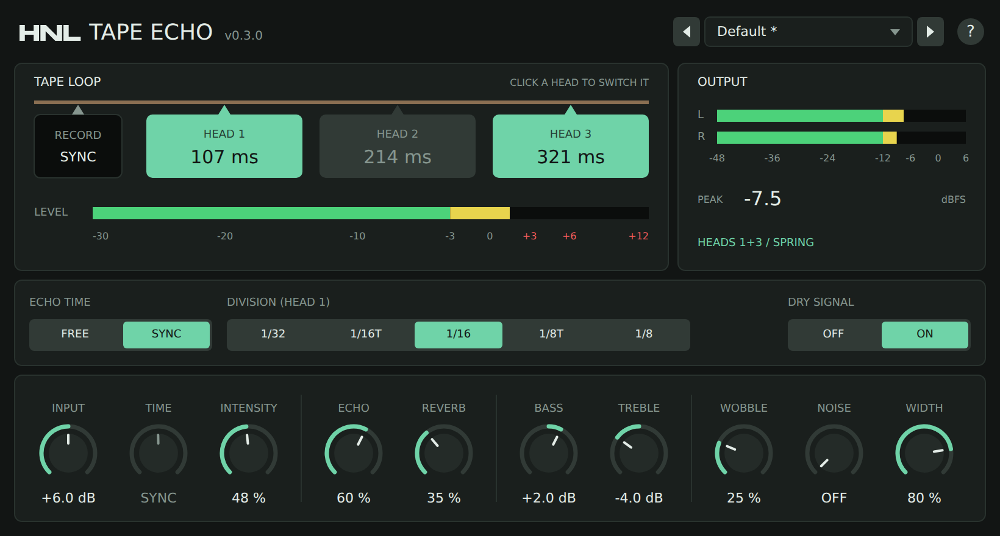
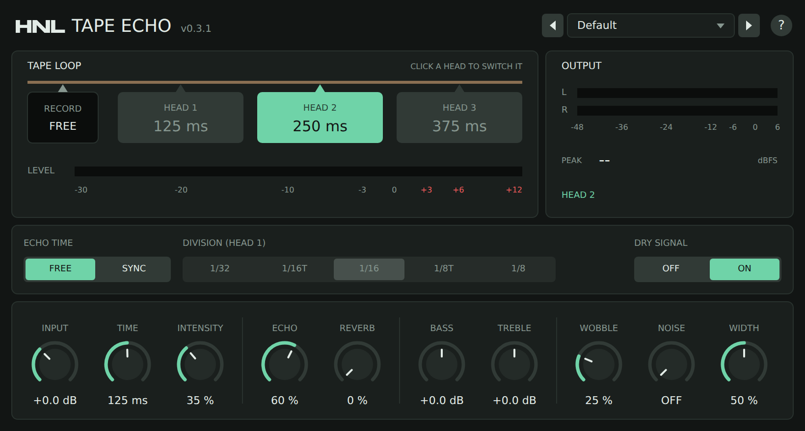
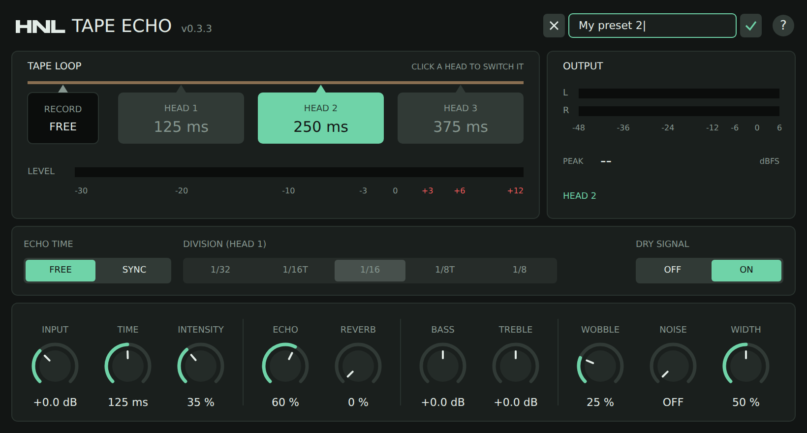

# HNL Tape Echo

A tape echo with three playback heads and a spring reverb, in the spirit of the tape echo machines of the
1970s. The repeats are warm, and they darken and saturate. The pitch bends when you turn the time. Push it and
the echo starts to howl on its own.

| Default | Help tips | Presets | Saving a preset |
| --- | --- | --- | --- |
|  |  |  |  |

*These pictures are rendered from the plugin's drawing code, not taken from a DAW.*

## What it does

- **Three heads on one tape.** Head 1 plays at the echo time, heads 2 and 3 at twice and three times that. Switch
  them in any combination for single echoes or rhythms.
- **A tape that moves.** The time control sets the tape speed. Turning it bends the pitch of the echoes already
  on the tape, and the motor takes a moment to follow. Long times are darker than short ones.
- **Saturating repeats.** The echo is recorded again and again through the tape, so every repeat is a little
  more compressed and coloured. Past about 60% intensity it feeds itself and howls, held in check by the tape.
- **Spring reverb.** Three springs with the splashy upward sweep of the real thing. The echoes reverberate too.
- **Wow, flutter and hiss.** An unsteady tape speed, and noise that is recorded along with the signal.
- **Tempo sync.** The echo time can follow the song tempo.

## Quick start

1. Put HNL Tape Echo on a track as an insert, or on a send. On a send, switch **Dry signal** off.
2. Click the heads in the tape loop to choose which ones play.
3. Set the echo time with **Time**, or switch to Sync and pick a **Division**.
4. Set the number of repeats with **Intensity**, and the levels with **Echo** and **Reverb**.

A howling echo is loud. The tape holds it back, but Echo, Bass and Treble come after the tape. Put a limiter
behind the plugin if you plan to play with Intensity.

## Controls

| Control | What it changes |
| --- | --- |
| Head 1, 2, 3 | Click a head in the tape loop to switch it on or off. Each shows its echo time. |
| Echo time: Free / Sync | Free: the Time knob sets the time. Sync: it follows the tempo of the song. |
| Division | The note value of head 1 with Sync on: 1/32, 1/16 triplet, 1/16, 1/8 triplet or 1/8. With 1/16, head 2 plays an eighth and head 3 a dotted eighth. |
| Dry signal | On for use as an insert. Off for a send: echo and reverb only. |
| Input | Level onto the tape, -12 to +24 dB. Higher drives the tape harder. The level meter reads 0 where the tape starts to saturate clearly (a sine at -12 dBFS with Input at 0). |
| Time | Head 1, from 40 to 400 ms; head 3 reaches 1.2 s. |
| Intensity | How much of the echo is recorded again. One head starts to sustain on its own somewhere past 60%; three heads do so below 50%. |
| Echo | Echo level. At 100% the first repeat is as loud as the input. |
| Reverb | Spring reverb level. The springs are driven by the input and by the echoes (as loud as Echo sets them) and decay in about 2 seconds. |
| Bass, Treble | Tone of the echo, ±10 dB around 200 Hz and from 2.5 kHz. They sit inside the repeat loop, so each repeat gets them again. |
| Wobble | Wow and flutter. 25% is a machine in good order (a few cents of pitch movement); 100% needs service. |
| Noise | Tape hiss: off at 0, about 60 dB under the tape level at 50%, 20 dB more at 100%. With Intensity up it builds and can start the howl on its own. |
| Width | Spreads head 1 to the left, head 3 to the right and the springs apart. At 0% everything is mono. |

Drag a knob up or down. Hold Shift for fine steps, or use the mouse wheel. A double-click or Ctrl-click returns a
knob to its default.

## Presets and help

The menu at the top right holds thirteen presets. *Save as...* at the end of the list keeps your current
settings under a name of your own, for use in every song.

The **?** button switches help tips on. Rest the mouse on any control to read what it does.

## The window

The cog at the top right lists the looks (Classic, Hi-Fi Black and Hi-Fi Silver) and the window sizes (75 to
200 %). Where the DAW allows it you can also drag the window by its edge. A look applies to every HNL plugin at
once, and the size is remembered for this plugin. Neither is saved with the song.

## How it works

The tape is modelled as it moves. Every recorded sample remembers where on the tape it was written, and each
head plays what is passing under it. Speed changes, wow and flutter therefore behave as they do on a machine.
The springs are chains of allpass filters in a loop. The plugin adds no latency.

It is built from how such machines are known to behave, not measured from one, and it is not affiliated with
any maker of echo machines.

## Limits

- The echo itself is mono, as on machines of this kind. **Width** only places the heads on the way out.
- Tape splices, motor noise and the wear of a particular unit are not modelled.
- A howling echo is loud, and Echo, Bass and Treble come after the tape that holds it back. Follow with a
  limiter.

## Installing

[Download HNL-Tape-Echo-win64.zip](https://github.com/c-kick/hnl-vsts/releases/download/downloads/HNL-Tape-Echo-win64.zip): the current build, for 64-bit Windows.

The zip holds the plugin as VST3 (copy the `.vst3` folder to `C:\Program Files\Common Files\VST3\`) and as CLAP
(copy the `.clap` file to `C:\Program Files\Common Files\CLAP\`). Your DAW needs only one of the two.

## For developers

From the repository root, `./build.sh hnl-tape-echo` builds the plugin and `./test.sh hnl-tape-echo` runs its
tests (see the [main readme](../../README.md)).

- `dsp/TapeEcho.hpp`: the tape, the heads and the springs.
- `EchoPlugin.cpp`, `EchoUI.cpp`: the DPF plugin and its window.
- `Params.hpp`, `Presets.hpp`, `Help.hpp`: the parameters, the presets and the help tips.
- `tests/run.sh`: runs `dsp_test` (plainly, and with the flags the plugin is built with), `plugin_test`,
  `abuse_test` (`common/tests/HostAbuse.hpp`) and the window tests shared by all HNL plugins.

## Changelog

### 0.5.0 (2026-11-27)

- New: the window can be made larger and smaller. The cog at the top right lists the sizes (75 to 200 %) under the
  looks, and where the host allows it the window can be dragged by its edge, down to three quarters of its design
  size. It keeps its shape, everything in it is drawn anew at the size it has, and it opens next time at the size
  it was left at. The size is kept for this plugin, not in the song, and changes nothing about the sound.

### 0.4.0 (2026-11-22)

- New: three looks. Classic, the look the plugin has always had, stays the default; Hi-Fi Black and Hi-Fi Silver
  dress the same window as a piece of hi-fi equipment. The cog at the top right chooses, for every HNL plugin at
  once. The choice changes nothing about the sound and is not stored in the song.
- To make room for the cog, the preset bar and the help button stand 28 pixels further left.

### 0.3.3 (2026-11-18)

- Fixed: samples and parameter values that are not numbers are caught again in the builds made with clang.

### 0.3.2 (2026-11-17)

- Fixed: a preset's name can be typed in a host that hands over the keys without their text.
- The licence text (GPL-3.0-or-later) comes with the download.

### 0.3.1 (2026-11-17)

- The version is shown behind the title, next to the HNL logo; the preset bar stands at the right.
- The preset menu spreads a long list evenly over its columns.
- A CLAP build next to the VST3.

### 0.3.0 (2026-11-17)

- New: presets of your own, saved, replaced and deleted from the preset menu.

### 0.2.1 (2026-11-17)

- Guards against samples and parameter values that are not numbers, and against whatever else a host may send.

### 0.2.0 (2026-11-16)

- The echoes feed the spring reverb.

### 0.1.0 (2026-11-16)

- First version: a three-head tape echo with spring reverb.
