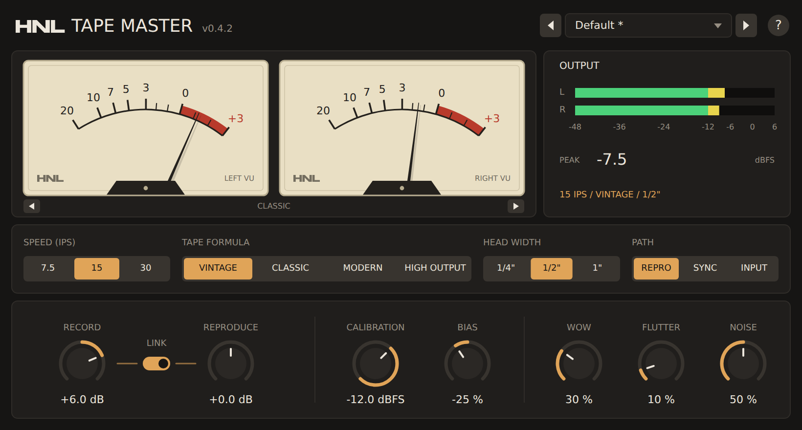
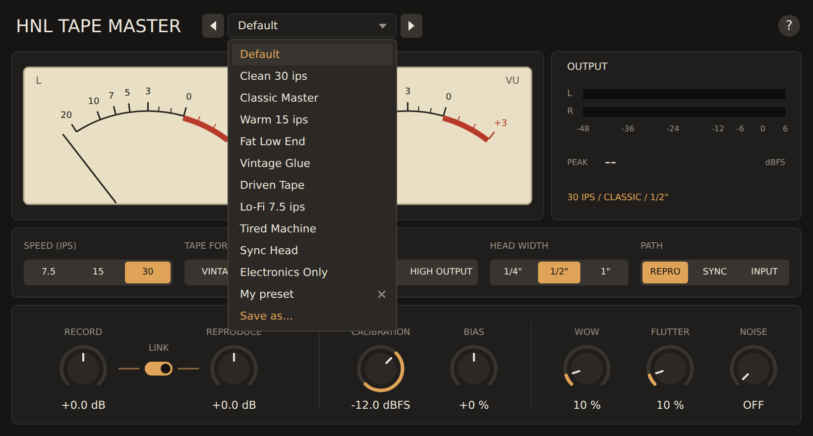
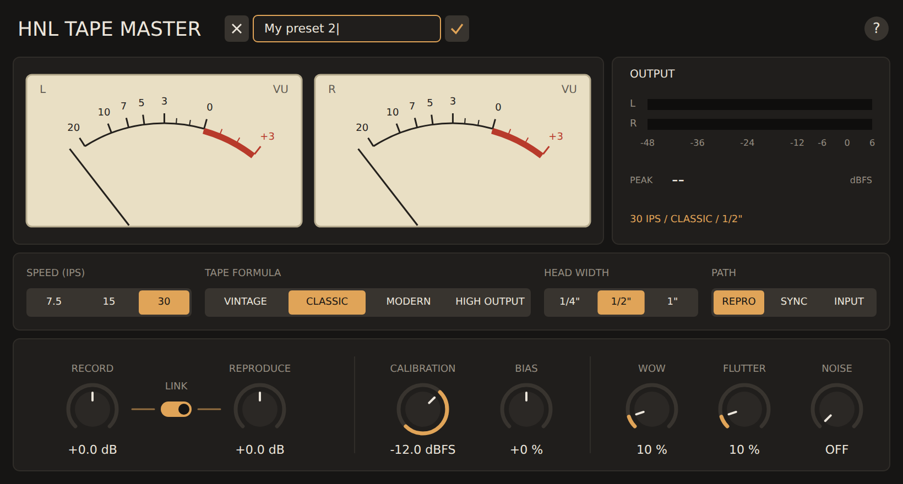

# HNL Tape Master

A two-track mastering tape machine for the master bus or a mix bus: the sound of recording onto half-inch tape
and playing it back.

| Help tips | Presets | Saving a preset |
| --- | --- | --- |
|  |  |  |

| Meter design: Arc | Meter design: LEDs |
| --- | --- |
|  |  |

*Rendered from the plugin's drawing code; not yet a screenshot from a host.*

## What it does

- **Tape saturation:** almost purely odd harmonics. Each formula reaches 3% third harmonic at its own level.
- **Tape compression:** loud peaks are rounded off; the further over 0 VU, the more.
- **High-frequency behaviour:** the top saturates before the rest, most on slow tape, and falls off earlier at
  lower speeds.
- **Low-frequency behaviour:** the head bump (a lift of 1 to 3 dB) with a roll-off below it. Both move up with
  the tape speed.
- **Wow and flutter:** slow and fast pitch movement from the transport, the same for both channels.
- **Hiss:** tape noise, off by default.

## Controls

| Control | What it changes |
| --- | --- |
| Speed | 30 ips is the cleanest and most extended, with the bump around 110 Hz. 15 ips has more character and a bump around 55 Hz. 7.5 ips is the most coloured: early top roll-off, the top saturates easily, more hiss. |
| Tape formula | Vintage: little headroom, soft knee, noisiest. Classic. Modern. High Output: stays clean longest, then firm. Headroom (3% third harmonic) is +6, +9, +12 and +15 dB over 0 VU. |
| Head width | 1/4", 1/2" or 1". Narrow tracks have a bigger head bump and more hiss; each doubling is 3 dB less noise. |
| Path | Repro: the full machine. Sync: playback through the record head, duller with a bigger, lower bump. Input: electronics only, no tape. |
| Record | How hard the tape is driven. The VU meters show the level on tape. |
| Reproduce | Playback level. |
| Link | Takes the record level off again at the output, so turning Record changes the colour, not the volume. |
| Calibration | The level in your mix that the machine treats as 0 VU, from -24 to -6 dBFS (default -12). If the needles sit pinned in the red with Record at 0, raise it. |
| Bias | Towards under: brighter, quiet signals get rougher. Towards over: duller top, cleaner lows. |
| Wow, Flutter | 10% is a well-kept machine (about 0.04% pitch movement); 100% is a tired one (about 0.3%). |
| Noise | 0 is off, 50% is the level of real tape, 100% is 20 dB more. |

The two arrows under the VU meters step through three designs: a needle over a printed card (Classic), an arc that
fills with the reading as a figure (Arc) and a row of lights (LEDs). The choice is kept with the song and changes
nothing about the sound; a new instance starts on Classic.

Eleven presets are in the menu at the top right; they leave Calibration alone. The **?** button switches help on:
rest the mouse on any control to read what it does.

Drag a knob up or down (Shift for fine steps, mouse wheel also works); double-click or Ctrl-click returns it to
its default. Latency is about 1.8 ms and is reported to the host.

## About the model

It is built from the documented behaviour of professional half-track mastering machines and tape stock, not
measured from one machine, and it is not affiliated with any tape machine or tape manufacturer. The saturation
is a memoryless curve between pre- and de-emphasis, 4x oversampled; magnetic hysteresis, crosstalk and hum are
not modelled.

## Installing

Download the zip from the [releases](https://github.com/c-kick/hnl-vsts/releases). It holds the plugin as VST3
(copy the `.vst3` folder to `C:\Program Files\Common Files\VST3\`) and, from the first release after 17 November
2026 on, as CLAP (copy the `.clap` file to `C:\Program Files\Common Files\CLAP\`). A host needs only one of the
two. Windows 64-bit.
