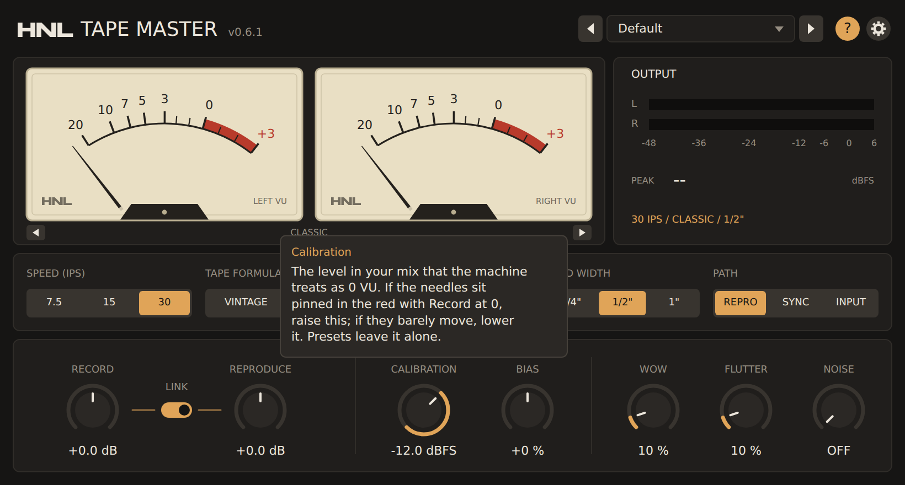
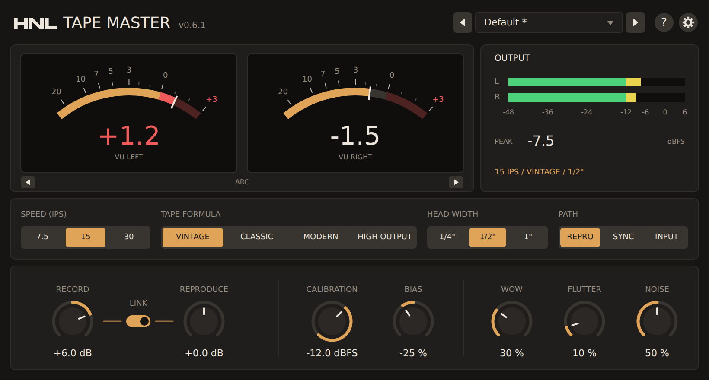
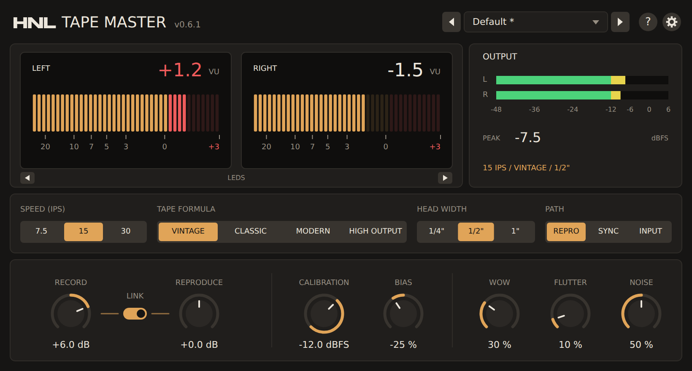

# HNL Tape Master

A two-track mastering tape machine for the master bus or a mix bus. It gives you the sound of recording onto
half-inch tape and playing it back.

| Help tips | Presets | Saving a preset |
| --- | --- | --- |
|  |  |  |

| Meter design: Arc | Meter design: LEDs |
| --- | --- |
|  |  |

*These pictures are rendered from the plugin's drawing code, not taken from a DAW.*

## What it does

- **Tape saturation.** Almost purely odd harmonics. Each formula reaches 3% third harmonic at its own level.
- **Tape compression.** Loud peaks are rounded off, and more so the further they go over 0 VU.
- **High-frequency behaviour.** The top saturates before the rest, most on slow tape, and falls off earlier at
  lower speeds.
- **Low-frequency behaviour.** The head bump (a lift of 1 to 3 dB) with a roll-off below it. Both move up with
  the tape speed.
- **Wow and flutter.** Slow and fast pitch movement from the transport, the same for both channels.
- **Hiss.** Tape noise, off by default.

## Quick start

1. Put HNL Tape Master on the master bus or a mix bus.
2. Watch the VU needles with **Record** at 0. If they sit pinned in the red, raise **Calibration**. If they
   barely move, lower it.
3. Choose a **Speed** and a **Tape formula**, or pick a preset. Presets leave Calibration alone.
4. Turn **Record** up for more saturation and tape compression. With **Link** on, the volume stays the same.

## Controls

| Control | What it changes |
| --- | --- |
| Speed | 30 ips is the cleanest and most extended, with the bump around 110 Hz. 15 ips has more character and a bump around 55 Hz. 7.5 ips is the most coloured: early top roll-off, the top saturates easily, more hiss. |
| Tape formula | Vintage: little headroom, soft knee, noisiest. Classic. Modern. High Output: stays clean longest, then firm. Headroom (3% third harmonic) is +6, +9, +12 and +15 dB over 0 VU. |
| Head width | 1/4", 1/2" or 1". Narrow tracks have a bigger head bump and more hiss; each doubling is 3 dB less noise. |
| Path | Repro: the full machine. Sync: playback through the record head, duller with a bigger, lower bump. Input: electronics only, no tape. |
| Record | How hard the tape is driven. The VU meters show the level on tape. |
| Reproduce | Playback level. |
| Link | Takes the record level off again at the output, so turning Record changes the colour, not the volume. |
| Calibration | The level in your mix that the machine treats as 0 VU, from -24 to -6 dBFS (default -12). If the needles sit pinned in the red with Record at 0, raise it. |
| Bias | Towards under: brighter, quiet signals get rougher. Towards over: duller top, cleaner lows. |
| Wow, Flutter | 10% is a well-kept machine (about 0.04% pitch movement); 100% is a tired one (about 0.3%). |
| Noise | 0 is off, 50% is the level of real tape, 100% is 20 dB more. |

Drag a knob up or down. Hold Shift for fine steps, or use the mouse wheel. A double-click or Ctrl-click returns a
knob to its default.

## Presets and help

The menu at the top right holds eleven presets. They leave Calibration alone. *Save as...* at the end of the
list keeps your current settings under a name of your own, for use in every song.

The **?** button switches help tips on. Rest the mouse on any control to read what it does.

## The window

The two arrows under the VU meters step through three meter designs: a needle over a printed card (Classic), an
arc that fills, with the reading as a figure (Arc), and a row of lights (LEDs). The choice is saved with the song
and does not change the sound. A new instance starts on Classic.

The cog at the top right lists the looks (Classic, Hi-Fi Black and Hi-Fi Silver) and the window sizes (75 to
200 %). Where the DAW allows it you can also drag the window by its edge. A look applies to every HNL plugin at
once, and the size is remembered for this plugin. Neither is saved with the song.

## How it works

The plugin is built from the documented behaviour of professional half-track mastering machines and tape stock,
not measured from one machine. It is not affiliated with any tape machine or tape manufacturer.

The saturation is a memoryless curve between pre-emphasis and de-emphasis, four times oversampled.

## Limits

- Magnetic hysteresis, crosstalk and hum are not modelled.
- The tape rounds peaks off but does not limit. Keep an eye on the output level, or follow with a limiter.
- Latency is about 1.8 ms. It is reported to the DAW.

## Installing

[Download HNL-Tape-Master-win64.zip](https://github.com/c-kick/hnl-vsts/releases/download/downloads/HNL-Tape-Master-win64.zip): the current build, for 64-bit Windows.

The zip holds the plugin as VST3 (copy the `.vst3` folder to `C:\Program Files\Common Files\VST3\`) and as CLAP
(copy the `.clap` file to `C:\Program Files\Common Files\CLAP\`). Your DAW needs only one of the two.

## For developers

From the repository root, `./build.sh hnl-tape-master` builds the plugin and `./test.sh hnl-tape-master` runs
its tests (see the [main readme](../../README.md)).

- `dsp/TapeMachine.hpp`: the tape machine.
- `TapePlugin.cpp`, `TapeUI.cpp`: the DPF plugin and its window.
- `Params.hpp`, `Presets.hpp`, `Help.hpp`: the parameters, the presets and the help tips.
- `tests/run.sh`: runs `dsp_test` (plainly, and with the flags the plugin is built with), `plugin_test`,
  `abuse_test` (`common/tests/HostAbuse.hpp`) and the window tests shared by all HNL plugins.

## Changelog

### 0.6.1 (2026-11-28)

- Fixed: on Windows, on a display set to another scale than 100 %, clicks could land beside what was drawn, so that
  knobs and buttons did not answer or another one did. The window was made larger for the display's scale without
  the plugin being told, and it read every click that much too far right and down (at 125 %, a quarter). It now goes
  by the size its window really has. Reported for HNL Sampler in Cubase and Studio One; found by reading the code
  that makes the window, and not yet seen fixed in those DAWs themselves.

### 0.6.0 (2026-11-27)

- New: the window can be made larger and smaller. The cog at the top right lists the sizes (75 to 200 %) under the
  looks, and where the host allows it the window can be dragged by its edge, down to three quarters of its design
  size. It keeps its shape, everything in it is drawn anew at the size it has, and it opens next time at the size
  it was left at. The size is kept for this plugin, not in the song, and changes nothing about the sound.

### 0.5.0 (2026-11-22)

- New: three looks. Classic, the look the plugin has always had, stays the default; Hi-Fi Black and Hi-Fi Silver
  dress the same window as a piece of hi-fi equipment. The cog at the top right chooses, for every HNL plugin at
  once. The choice changes nothing about the sound and is not stored in the song.
- To make room for the cog, the preset bar and the help button stand 28 pixels further left.

### 0.4.2 (2026-11-18)

- Fixed: samples and parameter values that are not numbers are caught again in the builds made with clang.

### 0.4.1 (2026-11-17)

- Fixed: a preset's name can be typed in a host that hands over the keys without their text.
- The licence text (GPL-3.0-or-later) comes with the download.

### 0.4.0 (2026-11-17)

- The version is shown behind the title, next to the HNL logo; the preset bar stands at the right.
- The preset menu spreads a long list evenly over its columns.
- The meter comes in three designs (classic, arc, leds).
- A CLAP build next to the VST3.

### 0.3.0 (2026-11-17)

- New: presets of your own, saved, replaced and deleted from the preset menu.

### 0.2.1 (2026-11-17)

- Fixed: back from the Input path to Repro or Sync, the tape let out a thump of old sound; its filters now start clean.
- Guards against samples and parameter values that are not numbers, and against whatever else a host may send.

### 0.2.0 (2026-11-16)

- New: help tips, the preset bar shared by all HNL plugins, tape presets and calibration.

### 0.1.0 (2026-11-16)

- First version: a two-track mastering tape machine.
