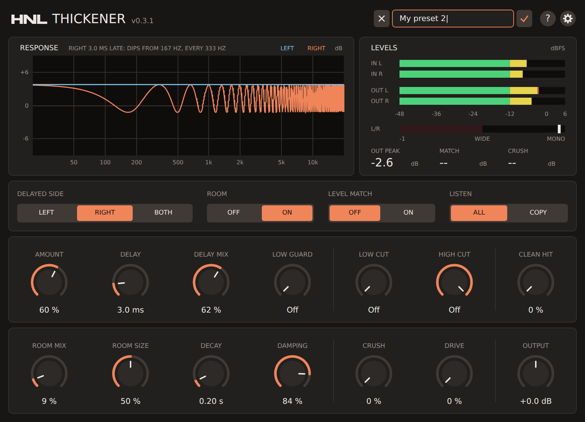

# HNL Thickener

Thickens drums and beats, and anything else that sits in the middle of the stereo picture. Your sound passes
through untouched. On top of it the plugin adds a copy in which one channel is a few milliseconds late. That
copy goes through a small room and, if you want, a compressor and a saturator.

| Parallel Crush preset, Level Match on | Body Only preset |
| --- | --- |
|  |  |

| Help tips | Presets | Saving a preset |
| --- | --- | --- |
|  |  |  |

*These pictures are rendered from the plugin's drawing code, not taken from a DAW.*

## Installing

[Download HNL-Thickener-win64.zip](https://github.com/c-kick/hnl-vsts/releases/download/downloads/HNL-Thickener-win64.zip),
the current build for 64-bit Windows.

The zip holds the plugin as VST3 and as CLAP. Your DAW needs only one of the two.

- **VST3:** copy the `.vst3` folder to `C:\Program Files\Common Files\VST3\`.
- **CLAP:** copy the `.clap` file to `C:\Program Files\Common Files\CLAP\`.

## Quick start

1. Put HNL Thickener on a drum bus, a beat, or any other sound that sits in the middle.
2. Start with the Default preset and turn **Amount** to taste.
3. Switch **Level Match** on while you compare. More Amount is also louder, and Level Match takes that out.
4. To keep the kick and the sub in the middle, turn up **Low Guard**.
5. Set **Listen** to Copy to hear only what the plugin adds.

The **?** button switches on help tips for every control.

## How it works

    in ──┬────────────────────────────────────────────────────────────► + ─► match ─► output
         │                                                              ▲
         └─► tone ─► clean hit ─► late channel ─► room ─► crush ─► drive ─► × amount

- **The signal itself passes untouched.** Everything the plugin does is added on top, so more Amount is also
  louder, by about 3 dB at the default settings. Level Match takes that back out when you want to compare.
- **One channel of the copy is late**, by 3 ms unless you change it. That is too short to hear as an echo.
  Added to the signal it makes shallow dips in that channel, 333 Hz apart from 167 Hz up, and the other channel
  does not have them. A sound in the middle is pulled a little apart at those pitches. That is the thickening.
- **Or both channels are late, by different amounts** (Delayed Side: Both). Each channel then has its dips
  where the other has none, the two are equally loud, and the sound stays in the middle.
- **Low Guard** keeps the lows of the copy on time, so the kick and the sub stay in the middle.
- **Low Cut and High Cut** work on the copy and choose what is thickened. You can thicken only the body, for
  example, and leave the sub and the hats alone.
- **Clean Hit** turns the copy down for the first moment of each hit. The attack stays as it went in, and only
  what follows it is thickened.
- **A small room** in the copy adds a short, dark tail under the hits. It also hears the two channels at
  different times. You can switch it off.
- **Crush** compresses the copy hard, as on a parallel drum bus. The quiet parts of the copy come up, and the
  room with them. **Drive** saturates the copy. Neither touches the signal itself.
- **Safe in mono.** At the default settings the response of the two channels summed moves by about 2 dB and
  has no deep holes. The L/R bar shows how alike the two outputs are.

## Controls

| Control | What it changes |
| --- | --- |
| Amount | 0 to 100%: level of the added copy. At 100% it is as loud as the signal itself. |
| Delay | 0.1 to 20 ms: how late the delayed channel of the copy is. The first dip lies at 500 / delay Hz (167 Hz at 3 ms). |
| Delay Mix | 0 to 100%: how much of that channel is late. The rest stays on time. |
| Delayed Side | Left, Right or Both. With Both the left is late by 62% of the delay, the right by all of it. |
| Low Guard | Off, or 10 to 400 Hz: below it next to nothing in the copy is late. |
| Low Cut | Off, or up to 2 kHz: takes the lows out of the copy. |
| High Cut | Off, or down to 500 Hz: takes the highs out of the copy. |
| Clean Hit | 0 to 100%: how far the copy is turned down on each hit, up to 18 dB. |
| Room | On or Off. |
| Room Mix | 0 to 100%: how much of the copy is room sound. |
| Room Size | 0 to 100%: how far apart the room's reflections are. |
| Decay | 0.1 to 1.5 s: the time for the room's tail to fall by 60 dB. |
| Damping | 0 to 100%: how fast the highs of the room die away (from 16 kHz down to 1 kHz). |
| Crush | 0 to 100%: compression of the copy. The threshold goes down to -40 dBFS, at 6:1, with make-up. |
| Drive | 0 to 100%: saturation of the copy, up to 18 dB into the saturator. |
| Level Match | On: the output is turned down by as much as the copy made it louder, following the last moment. |
| Listen | All, or Copy: only what the plugin adds. |
| Output | -12 to +12 dB on everything coming out. |

Drag a knob up or down to turn it. Hold Shift for fine steps, or use the mouse wheel. A double-click or
Ctrl-click returns a knob to its default. The plugin adds no latency.

**The plot** shows what the left and the right channel do to a steady tone. The room, Clean Hit, Crush and
Drive are left out of it, because what they do depends on the sound.

**The meters.** Under the level bars, the L/R bar shows how alike the two outputs are. At the right end they
are the same, towards the middle they differ, and left of the middle they cancel each other in mono. Next to
it you find the peak coming out, the gain Level Match applies and how far Crush turns the copy down.

**Presets.** The menu at the top right holds fifteen presets, and *Save as...* keeps your own. Presets leave
Level Match and Listen as they are.

**Help.** The **?** button switches help on. Rest the mouse on any control to read what it does.

## Measured

On a kick, snare and hat loop in the middle of the stereo picture (the same on both channels):

| Setting | Louder | Lows, left against right | Peak against average |
| --- | --- | --- | --- |
| Default | 3.1 dB | left 1.2 dB louder | 18.5 dB (17.9 going in) |
| Delayed Side: Both | 2.8 dB | left 0.7 dB louder | 17.6 dB |
| Low Guard 150 Hz | 3.9 dB | right 0.5 dB louder | 17.7 dB |
| Clean Hit 100% | 1.9 dB | left 0.7 dB louder | 16.6 dB |
| Crush 60% | 3.3 dB | left 1.2 dB louder | 18.2 dB |
| Drive 55% | 3.4 dB | left 0.9 dB louder | 16.4 dB |
| Parallel Crush preset | 3.2 dB | level within 0.3 dB | 16.8 dB |
| Default with Level Match | 0.0 dB | left 1.2 dB louder | 18.5 dB |

At the default settings and with a steady tone, the right channel is about 5.4 dB below the left at 167, 500 and
833 Hz, and the two are equal at 333, 667 and 1000 Hz.

## Where it comes from

The Default preset follows a rack patch built from a splitter, a delay, a small room reverb and a line mixer.
In that patch the right channel of the split signal went through a 3 ms delay, set 62% wet, into the reverb
(9% wet), and the reverb's output was mixed under the direct signal.

The routing and the delay are copied exactly. The room is our own model (eight short delay lines feeding each
other) and not a copy of that reverb. The level of the copy (60%) is an estimate of the mixer setting.
Everything else was added here and is off in the Default preset: Both, Low Guard, the cuts, Clean Hit, Crush,
Drive and Level Match. The plugin is not affiliated with the makers of those devices.

## The window

The cog at the top right lists the looks (Classic, Hi-Fi Black and Hi-Fi Silver) and the window sizes (75 to
200 %). Where the DAW allows it you can also drag the window by its edge. The look applies to every HNL plugin
at once, and the size is remembered for this plugin. Neither is saved with the song or changes the sound.

## Limits

- Windows 64-bit only.
- Nothing limits the output, so it can go over 0 dBFS. Turn Output down, or put a limiter after the plugin.
- Drive is not oversampled. On very bright material it can get harsh at high settings. High Cut on the copy
  takes care of that.

## For developers

### Tests

`tests/run.sh` runs six test programs:

- `dsp_test` measures the thickener. It runs twice: plainly, and with the flags the plugin is built with.
- `plugin_test` runs the plugin in DPF's wrapper.
- `abuse_test` does everything a DAW is allowed to do (`common/tests/HostAbuse.hpp`).
- `ui_presets_test`, `ui_skin_test` and `ui_size_test` drive the window itself: saving, loading and deleting a
  preset, the choice of look and the size of the window. These three are shared by all plugins (`common/tests/`).

### Code

- `dsp/Thickener.hpp`: the engine.
- `ThickenerPlugin.cpp`, `ThickenerUI.cpp`: the DPF plugin and its window.
- `Params.hpp`, `Presets.hpp`, `Help.hpp`: the parameters, the presets and the help texts.

The parameters the DAW sees are the eighteen controls in the table above, where Decay and Damping are called
Room Decay and Room Damping. On top of those come seven meters it can read: input and output peak left and
right, the gain reduction of Crush, the gain of Level Match and the correlation between left and right. New
parameters are added at the end, because DAWs store automation by position.

## Changelog

### 0.3.1 (2026-11-28)

- Fixed: on Windows, on a display set to another scale than 100 %, clicks could land beside what was drawn, so that
  knobs and buttons did not answer or another one did. The window was made larger for the display's scale without
  the plugin being told, and it read every click that much too far right and down (at 125 %, a quarter). It now goes
  by the size its window really has. Reported for HNL Sampler in Cubase and Studio One; found by reading the code
  that makes the window, and not yet seen fixed in those DAWs themselves.

### 0.3.0 (2026-11-27)

- New: the window can be made larger and smaller. The cog at the top right lists the sizes (75 to 200 %) under the
  looks, and where the host allows it the window can be dragged by its edge, down to three quarters of its design
  size. It keeps its shape, everything in it is drawn anew at the size it has, and it opens next time at the size
  it was left at. The size is kept for this plugin, not in the song, and changes nothing about the sound.

### 0.2.0 (2026-11-22)

- New: three looks. Classic, the look the plugin has always had, stays the default; Hi-Fi Black and Hi-Fi Silver
  dress the same window as a piece of hi-fi equipment. The cog at the top right chooses, for every HNL plugin at
  once. The choice changes nothing about the sound and is not stored in the song.
- To make room for the cog, the preset bar and the help button stand 28 pixels further left.

### 0.1.2 (2026-11-18)

- Fixed: samples and parameter values that are not numbers are caught again in the builds made with clang.

### 0.1.1 (2026-11-17)

- Fixed: a preset's name can be typed in a host that hands over the keys without their text.
- The licence text (GPL-3.0-or-later) comes with the download.

### 0.1.0 (2026-11-17)

- First version: a copy with one channel a few milliseconds late, through a small room, on top of the signal.
