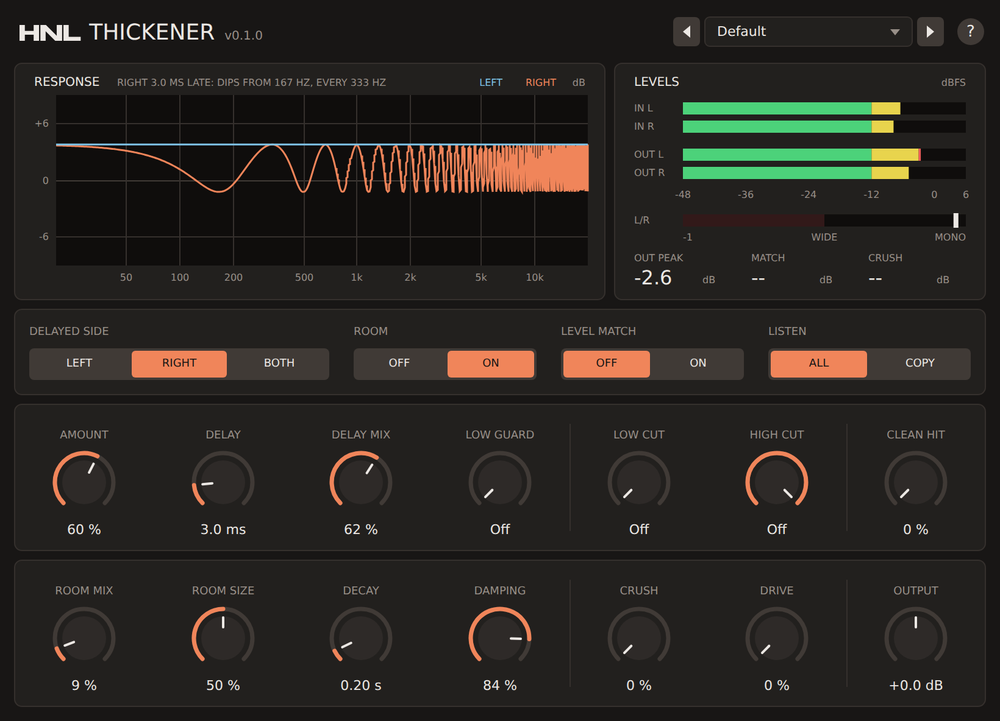
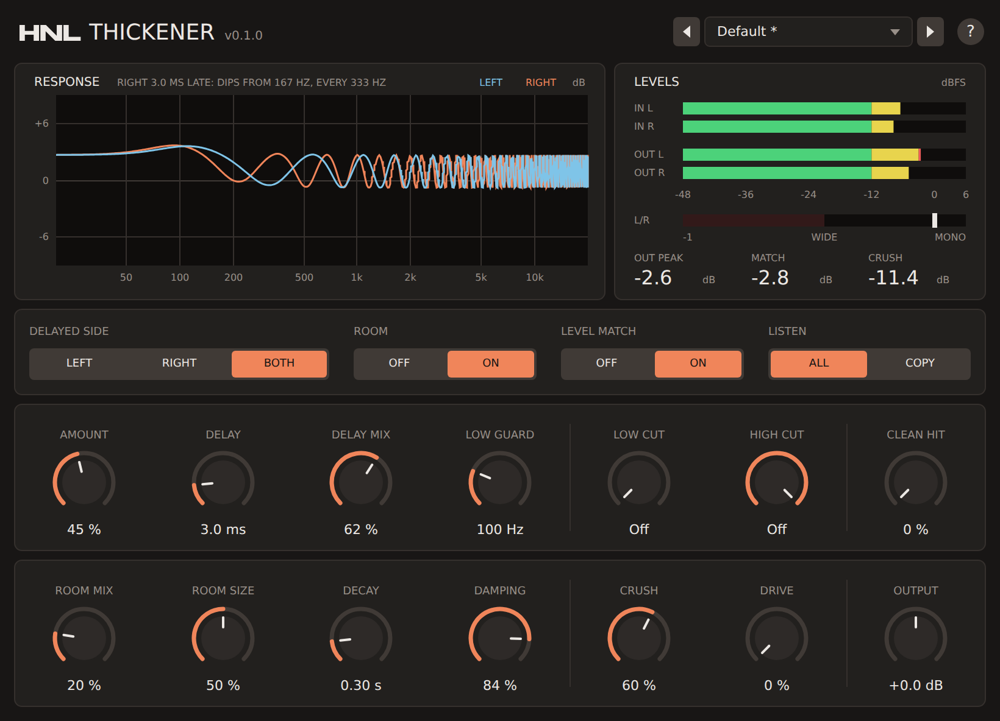
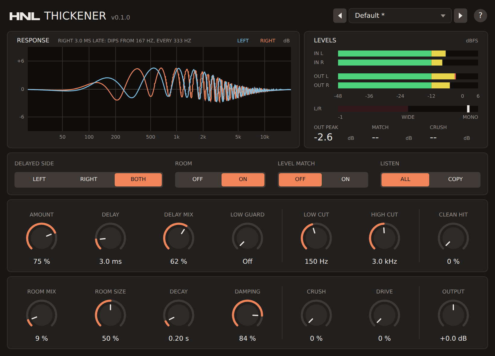
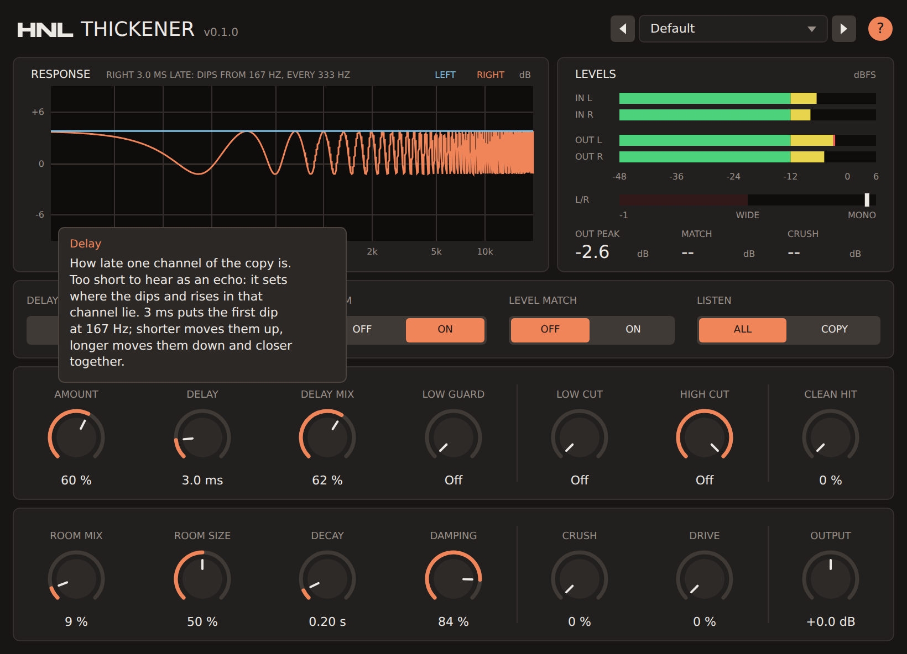
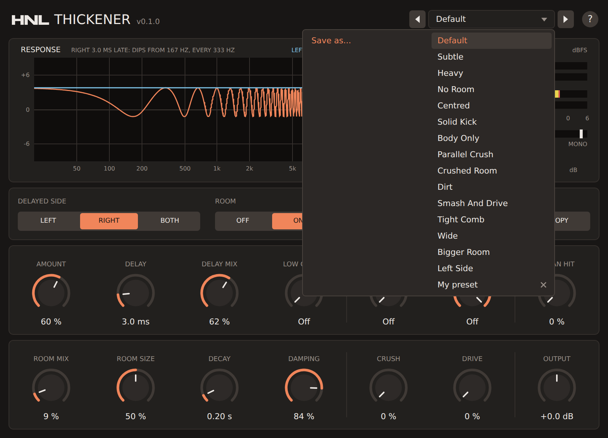

# HNL Thickener

Thickens drums and beats, and anything else that sits in the middle. On top of the untouched signal it adds a
copy in which one channel is a few milliseconds late, passed through a small room and, if wanted, a compressor
and a saturator.

| Parallel Crush preset, Level Match on | Body Only preset |
| --- | --- |
|  |  |

| Help tips | Presets | Saving a preset |
| --- | --- | --- |
|  |  |  |

*Rendered from the plugin's drawing code; not yet a screenshot from a host.*

## What it does

    in ──┬────────────────────────────────────────────────────────────► + ─► match ─► output
         │                                                              ▲
         └─► tone ─► clean hit ─► late channel ─► room ─► crush ─► drive ─► × amount

- **The signal itself passes untouched.** Everything the plugin does is added on top, so more Amount is also
  louder: about 3 dB at the default settings. Level Match takes that back out for comparing.
- **One channel of the copy is late**, by 3 ms unless you change it. That is too short to hear as an echo.
  Added to the signal it makes shallow dips in that channel, 333 Hz apart from 167 Hz up, which the other
  channel does not have. A sound in the middle is pulled a little apart at those pitches, and that is the
  thickening.
- **Or both channels are late, by different amounts** (Delayed Side: Both). Each then has its dips where the
  other has none, the two are as loud as each other, and the sound stays in the middle.
- **Low Guard** keeps the lows of the copy on time, so the kick and the sub stay in the middle.
- **Low Cut and High Cut** on the copy choose what is thickened: only the body, say, with the sub and the hats
  left alone.
- **Clean Hit** turns the copy down for the first moment of each hit. The attack stays as it went in; only what
  follows it is thickened.
- **A small room** in the copy adds a short, dark tail under the hits, and hears the two channels at different
  times. It can be switched off.
- **Crush** compresses the copy hard, as on a parallel drum bus: its quiet parts come up, the room with them.
  **Drive** saturates it. Neither touches the signal itself.
- **Safe in mono:** at the default settings the response of the two channels summed moves by about 2 dB and has
  no deep holes. The L/R bar shows how alike the two outputs are.

Measured on a kick, snare and hat loop in the middle of the stereo picture (the same on both channels):

| Setting | Louder | Lows, left against right | Peak against average |
| --- | --- | --- | --- |
| Default | 3.1 dB | left 1.2 dB louder | 18.5 dB (17.9 going in) |
| Delayed Side: Both | 2.8 dB | left 0.7 dB louder | 17.6 dB |
| Low Guard 150 Hz | 3.9 dB | right 0.5 dB louder | 17.7 dB |
| Clean Hit 100% | 1.9 dB | left 0.7 dB louder | 16.6 dB |
| Crush 60% | 3.3 dB | left 1.2 dB louder | 18.2 dB |
| Drive 55% | 3.4 dB | left 0.9 dB louder | 16.4 dB |
| Parallel Crush preset | 3.2 dB | level within 0.3 dB | 16.8 dB |
| Default with Level Match | 0.0 dB | left 1.2 dB louder | 18.5 dB |

At the default settings and with a steady tone, the right channel is about 5.4 dB below the left at 167, 500 and
833 Hz, and the two are equal at 333, 667 and 1000 Hz.

## Controls

| Control | What it changes |
| --- | --- |
| Amount | 0 to 100%: level of the added copy. At 100% it is as loud as the signal itself. |
| Delay | 0.1 to 20 ms: how late the delayed channel of the copy is. The first dip lies at 500 / delay Hz (167 Hz at 3 ms). |
| Delay Mix | 0 to 100%: how much of that channel is late; the rest stays on time. |
| Delayed Side | Left, Right or Both. With Both the left is late by 62% of the delay, the right by all of it. |
| Low Guard | Off, or 10 to 400 Hz: below it next to nothing in the copy is late. |
| Low Cut | Off, or up to 2 kHz: takes the lows out of the copy. |
| High Cut | Off, or down to 500 Hz: takes the highs out of the copy. |
| Clean Hit | 0 to 100%: how far the copy is turned down on each hit, up to 18 dB. |
| Room | On or Off. |
| Room Mix | 0 to 100%: how much of the copy is room sound. |
| Room Size | 0 to 100%: how far apart the room's reflections are. |
| Decay | 0.1 to 1.5 s: the time for the room's tail to fall by 60 dB. |
| Damping | 0 to 100%: how fast the highs of the room die away (from 16 kHz down to 1 kHz). |
| Crush | 0 to 100%: compression of the copy. The threshold goes down to -40 dBFS, at 6:1, with make-up. |
| Drive | 0 to 100%: saturation of the copy, up to 18 dB into the saturator. |
| Level Match | On: the output is turned down by as much as the copy made it louder, following the last moment. |
| Listen | All, or Copy: only what the plugin adds. |
| Output | -12 to +12 dB on everything coming out. |

The plot shows what the left and the right channel do to a steady tone. The room, Clean Hit, Crush and Drive are
left out of it: they depend on the sound. Under the level bars the L/R bar shows how alike the two outputs are
(the same at the right end, different towards the middle, cancelling each other in mono left of it), followed by
the peak coming out, the gain Level Match applies and how far Crush turns the copy down. Nothing limits the
output, so it can go over 0 dBFS: turn Output down, or follow with a limiter.

Fifteen presets are in the menu at the top right; they leave Level Match and Listen as they are. The **?**
button switches help on: rest the mouse on any control to read what it does.

Drag a knob up or down (Shift for fine steps, mouse wheel also works); double-click or Ctrl-click returns it to
its default. There is no latency.

Drive is not oversampled: on very bright material it can get harsh at high settings. High Cut on the copy
takes care of that.

## Where it comes from

The Default preset follows a rack patch built from a splitter, a delay, a small room reverb and a line mixer:
the right channel of the split signal went through a 3 ms delay set 62% wet into the reverb (9% wet), and the
reverb's output was mixed under the direct signal. The routing and the delay are copied exactly. The room is a
model of our own (eight short delay lines feeding each other), not a copy of that reverb, and the level of the
copy (60%) is an estimate of the mixer setting. Everything else (Both, Low Guard, the cuts, Clean Hit, Crush, Drive,
Level Match) was added here and is off in the Default preset. The plugin is not affiliated with the makers of those devices.

## Installing

Download the zip from the [releases](https://github.com/c-kick/hnl-vsts/releases). It holds the plugin as VST3
(copy the `.vst3` folder to `C:\Program Files\Common Files\VST3\`) and as CLAP (copy the `.clap` file to
`C:\Program Files\Common Files\CLAP\`). A host needs only one of the two. Windows 64-bit.
