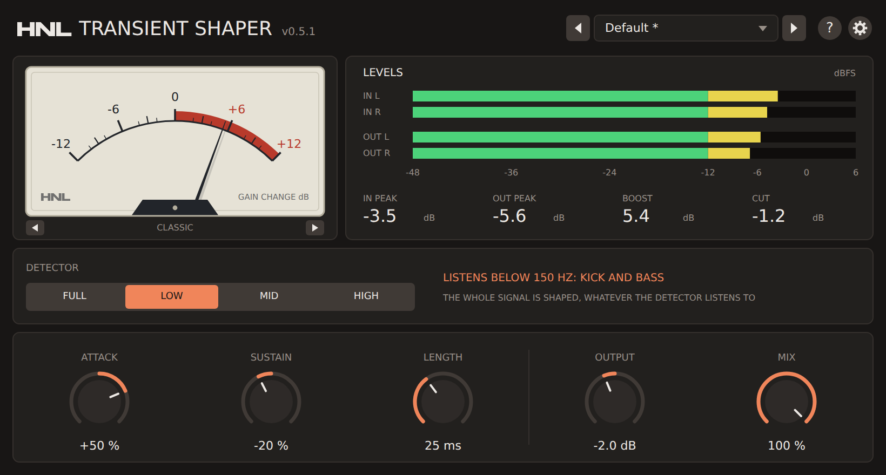
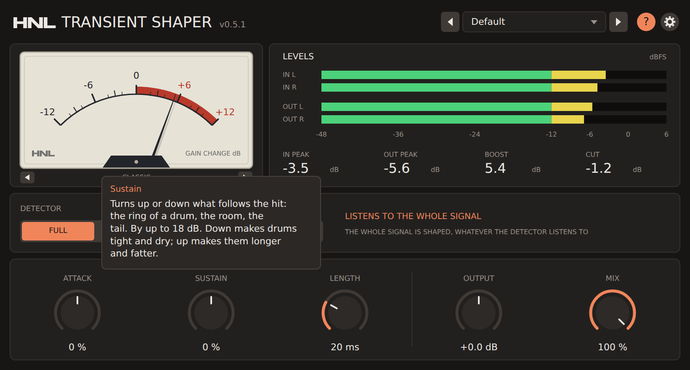
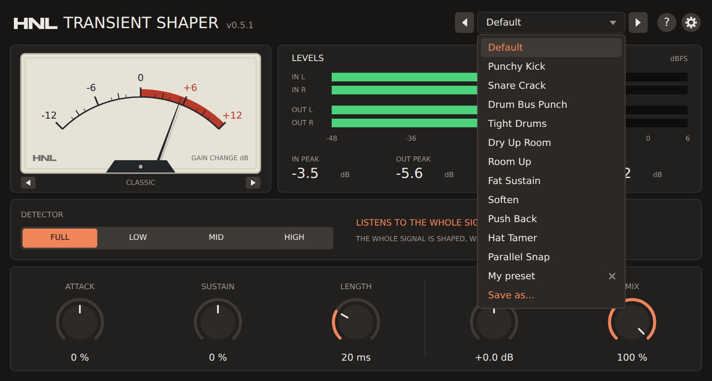
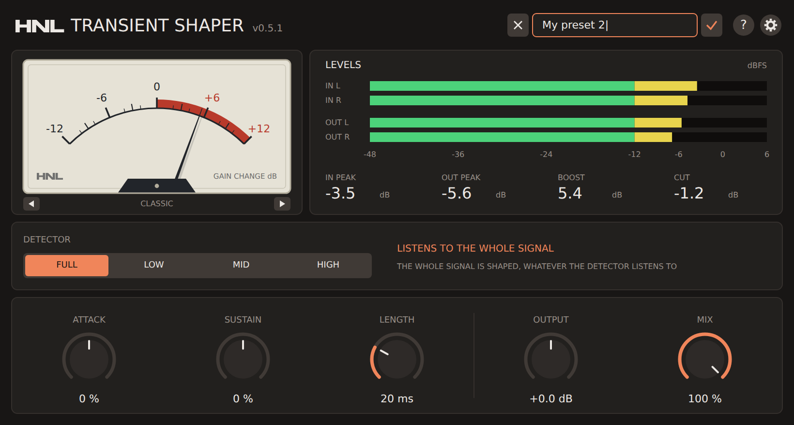
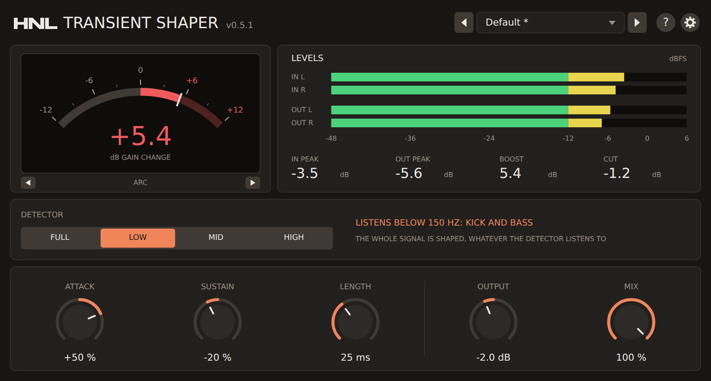

# HNL Transient Shaper

Turns the hit of each sound up or down separately from what follows it. It is made for drums: more punch, less
room, or the other way round.

| Help tips | Presets | Saving a preset |
| --- | --- | --- |
|  |  |  |

| Meter design: Arc | Meter design: LEDs |
| --- | --- |
|  |  |

*These pictures are rendered from the plugin's drawing code, not taken from a DAW.*

## What it does

- **No threshold.** It reacts to the shape of the sound, not its level. A quiet ghost note is shaped like a loud
  hit, and you do not have to set anything to the level of the track.
- **Attack.** The start of each sound, up or down by up to 12 dB. A large jump in level gets the full amount, a
  small one less.
- **Sustain.** What follows the hit (the ring of a drum, the room), up or down by up to 18 dB. A level that is
  simply held is left alone.
- **Detector range.** The detector can listen to only the lows, mids or highs. That lets you shape the kick
  without the hats setting it off, or the other way round. The whole signal is shaped either way.
- **Steady low notes are left alone.** The detector holds the level over the gaps between the waves of a low
  note, so it does not mistake a bass tone for a row of hits.

## Quick start

1. Put HNL Transient Shaper on a drum track or a drum bus.
2. Turn **Attack** up for more punch, or down to soften the hits.
3. Turn **Sustain** down for tight, dry drums, or up for longer, fatter ones.
4. Watch the output bar. More attack means higher peaks, so turn **Output** down if it goes over 0 dBFS.

## Controls

| Control | What it changes |
| --- | --- |
| Attack | -100 to +100%. Up gives punch and snap; down softens a sound and pushes it back. |
| Sustain | -100 to +100%. Down makes drums tight and dry; up makes them longer and fatter. |
| Length | 5 to 60 ms: how much of the start of a sound is treated as the hit. Short shapes only the click; long includes the body of the drum. |
| Detector | Full, Low (below 150 Hz), Mid (150 Hz to 2.5 kHz) or High (above 2.5 kHz). |
| Output | -12 to +12 dB on the shaped signal. More attack means higher peaks. |
| Mix | 0% is the untouched signal, 100% only the shaped one. |

The meter shows what the shaper is doing. It moves right when the signal is turned up and left when it is turned
down. Beside the level bars are the largest boost and cut of the last moment.

Drag a knob up or down. Hold Shift for fine steps, or use the mouse wheel. A double-click or Ctrl-click returns a
knob to its default.

## Presets and help

The menu at the top right holds twelve presets. *Save as...* at the end of the list keeps your current settings
under a name of your own, for use in every song.

The **?** button switches help tips on. Rest the mouse on any control to read what it does.

## The window

The two arrows under the meter step through three meter designs: a needle over a printed card (Classic), an arc
that fills, with the reading as a figure (Arc), and a row of lights (LEDs). The choice is saved with the song and
does not change the sound. A new instance starts on Classic.

The cog at the top right lists the looks (Classic, Hi-Fi Black and Hi-Fi Silver) and the window sizes (75 to
200 %). Where the DAW allows it you can also drag the window by its edge. A look applies to every HNL plugin at
once, and the size is remembered for this plugin. Neither is saved with the song.

## How it works

Three envelopes follow the detector's level in dB: one almost at once, one that rises slowly and one that falls
slowly. Where the first is above the second there is an attack. Where the third is above the first there is a
decay. Comparing envelopes like this is a well-known method. The plugin is not a copy of any existing unit and
is not affiliated with one.

The plugin looks 1 ms ahead, so the gain is in place when a hit arrives.

## Limits

- Nothing limits the output, so it can go over 0 dBFS. Turn **Output** down, or follow with a limiter.
- Latency is 1 ms, the time the plugin looks ahead. It is reported to the DAW.

## Installing

[Download HNL-Transient-Shaper-win64.zip](https://github.com/c-kick/hnl-vsts/releases/download/downloads/HNL-Transient-Shaper-win64.zip): the current build, for 64-bit Windows.

The zip holds the plugin as VST3 (copy the `.vst3` folder to `C:\Program Files\Common Files\VST3\`) and as CLAP
(copy the `.clap` file to `C:\Program Files\Common Files\CLAP\`). Your DAW needs only one of the two.

## For developers

From the repository root, `./build.sh hnl-transient-shaper` builds the plugin and
`./test.sh hnl-transient-shaper` runs its tests (see the [main readme](../../README.md)).

- `dsp/TransientShaper.hpp`: the detector and the shaping.
- `ShaperPlugin.cpp`, `ShaperUI.cpp`: the DPF plugin and its window.
- `Params.hpp`, `Presets.hpp`, `Help.hpp`: the parameters, the presets and the help tips.
- `tests/run.sh`: runs `dsp_test` (plainly, and with the flags the plugin is built with), `plugin_test`,
  `abuse_test` (`common/tests/HostAbuse.hpp`) and the window tests shared by all HNL plugins.

## Changelog

### 0.5.1 (2026-11-28)

- Fixed: on Windows, on a display set to another scale than 100 %, clicks could land beside what was drawn, so that
  knobs and buttons did not answer or another one did. The window was made larger for the display's scale without
  the plugin being told, and it read every click that much too far right and down (at 125 %, a quarter). It now goes
  by the size its window really has. Reported for HNL Sampler in Cubase and Studio One; found by reading the code
  that makes the window, and not yet seen fixed in those DAWs themselves.

### 0.5.0 (2026-11-27)

- New: the window can be made larger and smaller. The cog at the top right lists the sizes (75 to 200 %) under the
  looks, and where the host allows it the window can be dragged by its edge, down to three quarters of its design
  size. It keeps its shape, everything in it is drawn anew at the size it has, and it opens next time at the size
  it was left at. The size is kept for this plugin, not in the song, and changes nothing about the sound.

### 0.4.0 (2026-11-22)

- New: three looks. Classic, the look the plugin has always had, stays the default; Hi-Fi Black and Hi-Fi Silver
  dress the same window as a piece of hi-fi equipment. The cog at the top right chooses, for every HNL plugin at
  once. The choice changes nothing about the sound and is not stored in the song.
- To make room for the cog, the preset bar and the help button stand 28 pixels further left.

### 0.3.2 (2026-11-18)

- Fixed: samples and parameter values that are not numbers are caught again in the builds made with clang.

### 0.3.1 (2026-11-17)

- Fixed: a preset's name can be typed in a host that hands over the keys without their text.
- The licence text (GPL-3.0-or-later) comes with the download.

### 0.3.0 (2026-11-17)

- The version is shown behind the title, next to the HNL logo; the preset bar stands at the right.
- The preset menu spreads a long list evenly over its columns.
- The meter comes in three designs (classic, arc, leds).
- A CLAP build next to the VST3.

### 0.2.0 (2026-11-17)

- New: presets of your own, saved, replaced and deleted from the preset menu.

### 0.1.1 (2026-11-17)

- Guards against samples and parameter values that are not numbers, and against whatever else a host may send.

### 0.1.0 (2026-11-16)

- First version: attack and sustain shaping for drums, without a threshold.
