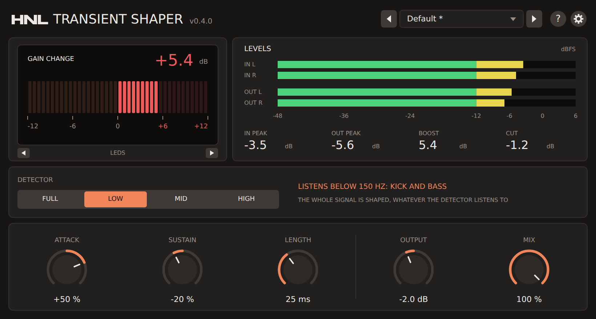

# HNL Transient Shaper

Turns the hit of each sound up or down separately from what follows it. Made for drums: more punch, less room,
or the other way round.

| Help tips | Presets | Saving a preset |
| --- | --- | --- |
|  |  |  |

| Meter design: Arc | Meter design: LEDs |
| --- | --- |
|  |  |

*Rendered from the plugin's drawing code; not yet a screenshot from a host.*

## What it does

- **No threshold:** it reacts to the shape of the sound, not its level. A quiet ghost note is shaped like a loud
  hit, and nothing has to be set to the level of the track.
- **Attack:** the start of each sound, up or down by up to 12 dB. A large jump in level gets the full amount, a
  small one less.
- **Sustain:** what follows the hit (the ring of a drum, the room), up or down by up to 18 dB. A level that is
  simply held is left alone.
- **Detector range:** it can listen to only the lows, mids or highs, to shape the kick without the hats setting
  it off, or the other way round. The whole signal is shaped either way.
- **Steady low notes are left alone:** the detector holds the level over the gaps between the waves of a low
  note, so a bass tone is not taken for a row of hits.

## Controls

| Control | What it changes |
| --- | --- |
| Attack | -100 to +100%. Up gives punch and snap; down softens a sound and pushes it back. |
| Sustain | -100 to +100%. Down makes drums tight and dry; up makes them longer and fatter. |
| Length | 5 to 60 ms: how long the start of a sound counts as the hit. Short shapes only the click; long includes the body of the drum. |
| Detector | Full, Low (below 150 Hz), Mid (150 Hz to 2.5 kHz) or High (above 2.5 kHz). |
| Output | -12 to +12 dB on the shaped signal. More attack means higher peaks. |
| Mix | 0% is the untouched signal, 100% only the shaped one. |

The meter shows what the shaper is doing: right when it turns the signal up, left when down. Beside the level
bars are the largest boost and cut of the last moment. Nothing limits the output, so it can go over 0 dBFS:
turn Output down, or follow with a limiter.

The two arrows under the meter step through three designs: a needle over a printed card (Classic), an arc that
fills with the reading as a figure (Arc) and a row of lights (LEDs). The choice is kept with the song and changes
nothing about the sound; a new instance starts on Classic.

Twelve presets are in the menu at the top right. The **?** button switches help on: rest the mouse on any control
to read what it does.

Drag a knob up or down (Shift for fine steps, mouse wheel also works); double-click or Ctrl-click returns it to
its default. Latency is 1 ms and is reported to the host: the plugin looks that far ahead, so the gain is in
place when a hit arrives.

## About the model

Three envelopes follow the detector's level in dB: one almost at once, one that rises slowly and one that falls
slowly. Where the first is above the second there is an attack; where the third is above the first there is a
decay. The method is the well-known one of comparing envelopes; the plugin is not a copy of, or affiliated with,
any existing unit.

## Installing

[Download HNL-Transient-Shaper-win64.zip](https://github.com/c-kick/hnl-vsts/releases/download/downloads/HNL-Transient-Shaper-win64.zip): the current build, for 64-bit Windows.

The zip holds the plugin as VST3
(copy the `.vst3` folder to `C:\Program Files\Common Files\VST3\`) and as CLAP (copy the `.clap` file to `C:\Program Files\Common Files\CLAP\`). A host needs only one of the
two. Windows 64-bit.

## Changelog

### 0.4.0 (2026-11-22)

- New: three looks. Classic, the look the plugin has always had, stays the default; Hi-Fi Black and Hi-Fi Silver
  dress the same window as a piece of hi-fi equipment. The cog at the top right chooses, for every HNL plugin at
  once. The choice changes nothing about the sound and is not stored in the song.
- To make room for the cog, the preset bar and the help button stand 28 pixels further left.

### 0.3.2 (2026-11-18)

- Fixed: samples and parameter values that are not numbers are caught again in the builds made with clang.

### 0.3.1 (2026-11-17)

- Fixed: a preset's name can be typed in a host that hands over the keys without their text.
- The licence text (GPL-3.0-or-later) comes with the download.

### 0.3.0 (2026-11-17)

- The version is shown behind the title, next to the HNL logo; the preset bar stands at the right.
- The preset menu spreads a long list evenly over its columns.
- The meter comes in three designs (classic, arc, leds).
- A CLAP build next to the VST3.

### 0.2.0 (2026-11-17)

- New: presets of your own, saved, replaced and deleted from the preset menu.

### 0.1.1 (2026-11-17)

- Guards against samples and parameter values that are not numbers, and against whatever else a host may send.

### 0.1.0 (2026-11-16)

- First version: attack and sustain shaping for drums, without a threshold.
