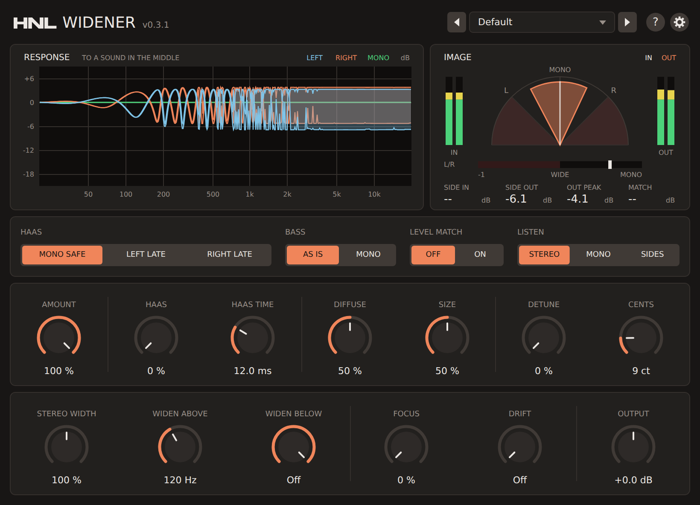
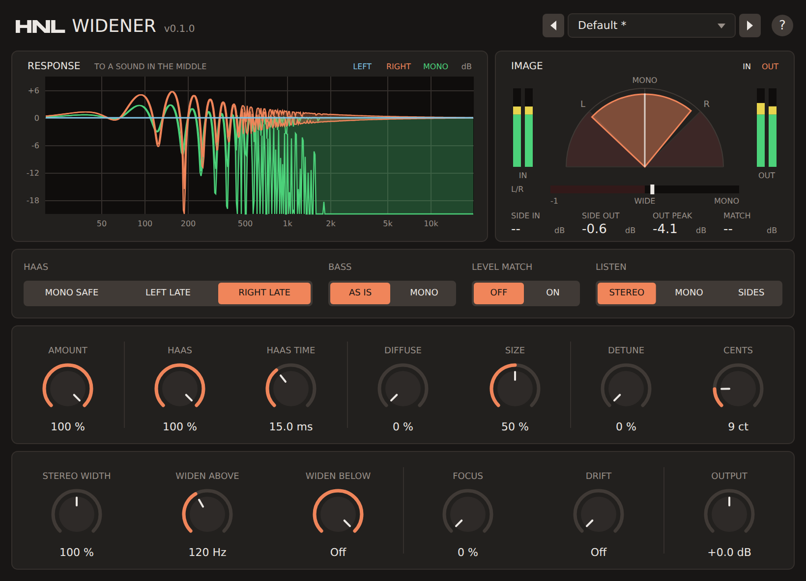
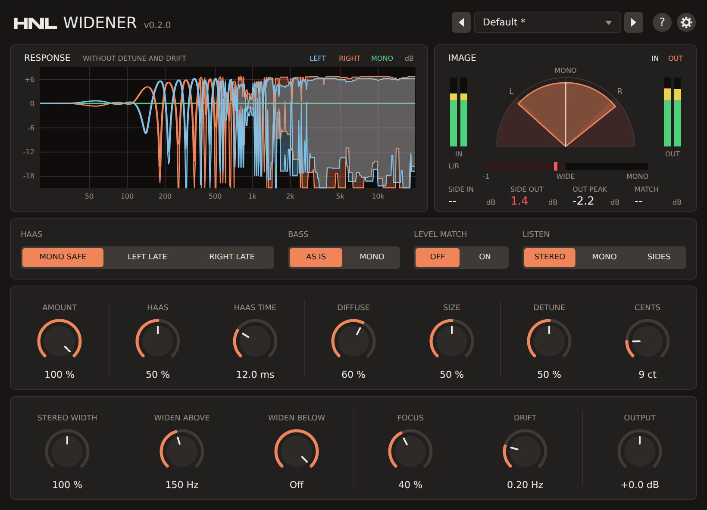
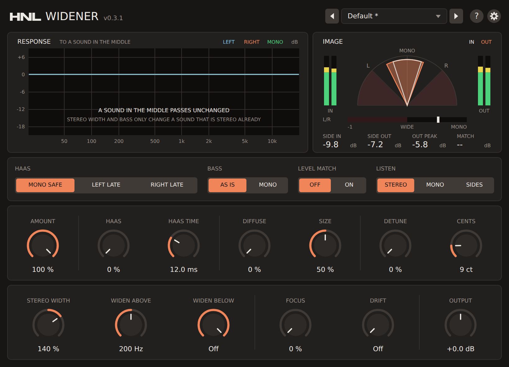
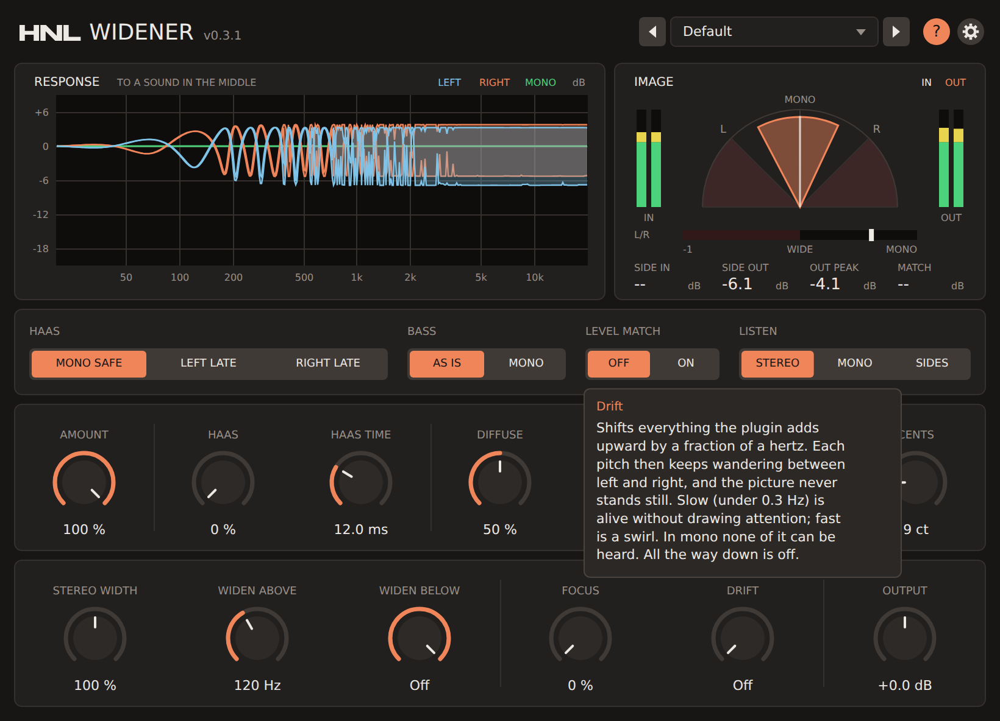
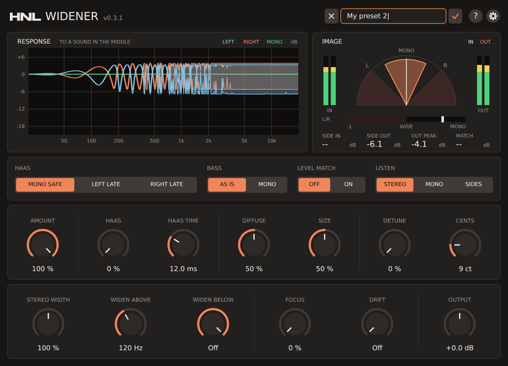

# HNL Widener

Makes a sound wider, including a mono sound, without changing what a mono speaker plays. Everything it adds
goes to the side signal (left minus right). It has three ways to widen (Haas, diffusion and detuning), a slow
drift that keeps the picture moving, and a focus that keeps the hits in the middle.

| Haas Classic preset: the right channel late | Everything preset | Stereo Mix Wider preset |
| --- | --- | --- |
|  |  |  |

| Help tips | Presets | Saving a preset |
| --- | --- | --- |
|  |  |  |

*These pictures are rendered from the plugin's drawing code, not taken from a DAW.*

## Installing

[Download HNL-Widener-win64.zip](https://github.com/c-kick/hnl-vsts/releases/download/downloads/HNL-Widener-win64.zip),
the current build for 64-bit Windows.

The zip holds the plugin as VST3 and as CLAP. Your DAW needs only one of the two.

- **VST3:** copy the `.vst3` folder to `C:\Program Files\Common Files\VST3\`.
- **CLAP:** copy the `.clap` file to `C:\Program Files\Common Files\CLAP\`.

## Quick start

1. Put HNL Widener on the sound you want wider. It can be mono or stereo.
2. Pick a preset from the menu at the top right, or turn up **Haas**, **Diffuse** or **Detune** yourself.
   **Amount** sets the three together.
3. Set **Listen** to Mono to hear what a mono speaker plays, and to Sides to hear only what differs between
   left and right.
4. Switch **Level Match** on while you compare with the plugin switched off. Wider is also a little louder.

The **?** button switches on help tips for every control.

## How it works

    in ─► mid ──┬──────────────────────────────────────────────────► + ─► late ─► listen ─► output
                │                                                    ▲
                └─► range ─┬─► haas ────┐                            │ (left: plus, right: minus)
                           ├─► diffuse ─┼─► × amount ─► drift ─► focus
                           └─► detune ──┘                            │
          side ─► stereo width, mono bass ───────────────────────────┘

A stereo signal is a mid signal (left plus right, which is what a mono speaker plays) and a side signal (left
minus right, which is everything that makes it wide). A mono sound has no side signal at all, so turning its
"width" up does nothing. This plugin makes side signal out of the mid. It does that in three ways, and you can
mix them:

- **Haas** adds the mid a few milliseconds late. Each channel gets rises and dips that the other channel has
  the other way round.
- **Diffuse** sends the mid through four allpass filters. Every narrow band of pitch lands at a place of its
  own between left and right, with no pattern to it and no echo. At 100% left and right have as little in
  common as two different recordings.
- **Detune** adds a copy a few cents higher and subtracts a copy as much lower. It is the sound of a doubled
  voice or guitar, but only at the sides.

What is added to the left is taken off the right. **Left plus right therefore stays exactly what went in**, at
any setting of these three. A mono speaker, a phone or a club system plays the sound as if the plugin were not
there. The green line in the plot shows it, and it is flat.

The plugin adds a few things of its own:

- **Drift** shifts everything the plugin adds upward by a fraction of a hertz. The mid stays put, so against it
  each pitch keeps wandering between left and right. The picture is alive without the pitch wobble of a chorus,
  and in mono none of it exists. On Haas alone it is an endless sweep, in opposite directions on the two sides.
- **Focus** holds back what is added for the first moment of each hit. The attack of a drum stays in the middle
  and sharp, and the sound opens up behind it.
- **Widen Above and Widen Below** set the range of pitch that is widened. The bass stays in the middle unless
  you ask otherwise.
- **Haas the classic way** is there too (Left Late, Right Late), with one whole channel late. It is the only
  setting that changes the mono sum, and the green line shows by how much.

**Stereo Width** and **Bass** work on the width a sound already has, as in HNL Master. They make it narrower,
wider (only within the range), or mono in the lows. On a mono sound they do nothing. The same goes for the two
presets built on them alone, Stereo Mix Wider and Stereo Mix Mono Bass. The plot tells you so when nothing else
is turned up.

## Controls

| Control | What it changes |
| --- | --- |
| Amount | 0 to 100%: Haas, Diffuse and Detune together. |
| Haas | 0 to 100%: how much of the late sound is added. |
| Haas Time | 1 to 40 ms: how late. |
| Haas (switch) | Mono Safe: to the sides only. Left Late, Right Late: that whole channel is late. |
| Diffuse | 0 to 100%. |
| Size | 0 to 100%: how far Diffuse smears the sound in time. Half of a click is through after 5 ms at 0% and after 28 ms at 100%. |
| Detune | 0 to 100%. |
| Cents | 1 to 50 cents up and down. |
| Stereo Width | 0 to 200% of the side signal that came in. Above 100% only within the range. |
| Widen Above | 20 Hz to 2 kHz: nothing is widened below it. |
| Widen Below | Off, or down to 1 kHz: nothing is widened above it. |
| Bass | As Is, or Mono: no side signal below Widen Above. |
| Focus | 0 to 100%: how far the added side signal steps back on a hit, up to 18 dB. |
| Drift | Off, or up to 4 Hz. |
| Listen | Stereo, Mono (what a mono speaker plays) or Sides (only what differs between left and right). |
| Output | -12 to +12 dB on everything coming out. |
| Level Match | On: the output is turned down by as much as the width made it louder, following the last moment. For comparing with the plugin switched off. |

Drag a knob up or down to turn it. Hold Shift for fine steps, or use the mouse wheel. A double-click or
Ctrl-click returns a knob to its default. The plugin adds no latency.

**The plot** shows, for each pitch, how a sound in the middle comes out on the left, on the right and in mono.
Detune and Drift are left out of it, because they move.

**The fan** next to the plot shows how wide the sound is going in (outline) and coming out (filled). Straight
up is mono. The lines at L and R are one speaker only. In the red beyond them the two channels have more
against each other than in common.

**The meters.** Under the fan, the L/R bar shows how alike the two outputs are. Next to it you find the side
signal against the mid going in and coming out, the peak coming out and the gain Level Match applies.

**Presets.** The menu at the top right holds sixteen presets, and *Save as...* keeps your own. Presets leave
Listen and Level Match as they are.

**Help.** The **?** button switches help on. Rest the mouse on any control to read what it does.

## Measured

On mono pink noise:

| Preset | Left against right (1 = the same, 0 = unrelated) | Louder per side | Left plus right |
| --- | --- | --- | --- |
| Default | 0.75 | 0.6 dB | unchanged |
| Mono To Stereo | 0.55 | 1.1 dB | unchanged |
| Haas Mono Safe | 0.56 | 1.1 dB | unchanged |
| Haas Classic | 0.47 | 0.4 dB | 1.0 dB down, with holes |
| Double Track | 0.55 | 1.1 dB | unchanged |
| Wide Pad | 0.36 | 1.7 dB | unchanged |
| Everything | 0.41 | 1.5 dB | unchanged |

Pink noise has most of its level in the lows, which the presets leave in the middle. A sound that lives above
Widen Above comes out wider than these figures.

## The window

The cog at the top right lists the looks (Classic, Hi-Fi Black and Hi-Fi Silver) and the window sizes (75 to
200 %). Where the DAW allows it you can also drag the window by its edge. The look applies to every HNL plugin
at once, and the size is remembered for this plugin. Neither is saved with the song or changes the sound.

## Limits

- Windows 64-bit only.
- Nothing limits the output, so it can go over 0 dBFS. Turn Output down, or put a limiter after the plugin.
- Width makes each side louder even though the mono sum stays the same: 0.6 dB at the default settings, up to
  3 dB with one of the three at 100%. Level Match takes that back out, and that turns the mono sum down by the
  same amount. Use it to compare, not to keep mono untouched.
- Short Haas times (under 5 ms) put whole stretches of the low notes on one side. Raise Widen Above, or use a
  longer time.
- Size at 100% rings on for about a tenth of a second after a hit, like a small room.
- A change of the Haas switch takes about a quarter of a second. The old setting fades out before the new one
  fades in, so that it does not click.
- Drift needs its two rows of filters to be a quarter of a wave apart. They are from 0.0005 of the sample rate
  upward, which is 24 Hz at 48 kHz and 96 Hz at 192 kHz.

## For developers

### Tests

`tests/run.sh` runs six test programs:

- `dsp_test` measures the widener. It runs twice: plainly, and with the flags the plugin is built with.
- `plugin_test` runs the plugin in DPF's wrapper.
- `abuse_test` does everything a DAW is allowed to do (`common/tests/HostAbuse.hpp`).
- `ui_presets_test`, `ui_skin_test` and `ui_size_test` drive the window itself: saving, loading and deleting a
  preset, the choice of look and the size of the window. These three are shared by all plugins (`common/tests/`).

### Code

- `dsp/Widener.hpp`: the engine.
- `WidenerPlugin.cpp`, `WidenerUI.cpp`: the DPF plugin and its window.
- `Params.hpp`, `Presets.hpp`, `Help.hpp`: the parameters, the presets and the help texts.

The parameters the DAW sees are the seventeen controls in the table above, where the Haas switch, Size and
Cents are called Haas Mode, Diffuse Size and Detune Cents. On top of those come nine meters it can read: input
and output peak left and right, the correlation between left and right, the side signal against the mid going
in and coming out, the right output against the left, and the gain of Level Match. New parameters are added at
the end, because DAWs store automation by position.

## Changelog

### 0.3.0 (2026-11-27)

- New: the window can be made larger and smaller. The cog at the top right lists the sizes (75 to 200 %) under the
  looks, and where the host allows it the window can be dragged by its edge, down to three quarters of its design
  size. It keeps its shape, everything in it is drawn anew at the size it has, and it opens next time at the size
  it was left at. The size is kept for this plugin, not in the song, and changes nothing about the sound.

### 0.2.0 (2026-11-22)

- New: three looks. Classic, the look the plugin has always had, stays the default; Hi-Fi Black and Hi-Fi Silver
  dress the same window as a piece of hi-fi equipment. The cog at the top right chooses, for every HNL plugin at
  once. The choice changes nothing about the sound and is not stored in the song.
- To make room for the cog, the preset bar and the help button stand 28 pixels further left.

### 0.1.0 (2026-11-18)

- First version: widening by adding to the side signal only (Haas, diffusion, detuning, Drift, Focus), so that the mono sum stays as it went in.
