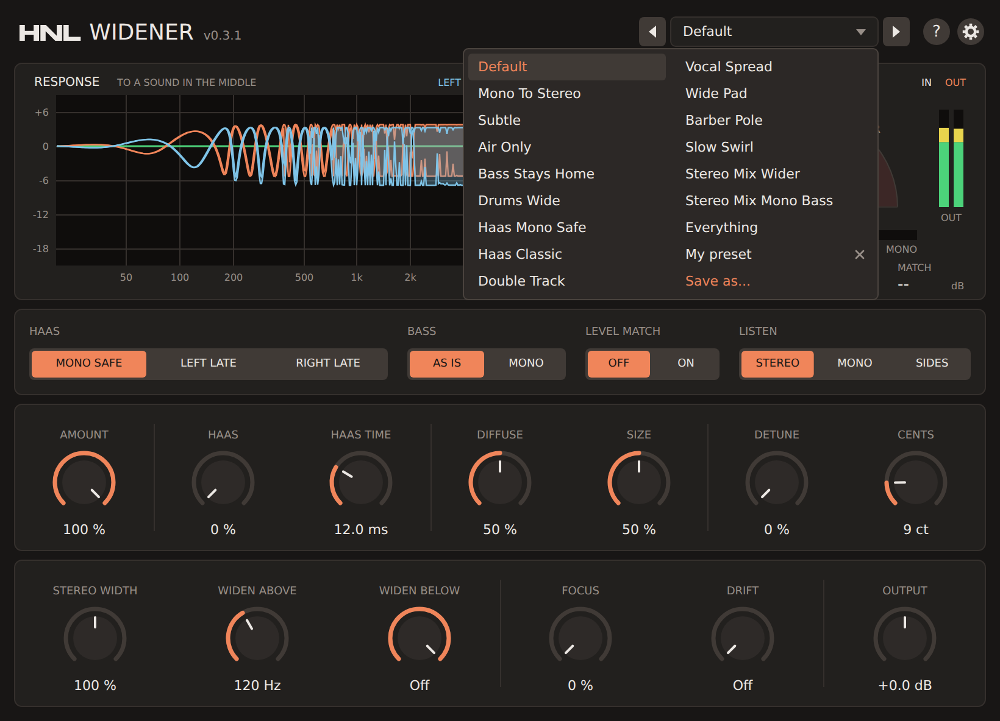

# HNL Widener

Makes a sound wider, a mono sound included, without changing what a mono speaker plays. Everything it adds
goes to the side signal (left minus right): Haas, diffusion and detuning, a slow drift that keeps the picture
moving, and a focus that keeps the hits in the middle.

| Haas Classic preset: the right channel late | Everything preset | Stereo Mix Wider preset |
| --- | --- | --- |
|  |  |  |

| Help tips | Presets | Saving a preset |
| --- | --- | --- |
|  |  |  |

*Rendered from the plugin's drawing code; not yet a screenshot from a host.*

## What it does

    in ─► mid ──┬──────────────────────────────────────────────────► + ─► late ─► listen ─► output
                │                                                    ▲
                └─► range ─┬─► haas ────┐                            │ (left: plus, right: minus)
                           ├─► diffuse ─┼─► × amount ─► drift ─► focus
                           └─► detune ──┘                            │
          side ─► stereo width, mono bass ───────────────────────────┘

A stereo signal is a mid signal (left plus right: what a mono speaker plays) and a side signal (left minus
right: everything that makes it wide). A mono sound has no side signal at all, so turning its "width" up does
nothing. This plugin makes side signal out of the mid, in three ways that can be mixed:

- **Haas** adds the mid a few milliseconds late. Each channel gets rises and dips that the other channel has
  the other way round.
- **Diffuse** sends the mid through four allpass filters. Every narrow band of pitch lands at a place of its own
  between left and right, with no pattern to it and no echo. At 100% left and right have as little in common as
  two different recordings.
- **Detune** adds a copy a few cents higher, less a copy as much lower: the sound of a doubled voice or guitar,
  only at the sides.

What is added to the left is taken off the right. **Left plus right therefore stays exactly what went in**, with
any setting of these three. A mono speaker, a phone or a club system plays the sound as if the plugin were not
there. The green line in the plot shows it: flat.

Our own additions on top of that:

- **Drift** shifts everything the plugin adds upward by a fraction of a hertz. Against the mid, which stays put,
  each pitch then keeps wandering between left and right: the picture is alive, without the pitch wobble of a
  chorus, and in mono none of it exists. On Haas alone it is an endless sweep, in opposite directions on the
  two sides.
- **Focus** holds back what is added for the first moment of each hit. The attack of a drum stays in the middle
  and sharp; the sound opens up behind it.
- **Widen Above and Widen Below** set the range of pitch that is widened. The bass stays in the middle unless
  you ask otherwise.
- **Haas the classic way** is there too (Left Late, Right Late): one whole channel late. It is the only setting
  that changes the mono sum, and the green line shows by how much.

**Stereo Width** and **Bass** act on the width a sound already has, as in HNL Master: narrower, wider (only
within the range), or mono in the lows. On a mono sound they do nothing, and neither do the two presets built on
them alone (Stereo Mix Wider, Stereo Mix Mono Bass); the plot says so when nothing else is turned up.

Measured on mono pink noise:

| Preset | Left against right (1 = the same, 0 = unrelated) | Louder per side | Left plus right |
| --- | --- | --- | --- |
| Default | 0.75 | 0.6 dB | unchanged |
| Mono To Stereo | 0.55 | 1.1 dB | unchanged |
| Haas Mono Safe | 0.56 | 1.1 dB | unchanged |
| Haas Classic | 0.47 | 0.4 dB | 1.0 dB down, with holes |
| Double Track | 0.55 | 1.1 dB | unchanged |
| Wide Pad | 0.36 | 1.7 dB | unchanged |
| Everything | 0.41 | 1.5 dB | unchanged |

Pink noise has most of its level in the lows, which the presets leave in the middle; a sound that lives above
Widen Above comes out wider than these figures.

## Controls

| Control | What it changes |
| --- | --- |
| Amount | 0 to 100%: Haas, Diffuse and Detune together. |
| Haas | 0 to 100%: how much of the late sound is added. |
| Haas Time | 1 to 40 ms: how late. |
| Haas (switch) | Mono Safe: to the sides only. Left Late, Right Late: that whole channel is late. |
| Diffuse | 0 to 100%. |
| Size | 0 to 100%: how far Diffuse smears the sound in time. Half of a click is through after 5 ms at 0% and after 28 ms at 100%. |
| Detune | 0 to 100%. |
| Cents | 1 to 50 cents up and down. |
| Stereo Width | 0 to 200% of the side signal that came in. Above 100% only within the range. |
| Widen Above | 20 Hz to 2 kHz: nothing is widened below it. |
| Widen Below | Off, or down to 1 kHz: nothing is widened above it. |
| Bass | As Is, or Mono: no side signal below Widen Above. |
| Focus | 0 to 100%: how far the added side signal steps back on a hit, up to 18 dB. |
| Drift | Off, or up to 4 Hz. |
| Listen | Stereo, Mono (what a mono speaker plays) or Sides (only what differs between left and right). |
| Output | -12 to +12 dB on everything coming out. |
| Level Match | On: the output is turned down by as much as the width made it louder, following the last moment. For comparing with the plugin switched off. |

The plot shows what a sound in the middle comes out as at each pitch: on the left, on the right, and in mono.
Detune and Drift are left out of it: they move. The fan next to it shows how wide the sound is going in
(outline) and coming out (filled): straight up is mono, the lines at L and R are one speaker only, and in the red
beyond them the two channels have more against each other than in common. Under it the L/R bar shows how alike
the two outputs are, followed by the side signal against the mid going in and coming out, the peak coming out and the gain
Level Match applies. Nothing limits the output, so it can go over 0 dBFS: turn Output down, or follow with a limiter.

Sixteen presets are in the menu at the top right; they leave Listen and Level Match as they are. The **?** button switches help on:
rest the mouse on any control to read what it does.

Drag a knob up or down (Shift for fine steps, mouse wheel also works); double-click or Ctrl-click returns it to
its default. There is no latency.

## Good to know

- Width makes each side louder even though the mono sum stays the same: 0.6 dB at the default settings, up to
  3 dB with one of the three at 100%. Level Match takes that back out, which turns the mono sum down by the
  same amount: use it to compare, not to keep mono untouched.
- Short Haas times (under 5 ms) put whole stretches of the low notes on one side. Raise Widen Above, or use a
  longer time.
- Size at 100% rings on for about a tenth of a second after a hit, like a small room.
- A change of the Haas switch takes about a quarter of a second: the old setting fades out before the new one
  fades in, so that it does not click.
- Drift needs its two rows of filters to be a quarter of a wave apart, which holds from 0.0005 of the sample
  rate up (24 Hz at 48 kHz, 96 Hz at 192 kHz).

## Installing

[Download HNL-Widener-win64.zip](https://github.com/c-kick/hnl-vsts/releases/download/downloads/HNL-Widener-win64.zip): the current build, for 64-bit Windows.

The zip holds the plugin as VST3
(copy the `.vst3` folder to `C:\Program Files\Common Files\VST3\`) and as CLAP (copy the `.clap` file to
`C:\Program Files\Common Files\CLAP\`). A host needs only one of the two. Windows 64-bit.

## Changelog

### 0.3.0 (2026-11-27)

- New: the window can be made larger and smaller. The cog at the top right lists the sizes (75 to 200 %) under the
  looks, and where the host allows it the window can be dragged by its edge, down to three quarters of its design
  size. It keeps its shape, everything in it is drawn anew at the size it has, and it opens next time at the size
  it was left at. The size is kept for this plugin, not in the song, and changes nothing about the sound.

### 0.2.0 (2026-11-22)

- New: three looks. Classic, the look the plugin has always had, stays the default; Hi-Fi Black and Hi-Fi Silver
  dress the same window as a piece of hi-fi equipment. The cog at the top right chooses, for every HNL plugin at
  once. The choice changes nothing about the sound and is not stored in the song.
- To make room for the cog, the preset bar and the help button stand 28 pixels further left.

### 0.1.0 (2026-11-18)

- First version: widening by adding to the side signal only (Haas, diffusion, detuning, Drift, Focus), so that the mono sum stays as it went in.
